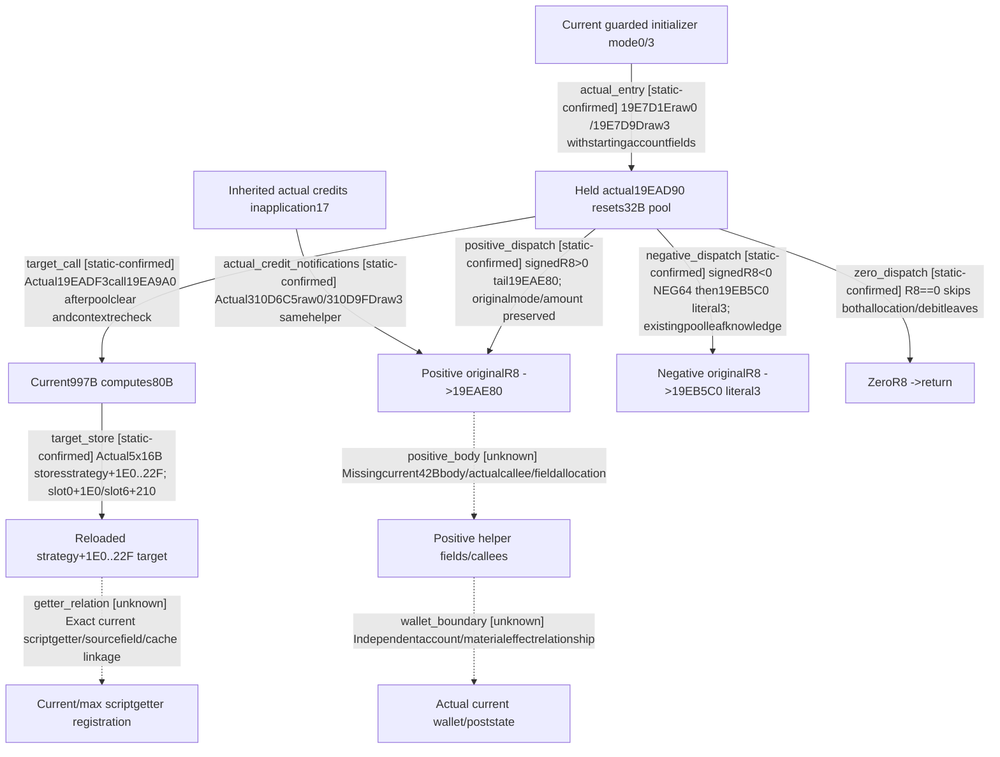

# Research plan: ai-fiscal-target-storage-and-credit-notification

GENERATED from the supplied research plan; no native semantics are inferred.

Question: How does actual4 initializer19EAD90 store the proven80B fiscal target and seed selector0/3 pools, and what actual positive-change helper remains missing?



| Edge | Declared status | Evidence IDs | Open question |
|---|---|---|---|
| actual_entry | static-confirmed | initializer_body, initializer_entry |  |
| target_call | static-confirmed | held239, analysis, connection |  |
| target_store | static-confirmed | held239, analysis, connection |  |
| positive_dispatch | static-confirmed | held239, connection |  |
| negative_dispatch | static-confirmed | held239, negative_knowledge |  |
| zero_dispatch | static-confirmed | held239 |  |
| actual_credit_notifications | static-confirmed | application17 |  |
| positive_body | unknown |  | Only exact42B metadata and3actual inbound edges areheld; request solely thissource, no guessed allocation or current funds. |
| getter_relation | unknown |  | Current getter registration may read storedvector orcomputeafresh; no choice admitted by oldRVA/fieldresemblance. |
| wallet_boundary | unknown |  | Tracker notification/reset/target doesnot establish anywallet change; Gamebeforeafter remainsseparate. |

| Observation design | Value |
|---|---|
| mode | offline-only |
| actor_kind | ai |
| owner_scope | Already held actual4 239B original JSON plus current997B body and inherited application17; static reusable knowledge only. |
| identity_kind | definition-key |
| identity_lifetime | RVAs and raw pin exact image; no loaded state, source-machine runtime or cache epoch inferred. |
| producer_trigger | unknown |
| producer | Guarded initializer calls19EAD90 in raw modes0/3 with actual starting account fields; target body997B supplies all80B. |
| caller | Existing19E7D1E/19E7D9D actual calls; resource-application17 credit branches310D6C5/310D9FD also notify19EAE80. |
| consumer | C+20 target80B copied tostrategy+1E0; raw0/3 selected32B pools reset then signedR8dispatched. Exact script getter consumers remain independent unknown. |
| cache_lifetime | Initializer flag+2D source known; no native calendar/epoch or later invalidation schedule. Generic positive callbacks are concrete but full coverage unknown. |
| expected_signal | Existing239B/64instructions prove current19EADF3call and5vector stores. Missing42B positive helper follows actual tail and2application callers. |
| zero_sample_meaning | No current actor/account sampled; resetting/reseeding tracker state is not a wallet payment or current funds receipt. |
| stop_condition | Reuse239B original raw_hex, no substitute raw; analyze sameEXE static source. Any next finite42B helper source goes only through b64 actual identity/resource pipeline; no scans/Game/build/policy. |
| runtime_window_ref | None |

| Evidence ID | Declared layer | File | SHA-256 | Supports |
|---|---|---|---|---|
| held239 | source-contract | Z:/ck3_mod_rewrite/docs/ck3-native-ai/evidence/declaration-upstream-reuse-boundary-2026-10-19.json | 634700bdcdc0fc64810a5ecab37bb8922afff81b111e9791ddde3c2583874697 | Already held new_bounded_source raw239B/64instructions exact19EAD90..19EAE7F; original .4current source. |
| reuse | source-contract | D:/codex-ck3-background/ck3-java-g2-resume-r4-20261025/resume61/b64_execution/WAR-CHEST-HELD-REUSE04.json | 2d1b5399ae12fc594e28973719778d810b123ec326da283ef6238ad0225a6dda | b64 verified original rawhex SHA/instruction continuity, cancelled new239B read beforetake. |
| connection | source-contract | AI-CHEST-STORAGE26.json | b601cbb342c540eff957bf2c780f46fddfda1a5fe0746ad3dc3aa16433e1bca4 | New source connection:actual19EADF3call, target80B stores1E0..22F, mode pools and signed helper dispatch; no raw239 duplication. |
| analysis | source-contract | AI-CHEST-BODY25.json | 8ca427f066d650011557c510dc0fbc8186af8248d3316913df39eca60834962d | All273 decoded instructions, exact RIP/call references, direct stores and conservative branch analysis. |
| initializer_body | source-contract | D:/codex-ck3-demos/2026-10-14-robert-30year/continuation42-cold-prep/cb-discovery-vanilla-12004-research03/current-context-update-body01.json | 5a9a9187bde9e3924c67bbe8739b59b44957d3fe667c282d19aada1558f43bd6 | Held actual initializer body contains19E7D1E/mode0 and19E7D9D/mode3 calls19EAD90; embedded switch data not code. |
| initializer_entry | source-contract | D:/codex-ck3-demos/2026-10-14-robert-30year/continuation42-cold-prep/cb-discovery-vanilla-12004-research03/current-context-update-thunk01.json | 0317e04af7993beadc7b0262a145a0874bf2ad3e049fe9cd5e953704c7e80120 | Held chained initializer entry checkscontext+2D and branches to19E7E71; not a whole routine by its19B pdata fragment. |
| application17 | source-contract | D:/codex-ck3-background/ck3-java-g2-resume-r4-20261025/resume60/native_war_cash/RESOURCE-APPLICATION17.json | 8a3cdf78c028271fdbb5452e99aa50eff3493e73c6ee6dbe6041ea6f5517ca3d | Already closed current resource application17 hasactualcredit notifications310D6C5(mode0) and310D9FD(mode3)-&gt;19EAE80 after original credit branch. |
| negative_knowledge | source-contract | Z:/ck3_mod_rewrite/docs/ck3-native-ai/war-payment-passive-12004.md | 93e462f3157ab8fd1e195a692817da705f9b4fc07947da49092fe13fd7459cff | Existing exact4 other-machine static155B pool-debit leaf knowledge, not current-machine deployment/wallet acceptance; literal3notmilitary fee. |
| positive_boundary | source-contract | ../b64_execution/BATCH04-REQUESTED-BOUNDARIES02.json | 8707a443b67367089d4f685a356303e32a841ce2eccc1f74199ba5e6d4bcac60 | Cachedrows[2].trail84855 bounds19EAE80..19EAEAA42B/UW51BFD04; no body semantic from metadata. |
| installation | exact-build | ../formal_release/INSTALLATION-WITNESS02.json | 49f08808eb15dd2eb2d24d05f400c7dd68cf1d4d7de14741e2efbbd7417c339c | Machine xenoamess-full-tower-eb9d2c1186 observed2026-10-25T21:43:36.139626Z metadata matches build25734779/version1.20.0.4; reused EXE hash, no loaded fact. |

Check result (file integrity and declarations only):

```json
{
  "schema": "xar.native-research-plan-check.v1",
  "result": "plan-consistent",
  "proof_layer": "record-structure-and-file-integrity",
  "semantic_correctness_verified": false,
  "live_execution_performed": false,
  "observation_plan_issues": [
    "offline-only plan does not define a live observation window",
    "the real producer trigger must be located before live sampling"
  ],
  "declared_edges_by_status": {
    "counter-policy": 0,
    "inference": 0,
    "live-confirmed": 0,
    "static-confirmed": 7,
    "unknown": 3
  },
  "enumerated_native_edges": 10,
  "declared_cases_by_status": {
    "pending": 3,
    "observed": 0,
    "not-applicable": 0
  },
  "checked_evidence_files": 10,
  "limitations": [
    "Evidence layers and conclusions are author declarations; hashes bind bytes, not their truth.",
    "Counts cover this enumerated graph only, not all CK3 branches.",
    "A consistent observation plan is not authorization to run or manipulate CK3."
  ],
  "plan_sha256": "63075c56d4bc49fef62ce56349ca09387df73106391033ee50ba148723af0819"
}
```
