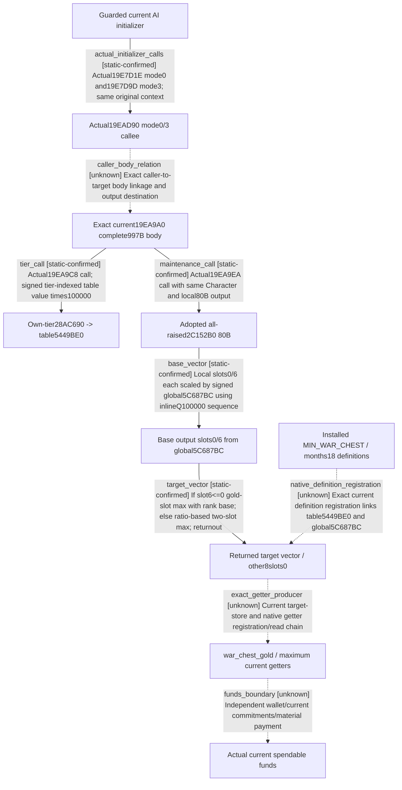

# Research plan: ai-fiscal-target-current-body

GENERATED from the supplied research plan; no native semantics are inferred.

Question: What does exact actual4 0x19EA9A0 compute, which input calls and output slots are proven, and which caller/definition/getter relations remain unknown?



| Edge | Declared status | Evidence IDs | Open question |
|---|---|---|---|
| actual_initializer_calls | static-confirmed | initializer_body, initializer_entry |  |
| caller_body_relation | unknown |  | 19EAD90 actual239B body not captured here; do not infer it calls19EA9A0 from proximity or historical .3 names. |
| tier_call | static-confirmed | body_raw, tier_header, analysis |  |
| maintenance_call | static-confirmed | body_raw, cash_header, cash_binder, all_raised_cache |  |
| base_vector | static-confirmed | body_raw, analysis |  |
| target_vector | static-confirmed | body_raw, analysis |  |
| native_definition_registration | unknown |  | Authored values resemble historical budget inputs, but neither current registration nor current global values are captured; do not alias by equality. |
| exact_getter_producer | unknown |  | Output destination, owning strategy fields, exact current/max getters and their cache lifetimes remain unproven. |
| funds_boundary | unknown |  | A native budget target does not prove spendable funds, pending loan/refund credit, military payment or wartime construction policy. |

| Observation design | Value |
|---|---|
| mode | offline-only |
| actor_kind | ai |
| owner_scope | Same-machine actual4 finite source capture and existing admitted ABI source; existing initializer windows reused. No Game or native execution. |
| identity_kind | definition-key |
| identity_lifetime | RVA/bytes bind exact actual4 image only. Strategy context lifetime and script getter cache remain unproven. |
| producer_trigger | unknown |
| producer | Exact273-instruction body computes ten-qword output with only slots0/6 written from own-tier table and all-raised maintenance. |
| caller | Held guarded initializer calls19EAD90 twice with modes0/3; that callee body and its relation to19EA9A0 remain unknown. |
| consumer | HoF and Finance16 current/max authored script consumers. No exact actual4 script getter binding admitted. |
| cache_lifetime | No direct strategy or Character store in19EA9A0; output storage destination, refresh trigger and current getter cache lifetime unresolved. |
| expected_signal | Current complete997B body proves its own calls/globals/arithmetic/output shape. Existing80B all-raised ABI is reused, not a new paid-maintenance proof. |
| zero_sample_meaning | Static computation only. Unknown caller/global registration/getter cannot become zero reserve or available money. |
| stop_condition | Analyze captured997B and already held named text/raw only; no new EXE read/hash/scan, Game/native call/build/policy. Next finite239B caller request must use shared b64 workflow. |
| runtime_window_ref | None |

| Evidence ID | Declared layer | File | SHA-256 | Supports |
|---|---|---|---|---|
| body_raw | source-contract | D:/ck3-state/ck3-java-g2-native-static-resume61/batch03/capture01/window-046.raw | 30141de6650748e4c99d3f0d9d465b6d7b1846c19f983647115222cac2fd03a2 | Exact997B body19EA9A0..19EAD85;273 instructions fully decoded, RET19EAD84. |
| capture | exact-build | ../b64_execution/BATCH03-RESULT01.json | 460cb1a0294518eccb7c0ba5d22da7b93d51976f98d13e2c7c3b73dc8303acbb | Shared finite actual capture windows[46], inputCLOSED/three phases0/Job0/source checks MATCH; no loaded claim. |
| analysis | source-contract | AI-CHEST-BODY25.json | 8ca427f066d650011557c510dc0fbc8186af8248d3316913df39eca60834962d | All273 decoded instructions, exact RIP/call references, direct stores and conservative branch analysis. |
| cash_header | source-contract | Z:/ck3_mod_rewrite/ck3_autonomous_player/native_bridge/include/xar_bridge/ck3_12004_war_cash_claim_terms.hpp | 647da1cb955c36a152da96e2297d0f470a3259d8dadbd5fd027985aad2ceff9a | Adopted exact4 all-raised2C152B0 source constant. |
| cash_binder | source-contract | Z:/ck3_mod_rewrite/ck3_autonomous_player/native_bridge/src/ck3_12004_war_cash_claim_terms.cpp | 97e338be9d7e657f1cca4a7e2d9f2417d783b1dc15be91200a994ade404ef249 | Actual4 SHA-gated binder for current/all-raised resource ABIs. |
| tier_header | source-contract | Z:/ck3_mod_rewrite/ck3_autonomous_player/native_bridge/include/xar_bridge/ck3_12004_family_abi.hpp | 9f6f58cfedd60c42734eb7ca4120f6cbbe9b3f4bdefa60e618750c88c1430fe7 | Already adopted own-tier28AC690 ABI, independent from lineage max. |
| defines | source-contract | Z:/SteamLibrary/steamapps/common/Crusader Kings III/game/common/defines/ai/00_ai.txt | 3af5d4100789bad56570e05c5852f35783605813957de7a5129d23142a116120 | Installed stock MIN_WAR_CHEST and18months text only; native registration of globals remains unknown. |
| initializer_body | source-contract | D:/codex-ck3-demos/2026-10-14-robert-30year/continuation42-cold-prep/cb-discovery-vanilla-12004-research03/current-context-update-body01.json | 5a9a9187bde9e3924c67bbe8739b59b44957d3fe667c282d19aada1558f43bd6 | Held actual initializer body contains19E7D1E/mode0 and19E7D9D/mode3 calls19EAD90; embedded switch data not code. |
| initializer_entry | source-contract | D:/codex-ck3-demos/2026-10-14-robert-30year/continuation42-cold-prep/cb-discovery-vanilla-12004-research03/current-context-update-thunk01.json | 0317e04af7993beadc7b0262a145a0874bf2ad3e049fe9cd5e953704c7e80120 | Held chained initializer entry checkscontext+2D and branches to19E7E71; not a whole routine by its19B pdata fragment. |
| all_raised_cache | source-contract | Z:/ck3_mod_rewrite_process_assets/g2-background-20261007/upstream-build-migration/shared-span-cache/new-02C152B0-02C155EC.bin | 3ea4f4f7df2dfd67f56ec3927988dd2c2c6f92cb186fb926d5c3c2f811caddcc | Existing828B all-raised completebody, reused not newly captured. The adopted ABI names its alternative maintenance rate, not paid ledger. |
| consumers | source-contract | Z:/ck3_mod_rewrite/docs/ck3-native-ai/finance-war-chest-authored-consumers-12004-2026-10-26.md | 5d608bb58bdf8e0cfb049f812e8be68148fa5eee94dc8d72e1efe36aeb2c2ea5 | Finance16 independently closed seven authored consumer files/ten direct references, with native current/max getters still unknown. |
| installation | exact-build | ../formal_release/INSTALLATION-WITNESS02.json | 49f08808eb15dd2eb2d24d05f400c7dd68cf1d4d7de14741e2efbbd7417c339c | Machine xenoamess-full-tower-eb9d2c1186 observed2026-10-25T21:43:36.139626Z metadata matches build25734779/version1.20.0.4; reused EXE hash, no loaded fact. |

Check result (file integrity and declarations only):

```json
{
  "schema": "xar.native-research-plan-check.v1",
  "result": "plan-consistent",
  "proof_layer": "record-structure-and-file-integrity",
  "semantic_correctness_verified": false,
  "live_execution_performed": false,
  "observation_plan_issues": [
    "offline-only plan does not define a live observation window",
    "the real producer trigger must be located before live sampling"
  ],
  "declared_edges_by_status": {
    "counter-policy": 0,
    "inference": 0,
    "live-confirmed": 0,
    "static-confirmed": 5,
    "unknown": 4
  },
  "enumerated_native_edges": 9,
  "declared_cases_by_status": {
    "pending": 3,
    "observed": 0,
    "not-applicable": 0
  },
  "checked_evidence_files": 12,
  "limitations": [
    "Evidence layers and conclusions are author declarations; hashes bind bytes, not their truth.",
    "Counts cover this enumerated graph only, not all CK3 branches.",
    "A consistent observation plan is not authorization to run or manipulate CK3."
  ],
  "plan_sha256": "bf88a54fa33e8e67c0cdf4a620f80b2512eca00ec54fbba1eb69940264074ffa"
}
```
