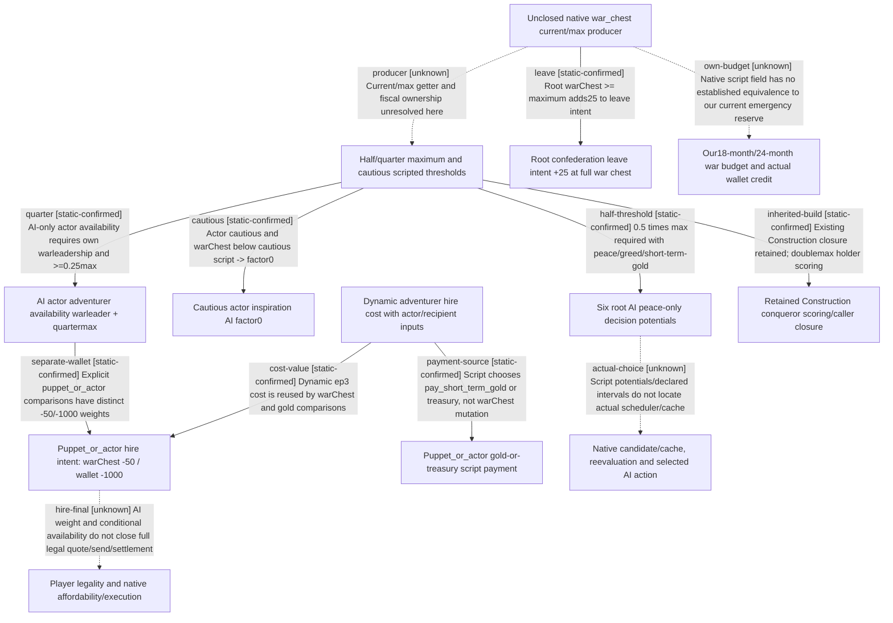

# Research plan: finance-war-chest-authored-consumers-r61

GENERATED from the supplied research plan; no native semantics are inferred.

Question: Which distinct stock decision/interaction consumers compare war_chest_gold/max, in which scope and stage, and do they establish spendable wallet or our emergency budget?



| Edge | Declared status | Evidence IDs | Open question |
|---|---|---|---|
| producer | unknown | installation, values | NativeWarCash owns current actual4 getter/fiscal source; no current runtime value or reserve equivalence. |
| half-threshold | static-confirmed | values, artifact, legend, ep3, divination |  |
| cautious | static-confirmed | values, inspiration, interaction-info |  |
| quarter | static-confirmed | values, laamp, interaction-info |  |
| separate-wallet | static-confirmed | laamp, interaction-info |  |
| cost-value | static-confirmed | cost, laamp |  |
| payment-source | static-confirmed | cost, laamp |  |
| leave | static-confirmed | confederation |  |
| inherited-build | static-confirmed | values, building-modifier, construction-ref |  |
| actual-choice | unknown | artifact, legend, ep3, divination | Native task caller, candidate generation/index/cache, reevaluation and final AI execution remain unobserved. |
| hire-final | unknown | laamp, interaction-info | Native final legality, numeric cost at submit, wallet/treasury mutation and actual army participation not observed. |
| own-budget | unknown | values, laamp, building-modifier | No current native producer/ownership or derivation proves equivalence; retain existing budget and actual-credit0 boundaries. |

| Observation design | Value |
|---|---|
| mode | offline-only |
| actor_kind | ai |
| owner_scope | Decision root; interaction root actor and explicitly separate puppet_or_actor; retained building holder scope. Excludes NativeWarCash HoF branch. |
| identity_kind | definition-key |
| identity_lifetime | Keys bind these installed stock bytes; no current actor, Game, date or cache instance sampled. |
| producer_trigger | unknown |
| producer | Actual4 native war-chest getter/fiscal producer remains with NativeWarCash; source declarations are consumers. |
| caller | Named stock ai_potential/is_available/ai_will_do definitions; exact native AI scheduler and GUI invocation not executed. |
| consumer | Six peace-only decision potentials, cautious inspiration ranking, landless-adventurer availability/ranking, confederation departure ranking; construction closure reused. |
| cache_lifetime | Native candidate/index/cache production, invalidation and task assignment remain unknown; declared AI intervals are not cache lifetime. |
| expected_signal | Separate each source comparison, scope, AI gate/ranking and independent wallet/payment path; no mapping to our commitments or current/all-raised emergency reserve. |
| zero_sample_meaning | No live samples; zero AI ranking or no literal hits in gift definitions is not zero gold, legal refusal or proof of absent transitive/native consumers. |
| stop_condition | Bounded named text files plus retained Construction refs only. No EXE reads, compiler/JVM/Game/native action, new production implementation or budget change. |
| runtime_window_ref | None |

| Evidence ID | Declared layer | File | SHA-256 | Supports |
|---|---|---|---|---|
| artifact | source-contract | Z:/SteamLibrary/steamapps/common/Crusader Kings III/game/common/decisions/00_artifact_decisions.txt | 79dd6ef37068abec68fcf5155aa23eed8ac6ea957352ba319dfdc4ea42b0a641 | commission_artifact_decision625-631 decision-root ai_potential is peace, greed, short-term-gold and half-maximum conjunction, plus non-conqueror/capital focus exclusions. |
| legend | source-contract | Z:/SteamLibrary/steamapps/common/Crusader Kings III/game/common/decisions/06_ce1_decisions.txt | f0cee85b506bc7e2cc7a1b0a1a8d9faf49b33758dfe54fef1334caecba95d09e | commission_legend_artifact111-115 and clear_ground_for_legendary_building276-280 same four ai_potential conjuncts; clear-ground262-265 opens a separate barony decision. |
| ep3 | source-contract | Z:/SteamLibrary/steamapps/common/Crusader Kings III/game/common/decisions/dlc_decisions/ep3_decisions.txt | fd26051062de094fd537ab0d680141c0ef113d396578856d99f3fb2415656cd0 | commission_icon2338/2554-2561 and commission_silk_regalia2837/2942-2949 use same six ai_potential conjuncts. |
| divination | source-contract | Z:/SteamLibrary/steamapps/common/Crusader Kings III/game/common/decisions/dlc_decisions/mpo/mpo_court_astrologer_decision.txt | 9ea23ff2ae2a3dae4e92acf32ee5a681ccd424a66442fa30b2776f08c5aabce9 | mpo_divination_decision57-61 same four ai_potential conjuncts, separate declared AI check intervals48-55. |
| confederation | source-contract | Z:/SteamLibrary/steamapps/common/Crusader Kings III/game/common/decisions/dlc_decisions/mpo/mpo_decisions.txt | 05d31b1a046f48599c3d1e01b7d5d11bb981efdd6bb7edb08e2d66f9312f950e | leave_confederation_decision397 has ai_will_do558 base0; root war_chest&gt;=maximum adds25 at1507-1511; not a spending authorization. |
| inspiration | source-contract | Z:/SteamLibrary/steamapps/common/Crusader Kings III/game/common/character_interactions/02_ep1_interactions.txt | e944e86dfc0bf2d1466c8b5f78090adf5564b2cad116277c0e89087df2cec358 | fund_inspiration_interaction7; ai_will_do185 base100; cautious personality plus war_chest&lt;cautious minimum factor0 at259-263. |
| laamp | source-contract | Z:/SteamLibrary/steamapps/common/Crusader Kings III/game/common/character_interactions/06_ep3_laamp_interactions.txt | 00f10e936c3528dbf2316037ca2518c3b216c5e48ad267f4d7eaa71968be2042 | hire_laamp_mercenaries_interaction5373; is_available5391 AI actor warleader+quarter-max. ai_will_do5988 uses puppet_or_actor war_chest&lt;cost add-50 and separate gold&lt;cost add-1000 at6093-6104. Script payment5538-5552 chooses gold/treasury independently. |
| values | source-contract | Z:/SteamLibrary/steamapps/common/Crusader Kings III/game/common/script_values/00_ai_values.txt | 975b0fa8d02b3342c8984050eca0387a463cd1028c68122d1bbd255f90db5fb4 | half-max296-299 and quarter-max311-314 are 0.5/0.25 times war_chest_gold_maximum; cautious316-343 contains tier additions and literal max operation; conqueror350-353 double maximum. |
| cost | source-contract | Z:/SteamLibrary/steamapps/common/Crusader Kings III/game/common/script_values/07_ep3_values.txt | b4b46e562baa20f8aa7fbac91b3d8b95f6a59d053eaf6b5f28ca9d091f85c776 | ep3_hire_laamp_mercs_cost_value996-1025 uses recipient strength, actor minor_gold, actor warleader count and recipient domicile/perk multipliers. No evaluated current value. |
| interaction-info | source-contract | Z:/SteamLibrary/steamapps/common/Crusader Kings III/game/common/character_interactions/_character_interactions.info | cc2442a313a6b1a2a7fa02b92a094276edfe39c60835c3286172c5b6d7b70a37 | is_available570-573 documents root actor; ai_will_do583-589 is AI sending interest after targets and options selection. |
| building-modifier | source-contract | Z:/SteamLibrary/steamapps/common/Crusader Kings III/game/common/scripted_modifiers/00_building_modifiers.txt | c7cc953fd11ec3017f26c57b6165c385e82fa0f541cf88ceaa99c75df47a3866 | Retained Construction closure: general3-15 subtracts1000 for holder conqueror and gold&lt;=double maximum. Not re-researched or adopted as our gate. |
| construction-ref | locator | D:/codex-ck3-background/ck3-java-g2-resume-r4-20261025/resume60/construction/CONSTRUCTION-SCORE-WAR-SOURCE03.json | 5c5686ec54fe92176ae8fca47d9e66609b0a5a28a3b520d741ea956a6a4fd79b | Reuse existing farm_estates01/02 actual ai_value caller closure and its 33a6253e source; no duplicate caller research or native score qualification. |
| installation | locator | D:/codex-ck3-background/ck3-java-g2-resume-r4-20261025/resume61/formal_release/INSTALLATION-WITNESS02.json | 49f08808eb15dd2eb2d24d05f400c7dd68cf1d4d7de14741e2efbbd7417c339c | Current installation metadata unchanged from held hash, 1.20.0.4 build25734779; no full EXE hash or loaded-runtime observation in this text-only task. |

Check result (file integrity and declarations only):

```json
{
  "schema": "xar.native-research-plan-check.v1",
  "result": "plan-consistent",
  "proof_layer": "record-structure-and-file-integrity",
  "semantic_correctness_verified": false,
  "live_execution_performed": false,
  "observation_plan_issues": [
    "offline-only plan does not define a live observation window",
    "the real producer trigger must be located before live sampling"
  ],
  "declared_edges_by_status": {
    "counter-policy": 0,
    "inference": 0,
    "live-confirmed": 0,
    "static-confirmed": 8,
    "unknown": 4
  },
  "enumerated_native_edges": 12,
  "declared_cases_by_status": {
    "pending": 3,
    "observed": 0,
    "not-applicable": 1
  },
  "checked_evidence_files": 13,
  "limitations": [
    "Evidence layers and conclusions are author declarations; hashes bind bytes, not their truth.",
    "Counts cover this enumerated graph only, not all CK3 branches.",
    "A consistent observation plan is not authorization to run or manipulate CK3."
  ],
  "plan_sha256": "ab952b00953161af31d1aba1d0fc37dd689bf334093930304ce516f43cbed623"
}
```
