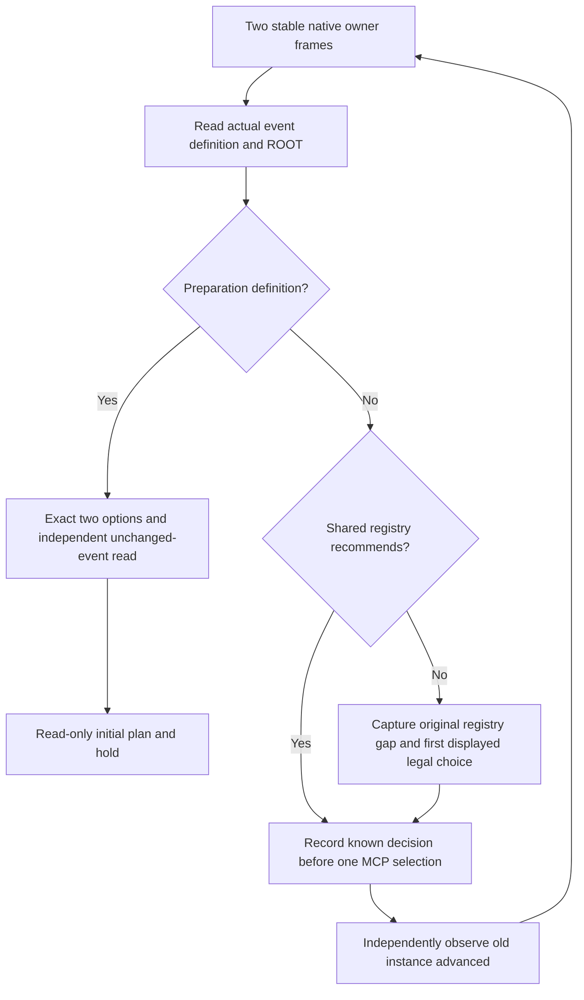

# Persian struggle introduction before mechanism preparation

The real first episode run displayed `fp3_struggle.0051` before the experiment's `xar_faith_h01_prepare.1`. The host correctly refused to call the first card the preparation card, but its startup dispatcher incorrectly assumed preparation would be the first displayed event. Future startup now inspects the real definition, handles earlier events using the shared registry or the owner's first displayed legal option policy, then returns to the exact preparation observation. Preparation itself remains unselected.

This improves ordinary event knowledge and startup sequencing; it is not a special way to bypass player, process, native revision or preparation identity checks.

## Source and decision effects

Source read on machine_id `4-8e1c2f1861` at `2026-10-17T08:40:31.862500Z`: installed CK3 1.20.0.4, EXE SHA `98702F88A547CDE2EAF29A85F93B85F68EE4CF8148336A4F7AFAEB75319DD518`. File `events/dlc/fp3/fp3_struggle_events.txt` is 35,995 bytes, SHA `31989C33ECAEA73D2F2ED536813B8815B0CD90CB2A824E6DC9D85BC47A531C52`. Definition lines 102–222 have UTF-8 block SHA `DFAEFDA8591838035E846C2954408E8EAB5DD4BB7BA9B3A52D1E507568692731`. Source pins are preserved in the external episode `runtime-audit/fp3-struggle-0051-source-pins.json`; no vanilla source file is copied into the repository.

The event is a fullscreen Persian struggle bookmark introduction. Its trigger requires a human player, no existing `fp3_struggle_intro_event_flag`, and a Persian struggle association; its authored cooldown is 100 years. Immediate effects, already applied before the choice, play music, set the intro flag, add ROOT to the global intro-flag character list, save `start=yes`, and save four localization character scopes. The widget also declares a struggle setup scope, but the observed current window exposed only the five saved scopes listed below; its opaque or absent runtime state is not invented.

There is **one authored option**. Its `first_valid` branches choose localized `.a` or `.b` names; they do not define two selectable options. The option body supplies a click sound and no gameplay effects. There is no `after` or common-after block. Confirming this card therefore has no authored faith, rite, piety, wealth, relationship or date effect. Immediate flags and music must not be attributed to the confirmation. There is no authored AI weight to optimize among alternatives.

The shared 1.20.0.4 registry records native option 0 / API option 1 for the observed exact five-scope presentation (`start`, `Mutawakkil`, `Muntasir`, `Mustain`, `Mostaza`), with ROOT bound to the actual current player. A different presentation remains a real diagnostic; the owner's existing capture-first fallback continues uncovered variants instead of requiring offline registry completion before play resumes. Empty choice/common-after effect lists do not prove the process, popup or follow-up state changed.

## Actual discovery and capacity boundary

The original R1 evidence was read at `2026-10-17T08:30:51.334897Z` on machine_id `4-8e1c2f1861`, run `4-8e1c2f1861--faith-and-power--R0001`, CK3 PID 18236 / connection generation 1. The paused frame was `native:3`, public revision 4, native revision 3, date 51394920. Native ROOT and actual player both read **15893**; history ID **34014** was not substituted for this runtime reference. Current event instance 2 was `fp3_struggle.0051`, with one shown enabled native-0 option. Schema, readiness, ROOT and same-frame binding were valid. The failed expectation was the later preparation definition and its two options. The original host error and unselected event evidence remain intact in the run's `native-report.json`.

This package did not operate CK3, query its live MCP, select an option, restart it, change its loaded inputs or replace that report. ROOT owns the actual one-shot selection and post-state. The new source and fixture tests do not grant live selection, experiment or video credit.

## Future host sequence

`dispatch_fixture_scenario_startup_event` does not assume instance order, translate history IDs into runtime IDs, or require the successor to be event-free. A queued preparation card is a valid successor to a confirmed introduction. It records the complete typed card, registry decision or original fallback input, intended choice and submission before dispatch. Lost acknowledgement or an unchanged old instance stays RED and cannot replay the action. Unknown first-choice continuation is not labelled semantic optimality or native-AI equivalence. Any newly captured unknown cards remain batch offline-analysis inputs; this discovered Persian intro has been source-reviewed and is now recognized in the shared registry.

The strict `observe_fixture_scenario_startup_event` verifier remains unchanged. Ordinary Robert/v1 startup behavior is unchanged. The new dispatcher is used only by the explicitly approved schema-v2 mechanism scenario. It does not alter the running frozen R1 host.

## Validation

On machine_id `4-8e1c2f1861`, the actual focused command used `C:/workspace/ck3_eternal_recurrence/tools/.venv/Scripts/python.exe -B -X utf8 -m unittest test_fp3_struggle_startup_policy test_frontend_fixture_scenario_host`, with cwd `C:/fef1/ck3_autonomous_player/tests/unit`: **15 tests passed** in 2.930 seconds. Six new cases cover exact current-build registry knowledge and empty effects, actual scope/ROOT policy, known introduction followed by a queued unselected preparation, unknown first-rendered/native-index mapping, lost acknowledgement without retry, and ACK with the old event still present. The affected nine scenario-host cases keep exact preparation observation, initial read-only constraints and the earlier rejection coverage. Tests call no game, Steam, screen, native DLL or build.

There is no CK3 script execution in the registry/dispatcher tests; they test Python knowledge selection and orchestration with explicit native packet fixtures. `open_kaishek` pre-execution is not applicable to this deterministic subset, and these tests do not claim to simulate vanilla event effects or replace exact-build live readback.
