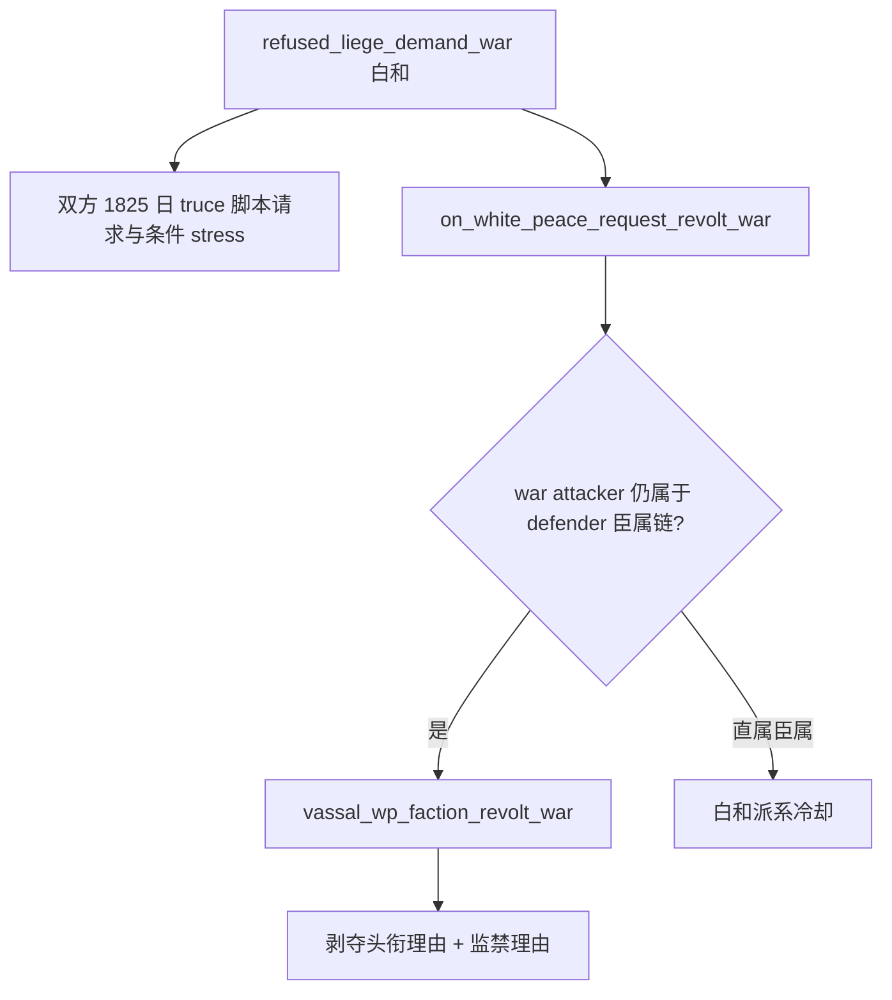

# G2-M0：拒绝领主要求战争的白和并非无政治代价

本包保留 **M0 complete、G2 6/8**。`g2-requirements-v1.json` 中 R839、R846、R0043 已完成原合同的同帧继续／白和／投降比较、一次退出、独立后验及替换进程冷恢复；本次没有重测这些业务，也不增加实机信用。研究目的只是避免下一局把陌生 CB 的“可白和”错误当成“安全保地”。

`machine_id: xenoamess-full-tower-eb9d2c1186`。`tools/ck3_live_run_id.py machine` 实际读回机器身份；`2026-10-19T01:49:13.796107Z` 对三份安装脚本及五份公共 Python 叶进行小文件读取，来源、逐叶 SHA、原版关键摘录和一次离线核对保存在[来源回执](evidence/g2-m0-refused-demand-white-peace-source-2026-10-19.json)。回执 7,415 B、SHA-256 `1c6bf0524a0c3e845215a124ce77f1f6ae10add24b6f582fa5af6518e1738a96`。三份原版 SHA 与 [P87 已审来源](evidence/p87-political-survival-crisis-profile-2026-10-18.json) 一致；这证明脚本字节身份，没有重新核 EXE、安装 build、Steam、部署或现场运行状态。

## 本次新确认的来源分支

P87 已记录 `refused_liege_demand_war` 叛乱者是进攻方，败战可能被监禁并给领主后续处罚理由。本次沿同一已审脚本补齐它的**白和**分支：

`00_civil_war.txt:1557`—1582 调用 `on_white_peace_request_revolt_war`，并请求双方 1825 日停战；进攻者 ambitious／arrogant 与防守者 arrogant 仍有条件 stress/fulfillment 效果。`00_war_effects.txt:1250`—1269 对仍在防守者臣属链内的每名进攻者加 `vassal_wp_faction_revolt_war`；直属臣属另加白和派系冷却。`00_war_opinions.txt:38`—44 将该意见定义为 −30、15 年衰减，并同时设置 `revoke_title_reason=yes`、`imprisonment_reason=yes`。

| 来源分支 | 仍在 defender 臣属链的 attacker 所面临的直接脚本条件 | 不能据此宣称 |
| --- | --- | --- |
| 白和 | 领主获得剥夺头衔、监禁理由；直属臣属另有冷却 | 已经被监禁、已经丢头衔、完整无害退出 |
| 叛乱者败战 | 未监禁者进入 `hard_imprison_character_effect`；领主获得剥夺、监禁、放逐、处决理由；直属臣属另有败战冷却 | 必然立即被处决、全部领地自动转移、后续任意处罚必然执行 |

白和 helper 本身没有败战 helper 的立即条件监禁调用，其意见也没有放逐／处决理由。因此两条分支风险不同；**白和保留潜在剥夺风险**，不能把它泛化成消除政治生存风险。这里列的是静态分支与条件，不是任何一局实际处罚结果。脚本存在 `on_white_peace` 亦不证明当前 loaded CB 允许白和、原生 CanSend 合法或对方当前接受；这些仍由当前原生 options 决定。

## 当前消费者边界与下一项最小观测

[`war_political_survival_stakes_v1.py`](../../ck3_autonomous_player/src/xar_autoplayer/war_political_survival_stakes_v1.py) 已以同帧原生 CB、玩家主将进攻方、exact `.4` root 来源及明确观察的直属／最高领主关系授予“败战政治生存 stakes”，用于 P87 战争资金和增援判断。该合同没有完整三路退出物质效用，也没有把本次白和分支加入自动退出排序。本包不另加未消费的策略开关，也不改变雇佣、继续战争或投降阈值。

县法理防守方的 [`formal_defender_exit_observation.py`](../../ck3_autonomous_player/src/xar_autoplayer/formal_defender_exit_observation.py)、[`formal_defender_exit_comparison.py`](../../ck3_autonomous_player/src/xar_autoplayer/formal_defender_exit_comparison.py) 和 [`formal_defender_continue_risk_v1.py`](../../ck3_autonomous_player/src/xar_autoplayer/formal_defender_continue_risk_v1.py) 仍分别保留原生合法性、物质比较及短期接触／围城观测的边界。其 CB 是 `individual_county_de_jure_cb/17`；不能拿这个来源或历史 Raiktor 完成信用覆盖 `refused_liege_demand_war`。现有 de-jure terms baseline 的 title/vassal、signed resource、directed truce 三类 delta 仍明确未发布；不能把不完整观测当作完整退出效用。

下一次若普通自动游玩确实需要评估该叛乱的谈判退出，最小施工对象是**当前双方角色／臣属关系及政治理由、囚禁状态的只读前态与后态**，并复用同帧原生 options 的合法性和接受结果。特别要区分“当前已有理由”“本次结算新增理由”“实际执行剥夺／监禁”，不能用 WarID 消失代替这三件事。当前 `.4` provider 对这些用途的现成覆盖需要按该次 exact tuple核实；本包没有假定它已具备，也没有进行 Native 调用或构建。未知结果仍单发、保留 pending；普通合法战术与政务继续，不把完整全 CB 效用模型设成开新局门槛。

本次没有找到“旧局提前投降导致大缩水”的新证据。旧局的已闭损失证据仍是 [P50/AUTO193 民粹独立](p50-populist-loss-prevention-2026-10-18.md)，其后全部失地不可倒推为同一因果；[10/19 交接](../handover/2026-10-19-robert-first30-scoring-vacation-handoff.md) 已明确最终 active184549379 是玩家反抗领主战争。公共 `_terminal_score_surrender_ready` 仍只对同帧原生证明的玩家主将进攻方 −100 终局授予一次认输动作，不是防守方提前让地规则。本次没有放宽它。

## 验证与资源闭场

只运行一次定向离线来源核对：三份文件 SHA 必须精确匹配 P87，且验证白和 CB 调用、臣属链条件、意见的两类理由和与败战立即条件监禁的区别，结果 `SOURCE_CONTRACT_PASS`。没有重复旧测试、启动 CK3、桌面操作、MCP、Native 调用、编译、媒体或 SAVE 正文读取。新增内容仅本页及来源小 JSON，由 Root 统一审阅、提交和推送。

存储使用统一策略 1.0.0；本包小记录预算 32 KiB 已由本轮存储协调者计入并行研究额度，无重型写入准入或删除／清理信用。源读取器位于忽略的 `.task-tmp`，可从三份来源与回执重建；两份跟踪小记录为 `record`，`2027-04-17T00:00:00Z` 复核归纳。未创建保护中的大资产，也未续期任何旧场次。
