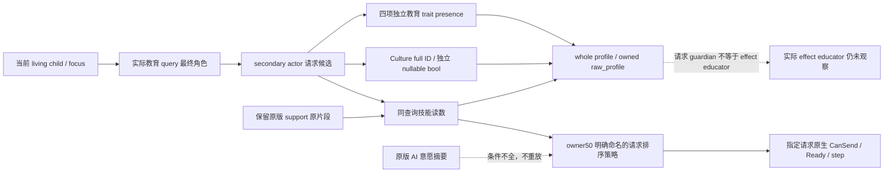

# Guardian 教育请求的原版选择依据（1.20.0.4）

本专题供现有 family 教育 planner 比较**原生查询给出的请求候选**。
只复用保留的静态源码，未读取安装目录；没有测试、项目 import、构建、游戏、SDK 或 RPC。
旧 needs 模块已采用，本轮没有修改它。排序实现由 Service owner50 独占。

## 先区分三棵实际源树

| 原版源树 | 保留源与具体 criteria | 本轮可直接消费的意义 |
| --- | --- | --- |
| 玩家交互 redirect | Education34 源摘要，`00_education_interactions.txt:20–121`；自选符合条件的自己，否则 random courtier。权重 base1，same culture+5、same faith+2、chaplain+10、councillor+2、same dynasty+3、education rank4+2/rank3+1 | 解释默认原生 query 为什么可能选择某个 secondary actor；不构造完整候选表或确定性原生选择 |
| AI 交互意愿 | 同摘要 `:678–832`；`ai_recipients=self`；base100+ward age，自教自己的 heir+900、heir 的 rank3/4 guardian+200、same dynasty+200、friend/lover 等关系+100；还含 rival/nemesis、lowborn、`player_educated`、转换和大学分支 | 这些是已保留的摘要级准则。当前技能 mouth 不提供所需全部布尔条件，不能重建完整 `ai_will_do` |
| 教育 acquisition/support | Family40 **逐行原始片段**：`00_education_effects.txt:29–50,249–438` 与 `00_education_values.txt:3–6` | 提供可审阅的教育技能分量与条件顺序；它不是 AI 交互意愿或候选选择概率 |

完整 `ai_target` / `ai_will_do:691–832` 和选项 AI 子条件的原始脚本不在这次复用的
34/42 packet 中。42 `INPUT-RECEIPT.json` 明确34先前只有摘要和行引用，后来补读的是
main/option receiver ledger；保留文件未包含 AI 全文。本轮没有补读安装目录，
因此**不新增原生 AI 权重重放实现**。未知关系、dynasty、education rank、rite、gold 等
不能按 false 或零填充后声称复现原版 AI。

## 可复用的精确技能表达式

Family40 原片段中，当前 child focus 在 `00_education_effects.txt:29–50` 选择
`SKILL=diplomacy/martial/stewardship/intrigue/learning`。support effect 的
`exists=scope:educator` 分支在`:318–349` 读取该 educator 的 `$SKILL$` 与 learning：

```text
focus_skill × educator_skill_modifier_factor
  + learning × educator_learning_skill_modifier_factor
educator_skill_modifier_factor = 0.4
educator_learning_skill_modifier_factor = 0.2
```

已观察字段单位相同时，精确技能分量是 `(2 × focus_skill + learning) / 5`。
learning focus 的两个操作数来自同一 learning 值，分量为 `3 × learning / 5`。
focus 未知、为空或是非教育 key 时，没有源码允许挑一个最高 skill、平均四项或把缺失
focus skill 填零；已观察 learning 的独立 `learning/5` 分量仍可保留。

这可作为 **source-informed 请求排序策略的技能分量**，而不是命名为 native AI score。
请求 secondary actor 的读数属于该请求候选；没有把它命名成 effect 的已保存 educator。
分量不是总教育成功值：`:323–337` 的 intellect/shrewd first-match 项、`:352–353`
的 culture 条件 `value=10`（重设该内层 success 表达式）、`:372–373` 的 House add5、
child traits 与失败项都各有输入和条件。缺少这些字段不允许报告完整 outcome 或概率。
排名可以比较已观测分量，并明确哪些项未观察；原生 CanSend/Ready 决定提交。

## B11-16：请求 guardian 的四项教育 trait

`request_guardian_skill_inputs_v1.education_traits` 是新增的 optional 子项，固定包含
`intellect_good_3`、`intellect_good_2`、`intellect_good_1`、`shrewd`。
每项独立保存 `{available, value, unavailable_reason}`：已观察的 true/false 原样保留；
未知是 `available=false, value=null` 加具体 reason。legacy 缺项保持缺省，
known-null guardian 不生成四个 false。它们继承原 profile 的最终 roles[2]/roles[3]
guardian/child 完整 ID、`request_guardian_secondary_actor` 来源和完整 64 位 revision；
trait 未知不改变独立 skills、CanSend 或原生 ready。

保留源码 `00_education_effects.txt:318–339` 在实际 `scope:educator` 中按 first-match
取值：good3 为 15；否则 good2 为 10；否则 good1 OR shrewd 为 5。
`:341–349` 随后加入技能项；`:350–354` 仍在同一 educator scope，若其 culture
命中 `better_ward_education`，`value=10` **覆盖整个此前内部表达式**。
这不是额外 +10，也不是 XP 或概率。请求的最终 secondary actor guardian 与 effect
实际选定的 educator 尚无等价证明；四项请求 presence 不能据此报告完整系数或结果。

Native35 与 SDK04 按这个字段合同施工；42 strict 沿既有 whole-profile 委托 SDK。
Service 的 whole-query 保留及 SDK `raw_profile=deepcopy(profile)` 已有透传入口，
无需新增 Service hunk。现有 focus skill 2/5、learning 1/5 请求偏好保持不变，
本字段增量没有修改 owner50 ranking。Culture 输入按下述同 profile 后继合同接线；
本专题只记录源顺序，不报告完整表达式、动作结果或原生 AI 重放。

### 同 profile 的 Culture 输入后继

新增 optional `request_guardian_skill_inputs_v1.education_culture_parameters`，固定保存
`{culture_full_id, available, better_ward_education, unavailable_reason}`。
`culture_full_id` 保留所读完整 uint32；未读为 null。`available=true` 时必须由实际
full-generation resolver 绑定非空 Culture，布尔值可为 true 或 false，reason 为 null。
ID0 沿实际完整 ID 匹配处理；FFFFFFFF 只能保留在 unavailable 结果中。
未知为 `available=false, better_ward_education=null` 加 reason，已读 ID 可保留；
legacy 缺组仍缺省，不补 false、Culture ID 或系数。

该输入继承原 profile 最终 roles[2] guardian、roles[3] child 的完整 ID、
`request_guardian_secondary_actor` 来源和完整 64 位 revision。Culture 未知不改变
独立 skills、traits 或 CanSend；原 parent identity/bookend 失败则使 profile 事实失效。
Native13 复用已闭 actual4 CultureHasParameter25497F0 的249B源码、精确 key roundtrip
和 Culture generation resolver；SDK04 追加该组验证。strict 与 composer 沿既有完整
profile 透传，无新增 hunk。四项 trait 合同与现有2/5、1/5技能排序均保持不变。

这个 raw bool 属于请求 guardian。原片段`:350–354` 只有在**实际 effect educator** 的
Culture 命中 `better_ward_education` 时，才以 `value=10` 替换此前整个内部表达式。
请求角色的 true/false 不证明这次 effect 选中了该角色，也不提供完整系数、XP、概率、
结果或原生 AI 重放；本后继只增加同查询可消费的独立原始输入。

## 候选与选项的真实方向

42 receiver ledger 保留 `educate_child_interaction` 的 `secondary_actor=guardian`、
`secondary_recipient=ward`。primary recipient 是 ward liege，redirect 可能改为 employer；
原请求 child recipient 不等于最终 primary role。planner 只把最终 secondary recipient
与该 living child 完整 ID 匹配，并保留最终 secondary actor 的完整 ID 作为请求候选。
角色 readback、选项、CanSend 与 ready 均由现有实际 query 读取，已知 false 不改成 unknown。

选项 receiver ledger（42 `next-interaction-clause`）：

- `convert_culture.is_shown:567–571` 比较两 secondary roles 的 culture。
- `convert_faith.is_shown:594–598` 比较两者 **rite**；不以 faith ID 等价替代。
- `send_to_university.is_shown:621–648` 使用 recipient realm 的 higher-studies 分支，
  `.is_valid:649–651` 使用 guardian liege 的 gold gate。
- `education_hook.is_shown:657–661` 区分 guardian 与其 liege，
  `.is_valid:662–666` 是 guardian liege 对选中 guardian 的 usable hook。

这是 receiver/用途证据，不是新选项开关或提交门禁。当前 ordered flag rows、bank byte、
完整 request intent 与后续 native readback 由现有生产链承担。

## Effect 选择与本次请求候选分开

Family40 support 原始`:249–284` 先从**该 child** 的 guardian relation 随机绑定 educator；
没有 guardian 时，依次使用 child CourtOwner 的 court tutor、court guru 随机 holder。
仅静态树不能证明这次实际选择、完整 guardian 列表或 tutor/guru holder 身份。
generic peer / `guardian_named_material` true/false 也不能充当 HasGuardian。
本轮请求候选来自实际 education query 的角色；没有把 CourtOwner、peer 第一项、Robert、
父母或 heir 当作教师。focus 管理条件不变成 Guardian assignment 或提交年龄条件。



## 固定保留来源

- [Family40 raw](Z:/ck3_mod_rewrite_process_assets/g2-parallel-20261008/family-genetic-inputs40/stock/SOURCE-READS-RAW.json)：68194 bytes，SHA256 `8b575eec9130fb1e4fbcfb380b2870e12fdb51c76993259ee88ef26f52e69230`。
- [Family40 原采集记录](Z:/ck3_mod_rewrite_process_assets/g2-parallel-20261008/family-genetic-inputs40/stock/SOURCE-READS.json)：current4、Steam build25734779、Root supplied EXE identity `98702F88A547CDE2EAF29A85F93B85F68EE4CF8148336A4F7AFAEB75319DD518`；本轮未重新读取/哈希 EXE。
- [Education34 AI 摘要树](Z:/ck3_mod_rewrite_process_assets/g2-parallel-20261008/post-birth-child-education34/stock/SOURCE-TREE.md)：15807 bytes，SHA256 `279d5b6ca0df26d78e2f2faa5c3ac03c33cde809aa54411bdf6a9dbe635f0af9`。
- [42 receiver receipt](Z:/ck3_mod_rewrite_process_assets/g2-parallel-20261008/post-birth-guardian-educator42/stock-role-tree/next-interaction-clause/INPUT-RECEIPT.json)：6814 bytes，SHA256 `abb259beb6ab41be92348a2914f2bd2008b2e68a4bc55643af2e068a1f8fae1f`。

以上是固定 current4 静态来源和可读保留证据，不是新的运行结果。完整 AI 子条件仍只在
summary 层；精确技能分量已有原片段。实现消费、确定性 policy 与实际动作结果分别记录。
