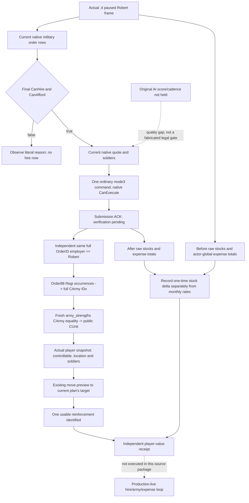

# Holy-order hire, usable army and treasury: one player-value chain

Source cutoff: **2026-10-07 / ISO2026-W41**, isolated preimage
`14f07ade00e9ad359da3aa6af3642592ede3f48d`. The installed identity is CK3
**1.20.0.4 / Steam25734779**, retained EXE SHA
`98702F88A547CDE2EAF29A85F93B85F68EE4CF8148336A4F7AFAEB75319DD518`.
The Root-owned ordinary campaign is Robert29829. Root's current runtime19,
H9638/date53288448/saved-day6005 is coordination context, not a new holy-order
observation made by this package. SideR68 has no G2 credit here.

This package connects already implemented observations to one useful result:
**hire one currently legal military order, independently identify its usable
player army, and observe the player's actual resource/expense outcome**.
It adds no native query, strategy, admission rule, build flag or action. The
existing inputs are sufficient for this bounded decision; source-only research
does not execute the recipe or award an actual hire loop.

The older R63 holy/cash reads at date53288256 predate the H9638 cold load.
Root must freshly read the current holy context, current cash and current army
for this chain; the old values are not carried forward as current terms.

## Native tree before player decision

The [actual4 query/action tree](religion-holy-order-query-and-ordinary-hire-12004.md)
already closes the current manager/full-generation rows, final permission,
quote, current soldiers, ownership and ordinary mode3 command. The
[native AI choice topic](religion-holy-order-native-ai-choice-12003.md) remains
the explicit quality boundary: no actual original-AI candidate scorer or
incoming hire cadence is held. Its stock reserves500gold/1500treasury belong
to the **holy-order leader**, not the hiring player's budget. This recipe does
not assign those numbers to Robert, label a legal candidate as an AI intention,
or require an unresolved optimal chooser before a useful ordinary hire.

| Actual input/producer | Existing published consumer | Decision/result meaning |
| --- | --- | --- |
| Actual4 `2619C30` final CanHire and literal reasons | `military_terms.can_hire` | Current native legal availability; do not substitute a CB-name whitelist. |
| `26198C0 ->2619960` evaluated ten-slot quote; actual4 shared CanAfford | `resource_costs_raw`, `can_afford`, reasons | Current one-time terms in native slot order/Q100000, including native zero. |
| `261ACF0` current soldier aggregate | `troop_strength.current_soldiers` | Candidate's current size; not the player's already acquired troops. |
| Ordinary typed inline mode3/CanExecute/owning clone | `ck3_hire_holy_order_v1` | One native submission; ACK remains verification pending. |
| Actual manager mutation `2A88610` writes employer80 | Fresh context row `employer_id` | Independent hire postcondition for the exact full OrderID. |
| Order88 -> full ArRg -> Regi140 -> full CArmy | `troop_association.rows[].native_carmy_id` | Independent association only when currently employed by played actor. Preserve occurrences, duplicates, generation and invalid/unraised cases. |
| Current public army producer and strength reader | Snapshot `player_armies` plus `army_strengths[].native_carmy_id` | Full CArmy equality joins to a real public CUnit ID; snapshot supplies actual owner, controllable and location. |
| Current player resource fields | Snapshot `played_character_gold/prestige/piety` | Actual signed stocks; piety is not gold, and devotion total is not spendable piety. |
| Native current/all-raised military expenses; gross/total/net | `ck3_query_war_cash_current_resources_private_v1` | Actor-global current rates and actual resource vectors; no per-order attribution or future guarantee. |

## Existing consumer omission

The scoped search for `holy_order` in the current `xar_autoplayer` Python source
finds the registered query/action, native-driver/Service delegates, strict
contracts and standalone reinforcement consumer. **`strategy.py` has no
holy-order consumption** at this preimage. The existing
`m5_war_cash_resource_v1.py` combines explicitly sourced gold commitments and
bounded future estimates; it does not ingest the current holy-order rows or
turn their piety quote into gold. Thus the missing practical connection is
planning/ordinary execution, not another getter with a permanent null value.

The raw source clips and exact entry locations are frozen externally in
`C:/codex-ck3-background/packets/holy-order-g2-value-20261007/`. No existing
GREEN projection or fixture was rerun. No new EXE code/metadata read, hash,
provider/import/test/build, SDK call or game operation occurred.

## Root-owned ordinary MCP recipe

The actual source route is enabled without a separate hire build switch:
`ck3_12004_adapter.cpp:123` unconditionally advertises
`game.command.hire-holy-order-v1`; the actual4 environment registers its
executor at `bridge.cpp:11651`, and the dispatcher at14335 invokes the actual4
aware `RunPlayerHolyOrderHire12003`13536. The mailbox selects actual4 Core and
`BindHolyOrderHireActionImage12004`; that factory supplies actual primary
476D9D8, secondary476D9A8, final validator29947F0 and the central actual owning
command binding. Its provider is in the existing runtime source list. Neither
the Python direct action delegate nor this native path has a dedicated
holy-order-hire OFF flag. A historical OFF record therefore does not establish
the current route's absence. Root can reuse current `ck3_get_capabilities()`
to identify its loaded token. If the current DLL lacks the token, the concrete
work is loading the adopted runtime route; no invented new switch or old
authorization restriction is required. Source availability is not a new
runtime/action qualification.

Use the current paused ordinary Robert campaign and an already chosen military
need/target. The recipe does not declare a war merely to generate a hire scene.

1. Take one fresh `ck3_take_snapshot()` and retain actual build, Robert identity,
   date, public/native revisions, raw gold/prestige/piety and `player_armies`.
   Call `ck3_query_player_holy_order_context_v1(expected_revision=R)` and
   `ck3_query_war_cash_current_resources_private_v1(expected_revision=R)`.
   Private queries retain their own frame metadata; public R is the MCP
   argument, not the native revision. Existing transport enforces the query
   frame.
2. From actual military rows, use the exact full OrderID and current final
   CanHire/CanAfford/quote. A false native answer is a current outcome, not a
   missing migration port. If no legal candidate exists, record the literal
   reason and continue the existing war plan. If already employed by Robert,
   continue at the army join without another hire. If multiple candidates are
   legal, Root chooses one using observed costs/current size and the current
   military need; original-AI optimal ranking remains unclaimed.
3. Submit exactly one
   `ck3_hire_holy_order_v1(holy_order_id=FULL_ORDER_ID, expected_revision=R)`.
   Its provider recaptures current terms and native CanExecute. Retain the
   original ACK; `submitted_verification_pending` supplies no after-state.
4. Take a fresh snapshot after ordinary queued-command processing and query
   holy context/cash with its current public revision. Match the same full
   OrderID, independently observe employer29829, and retain all original
   association occurrences. A legitimate empty/unraised association is not yet
   usable army evidence; use the existing ordinary raise path if the actual
   state demands raising. Do not infer the army from aggregate order soldiers.
5. Query existing `ck3_query_army_strengths(army_ids=POST_PLAYER_PUBLIC_IDS,
   expected_revision=POST_R)` once for the current public player-army set.
   Join only resolved association full CArmy IDs to available strength rows.
   Do not guess that a newly added public ID is necessarily the order, sum
   repeated Regi references as independent armies, or require a new army if
   the native result joins an existing one. The public snapshot must show the
   joined actual army's controllable status, location and positive troops.
6. For the existing military target, use
   `ck3_execute_step(step="preview-move-army-PUBLIC_ID-to-PROVINCE_ID",
   expected_revision=POST_R)`. A successful actual preview provides present
   usability for that intended route; a native deferred/rejected reason is
   retained as the result. Normal `ck3_move_army` and independent move-target
   readback may then belong to Root's current war plan. No movement is executed
   by this package.
7. Record actual before/after raw stock deltas separately from the native quote.
   If the date is unchanged and no other resource mutation occurred, an exact
   raw quote/stock-delta comparison can qualify immediate payment. If time or
   other actions intervened, report the observed delta and its attribution
   limit rather than manufacturing exact payment. Record current native
   military expense vectors and gross/total/net rates from the independent
   after query. These qualify actual actor expense state, including observed
   zero; they do not identify the order's exact isolated upkeep contribution.

One receipt can therefore award independent employer, associated controllable
army, resource delta and actual expense observation. Full war victory,
original-AI optimality, replenishment, automatic/ordinary release, per-order
maintenance attribution and future affordability remain separate.

## Treasury units and immediate limits

The ten slots are gold, prestige, piety, renown, influence, herd, treasury,
treasury_or_gold, merit and barter_goods. `current_treasury` in the existing
war-cash DTO denotes the player's **personal gold stock**; native slot6 is the
distinct treasury resource. Keep both names/units as authored rather than
adding gold and treasury. `current` and `all_raised` are alternative
actor-global expense totals, counted once across all wars. Net gold is already
gross minus total expenses: subtracting military expense again double-counts.

The query does not promise an unchanged future monthly rate. Before/after
actor totals are useful for this immediate reinforcement decision without a
new per-order expense leaf. A later real question requiring exact isolated
holy-order upkeep would need its specific native expense producer; that
unconsumed future question is not a blocker for this bounded chain.

Status: **source-ready recipe using adopted inputs; execution NOTRUN**.
No capability/readiness promotion, action, payment or G2 loop credit is claimed
by this documentation package. Root owns ordinary live execution and shared
Oct7/W41 reporting. The independent pendingInteraction projection remains a
separate backlog and is not consumed or rerun here.
