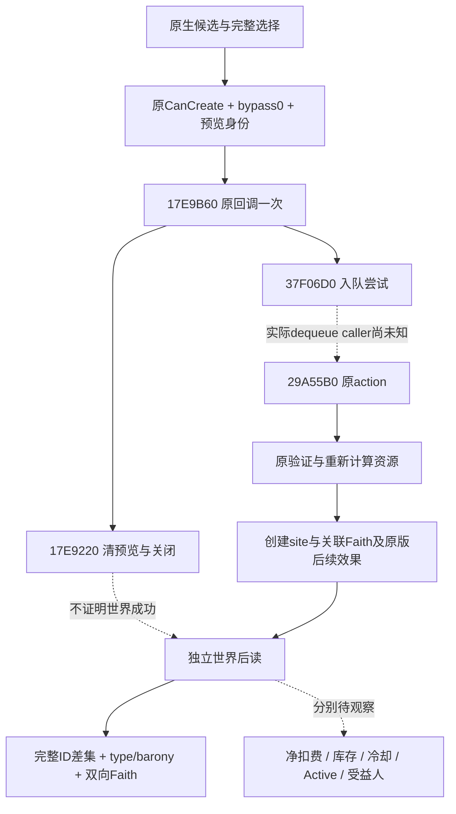

# 新建圣地：原版 Create 一次接口与规划合同（1.20.0.4）

此页冻结 **Create 的来源与决策合同**。当前没有新建圣地的实机成功证据；已冻结主线 `b8be8ca6` 的创建 UI 只到 kind8/op17，后继 kind8/op18 仍是独立候选。静态知识始终 `source_reviewed_static`、`action_ready=false`。候选列表、按钮状态、调用 ACK 和窗口关闭分别记录。

`machine_id: 4-8e1c2f1861`；原始来源观察时间 `2026-10-17T15:09:03.951424Z`。目标为实际安装 CK3 1.20.0.4，EXE SHA256 `98702f88a547cde2eaf29a85f93b85f68ee4cf8148336a4f7afaeb75319dd518`。这是该机器的离线反汇编研究，没有新增游戏调用或当前材料/钱包观察。来源合同 SHA256 `6c7d93daa462e2fb631c1fa96f3006f7aa2785a04296aeffeb232f2a18cb0caf`；每个原件 SHA、RVA、LF 行号与字节位置见[来源合同](evidence/holy-site-creation-create-once12004/source-contract.json)及[紧凑指令索引](evidence/holy-site-creation-create-once12004/source-excerpts.json)。

最窄实现只包装原版 `void(window*)` 回调 `17E9B60`，由现有 typed UI 的原生 owner、暂停、revision、modal 与窗口身份守卫承接。它不需要重建 command 或声明队列 ABI。当前合法地点、圣物、CanCreate、钱包与实际费用都需在目标场景读回。

## 规划顺序

1. 使用[创建候选查询](holy-site-creation-native12004.md)和[原版界面选择](holy-site-creation-ui12004.md)，从实际模型选 type、barony 和圣物；每次变更后重读**完整**已选元组。类型选择可能重置地点，圣物满槽选择可能挤出首项，单个按钮的 ACK 不能代替完整读回。
2. 重读原生预览：actual actor/Faith、原窗口/owner、类型与地点、完整有序圣物、原 CanCreate、bypass、原 tooltip 与缓存资源向量。后继 `preview_identity_sha256` 是桥接层对这些原生读数的身份摘要；指针只参与摘要，不成为公共参数。它不证明引擎报价新鲜或已付款。
3. 缺最终 CanCreate 观察、原判定为 false、bypass 未观察或不为 0、身份漂移、窗口不可见、未决一次键已消费时明确拒绝。保留原版 tooltip，按其要求规划材料或地点，不改原版门槛来取得通过。
4. 仅在后继能力已启用并具备当前有效预览时调用一次。原回调返回或窗口消失后仍保持 pending；异常和丢失 ACK 也不能触发同键重试。
5. 用独立原生回调读取世界后验。先比较实际 Faith 的完整 site ID 集合，再对唯一匹配新 ID 核类型、barony、双向 Faith 关联。随后分别核实际钱包、圣物去向、免费额度/冷却、Active 和受益人。缺哪一项就保留该项 unknown。

| 观察 | 能供智能体决策的含义 | 不能据此认定 |
|---|---|---|
| 原模型候选 | 原窗口缓存的可选项与完整已选状态 | 当前最终许可或生产缓存刚刷新 |
| fresh CanCreate=true、bypass=0 | 此预览通过原版正常按钮判定 | 已排队、已创建或具体净扣费 |
| 桥接预览身份匹配 | 当前原生配置与已确认意图一致 | 引擎原生价格签名、库存已转移 |
| 原回调 attempted/returned | 原版回调最多尝试一次 | 队列接受、世界成功 |
| 窗口 reset/close | 原版提交分支的预览生命周期 | 新圣地存在 |
| 独立新 ID + 逐 site/关联有效 | 所指 Faith 得到类型/地点匹配的新圣地 | 免费额度、冷却、Active 或实际受益人 |

## 原版调用与费用边界

`17E9B60` 先调用 `17E9A70`；后者经 `17EABC0` 构造原命令，调用 primary vtable `476FF98+30=29A5AD0` 验证。合法分支再构造、clone 后调用 `37F06D0`。回调忽略队列返回 AL，随后 `17E9220` 清理预览并进入通用关闭路径。因此接受/拒绝入队都可能留下关闭现象，之后必须重新解析窗口与世界对象，不能继续使用旧指针。

原 builder 只取全局 actor `54DBC00`、window `+C8` Faith、`+D0` type、`+D8` barony、`+E0/+EC` 完整圣物序列。`+178` 的十项资源缓存没有作为该命令的付款值传入。实际 action 是 secondary `4770030+8=29A55B0`，会再次验证，调用 `29D9790` 建立 site，然后通过 `29A66C0→310CEC0` 重新计算资源并调用 `310D5B0` 应用。

规划时将 `cached_resource_vector_raw` 标为 **缓存预览**。精确当前成本和预算余量尚无独立最终报价读口，不能从摘要匹配或 CanCreate=true 推出任意价格。实际净扣费使用同场钱包前后读数；另一场的扣费也不能替代本次报价。

## 独立后读的最低标准

复用现 `ReadHolySiteSnapshot12004`，创建前保留 actual Faith 的完整 ID 数组，创建后在新的回调中重新读取。对差集中唯一目标必须同时满足 `Site.available`、完整 ID、类型与所选 barony 一致、associated Faith 包含实际 Faith，以及对应 `FaithRelation.available && faith_lists_site`。外层 `Snapshot.available` 只保证 Faith 数组双读稳定，不能代替每个 site 的读取结果。

现有 reader 来源为 `ck3_12004_holy_site_snapshot.cpp`，SHA256 `e4b71513d1c5008c047fbd37a0fb026b2218a3f8ee3f886de5aa6fb2d56cd39b`，主要入口 LF 213–248，关联读取 LF 140–174。底层新 site 的类型/地点/full ID 写入与 Faith 关联来源可由紧凑索引中的 `29D9882`、`29D988F`、`29D9893`、`29A5760` 定位。

没有新 ID、多个匹配、单个 Site/Relation 不可用或世界尚未处理时保持 pending，只做独立查询。`barony+12C` 当前只闭合创建前空位过滤，其创建后写者仍未知，不能把它作为唯一成功条件。一次动作的返回固定不授予 `business_outcome_observed`；后验是独立证据。

## 拒绝与可恢复实验

| 分支 | 记录与后续 |
|---|---|
| 没有合法 type/barony/圣物或最终判定 false | 保留候选、完整选择、原 tooltip；按真实局面规划，不扩大演员或改条件 |
| bypass 未观察或非 0 | 拒绝；不把调试要求绕过当普通合法性 |
| 预览变化、owner/revision 不匹配 | 拒绝，重新观察并规划；不得复用旧签名 |
| 同一次键已经尝试、队列/transport 结果未知 | 保留未决记录，独立读世界；不重发 |
| 后读不足 | 保留 unknown；使用明确冻结的独立机制实验母档恢复，不能把读取失败改写为业务拒绝 |

实验存档许可仅用于明确标注准备的宗教机制实验，不抵普通罗贝尔战役成绩。本页没有观察合法材料，也没有承诺当前演员一定能新建。未闭队列 dequeue caller、effect handler 名称与通用关闭尾链保持 unknown。后继实现、构建和冷载资格单独追加，不能回写为本来源研究当时已知。

机器可读的[主张与决策合同](evidence/holy-site-creation-create-once12004/claims.json)可由静态圣地知识口引用；当前数据保持 `current_state_observed=false`、`action_ready=false`。
