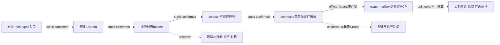

# 圣地创建：原版候选与只读规划接口（1.20.0.4）

machine_id: 4-8e1c2f1861。2026-10-17（各原件记录精确UTC） 的静态研究及离线资格；EXE SHA-256：98702f88a547cde2eaf29a85f93b85f68ee4cf8148336a4f7afaeb75319dd518。仓库上下文3d7a9f11；安装资源本身没有Git commit。此记录补齐[首期规划 E01-C06](faith-and-power-episode01-planning.md)当时未闭合的原生候选来源，保留旧历史边界。

新接口 ck3_query_player_holy_site_creation_context_v1 读取当前玩家实际Faith的创建窗口，返回原版候选、完整选择、最终按钮判定及拒绝文本。已通过新核心MSVC /WX、离线原生I/O夹具与真实MCP消费者资格；本lane没有启动游戏。完整DLL链接、实机候选、实际创建仍待后继证据。read_only=true、action_ready=false、create_invoked=false。

[机器可读来源合同](evidence/holy-site-creation-native12004/source-contract.json)包含源包SHA、原始代码字节SHA、RVA范围、开窗链、23个运行时前缀与资格回执。[研究图](evidence/holy-site-creation-native12004/research-plan.md)及同目录JSON可由tools/native_research_plan.py检查和渲染；检查绑定文件及声明层级，不自动证明语义或实机通过。

| 原版入口与模型 | 静态producer/caller/consumer | 规划含义 |
| --- | --- | --- |
| Faith typed入口 | B0EB80→B16A50发布handler+5E8；token43BC→viewAA；AF39E0接Faith Any40，SetData虚函数+90=17E92F0 | 只用当前玩家实际Faith；不接受actor override、RVA、指针或任意窗口名。 |
| 地点+100 | SetData17E92F0遍历玩家domain头衔，过滤rank1、lease byte130、既有HolySite ref12C；GetPotentialBaronyTitles→17EB820→BFFC70 | 读取创建自己的地点model；不拿采用决议setup_items、全领地扫描或首都提示代替。 |
| 圣物+118 | 17EA880→28AA890当前玩家库存，排除22E4420已装备者，再执行2530EF0对窗口Faith的原生认可；GetEnshrinableArtifacts→17D8090→D932F0 | 候选不是全库存或圣地供奉库存。无候选不能外推玩家没有圣物。 |
| 类型+130 | 17EACB0→A14A30遍历类型库，收dynamic+418非零；GetAvailableHolySiteTypes→17EBB80→D93320；CanPick17EAE10另查本Faith同类情况 | 保留禁选候选、原生CanPick及理由；静态类型表不等于实际许可。 |
| 全部选择+E0 | GetSelectedArtifacts→17EB930→B801A0；17E9940切换完整ID，满原生容量时先移除首项再追加 | desired selection先读完整集合；已达目标不可盲toggle。 |
| 最终条款 | IsCreateButtonEnabled反射→17E9040→17E9A70→17EABC0构造实际command→vtable476FF98+30=29A5AD0；tooltip17E9050进入同条款 | 原版最终判定不由脚本子规则重算；只有实读bypass=0才赋普通规则合法性资格。 |

安装GUI来源：gui/window_holy_site_creation.gui SHA 7e6cd0cf6cc70616fa1f3137dca1c229f60c68a7f18bb3d43cd44dd9bf367310，类型447–463、圣物510–567、地点596–640、按钮704–714行；gui/window_faith.gui SHA 67924e58ccba26d95853ac48af35d91a774f5ce6d2e7f32a0a033de3b9d51521，入口1660–1671行。原件绑定[现有来源清单](evidence/faith-and-power-holy-sites-12004/source-manifest.json)。地点empty-state在640行检查GetEnshrinableArtifacts，不能凭该文字断言地点model为空。GetSelectedArtifact是单个焦点，完整集合另有GetSelectedArtifacts。

Faith+C8、type+D0、barony+D8；向量ptr0/capacity i32+8/count i32+C，ID stride4、类型指针stride8。每个回调两次读取完整model与选中集合，保留顺序、重复项、0及高位完整ID，FFFFFFFF是缺失哨兵。损坏、超界或状态变化返回unavailable，不能降级为空列表。跨回调只保存ID、定义key及帧绑定，不保留原生指针。核心按signed int32原样保留角色引用；共享公共Driver仍拒绝负角色引用，本轮未扩展该公共边界。

选择类型可能重置地点；选择圣物可能替换首项。两个原版selector都会刷新成本。17EAAE0的+160/stride24是预览slot行，并非完整已选集合。

缓存报价在窗口+178嵌入十个signed int64，scale100000。17E9600构造真实选择scope，41D1010及物理续段最终进入310CEC0写值；它不是新对象指针。接口保持cached_quote_freshness_observed=false、native_affordability_observed=false、native_affordable=null。总体CanCreate=false不等于“缺钱”，true也不能单独证明报价新鲜。2000虔诚基值、免费额度及创建冷却继续引用原脚本合同；离线夹具示例不算实机报价或扣款。

智能体规划顺序：

1. 在当前暂停原生帧查询。窗口或模型未就绪时保留诊断；经独立许可的typed UI打开后重读。query自身不会开窗或创建。
2. 从原版类型model选明确可选的key；地点和圣物必须来自当前对应model。任何选择改变后重读全部候选及完整选中元组。
3. 分列CanCreate、bypass、原生拒绝全文、缓存报价和钱包预算。未观察字段保持unknown；免费额度、创建专用冷却、付款人及实际受益另设观察任务。
4. 本轮没有Create提交接口。未来动作仍需单次原版提交与独立世界后验：新ID/类型/地点/关联Faith、钱包净变动、库存转移、免费额度及冷却分别采集。ACK不算成功，结果未知不重复提交。

| 观察或拒绝 | 可恢复路径 | 不能外推 |
| --- | --- | --- |
| exact SHA/pin/actor/Faith/owner不一致 | 重取实际帧及正确build，不dispatch | 当前动作非法、候选为空 |
| model完整性失败或unavailable | 保存原诊断，下一独立查询 | 无库存、无地点或类型 |
| 类型CanPick=false | 读原生理由，换当前原版可选项 | 该类型永远不可建 |
| root/visible未观察 | 独立UI runtime/tree和选中后读 | 已经开窗或点击成功 |
| CanCreate=false且bypass=0 | 根据完整拒绝规划资源、地点、圣物或权限 | 原因必是价格/冷却 |
| bypass未知或非0 | 保留按钮原值，不授普通合法性资格 | 普通规则允许创建 |

Root另分配kind8=holy_site_creation与op14–17（打开、类型、地点、圣物desired bool）；native adapter和公共UI另有独立default-off接入，不由只读query flag默许。query离线资格不抵UI实机资格或Create业务验收。

离线原件分层：a01新核心27项/8包；a02只跑5项新增守卫，另用actor15893生产8个MCP输入包，未重跑27项。真实生产MCP保存25份结果：8正例、15显式拒绝、after-frame拒绝、高位actor入口拒绝。首次受管host choices漏项为RED，修复后只重跑该静态项；[资格索引](evidence/holy-site-creation-native12004/query-qualification.json)绑定两阶段证据。新owner wrapper及实际宗教mailbox hook已做2 TU compile，尚无完整DLL链接或实机资格。OpenKaishEk不适合替代窗口内存/ABI问题，未以脚本复演冒充原生结果。

2026-10-17 UTC后继：[typed UI与规划后读](holy-site-creation-ui12004.md)已新增独立default-off参数/生产DTO/MCP资格。仍无完整DLL、实机选中或Create业务资格；原query25结果没有重跑。
