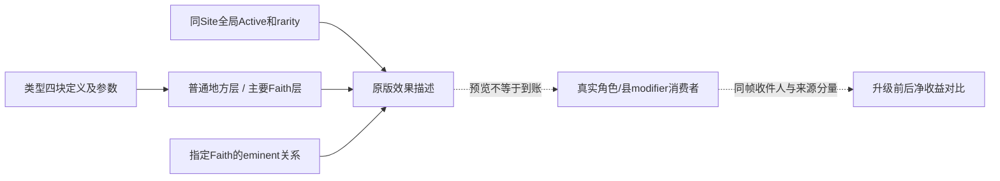

# 主要圣地的收益交换：麦加、纳杰夫与萨迈拉智慧圣地（1.20.0.4）

> 2026-10-18 后继更正：新稿统一官方名“智慧之地／伯爵领持有者／骑士战斗力／总宝物稀有度等级”。缩放值读取缓存，主要等级还有朝圣等其他消费者；完整范围以[v4机制更正](faith-and-power-episode01-v4-mechanics-corrections-12004.md)与[条件专题](holy-site-grade-effects-and-limits-12004.md)为准。下文保留上一轮来源与实机截点，不将其系数算例提升为实际净收益。

本研究回答“为什么值得升、该降哪一处”。主要名额只是约束；比较对象是失去与新增的宗教级效果、仍保留的地方效果，以及费用和政治代价。**R7完成了等级交换，没有实读最终角色属性；R8完成了普通智慧圣地326的创建与Active/rarity后验，也没有实读地方学识或县修正净值。** 本页将定义计算与实际到账分开。

machine_id: `4-8e1c2f1861`；本轮离线研究于2026-10-17 UTC补录。实际资源为Steam安装的CK3 1.20.0.4；EXE绑定SHA-256 `98702f88a547cde2eaf29a85f93b85f68ee4cf8148336a4f7afaeb75319dd518`复用同机R8冻结来源，本次不重hash EXE、不启动游戏。逐文件SHA、精确行号、观察时间和回执见[来源与值合同](evidence/holy-site-major-grade-value12004/value-contract.json)。R7绑定source `b8be8ca6`/a05，R8绑定source `02eea1e5`/a06，不将两场余额或神器前态互换。

## 先分清四层

| 层 | 普通与主要的区别 | 必须独立确认 |
|---|---|---|
| 成员/等级 | 等级属于`(faith_id, site_id)`；升级不新增地点，降级不退出Faith | 该Faith关联、eminent标志与当前名额 |
| Active/有效稀有度 | 同一个site只有一组全局缓存；已闭producer按县主持Faith关联与神器认可求和 | `site+18/+1C`缓存、新原生求值、县主Faith；不能发明每Faith一套Active |
| 地方效果 | 这三个类型的`county_holder_character_modifier`和`county_modifier_scaled`均可归入普通/主要地方层 | 实际Active、收件县主/县、真实属性消费者；普通等级本身不禁用地方层 |
| 全Faith角色效果 | `faith_character_modifier`及其scaled块限相关Faith的主要关系 | 真实收件Faith及消费者、每位收件人的奉献等级/骑士数；不只玩家或玩家领内角色 |

资源格式说明S01 32–78区分两类收件层。S01 33用“男爵领持有人”表述；本次实际闭合的`2441F30`沿男爵领找到county，再取县主持Faith作比较，因此本build以这个确切消费者为准。更重要的是：地方固定和县缩放有Active门，而完整全Faith生产primary没有同一个Active检查；效果描述隐藏不等于全Faith固定属性已归零。详见下方实际链与剩余缓存时效边界。

`parameters`是另一条脚本能力通道，格式说明S01 19–29甚至明确其存在性判断不取决于yes/no值。**麦加、纳杰夫、智慧之地三类均无parameters**，不会因为升主要凭空得到未声明的特殊能力。其他类型的传教参数须追具体consumer；不能一概归为主要专属或假定Inactive仍有效。

## 逐项比较：哪些保留，哪些才是主要增量

以下为实际类型声明，不是最终属性读回。令`R`为该地点已读的全局有效圣物稀有度和，`L`为**每位收件人自己的**有效奉献等级，`K`为其自身实际骑士数；`R`不是神器件数。地方层的适用门仍须成立。

| 类型/来源 | 普通也有资格享有的地方层，降主要本身不删此类 | 升主要新增、降主要失去的全Faith层 |
|---|---|---|
| 麦加`mecca`，S02 687–710 | 县主月虔诚倍率+5%、骑士效能+5%；县发展增长倍率`+1%×R`、旅行危险`−R` | 月虔诚倍率每名骑士+2%（原始项`0.02×K`）；骑士效能`+1%×R`、奉献等级影响`+1%×R` |
| 纳杰夫`nadjaf`，S02 842–865 | 县主教士好感+3；县发展增长倍率`+1%×R`、民众好感`+R` | 外交`+L`；教士好感+5；月虔诚倍率`+1%×R` |
| 智慧之地`site_of_wisdom`，S03 72–96 | 县主学识+2；县金币/威望/虔诚三类建造费各`−1%×R`；`development_growth +0.01×R` | 外交`+L`；学识与外交生活方式经验倍率各`+1%×R` |

智慧的`development_growth`为加法项，**R=4时是+0.04，不是+4%**；麦加/纳杰夫用`development_growth_factor`才是R=4时+4%。同理，智慧主要没有再送一份学识+2；这+2属于当地县主层。神器自己的个人装备属性不会被表中全Faith修正整套复制。

R=4的来源计算例：纳杰夫主要层为每级奉献外交+1、教士+5、月虔诚倍率+4%；智慧主要层为每级奉献外交+1、两系经验各+4%。若某收件人实际L=4，外交原始项为+4；不能用R7玩家初始L=4代替所有角色，或在付费后没有读回时追认其L不变。

### 本期实际镜头能证明什么

- R7 P中麦加26主要→普通、纳杰夫32普通→主要，T/E/R为`6/3/3→6/2/4→6/3/3`，独立钱包`4250→3250→2250`。当前Faith完整成员、类型/位置、已读库存和其他关联Faith等级在该观察范围内保留。没有实读麦加神器60的rarity/Active，不能给损失硬填“4%”。
- R7先升的是空纳杰夫；随后独立圣物链才将237放入，读到Active=true、R=4，再付500撤回至Inactive。**等级晋升不等于已实读净收益；反过来，也不能凭Inactive就断言其全Faith固定外交/教士项为零。** 县主15436与玩家15893不同；地方教士+3不能误算成玩家本地收益。
- R8新智慧326为普通、Active=true、R=4，县主就是玩家15893。已读世界/库存/owner后态支持其生效基础，不证明实际学识已经净增2、县建造费净减4%，更不授予普通站点主要专属的全Faith经验收益。新建后另一窗口的物品选择仍需重读。

## 什么场景为什么做

| 经营目标/局面 | 应比较的具体收益与损失 | 决策理由及边界 |
|---|---|---|
| 经营自己直辖县、建造与地方学识 | 智慧的县主学识+2、三种建造成本和发展加法项已在地方层 | 不必仅为这些地方定义再买主要等级；先确认地方效果真的消费。主要价值要另看外交与生活方式经验 |
| 外交、教士关系与虔诚收入 | 纳杰夫主要带`外交+L/教士+5/月虔诚+R%` | 对对应需求有具体价值，但须减去被降站点的原始项、政治成本及神器装备机会成本 |
| 骑士军力与大量骑士的虔诚增长 | 麦加主要保留每骑士+2%月虔诚项，以及按R缩放的骑士效能/奉献等级影响 | 不因拍摄使用麦加就把它默认当牺牲位；先读实际R、Active、收件人的K与已应用分量 |
| 从纳杰夫主要换成智慧主要，双方都真正适用 | 两者`diplomacy_per_piety_level=1`相同，原始外交系数净差0；失去教士+5/月虔诚R_N%，换两系XP各R_W% | “再获得外交”会重复记账。选择取决于关系/虔诚需求和未来生活方式时长，不直接宣称哪个最优 |
| 主要名额被Inactive或未来难控制的地点占用 | 分开评估全Faith固定层、按R缩放层及有Active门的地方层，计入县主持Faith与认可圣物的成本 | 不能只按模板数字排名，也不能用Active=true直接授予全Faith净属性 |
| 收益会给整个Faith，而不只自己 | 需要计入领外同Faith收件人与对手、不同角色的L/K | 同一种系数对不同角色价值不同。共享站点的另一Faith是否得到作用，要读实际consumer，不从共享eminent或认可推断 |

最少动作不等于最少总代价。比较输入应保存目标收件人、各效果来源分量、各站R/Active/控制Faith、原生许可/报价/冷却、当前主要上下限、政治关系、圣物机会成本和时间范围；缺值保持缺值，不把unknown变成0来制造最优结论。

## 费用、等待与政治代价

升级与降级的脚本基价各1000虔诚；Faith还有免费圣地行动时脚本费用/相应决议冷却为0并消耗额度。常规配置时长各5年，**同一个时长值不等于所有操作共用一把锁**。R7在降级冷却已开启后仍首次升格成功，随后两decision key分别有active冷却；原生只读原始counter，未换算日历日期。当前免费次数、报价和冷却须重新读。

若主要数已满，换一主要通常需要“降旧→独立后读→重取目标terms→升新”，R7实付合计2000。若两步仍各1000且不免费，R8历史终态1250不足2000预算，差750；这是条件预算，不是当前运行的affordability判定。

S04 85–100/237–252与S06/S07还声明：县主不是行动者时，升格使该县主对行动者+50、降格−50，均10年衰减；行动者获得10年modifier，升格为同Faith **Zealot（宗教狂热）封臣立场**好感+30，降格为同Faith Zealot与Parochial（本乡本土）立场各−20（S09 32–39/47–54）。不是“有热忱trait的所有角色”。两种actor modifier和多个关系项的最终叠加、封顶、实际收件人未读，不能把原始系数直接当净好感。智慧326县主是玩家，若未来升格，脚本不会给自己走外部县主+50分支；actor modifier仍另有声明。

降级另有特定Christian Faith与schism-rite县的条件分支（S04 253–265），不套到本期Sunni场景。升级/降级并不是回滚：资源、冷却、意见和等级分配都可能已变。R7恢复T/E/R并没有让麦加恢复主要，也没有返还2000。

## 原生效果观察施工入口

已闭的原生链均为exact EXE的离线来源证明，未执行重算函数，也未把其输出当成R7/R8实机净属性。详见[完整source合同](evidence/holy-site-major-grade-value12004/native-consumer-contract.json)与[精确源码行](evidence/holy-site-major-grade-value12004/native-source-excerpts.json)。

| 观察层 | 确切入口/条件 | 最窄可施工读口与仍缺的证明 |
|---|---|---|
| Faith级真实生产 | `24FB270..24FB8E0`：当前Rite所属Faith+890列表，须在Faith+8A8主要名单，且`2441F30`县主持Faith匹配；fixed type+58 / scaled+3D8 | 纯读当前角色Rite+20指针列表/count2C及集合中的已加载u16键/Q64；联结当前Faith、站点主要边与控制Faith。**完整primary无Active18检查**，不把空描述当固定全Faith零值 |
| 实际收件角色 | `291C0B0→291F080`：角色当前Rite+20/+2C集合经`2438830`加入真实角色aggregate | 复用`ReadCharacterModifier2C4D1D012004`；`28C3AC0`检查Character+1B0→cache+258及owner backlink，`23036E0`按已加载u16键读Q64。不能猜enum索引或把默认fallback当实值；总聚合不是单站贡献 |
| 地方固定真实链 | `291E3A0`及其两个Title输入族，须type固定块非空、site+18 Active、角色Faith关联site | 复用现生产`following_291e3a0_local_titles`与`following_291e3a0_first_title_vector`，保留两族顺序和过滤。不能直接化约为所有同Faith角色或仅holder==actor；已有holder身份与实际Title输入需同时读 |
| 县缩放真实链 | `2864E40..2865302`：county owner Faith、Active18、`2441F30`，以HolySite scope求type+3F0并写receiver+8 map；无需主要 | 下一精确caller是`2864D93`，其R15作为receiver；待绑定receiver+298 owner与owner+18 Title ID，再纯读aggregate。**禁止调用producer来刷新或猜receiver ABI** |
| UI效果文字 | `2659880`在Active=false时整个返回空，true才拼普通与请求Faith主要段 | 只作原生文字/预览读口；不是实际角色属性。缩放表达式以HolySite fullID scope经`24FD1F0/2872820`求值，不从某次预览硬拷一个永久倍率 |

共享纳杰夫的例子可以据实际consumer回答到这一层：县主持Faith50时，即使Faith51也列纳杰夫为主要，`2441F30`仍会拒绝Faith51的全Faith修正生产；神器被Faith51认可也不能跳过这个门。同一个县的地理效果与Faith51全体角色效果应分开。若县主持Faith日后实际改变，global rarity、控制Faith与受益结论都要重新读。

一次有意义的补拍最多先对齐两个角色/三项：玩家与当地持有人（或同Faith非县主对照）的教士好感modifier、外交按实际奉献等级的来源分量，以及智慧地方学识或经验倍率。保留同暂停日、身份、Rite/Faith、Title输入、实际L/K和cache owner；升降前后取独立聚合及来源集合。角色总外交变化可能还含奉献等级/其他来源变化，不能直接称单圣地净贡献。县净修正待上表receiver绑定后再读，不留下无限期泛化unknown。

`parameters`的实际consumer不在本次已闭四个modifier块中；只保留本期三type无参数的事实，不将新modifier门外推成所有特殊能力门。

## 可直接进入第一期的讲解段

我们刚才花两千虔诚，把麦加降成普通，再把纳杰夫升成主要。名额只是这件事的门槛，真正交换的是哪一组宗教级加成。

先别把主要理解成所有效果翻倍。按原版定义，普通圣地也能有地方收益。比如我们在萨迈拉建的智慧圣地，县主学识加二，以及随圣物稀有度变化的建造和发展效果，都属于地方层。它升主要以后新增的是每级奉献等级一点外交，还有学识、外交两类生活方式经验。稀有度四时，这两类经验各是百分之四；不是再送两点学识。

纳杰夫主要的方向不同：同样有按奉献等级增加的外交，再加教士好感五点，以及随有效稀有度变化的月虔诚。因而把纳杰夫主要位换成智慧主要位，外交这项原始系数其实没有增加；主要是在教士关系、虔诚收入与两类生活方式经验之间取舍。

麦加也不是随便就该放弃的名额。它的主要层提供每名骑士带来的月虔诚倍率，再按圣物有效稀有度提供骑士效能和奉献等级影响。准备靠骑士作战时，这一边的损失可能更重要。

还有两笔账。第一，界面未生效不等于所有固定属性都归零：实际代码里，地方固定项有Active门，全信仰生产则检查主要关系和县主持信仰，没有同一个Active开关。共享地点的另一信仰也不能只凭主要关系或认可圣物拿走这组全信仰加成。最终变化还要读角色的真实聚合修正。第二，降级和升级都可能花虔诚、进各自冷却，并改变县主和封臣立场的好感。所以本片这次交换证明了怎么做，不证明它就是当前最优。真正游玩时，先看自己缺什么、谁会受益、旧站点会失去什么，再决定值不值得花这两千。

## 2026-10-17 UTC 资源语义补注：奉献等级影响

本补注复用machine_id `4-8e1c2f1861`于2026-10-17T19:07:20.373084Z读取的1.20.0.4资源，未新增逆向或实机操作。[精确来源pin](evidence/holy-site-major-grade-value12004/piety-level-impact-source-pins.json)保留文件SHA、中文原文与行号。原版百科2341–2342把`piety_level_impact_mult`解释为提高或降低**当前奉献等级已经提供的修正**；麦加主要缩放块按每点有效圣物稀有度提供1%的这一修正强度。

规划器应将它理解为当前等级修正的放大器，不能当作直接加虔诚、奉献经验、等级或额外个人信条名额，也不能统一乘到所有`*_per_piety_level`项。普通等级定义设`hide_effects`、完整信息交由`GetPietyLevelDesc`生成；本次资源没有闭合它到底乘算哪些具体项目，因此不能自行认定神职好感、骑士数量或个人信条槽都受它放大。

麦加另一个已命名的主要固定项是`monthly_piety_gain_per_knight_mult=0.02`。十名骑士对应0.20的**条件原始倍率贡献**，不属于奉献等级影响的公式，也不是实际月虔诚面板净增20%的读回；主要缩放块还独立提供骑士效能。宗教政治规划先看当前等级实际修正，骑士规划可分别比较这两项直接定义，实际净值与收件人另读。

本期麦加、纳杰夫、智慧三种type的已验`parameters`均为空；升为主要只增加它们各自定义的主要层修正，不凭空新增特殊能力。该结论只覆盖这三种type，其他type须分别读定义。可维护值合同及MCP静态比较的`modifier_semantics.piety_level_impact_mult`同步保存上述边界；当前许可与实际收益观察守卫保持不变。
