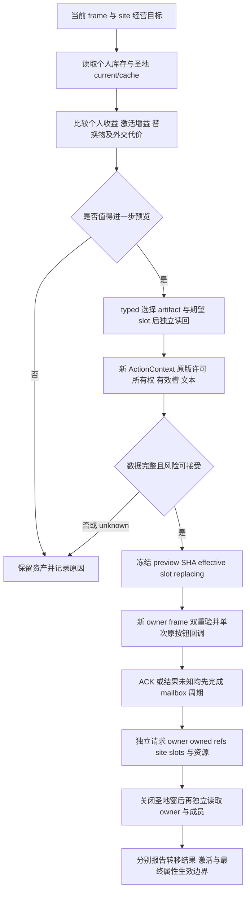

# 圣地遗物供奉与移除：动作观察、typed UI 与决策合同

本文把一期拍摄中“采用圣地后如何经营”转为可供游玩智能体使用的输入、决策和后验流程。目标 CK3 **1.20.0.4 / build 25734779**，EXE SHA-256 `98702f88a547cde2eaf29a85f93b85f68ee4cf8148336a4f7afaeb75319dd518`。本轮来源机器为 `machine_id: 4-8e1c2f1861`；实际读取 UTC、源码 SHA 和外置来源见[实现与来源索引](holy-site-relic-native-actions12004/implementation-contract.json)。记录时间是文档/源码检查时间，不是新实机时间。其他机器必须重新取得安装、加载与运行证据。

本页包含已绑定原版来源的机制知识和新候选的接口合同。**新动作是否具备运行资格，以独立[资格记录引用](holy-site-relic-native-actions12004/qualification-reference.json)为准**；不在本文填总通过数，不用静态反汇编、owned fixture 或 MCP ACK 追认供奉/移除实机成功。既有基础输入见[遗物只读口](holy-site-relic-readonly-mcp12004.md)与[候选/许可口](holy-site-relic-native-permissions12004.md)。

## R5 给规划器的已知局面

同机 R5 的保留原生前后态证明：faith50 实际采用 site32（Nadjaf），新增的是普通关联，库存仍为空、有效 rarity 总和 0、Active=false；控制 site14（Baghdad）有 artifact64，rarity2，原生 current 总和 2、缓存和 current 都 Active=true。R5 采用后虔诚实际减少 1000，既有五个 site DTO 没有改变。观察为 R5 当时状态，不能外推为后续场次的当前局面。

原审计时间为 `2026-10-17T12:05:27.062612+00:00`，`run_id: 4-8e1c2f1861--faith-and-power--R0005`；实际 receipt 的 SHA 和精确起止时间见[小型 R5 证据索引](holy-site-relic-native-actions12004/live-context-r5.json)，以及[采用专题](faith-and-power-episode01-r0005-adoption.md)。`12:35:46.426093Z` 的 Root 闭场记录证明屏幕释放序号 11345，与采用后态是两类证据。`r5-normal-exit-query-a02.json` 是计划，不作为退出或后态证明。

智能体应据此形成两个不同问题：site32 缺的是实际可用圣物和收益观察；site14 已有有效贡献，取出 artifact64 可能损失现有收益。不能由“已采用32”推出“32已激活”，也不能只为镜头效果把14的最后有效圣物当免费可撤回资产。

## R6 新增的真实 partial 与候选规划价值

本 a03 将 R6 原权限 partial 与后续 raw read probe 分层封闭；以下段落只引用权限原包，不把后续 probe 或修复混入本次读数。原包实际区间为 `2026-10-17T14:05:34.781657Z`–`14:05:35.200388Z`，机器 `4-8e1c2f1861`、run R0006、玩家15893、faith50、date_raw51394920、public revision6/native revision5；机器归属由显式 R6 identity allocation 与 Root run review 的 exact SHA 绑定，原单条 native receipt 未内嵌 machine_id 的事实保留，不能靠目录名字追认。[精简事实和原 SHA](holy-site-relic-native-actions12004/live-context-r6-partial-a03.json)保留了完整实际列表及失败诊断。

这包请求 **site14 / artifact64**，真实玩家 owned refs 原序为 `188,189,237,267,277`。针对 site14 当时县主 faith 的原生 candidate predicate，对237、267、277实际 true，对188、189实际 false，所有五条求值均 known。artifact64 的实际 HolySite owner 为14、rarity2，player owned refs 不包含它，site14 原始槽0中为64。owned 列表和候选求值已形成新的实机规划输入；它们既不是 GUI 缓存猜测，也不是新 actioncontext fixture。

这让智能体可以先比较现有个人物品237/267/277的个人收益、对目标site32的**另行实际**候选/许可和原版效果预览，而不必把“先从Baghdad取出64”当成获得圣物的前提。当前三个 true 只属于本次 site14 的候选语境，不能平移为对site32已合法，也不能因为自有物品较多就忽略个人装备机会成本。

窗口域实际 `available=false`，reason 精确为 `holy_site_window_registered_owner_unavailable`；显式64的 CanEnshrine/CanRemove 和当前按钮均未观察，value为null，不是false或true。根 available=true 只证明可读取的独立库存/候选/物品诊断存在，**没有任何供奉或移除已获许可的结论**。下一步先解决并实际读回注册窗口绑定，再读取完整许可、有效槽、替换物、owner/owned/equipped与效果文本；后续 probe 和修复证据另行分层，不追改这个实际 partial。

### 同场窗口绑定 probe 与原构造语义

Root 后续实际只读 probe 发生于 `2026-10-17T14:18:15.309149Z`，机器4、PID21920/create1792244644.324554，前后身份和固定链均稳定，实际请求3408 B，callbacks/process writes/input均0。它证明这一场窗口 `+98` 指向 mailbox 的 `CInGameInterfaceIdler` owner；owner`+10` 是不同的 `CIngameInterfaceIdlerGfx` 完整对象，所有已观察 complete-object offset 为0，独立全局路径和 mailbox 路径解析到同一 handler。旧 probe 字段名 `window_gfx` 是历史标签，不能再据名字把 `+98` 解释成 Gfx。[分层证据与完整 SHA](holy-site-relic-native-actions12004/window-binding-source-review-a03.json)保留实际原包，未把失败改写为成功。

既有冻结原版包进一步绑定了完整构造和调用方：`B0EA60..B0EAEC` 从 handler`+40` 取构造第二参数，第三参数为 handler；`17D4D40..17D4EF4` 将第二参数存到 window`+98`、第三参数存到`+A0`。对应写入为`17D4DAB`和`17D4DB2`。原调用合同和当场 RTTI/指针样本共同支持把误比 Gfx 的守卫修正为实际 owner 绑定；本轮没有声称穷尽全部`+98`下游消费者，也没有为这个结论扫描整EXE。

`research-plan-a01.json` 与实际`--for-observation` check 的小记录一起入索引：check 读取5份证据、issues=[]、结构一致；它明确只检查结构/文件完整性，不验证语义，不代替原生执行授权或许可资格。Root报告该check实际exit0，审阅线程没有重新执行。

**raw pointer/RTTI probe通过不是修复后的许可通过。** 当刻窗口选中的artifact为`FFFFFFFF`、slot为空；即使后续修正绑定，当前按钮也可能因没有选择而false，不能和显式artifact64的CanRemove混同。修正后的原Can、按钮和效果文本仍要在新的真实资格调用中分别观察；这里没有任何供奉/移除获准、排队或完成结论。

## 新只读 ActionContext

候选 MCP 名称为 `ck3_query_player_holy_site_relic_action_context_v1(expected_revision, holy_site_id, artifact_id)`，两个对象 full ID 必填。wire step 为 `query-player-holy-site-relic-action-context-v1`，domain 为 `player_holy_site_relic_action_context_v1`；独立 opt-in 为 `allow_private_player_holy_site_relic_action_context_query` / `--private-player-holy-site-relic-action-context-query`。公开 revision 必须由真实 Driver 转为该 snapshot 的 native revision，不能假定两者相等。

生产 reader 复用暂停的 religion owner callback，完整嵌入 permissions；不选择物品，不刷新 GUI 候选，不提交 command，不推进日期。`evaluation_context` 明确 `window_selection_written=false`、`world_cache_written=false`、`gameplay_command_submitted=false`。这里的只读指没有主动写入业务/选择，并不保证整个进程或脚本 RNG 零副作用；MCP 标为非幂等，异常后不自动重试。

| DTO 域 | 真实含义 | 决策用法 |
| --- | --- | --- |
| `permissions` | 当前玩家库存、候选、显式 artifact 的原版许可、真实窗口选择和当前按钮谓词。 | 显式物品许可与当前所选按钮分别判断，避免把另一选择的 false 当作该物不可用。 |
| `artifact_ownership` | artifact 身份、Character/HolySite owner、rarity、玩家 owned-reference membership、玩家和 site 的原生 equipped-slot membership。 | owner、所有库存引用、装备是独立条件；只有各自实际可用时才能用于前置或后验。 |
| `destination` | `action_kind`、当前选中槽、显式类型兼容、是否调用原 picker、effective slot、replacing artifact 及其所有权。 | 对供奉区分空槽与替换；对移除 effective/replacing 为 null。`available` 与 reason 必须一起读。 |
| `selected_artifact_matches_request` | 当前真实选择是否等于请求物品。 | false 时不为请求物品生成别人的文本或 preview identity。 |
| 三个文本域 | `selected_action_effect_description`、`enshrine_disabled_tooltip`、`remove_disabled_tooltip`，各自 available/text/reason。 | 完整效果和两个禁用原因不是同一文本；不可用不等于无代价，空字符串也不自动代表零风险。 |
| `preview_identity_sha256` | 当前规范化 ownership、destination、文本和原许可/按钮观察的身份。 | 作为下一次动作请求的冻结相等性条件，不能当历史动作资格或效果执行凭证。 |

当前 serializer 的 owner ID 将已观察到的 `FFFFFFFF` 输出为 null；对象解析失败和读不到 owner 需看 `available` / `object_resolved` / reason，不能只看 null。`destination.replacing_artifact_id=null` 只有在 destination 已实际可用且是供奉时才可解释为空槽；没有合法目的槽会返回 unavailable reason。替换物 full ID 失效不应被规划器视为无替换风险。

a02 的 preview identity 在 date/player 之后新增 `permissions.player_faith_id`，native 与 Python 必须同时采用新规范串；旧 a01 哈希不得作为新版本请求身份。reader 在描述求值前后重新核玩家 Character、rite full ID/对象指针和该 rite 的 faith ID，变化即整帧 unavailable。preview identity 不纳入 transient capture_epoch；同一个只读请求和后续动作拥有不同 owner callback stamp。实际动作另核 connection generation、native revision、日期、玩家、暂停/TLS owner 帧，并在本次 callback 内重新取得和比较两份完整 proof。哈希一致不能抵消帧不一致。规范串由 native 与 Python 分别重建，保持原字段顺序、Unicode 和控制字符转义；具体字段见[实现合同](holy-site-relic-native-actions12004/implementation-contract.json)。

## 所有权、owned refs 与 equipped

精确原版来源区分三件事：

| 观察 | 原版来源 | 不能替代的条件 |
| --- | --- | --- |
| Character owner | artifact `+78`；`252FECC` 写入新角色，`253045E` 清空。 | 不能仅凭 owner 推断该角色当前 owned-reference 列表真实包含该 ID。 |
| HolySite owner | artifact `+7C`；`252FE59` 清空，`253046C` 写入新 site。 | 不能仅凭 owner 推断物品在目标 site 的当前装备槽中。 |
| Owned/reference member | Player Inventory `+58` 的 4B full ID 序列，count 在 `+64`。 | 这不是装备槽，也不是跨世界物品搜索。 |
| Equipped-slot member | `bool 22E4420(const Inventory*, const Artifact*)`，第二参为指针，内部读取 artifact `+10` full ID，遍历 `+40/+4C` 的 24B 槽。 | false 不表示角色没有该物；仓库中未装备物可以是 owned=true / equipped=false。 |

reader 验证两个非空 owner 的 full ID 代际，并拒绝 Character/HolySite 两类 owner 同时非空的不一致状态。真实 Character 库存必须绑定当前角色的数据组件；const `28AA810` 对空组件会返回 TLS/static fallback，不能冒充真实库存。此轮没有宣称找到一个命名 `Artifact.GetOwner` 的独立纯 getter；字段与原版写入代码足以绑定读取。

供奉生产 proof 要求：Character owner 是玩家、player owned refs 包含物品、HolySite owner 空、原 CanEnshrine 与当前按钮均 true。a02 还要求 `current_candidates.evaluations` 至少出现一条请求 artifact 的记录，并且该 full ID 的每条重复记录均 `available=true && can_be_candidate=true`；任一重复项未知/false 都拒绝，不能只挑一条 true。其他 artifact 的 unknown 不要求整表 known，也不能偷换为 false；本次动作只收窄到请求物品。移除生产 proof 要求：HolySite owner 是目标 site、原生 site equipped member true、原 CanRemove 与当前按钮均 true；**移除前不要求玩家已拥有该物**。这些是动作口的前置绑定，不能倒写成原裸 CanEnshrine 自己已经验证全部所有权。

## 显式槽、fallback 与替换

原 guard `29AB4F0` 的 `29AB5ED..29AB6B5` 没有一个可直接调用的组合 getter。新 reader 以源绑定方式读取原显式分支，fallback 实际调用 `int32_t 2C805E0(const Inventory*, const Artifact*)`，方法字段固定为 `source_bound_explicit_slot_branch_then_original_native_picker`。

显式 index 必须属于当前真实 site 的 slots。类型兼容为 SlotType `+209` 非零，或两项原字段交叉相等：`slotType+44 == artifactType+40` 且 `slotType+40 == artifactType+44`；ArtifactType 指针来自 artifact `+B8`。不依赖汉化名或 Python 自创分类。显式有效且兼容即优先接受，**不要求空槽**。

显式不兼容或没有选择才调用原 picker：按原顺序优先首个兼容空槽；没有兼容空槽时选择兼容占用槽的最低 native rarity，同 rarity 保留更早槽。无兼容槽返回 `-1`。因此 GUI 选中槽与 effective 槽可能不同，供奉可能实际替换另一件物品。完整原 picker 无调用、分配、TLS 和世界写入；它只检查类型兼容，不检查槽位脚本许可。

后续原 `22E44A0` 会遍历全部符合类型/占用条件的槽，任一 `30FE7B0(slotType,site,null)` 的 `can_equip_holy_site` 通过便返回 true，**没有把这项脚本许可单独绑定到 effective index**。DTO 所以固定 `effective_slot_script_permission_independently_observed=false`。不要根据 CanEnshrine=true 编造该单槽脚本检查结果。

完整字节范围、ABI 和 loaded-code prefix 是不同证据，见[原版 ABI](holy-site-relic-native-actions12004/source-abi.json)、[来源 pins](holy-site-relic-native-actions12004/source-pins.json)、[loaded-code prefix manifest](holy-site-relic-native-actions12004/loaded-code-prefix-pins.json)。prefix 匹配不是完整函数等价，也不是业务后态。

## 原版文本、CE/CF 与代价

当前完整效果文本由 `HolySiteWindow.GetSelectedActionEffectDesc` 提供：注册 name-load `2D3083` → callback `17D8C80` → `NativeString* 17D6990(window*, out*)`。两个按钮禁用 tooltip 分别为 `17D5A60` / `17D5F60`。沿用原生 32B string 的构造、SSO/heap 读取与 `856050` 销毁，不把 Python buffer 当 native string。

`17D6990` 在供奉分支对新物生成 on_action index `CE` 描述，发生替换时再对旧物生成 `CF` 描述；移除生成 `CF`。helper `17D7240` 绑定 holy_site、actor、replacing scopes，调用 `245DE80` 生成说明，另描述县和 faith modifier 的潜在变化。它使用脚本上下文和临时对象；本轮没有封闭所有深层 trigger、modifier 和 RNG 分支。已知 bridge 自身不走命令提交入口，**未知脚本 RNG 副作用**，所以不能宣称查询幂等、零写入或由文本证明效果已生效。若两次 proof 的文本变化，动作应拒绝并留下观察差异，不能丢掉文本比较来放行。

规划器需要保留以下风险，原文件与行号在[脚本来源小索引](holy-site-relic-native-actions12004/script-risk-sources.json)：

| 风险 | 原版来源和静态含义 | 运行时必须补充 |
| --- | --- | --- |
| 个人物品机会成本 | S17 第42–43行、S18 第248行；供奉将物品从角色 owner 转给 site。接收器 `2530300` 实际转移，替换/移除可能以 `252FDD0` 交给 actor。 | 原物和替换物 owner、owned refs、装备槽；个人失去的装备收益不可由 rarity 代替。 |
| 虔诚/奉献经验 | S14 第167–243行供奉、385–398行移除；后者为 `add_piety_and_experience`。S15 对应 rarity 基值50/100/250/500及负值。 | 当前选中物的实际原版说明；动作前后 piety、经验和其他资源原值。基值不是无条件本次账单。 |
| 替换奖励条件 | S14 第137–155行的 `replacing_with_better_artifact=no` 条件是旧认可物 rarity>=新物，第158–165行奖励分支却要求该值 no。注释与直觉有张力。 | 不按注释自行修正规则，不承诺“更好的圣物必得虔诚”；以当前原版 preview 和独立后态为准。 |
| 关系 | S14 第245–295、355–383、401–522行按当前 faith、宗教领袖、狂热/少数派封臣、同僚和上级筛选；S16第111–120行移除-20/供奉+15，10年衰减。 | 哪些实际角色满足条件、原有修正和本次差值；静态数值不等于所有人都会受影响。 |
| reclaim relic CB | S14 第462–522行、S17第98行描述认可该物的他教统治者可能获得 CB；第462行 else_if 无显式 limit。 | 原生显示和目标角色实际状态；tooltip 本身不证明所有 CB 已创建，自己的 faith 不承认也不代表无外交风险。 |
| 圣地/全信仰 modifier | S17第44–45行描述有效 rarity 变化；最后有效圣物取出可能使 site 失活。 | actual current rarity、cached Active、受益者与最终属性生效各自独立观察；缓存刷新时间仍 unknown 时不能补写“已加成”。 |

未见本组脚本直接扣金币，不代表所有深层事件或 mod overrides 的总金币影响已证明为零。移除与重新供奉是两次带独立代价的动作，不能称作免费 undo。

## typed UI 请求与守卫

新候选复用共享 `IngameUiOperationV1` 的四项操作，公开输入是 full ID、slot index 和冻结观察，不接受内存指针、owner/TLS admission、`source_qualified` 或 `live_qualified` 自报值。完整公共 MCP schema/部署状态仍以资格记录为准，本页的 wire 字段来源是当前 C++ parser/API。

| 操作 | 原版入口/输入 | 成功判断 |
| --- | --- | --- |
| `select_relic_artifact` / 100 | `relic_artifact_id`；仅来自真实当前 site slots 或窗口候选。调用 `17D52B0`。 | 独立读回 artifact 选择相等、原 slot 选择保留、物品槽内容不变。 |
| `set_relic_slot` / 101 | `relic_slot_index` 与 `relic_desired_selected`；由当前 site 原数组解析指针。需要改变才调用 `17D52F0` toggle，不传 null。 | 读回目标槽 selected 状态符合请求，artifact 选择和槽内物品不变。已经符合时不再 toggle。 |
| `enshrine_relic` / 102 | `relic_artifact_id`、`relic_expected_effective_slot_index`、`relic_expected_replacing_empty`、必要时 `relic_expected_replacing_artifact_id`、`relic_expected_preview_sha256`。 | 只能得到原按钮 callback 尝试/ACK；业务后验是后续独立请求。 |
| `remove_relic` / 103 | 物品 full ID、`relic_expected_replacing_empty=true`、preview SHA；不传 effective slot/replacing ID。 | 同上；取出前不要求角色 owner 已是玩家。 |

`relic_expected_replacing_empty` 显式区分空槽和缺省参数。若为 false 必须传真实替换 full ID；不能传 `FFFFFFFF`。64字符十六进制 preview SHA 是本次观察身份，不是用户任意确认字符串。

在精确 EXE/loaded-code pins、当前 owner 主线程/TLS/暂停帧、无阻挡 modal、真实注册 holy_site_window、当前玩家/site/full ID 和 slot 表稳定之后，选择操作还需前后读回。Gameplay 操作另由独立 build opt-in `XAR_ENABLE_HOLY_SITE_RELIC_BUTTON_ACTION12004` 安装生产 preview adapter；`gameplay_action_lane_enabled` 只是配置允许本轮尝试，不表示历史业务验收通过。

动作还必须找到当前真实唯一可见、enabled 的原按钮，验证真实 callback 表达式和 GUI context；仅原 predicate=true 不够。供奉/移除分别通过 `17D5970` / `17D5E40` 重验，双读 preview/proof、presentation 和选择完全相同后，仅一次调用原 `OnEnshrineButtonClicked 17D5DD0` / `OnRemoveButtonClicked 17D62F0`。不直接构造 command、不调用最终 mutation receiver。

`PreviewProof.source_qualified/live_qualified` 在此指当前生产绑定和当刻观察成立，不代表过去某场动作已经通过；注入依赖不能自动授予这两个属性。原 `29AC540/640` 是 clone，`37F06D0` 是入队；真正 mutation 位于 secondary command 接口 `this=primary+18`。这些地址是来源解释，不开放给调用者作为绕过按钮的通路。

## 智能体的完整计划与后验

智能体每步均记录目的、备选、机会成本和原生证据。可供奉不等于值得供奉；rarity 高不等于总收益高。已有有效 site 的最后圣物、重要个人装备、他教认可物、未知替换物应进入计划风险项。不能为完成拍摄省掉普通规划器，也不能把停止查询称作完成经营目标。

Gameplay callback 返回后，当前 `Result` 始终 `business_outcome_observed=false`、`action_ready=false`。`dispatch_invoked` 与 `gameplay_command_may_have_been_queued` 只表示尝试，`after` 仅是选择读回。`dispatch_result_unknown`、attempted 后异常或 verification_pending 时，先读状态，禁止重复提交。

独立后验至少比较：请求物 owner 从玩家变为 site（供奉）或 site 变为玩家（移除）；相应 owned refs 增减；effective slot 中实际物品；替换物 owner/refs/旧槽变化；实际资源和经验差值。再读 current rarity、cached Active 与不一致情况。最终县/角色属性和受益者未读到时，保留 unknown，不用 rarity 或预览推算“已经兑现”。

**闭窗后验必须独立存在。** 新 ActionContext 当窗口缺失/不同 site 时仍可返回已绑定对象的 owner、玩家 owned refs、site equipped 成员；destination 与当前选择文本不可用，不授 preview identity。用这个路径或同等独立原生域证明物品实际归属，不能因按钮点击后窗口自动清选择、关闭或换页而把后验缺失包装为成功。对于替换，新旧两件都需单独按 full ID 读回。

## 资格与资料时效

新 owned fixture、真实 Driver→Service→MCP 消费、实际 DLL 加载、typed UI 选择、原按钮单次提交和闭窗后验是不同层次。a02 新原始 native 结果/source freeze/packet manifest 的精确引用在[独立窄 review](holy-site-relic-native-actions12004/source-review-a02.json)；a01 文档包和其 pending 资格引用作为历史原样保留，不充当 a02 源码的资格。最终 `qualification.json` 只由控制线程另行封闭，本增量包不创建或填充它；后续控制线程封闭该记录后再决定哪些动作开放。本文不会将旧 readonly/permissions 或 R5 的采用成功抵扣新 relic actions 资格。

新原始段留在外置 source-slot；仓库候选仅固化小型 ABI、范围/完整 SHA、prefix manifest、相关脚本行号与实现合同，不复制全部 ASM/section cache/EXE。2026-10-24 UTC 前复核本轮活跃保护，或在 EXE、GUI、原版脚本、DTO/typed UI 合同变化时立即复核；资格引用与机制摘要按统一存储策略归档，派生原包按实际用途和可重建条件回收，不无期限续存。

本 a02 增量只更新文档、当前实现源 SHA 和独立窄 review；原版 ABI、原始来源 pins、loaded prefix manifest 与 R5 小证据沿用 a01 的相同字节。审阅没有新增运行或 fixture 执行。canonical 绑定 faith，但未加入 rite ID；rite 在每个实际 owner callback 内前后核稳，不能把哈希解释成冻结历史 rite 的通用凭证。`NativeText` 若在原 getter 内异常退出会 fail-closed，当前没有对可能部分构造的 string 执行析构恢复；不重试该原调用，也不宣称无临时分配残留。

a03 的[最终源码权威指针](holy-site-relic-native-actions12004/final-source-manifest-reference.json)明确等待控制线程封闭 `final-source-manifest.json`；本文不以正在修改的其他线程源码重冻替代最终身份。a01/a02 的 implementation-contract 与所有旧包保持原样，属于当时审阅记录。最终源码、构建和实机资格以控制线程的实际 manifest 与 qualification.json 为准。

## R7 后续选择准备补充

R7 供奉后原回调清空 selected artifact；所选槽不等于所选圣物。现有 typed 选择可直接选择本站真实槽中的物品，无需它仍在玩家 owned 候选列表。[原版 GUI 两个 onclick、真实原包及智能体后续规则](holy-site-relic-r7-selection12004.md)已闭合；没有放宽原版权限或预览守卫。
