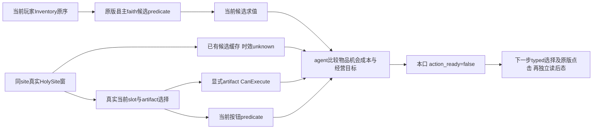

# 圣物候选、许可与供奉试拍施工口

machine_id: `4-8e1c2f1861`。2026-10-17 UTC在外置 `episode01/relic-candidate/permission-candidate-a01`完成原版静态来源及独立源码/fixture验证，精确时间、SHA和资格见[本轮回执](holy-site-relic-native-permissions12004/qualification.json)。目标CK3 1.20.0.4/build25734779、EXE SHA `98702f88a547cde2eaf29a85f93b85f68ee4cf8148336a4f7afaeb75319dd518`。没有改主树或a03冻结source/build，没有CK3、Steam、屏幕操作，没有新DLL部署或实机资格。

同机R5已实际完成采用：faith50新增site32、普通关联，空库存且Active=false；Baghdad14有artifact64、rarity2、Active=true。来源是Root保留的R5原生前后态，复读索引与逐原包SHA见本轮回执，不能以静态研究追认其他机器。R5的采用证明没有消除供奉试拍缺口，也不证明供奉/取出能力已存在。

新口为 `ck3_query_player_holy_site_relic_permissions_v1(expected_revision, holy_site_id, artifact_id=None)`。独立默认关闭opt-in和[Python消费合同](holy-site-relic-permissions-python12004.md)配套。底层仍复用宗教owner mailbox及 `XAR_CK3_ENABLE_G2_PLAYER_RELIGION_CONTEXT_PRIVATE_QUERY_V1`，没有新native flag。显式artifact许可和窗口当前按钮始终分开；未请求artifact不代选，不读任意地址。

| 返回域 | 实际来源 | 规划边界 |
|---|---|---|
| `player_inventory` | 原版`28AA890(current_player)`，核character+1B0的数据对象与+458实际Inventory、原始完整引用序列及owner字段。 | 完整代际、顺序、重复均保留；不是world roster或圣地库存。该getter可能初始化TLS/static默认上下文，不能宣称进程零写入。 |
| `window_context.cached_candidates` | 真实`CHolySiteWindow+130`缓存，核注册窗口、owner/gfx/root、selected site、实际InventorySlot指针。 | 原producer`17D7CD0`会清写这个数组；只读口不触发它。时效unknown，不能当最终许可。root存在不等于窗口像素可见。 |
| `current_candidates` | 遍历当前玩家Inventory原序，每件解析后调用原版`2531200(artifact,site,null)`，保持县主faith语境。 | 等价于producer的该段来源与filter，没有刷新GUI数组。任一对象/调用未知时最终候选列表null，已知逐项结果仍保留。空真实Inventory才可返回空数组。 |
| `artifact_permissions` | `17D53F0(window,artifact)` / `17D56F0(window,artifact)`原版CanEnshrine/CanRemove。 | 绑定当前全局actor、site、selected slot；false无完整失败文字。任意物品的raw wrapper true未独立证明玩家拥有它。 |
| `current_buttons` | `17D5970(window)` / `17D5E40(window)`原版按钮predicate。 | 仅针对window+108当前artifact，额外核artifact+7C当前HolySite owner；`context_matches_requested_artifact`避免把另一选择的false移给请求物品。 |

空selected slot表示原生自动选兼容槽；原生可fallback到别槽并替换旧物。`selected_slot_index`仅是当前GUI选择，**没有观察有效目的槽、替换物、失败文字、费用/效果preview或受益者**。这些继续unknown，`action_ready=false`。当前原始引用中的物品不一定可供奉；许可true也不是提交、排队或后态。

实现只从既有paused应用主线程宗教owner callback借用指针；按完整ID核storage代际和magic，原版getter入口前32B及command vtable的CanExecute槽需与固定来源匹配。源代码包的full-body SHA与这些loaded prefix checks是不同证据。结束时重新核actor/faith/site、Inventory表头/原序、slot表、窗口选择/缓存以及已解析artifact身份和已读target元数据；FinishQueryMailbox还核原生frame/revision。没有跨reload保留指针。深层script RNG效果unknown，因此MCP非幂等，不自动重试getter异常。

[完整原版guard与执行来源](holy-site-relic-native-permissions12004/guard-contract.md)闭合了最终CanExecute：先按县主faith认可，再找兼容slot/替换物、库存装备许可与compiled供奉/移除rule。`29AC540/640`只是克隆；`37F06D0`只是移入队列。真正变更receiver位于secondary接口`command+18`的vtable+8：供奉`29AADE0`、移除`29AB8A0`。它们绝不进入只读通道。完整队列消费调度、重验顺序、最终业务回执仍未在本窄包闭合，不用地址代替业务资格。

对既有游玩agent，下一窄流程是先在新冻结DLL中取得此只读口实机原包，比较site32经营需求和site14已有贡献，再决定保留个人圣物、供奉新物或研究取出。未来typed UI复用原版`SelectArtifact 17D52B0`与`ToggleSelectedSlot 17D52F0`：后者是toggle，null是no-op，不是可盲重试的setter；必须由本帧site/slot_index解析地址、按期望状态决定是否调用并独立读回。只读观测不为截图造选择。

后续最小action应沿原版按钮caller重验、一次提交，并独立读取artifact owner/slot、玩家库存、Active/有效总等级及真实资源/效果；未知结果先查状态，不重复提交。取出最后有效圣物使用可恢复分支，移除代价与供奉替换均须原生preview/脚本来源和实际后态，不包装为免费undo。此要求不以复原整个manager为前置，也不把本页或图卡代替第二条实机原片。

本轮只跑新permissions target及其生产serializer12包，没有重跑旧context28/9/4资格。独立MSVC `/W4 /WX`、32 native checks、真实Driver→Service→MCP的4 tests/0 skip、12正包和11个人工变异拒绝均有实际回执；注入getter不证明CK3引擎/TLS/trigger运行。新生产mailbox分支独立编译为对象，不等于整DLL已链接。首次编译的长对象路径与两处warning失败原样保留，后续短自有build通过。

来源与代码在2026-10-24或EXE/GUI/相关script SHA变化时复核；外置派生build在Root合入核验48小时后按统一存储策略复核。当前保留理由是一期第二试拍施工、动作缺口和失败纠正，不能无限保留重复源码/包。

## 2026-10-18 V5 好感条件后继导航

[好感条件完整表与作者候选](holy-site-relic-opinion-conditions12004-v5.md)补充供奉、同档/升档/降档替换与单独取出时的逐组关系筛选、好感方向、官方术语及同名修正刷新期限。原始脚本摘录和逐源 SHA 已随新页保存；旧表、旧 JSON 与当时知识状态保留。空槽 `scope:replacing ?=` 判断及实际净好感仍按新页的精确未知边界处理；本补注没有新增游戏、自然 AI 执行或口播连续审读资格。机器 `4-8e1c2f1861`。
