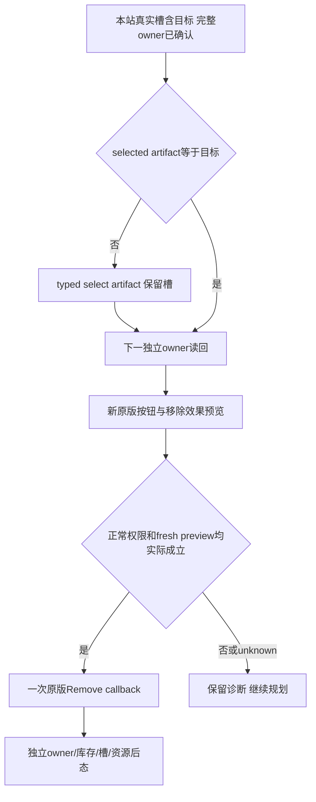

# 供奉后的移除准备：圣物选择与槽位选择是两个状态

machine_id: `4-8e1c2f1861`。本次离线核对时间为 2026-10-17T15:50:52.287434+00:00，实际原件属于 R0007、玩家 15893、日期 raw 51394920、圣地 32、圣物 237。源码基线为 `b8be8ca6cb9cc01297a2a6bd318c9b6e09847c2c`；CK3 1.20.0.4 EXE SHA `98702f88a547cde2eaf29a85f93b85f68ee4cf8148336a4f7afaeb75319dd518`。冻结 DLL 输入 SHA `13126d50051490c29f1c82cf2fd3f1050d8e501c727805f78daf22140a6987ef` 来自 R7 frozen-argv；本离线核对没有重新读取游戏进程或认定新 loaded-code 资格。[原件摘要](holy-site-relic-r7-selection12004/actual-contexts.json)记录每份原包 SHA、capture epoch 与来源；[原版来源](holy-site-relic-r7-selection12004/source-review.json)绑定完整 native 原包、叶函数字节和 GUI 文件/行。

R7 的独立前后观察显示，237 从玩家 owned IDs 转入圣地 32 的实际槽 0，原生 owner 从角色 15893 改为圣地 32。随后 `set_slot(0, desired_selected=true)` 的后态确实选中了槽 0 及其圣物 237，但窗口的 selected artifact 仍为空；显式 `CanRemove(237)=true`，当前 Remove 按钮却为 false，效果文字因 `current_selected_artifact_differs_from_request` 没有读取。这些结果互相一致：请求圣物、槽位选择、圣物选择和当前按钮各自有独立来源。

| 状态 | 原版来源 | 不能替代的观察 |
|---|---|---|
| selected artifact | `window+108`；原 `17D52B0` 从完整 artifact 的 `+10` 写入 fullID | 不能由所选槽或候选列表推定 |
| selected slot | `window+110`；原 `17D52F0` 仅切换真实槽指针 | 不会自动写 selected artifact |
| selected slot artifact | 当前本站真实 24 字节槽行的 `+10` fullID | 不等于 `window+108` |
| explicit CanRemove | 对请求的完整 artifact 对象运行原许可 | 不等于当前选中状态的 Remove 按钮 |
| Remove/效果预览 | 原 `17D5E40`、`17D6990` 先读取 selected artifact `+108` | 不能使用旧供奉 SHA 或空选择制造移除预览 |

供奉原回调 `17D5DD0` 在完成原窗口更新后于 `17D5E29` 主动清 `+108=FFFFFFFF`；移除原回调也会清该字段。因此业务动作后 selected artifact 为空是原版预期状态，不能仅凭它判定业务失败。

原版 `window_holy_site.gui` 的完整 SHA 为 `23542c54dd73b0c349e008649f201b1459ef833070fb6071e089dcd210642fb2`。已填槽按钮第 926–927 行声明两个 onclick：先 `SelectArtifact(Artifact.Self)`，再 `ToggleSelectedSlot(InventorySlot.Self)`；第 931 行的 down 状态是两种选择的 OR。空槽按钮第 1041–1047 行只切换槽。MCP 的 `set_holy_site_relic_slot_selection` 承诺的是期望槽状态，不能把它当作一次原版已填槽按钮的完整点击。

## 游玩智能体的决策规则

对于移除，先独立确认 artifact 的 HolySite owner 是当前本站，且本站真实 equipped 槽包含完整目标 ID。玩家 owned IDs 中没有该物品是供奉后的正常状态。现有 typed `select_artifact` 的可选条件先查当前本站真实槽；命中后直接成立，只有未命中本站槽时才查窗口候选。因此 237 退出个人候选池不会阻止从已供奉槽重新选择它。这项选择仍保留 fullID/magic、当前玩家、owner、窗口/root、本站槽与前后稳定守卫。

当前 R7 已选择槽 0，最窄后续步骤是：

1. 从新的公共 snapshot revision 发一次 `ck3_select_holy_site_relic_artifact_v1(holy_site_id=32, artifact_id=237)`，保留原槽选择；不要再相对 toggle 槽 0。
2. 在下一独立 owner 请求读回 selected artifact 237、selected slot 0、slot artifact 237，以及原来的 owner/真实库存。
3. 重新查询 action-context。只在当前原版 Remove 按钮实际 available/true、所选 artifact 匹配、移除 destination 与全部原版文字可读、fresh preview SHA 可取得时准备动作。静态来源不保证下一现场按钮一定为 true。
4. 移除请求使用这次新 SHA、`expected_replacing_empty=true`，不携带供奉 effective-slot 或 replacing-artifact 字段。正常可见 enabled 按钮、原版 predicate 和两次 preview proof 仍须通过，最多提交一次原版 callback。
5. ACK 继续记 pending。随后独立检查对象 owner、玩家 owned IDs、本站真实槽和资源；cached Active、稀有度与最终收益另行读取。命令后的选择清空不替代业务后态，结果未知时不盲重试。

一般策略是分别维护“目标物品已选中”和“期望槽状态已满足”两个条件，并按不满足的条件补齐现有 typed 动作。已填槽原 GUI 的复合点击可由这两个操作达到同一最终状态；不要在已经选中的槽上重放相对 toggle。

本次结论不需要修改原生接口、放宽守卫或制作 a06 DLL。此文只闭合 R7 选择准备缺口；它不声称后续选择、Remove、业务变化或新缓存收益已经执行通过。来源、EXE/GUI 或接口变化时应复核；外置派生资产按通用存储策略和当前有限保护期限复核。
