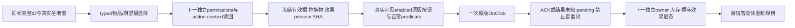

# 圣地圣物的 typed 选择与原版按钮动作

2026-10-17 R6 更正（machine_id: `4-8e1c2f1861`）：实际原生字段与完整构造 caller 证明 `window+98` 是外层 `CInGameInterfaceIdler` owner，`owner+10` 才是另一个 `CIngameInterfaceIdlerGfx` 完整对象。旧额外指针等式导致权限窗口不可用，现已在三处来源绑定入口修正；下列原 30/12 资格属于修复前保留基线。本次新针对性编译、13 个新原生包的真实 MCP 消费与尚缺的实机边界见[当前完整资格](holy-site-relic-native-actions12004/qualification.json)和[原版来源与真实 probe](holy-site-relic-native-actions12004/window-binding-source-review-a03.json)。这不代表修复后的原版 getter、供奉或取出已实机通过。

machine_id: `4-8e1c2f1861`。2026-10-17 UTC 在一期外置 `relic-candidate/action-candidate-a01/ui-stage`施工；实际观察时间、输入/产物 SHA 和构建回执见[资格记录](holy-site-relic-typed-ui12004/qualification.json)。目标为 CK3 1.20.0.4、EXE SHA `98702f88a547cde2eaf29a85f93b85f68ee4cf8148336a4f7afaeb75319dd518`。本轮没有游戏、Steam、屏幕或部署操作，没有修改主树或其他线程的 source/build。

新路径复用 `navigate-ingame-ui-v1`、`game.command.navigate-ingame-ui-v1`，窗口固定为 `holy_site`，`subject_id` 是完整圣地 ID。原来 0..13 的路径和有限决议字段仍保留；新 operation 编号为 100..103，创建圣地的 14..17 不属于此包。公共请求没有 native pointer、RVA、控件名称或 child path。

| operation | 额外请求字段 | 原生行为 |
|---|---|---|
| `select_relic_artifact` | `relic_artifact_id` | 完整代际/magic 解析，要求物品来自当前圣地真实槽或当前窗口候选缓存，再调用 `17D52B0(window,artifact)`。只改当前物品；保留已选槽。缓存的存在不证明当前最终许可。 |
| `set_relic_slot` | `relic_slot_index`、`relic_desired_selected` | 从本帧本站真实 24 字节槽表解析地址。期望状态已满足时不调用；否则以非空真实槽地址调用一次 `17D52F0`。不以 null 清槽，不盲重放 toggle。 |
| `enshrine_relic` | `relic_artifact_id`、`relic_expected_effective_slot_index`、`relic_expected_replacing_empty`、`relic_expected_preview_sha256`；替换非空时另需 `relic_expected_replacing_artifact_id` | 要求真实当前选择等于请求物品；由生产 preview 重新证明 owner、玩家 owned ID 序列成员、原生许可、实际生效槽/替换物和原生效果文字，再调用原版 `17D5DD0(window)`。 |
| `remove_relic` | `relic_artifact_id`、`relic_expected_replacing_empty=true`、`relic_expected_preview_sha256` | 要求本站 owner 和原生 equipped-slot membership、当前选择、正常许可及效果 preview；调用原版 `17D62F0(window)`。禁止供奉目的槽和替换 ID 字段。 |

ID 必须保留完整 uint32 且排除 FFFFFFFF；槽 index 为 0..4095，实际仍需小于本帧本站槽数。preview SHA 为 64 位小写十六进制，精确冻结当前效果观察身份。`relic_expected_replacing_empty` 为必填布尔；true 时禁止替换 ID 字段，false 时必须有真实完整替换 ID。各操作拒绝别的操作字段；非圣物操作拒绝所有这些 `relic_*` 字段。不能把省略、unknown 和 known-empty 混成 null。

所有操作先走既有 paused-map、application-owner、TLS、当前 snapshot/revision/generation、真实 GUI owner 和 modal admission。内部再次核 actor、完整对象代际/magic、CHolySiteWindow 双 vtable、owner/gfx/handler/root、窗口所选 site，以及 `window+110` 必须为空或指向当前本站真实槽。重新选择 site 后不会沿用旧 slot pointer。

按钮可见性独立于根窗口。当前原版 GUI 的 Remove、Swap、Enshrine 按钮是匿名控件。通过真实标准 click-expression census，精确匹配注册 callback `17D8A40 → 17D5DD0` 或 `17D8A60 → 17D62F0`，要求唯一可见且 enabled 的实例，再从固定 root 解析该次内部 child path、实际 widget/vtable/context，连续两轮保持一致；原版按钮 predicate 还会再运行。来源、GUI 全文件 SHA 和原片段见[按钮来源](holy-site-relic-typed-ui12004/button-source-contract.json)。根窗口可见或缓存候选存在都不能替代此证明。

供奉/取出接线使用独立生产 preview adapter：每次新建 source-bound bindings，从当前 actor/rite/faith 重建 context，读取同帧 `action-context`，核 loaded source pins、getter backend 和完整对象身份。供奉分别要求 artifact character owner 和玩家 owned reference 成员，不能把 equipped-slot membership 当 owned list；取出核本站 equipped-slot membership。所选/有效槽、替换物、效果 preview 身份与请求冻结值必须一致，连续两次 proof 及当前选择不得漂移。`source_qualified` / `live_qualified` 只说明本次生产原版 getter 在当前 owner frame 实际返回，不表示过去动作或业务已经通过。fixture 注入不得升级成生产观测。

构建开关 `XAR_ENABLE_HOLY_SITE_RELIC_TYPED_UI12004` 默认 OFF；原版业务按钮另有 `XAR_ENABLE_HOLY_SITE_RELIC_BUTTON_ACTION12004`，同样默认 OFF，并要求前者开启。生产 binder 默认不安装 preview reader、不启用业务 lane；导航仅在后一显式开关下安装真实 adapter 和实际按钮 presentation reader。`gameplay_action_lane_enabled` 是入口选择，不是历史业务资格。首次合法动作可由新鲜真实 preview 和正常原版按钮许可准入，不能把“以前已成功”设为首次实验的循环前提。

两个定义只写新源文件的 `SOURCE COMPILE_DEFINITIONS`：TYPED 仅 `actions.cpp`，BUTTON 仅 bridge 的 `holy_site_relic_navigation12004.cpp`；同文件用于旧 navigation test 时不会开启 BUTTON。不会用整个 bridge 的 compile definitions 触发既有巨大闭包重编。[小配置实测](holy-site-relic-typed-ui12004/source-flag-scope.json)逐项核对了 12 个生成编译命令，原 dummy、JSON/parser、adapter 与无关 target 均没有新定义；没有借此运行旧矩阵或游戏。

选择回调后独立读当前 artifact/slot，并保留 `verification_pending=true`；规划器还应在下一独立 owner 请求用 permissions/action-context 读回。已经处于期望选择时，`available=true`、`already_in_requested_state=true`，但 `dispatch_invoked=false`、`native_dispatch_attempted=false`，状态为 `already_in_requested_state_verification_pending`。没有调用 leaf 时不能伪造调用事实。

业务点击仅得到 ACK。结果永远保留 `business_outcome_observed=false`、`action_ready=false`；`gameplay_command_may_have_been_queued` 只在点击尝试后为 true。回调异常或结果未知时保留 `dispatch_result_unknown`、attempted 和 pending，不自动重试。下一独立原生后态必须核 artifact owner、玩家库存、本站 slot/库存和实际效果，才可由游玩智能体判断成功。UI 选择清空、调用返回、排队或数值缓存暂时不变均不能替代业务后态。本包不构造、克隆、直接 submit 或 Execute command，不修改采用条件或游戏资源。

本轮新窄 fixture 使用自有内存及显式注入依赖，执行实际 typed helper、有限 request parser 和 serializer；没有执行 CK3 引擎函数或原生脚本/TLS。原版 predicate/preview 深层 RNG 作用仍 unknown，不授幂等自动重试。真实按钮 provider、生产 preview adapter 和 action-enabled 接线只有独立对象编译，没有实机调用资格。

完整 command 包另以逐字隔离的 16 个生产纯函数/常量生成 TU，包括共享 request parser、`SerializeIngameUiResultV1` 和 `IngameUiCommandResultFrameV1`；精确源 SHA、byte spans 和生成 SHA 均保留。外层 owner/root admission 是明确注入的 fixture；正例由 C++ 原生产 formatter 产出，未用 Python 包装。这证明函数隔离编译和跨语言消费所需完整形状，不是完整 DLL 已链接或实机通过。首次直接链接原整 TU 遇到 27 个无关 runtime 符号的失败原样保留，没有扩跑旧矩阵。

源码/来源在 2026-10-24 或 EXE/GUI/相关原版脚本变化时复核；外置派生对象在 Root 合入核验后 48 小时复核。当前限期保留理由为一期第二试拍施工、完整 transport 与首次动作后态验收。
