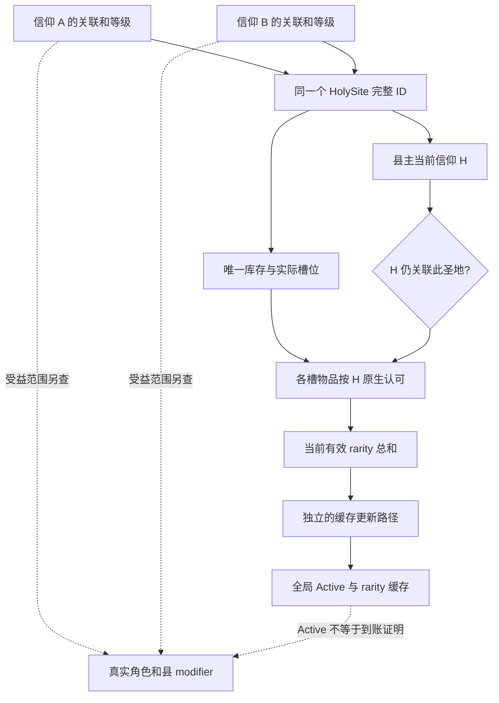

# 共享圣地与圣物价值：生效、换物及三种返还路径（1.20.0.4）

同一个实际圣地可以关联多个信仰，各信仰分别保存普通／主要等级，但它们共用一份圣物库存、同一组槽位和一组全局 Active／有效稀有度缓存。替换圣物会改变这个共同对象；旧物正常交给本次执行角色。主动取出也交执行角色，最后一个信仰放弃关联时的脚本退物却交给县主。把这三种路径混在一起，会让规划器错误估计收益、接收者和费用。

`machine_id: 4-8e1c2f1861`。本轮于2026-10-17 18:15 UTC起离线复核；精确文件读取时间、当前源码提交和原包SHA见[聚合证据](evidence/holy-site-shared-relic-value12004/manifest.json)与[核心来源](evidence/holy-site-shared-relic-value12004/core-evidence.json)。目标固定为CK3 1.20.0.4/build25734779，EXE SHA-256 `98702f88a547cde2eaf29a85f93b85f68ee4cf8148336a4f7afaeb75319dd518`。本次没有启动游戏、读进程、调用原生getter、构建或部署。R7/R8是同机器历史机制实验，所用准备内容和原source/DLL在各自文档披露，不能扩充为本轮新实测。

## 共享的是什么，分别保存的又是什么

| 层 | 准确身份／原版来源 | 对游玩规划的意义 |
|---|---|---|
| 世界圣地实例 | session＋HolySite完整ID；`265B000`解析全局storage `5D1DE80` | 同名地点不等于同实例；同一完整ID才引用同一对象 |
| 关联与等级 | site+98关联Faith；每个Faith+890保存全部圣地、+8A8保存主要圣地 | 等级键为 `(faith, site)`；A升主要不自动替B升级 |
| 物理库存与槽 | `BB6C50`返回唯一内嵌site+28；实际槽表site+68、24B/行 | 不得按信仰复制库存；B看见的同槽也会被A的合法换物改变 |
| 物品归属 | artifact+78角色owner、+7C圣地owner；完整ID分别解析 | 供奉后个人失去物品所有权，不能仍把个人装备价值计入资产 |
| 按信仰认可 | `2530EF0(artifact, faith_full_id, null)` | 键为 `(artifact, faith)`；动态圣化集合或模板compiled trigger任一路可使其true |
| 站点当前有效等级 | `265A3F0`逐实际槽，调用`2531320`再加物品+B0 | 依据县主当前信仰，不是“玩家认可的所有库存物品相加” |
| 世界缓存 | site+18 Active、+1C有效等级 | 一组全局值；缓存刷新时刻与实际modifier落地另行观察 |
| 最终受益者 | 当前角色／县的真实modifier消费者及实际值 | 认可、关联、主要等级、描述文字均不能单独代替到账证明 |

原生对象、receiver及picker的逐函数RVA／代码体SHA见[库存与替换研究](evidence/holy-site-shared-relic-value12004/native-sharing.md)及其[evidence](evidence/holy-site-shared-relic-value12004/native-sharing.evidence.json)。

## 为什么放着圣物也可能不生效

完整`2531320`先沿圣地barony→county→县主角色→个人礼仪→当前faith解析，并要求这个**县主信仰仍在该圣地的关联名单**，然后才问物品是否被它认可。`265A3F0`遍历真实已装槽，仅对上述有效物品累加对象rarity。owned引用里有物品，不等于它在槽里；物品rarity高，也不等于有效贡献高。

所以，A与B共享时：县主属于A，物品只被B认可，不能凭B的认可把它算进该站当前有效等级。县主改宗B后，要按B重新求值；B若没有关联该站，当前贡献也不能凭旧缓存延续。A退出而县主仍属于A、B还关联时，即使圣物仍在共享库存，县主信仰关联条件也会改变。这是需要在共享非空放弃补测里重点读取的状态。

当前读取与缓存落地必须分开：`29D8890..29D8A38`评估变化并暂存`(siteID,newSum)`；`29D8DD0..29D908B`后段将值写入site+1C及+18。库存添加／修改caller也可立即重算同两字段。完整上游时钟尚未闭合，不能说每天或每月刷新。只读查询不会主动写缓存；返回缓存／当前值不一致时，保留两套值与`cache_evaluation_disagreement`，继续独立观察。

这些源码闭合了“全局Active怎样产生”。进一步的实际modifier消费者研究已经查明另一个关键条件：全信仰producer`24FB270`要求请求Faith的主要圣地集合+8A8包含该站，并经`2441F30`严格比较**县主当前Faith完整ID等于请求Faith**。实际角色聚合`291C0B0→291F080`再从其当前rite修正表读取；当地固定修正消费者`291E3A0`另有Active检查。精确body SHA／边界由[实际消费者补注](evidence/holy-site-shared-relic-value12004/beneficiary-consumer-addendum.json)绑定，不重复拿描述函数充当来源。

因此，A与B共享、双方都主要，但县主属于A时，B不会因为自己主要、认可圣物或看到全局Active，就取得这处圣地的全Faith收益。B将来控制县主信仰，资格方向才可能改变；也仍须其主要关联及具体fixed／scaled修正条件成立。这里的“控制”是原版县主实际faith，不是玩家国境颜色、最高领主faith或地图县民faith。

**Active也不是所有效果统一的总开关。**完整Faithwide producer`24FB270..24FB8E0`取type+58固定修正及+3D8 scaled表达式，本段及县主faith条件`2441F30`均未见site+18检查；scaled是在HolySite scope求表达式，具体脚本可能通过有效rarity变量得到0。不能由GUI在Inactive时隐藏效果，就宣称所有Faith固定修正均停效。当地固定消费者`291E3A0`则明确检查site+18和角色Faith属于site+98。各域条件要逐条记录，实际净值仍以独立读回为准。

县级scaled实际producer`2864E40`另已确认要求Active和同一`2441F30`县主faith条件，不要求主要等级，求type+3F0表达式。它的runtime receiver根与身份getter仍需绑定；不能从source发现writer就直接调用它来制造“刷新后的只读收益”。

这是源码闭合的受益条件，不是本轮属性到账实测。R7县主Faith50，Faith51的认可未读；无论它对此物认可如何，不能越过县主Faith相等门。具体角色／县的实际modifier来源和数值仍要独立读回。描述链`2659880`只按Active和请求Faith主要关系拼接regular／eminent说明，缺少这条实际消费者门，**不能仅用另一faith的效果说明文本证明它正在受益**。

## 换物不是各宗教互不干扰

供奉validator`29AB4F0`对新物和真实有效槽求原版供奉规则；旧物存在时还求移除规则。正常供奉actor须满足县主／县主最高领主／教区统治者中的地域权限，且其faith关联此站；移除有相同地域权限而无该条自身faith关联要求。它们只是完整原生命令的一层，仍须读实际候选、所有权、槽兼容、当前按钮和完整预览。替换是一条原生命令内的顺序操作，不证明事务原子性或失败自动回滚，也不要求再提交一次取出。

原自动选槽`2C805E0`先取首个兼容空槽；没有空槽时取兼容旧物中对象rarity最低的槽，平手按原序。它不优化各教认可、当前有效总量、个人机会成本、关系或费用。不能把自动选槽当作“最值得换的圣物”。合法替换可能挤走另一关联信仰认可的物品，因为并不存在按信仰隔离的物理槽。

原receiver`29AADE0`先冻结有效槽旧ID，再转入新物；正常有效actor路径调用`252FDD0(old, actor)`把旧物从圣地移给本次执行者。**没有原捐献者、别教宗教领袖或县主优先接收的规则。**旧物因此可以重新供奉到别处，亦可能成为个人持有的争议圣物。正常移除receiver`29AB8A0`也交当前actor。无效actor的特殊fallback不作为玩家策略。

| 路径 | 圣物接收者 | 保留的关键区别 |
|---|---|---|
| 非空槽同一原生命令替换 | 新物→圣地；旧物→执行actor | 一个供奉GUI回调／命令，内部新物供奉和旧物移除两段脚本on_action；必须冻结真实replacing ID |
| 单独取出 | 旧物→执行actor | 没有replacement；该条件可能触发虔诚及奉献经验损失 |
| 放弃本faith，仍有任意其他关联faith | 脚本不执行退物 | 包括其他faith没有县信众；不按原捐献者退给自己 |
| 最后关联faith放弃，且县主存在 | 所有已供奉物→县主 | 县主不必是actor、同信仰或认可圣物；先退物，再移除关联 |
| 最后关联faith放弃但无县主 | 跳过该退物分支 | 不猜测接收者或最后世界对象的后续生命周期 |

放弃走通用`set_owner`，不会自动触发专门“移除已供圣物”on_action；不能套用单独取出的扣费，也不能据此宣称没有任何其他owner事件或政治风险。普通／主要和最低圣地数仍按当前faith决议资格分别检查。

## 钱包、奉献、好感和宣战理由要分开估值

精确脚本SHA、行号、条件人群和CB文件见[成本研究](evidence/holy-site-shared-relic-value12004/script-costs.md)及其[evidence](evidence/holy-site-shared-relic-value12004/script-costs.evidence.json)。以下都是原版静态分支；本轮没有实测替换后的资源／关系。

- 四档基础值B为50／100／250／500。新物供奉回调的变量名与注释容易误导：实际仅在旧物被actorFaith认可且`old.rarity >= new.rarity`等联合条件成立时，认可新物的供奉段执行`add_piety=B(new)-B(old)`及条件性的+15意见。不能反写成“升级必赚虔诚”。
- 旧物移除回调在其被actorFaith认可，且**没有新物或新rarity低于旧rarity**时，执行`add_piety_and_experience=-B(old)`。因此先取出再供奉和同命令升级替换不是同一价钱；降档还可能叠加供奉段负差额。
- 静态算例：旧4档、新3档，二者都被actorFaith认可且对应回调条件保持成立时，供奉段钱包−250，加上移除段钱包／奉献经验−500；钱包合计可能−750、经验−500。它是有明确前提的脚本算例，必须用当前原生总preview确认，不能写成任何卓越换名作一律收费750。
- +15／−20意见修正均为10年衰减，作用于脚本筛出的具体封臣、各级领主、宗教领袖；不是全体同教统一增减。宗教领袖负面段在移除flag=no时枚举全部关联faith（包括actorFaith），并检查有县信众、领袖存在且不是actor、领袖faith认可旧物。
- 移除的无`limit`后续`else_if`意味着等档／升级也可能走跨faith负面意见／CB提示分支。避开自己的虔诚／经验损失不等于免除政治风险。
- “夺回圣物”是提示，脚本没有直接授予可用CB。常规`reclaim_relic_artifact_war`还要求攻击者faith认可旧物、**防守者faith不认可**、无禁止转移flag等；AI另有极高宗教热忱／爵位要求及一般宣战条件。若双方faith都认可旧物，不能凭提示宣称这个常规CB已成立；伊比利亚分支另算。
- 放弃普通圣地基础1000虔诚、5年决议冷却；faith的免费圣地action可使费用／冷却为0并消耗一次。县主不是actor时有−50／10年意见，actor另得10年的同信仰zealot／parochial意见−20修正。免费次数不自动适用于供奉／移除。

物品离开个人库存的装备／展示收益也属于真实机会成本。先比较目标站点新增价值、旧站点失去价值、新旧物的个人用途、可回收旧物价值与上述政治成本，再选择供奉、替换、保留或不行动。高rarity不自动意味着最优捐献。

两个有明确前提的规划例子可说明这种区别；均为源码算例，不冒充已拍局面：

1. 县主信仰A仍关联圣地，唯一槽内X为4档、A认可而B不认可；自有Y为3档、A／B都认可。换入Y后，按当前县主A求值的贡献会从4降到3，且可能触发上文降档费用。Y对B也认可只说明认可面更宽，县主仍属于A时不能变成B的全Faith收益；若将来县主转B，Y在B关联仍存在时较能保持有效，而全Faith收益还须B主要等条件。这是改宗风险的价值。是否值得牺牲当前强度和个人物品，要连同实际受益者数值比较。
2. 县主过去改宗后，遗留旧X虽为4档，却仅B认可，而当前县主A不认可；新Y只有3档但A认可。原版当前贡献可能从0提高到3，不能把对象rarity降低直接当作圣地变弱。旧X回actor后仍可能激怒认可它的其他faith角色；当地与各faith实际收益另读。这个操作只在正常移除／供奉许可和真实槽兼容均成立时可行，例子本身不保证按钮可用。

## 已拍到什么，尚需本期补哪几格

| 来源 | 已有独立后态 | 不能借此宣称 |
|---|---|---|
| [R7供奉／取出](faith-and-power-episode01-relic-r7-12004.md)，15:37–15:50 UTC | 共享32关联[51,50]不变；237角色owner→site32→玩家，槽0空→237→空；current/cache Active false→true→false，rarity0→4→0；钱包2250→2250→1750 | Faith51认可、各受益者数值、非空替换、实际奉献经验／关系／CB |
| [R8放弃](faith-and-power-episode01-r8-abandon-12004.md)，16:22–16:24 UTC | 空site32仅移除Faith50边，Faith51主要关系和世界对象保留；钱包4250→3250 | 非空共享仍留物／Active变动、最后faith返还给县主 |
| [R8新建](faith-and-power-episode01-r8-create-12004.md)，16:33–16:34 UTC | 新site326仅Faith50普通关联；237入槽，current/cache Active=true、rarity4，钱包3250→1250 | 普通站点所有Faithwide收益到账，或跨faith非空更换 |

R7与R8是各自独立输入，不能把R7取出后的1750钱包接到R8创建。R7供奉前后native snapshot revision同为4但域状态已变，规划器应读新capture_epoch及实际owner／槽／缓存，不能仅凭revision相同复用旧结果。

本期最小补测应按下列可复用组收敛，先做已有只读观察，选择合格实际站点再安排动作；所有动作由现场owner单次执行。

1. **共享Active站点收益／等级组。** 先query26／27等实际对象，读current/cache及真实非空槽，不以roster有[60]判Active。对同一site的两个关联faith、当地县及明确角色，独立读取实际modifier来源／数值；再用合法等级调整比较。此组需要收益只读provider，描述预览不能代替。
2. **一次共享非空同一原生命令替换组。** 同一site至少两个faith，选旧O和真实玩家拥有的新N；采全关联faith认可矩阵，至少四格O/A、O/B、N/A、N/B。明确槽k，fresh action-context给effective=k／replacing=O，正常按钮／两段许可成立后仅提交一次。后读槽k=N、新物owner=site、旧物owner=actor／进入actor库存，其他槽和关联不变，并重读认可／current/cache／实际资源。需要至少一格认可差异才能实拍跨faith取舍；相同只证明换物结构。
3. **非空共享放弃组。** 对actorFaith普通且可放弃的共享站，读全部关联与物品；放弃后证明本faith边消失、别faith边保留、物品是否仍在同site、当前／缓存是否随县主faith关联改变，且具体受益者怎样变化。R8空库存不能抵此格。
4. **非空最后faith放弃组。** 合法soleFaith普通站，清楚披露准备，优先选actor与县主不同且具正常决议权限的例子；后读每物实际owner为县主，actor库存及资源／关系另读。没有合格场景时保留真实不可行原因，不用actor恰等于县主的巧合回答“给谁”。

先取出A再供奉B可作为独立操作示范，但不能代替第2组同一原生命令替换。清楚展示哪条后态已取到、哪条只是源推导，避免把pending／ACK接成成功。

## 下一最小MCP增量及智能体接入

现有queryholy已覆盖全部关联faith和各自等级；relic-context的认可只给玩家faith与县主faith，在R7两者均为50。建议补一个同owner、有上限的全关联认可矩阵，而不改变原查询语义：`ck3_query_holy_site_relic_faith_recognition_matrix_v1(expected_revision, holy_site_id, candidate_artifact_ids=[])`。复用原`2530EF0`，对非空实际槽物品∪显式候选×全部关联faith求值；完整ID、两端数组／owner稳定性、getter上限和unknown逐格保留。现有供奉MCP动作的冻结数据放在真实fields对象内，名称为`relic_artifact_id/relic_expected_effective_slot_index/relic_expected_replacing_empty/relic_expected_replacing_artifact_id/relic_expected_preview_sha256`；移除须明确选中神器，槽110选择独立且不是移除前提。schema、sourcepin、固定上限及独立默认OFF opt-in在[最小只读设计](evidence/holy-site-shared-relic-value12004/mcp-gap.md)。实现owner是runtime lane，本包没有provider实现或资格。

矩阵只给认可，不产生`ActiveForFaith`、收益数值或action_ready。实际收益读口需另外给`recipient_scope/recipient_id/faith_id/source_site_full_id/source_type_key/rank/active/cached_rarity/current_value/modifier_type/value/observed_at`等来源与数值，且须绑定实际属性消费者。若原版只暴露汇总值而没有source provenance，应同时返回可分辨的原始各域值和unknown，不能拼出假来源。本期各受益者和共享更换补拍等这些最小读口补齐后执行。

可施工的最窄实际值读取路径也已固定：角色复用既有`ReadCharacterModifier2C4D1D012004`及小型source-bound u16 key白名单；原`28C3AC0`沿Character+1B0→cache+258，核cache+8回指owner后返回cache+10，`23036E0`从有序u16-key／Q64-value表取值。fallback默认对象不是该角色真实cache，必须标明失败。它读的是当前总量，包含其他圣地／教义／特质等，不能标成单站净贡献。可另只复制该角色当前Rite+20/count+2C修正表，并连接当帧faith／主要关联／县主faith来源条件；静态producer不证明这张表刚刷新。

县级下一最窄绑定是`2864D93`实际传给`2864E40`的receiver：owner在+298，其Title完整ID在owner+18，aggregate在receiver+8。先闭runtime root与enum再读，不猜ABI、不调用writer刷新。县主角色当地fixed还须保留原`291E3A0`两种输入Title family，不能把第一组租赁／补充头衔简化为“自己直辖的县”，也不能给所有同faith角色无差别套值。精确源pin和未闭范围都在消费者补注。

给既有`enshrine_relic/remove_relic/abandon`知识的[小型结构化补充](evidence/holy-site-shared-relic-value12004/planning-supplement.json)按全局资源、per-faith边、归还对象、成本和观测缺口分层。它不新增策略门禁，不改变现有完整规划器，也不给本次未拍机制授予实机信用。Root可统一并入现有knowledge module并选择性替换旧“库存是否共享／Active producer未知”的笼统未知；实际收益与当前动作后态继续按各自观察状态记录。

## 实现补注：复用既有两个工具

`machine_id: 4-8e1c2f1861`；2026-10-17离线实施选择补注。上节与`mcp-gap.md`保留18:21原提案身份，其中新tool名、显式候选参数和独立opt-in属于当时设计，**不是现已注册的公共入口**。本补注对应Root选定的a03候选接线，随该源码合入后应用；本轮只审文档，没有构建、执行测试、消费新原生包或取得实机资格。

实现复用现有两个工具，签名和权限不增加：

| 既有公共工具 | 新增可选结果域 |
|---|---|
| `ck3_query_player_holy_site_relic_context_v1(expected_revision, holy_site_id)` | `recognition_matrix`、`modifier_aggregate_observation` |
| `ck3_query_player_holy_site_relic_action_context_v1(expected_revision, holy_site_id, artifact_id)` | 仅`recognition_matrix` |

不新增tool、MCP参数、native宏、CLI开关、私有opt-in或动作权限；独立permissions工具不改。正常公共religion owner路径附加这些观察域。旧四参数context reader的默认owner为null，保持原输出和原getter调用，不附新字段、不增加native调用；旧包缺这些字段继续兼容。action preview的canonical与hash仍排除两个独立只读域。

实际矩阵范围也与原提案有别：Faith来源为全部关联Faith，再加玩家／县主Faith；物品来源为真实非空槽、当前窗口候选缓存，以及action-context已有的请求物。原顺序、重复、source flags和indices保留，去重另列；没有任意Faith或显式候选数组的新公共参数。Faith、槽、candidate及去重物品各上限64，去重乘积最多256次**新增矩阵getter调用**；不把它冒作整个旧query成本。越界先拒绝，字段或身份漂移使全部cell unknown；`available=false`的值为null。缓存候选不等于已渲染可见，顺序求值也不等于原子快照，`evaluation_atomic=false`及深层脚本RNG未知边界保留。

`modifier_aggregate_observation`读取当前type的两个实际固定PC：`faith_fixed`(+58)与`local_fixed`(+218)。每块最多32项，first-seen去重键最多64，FFFF不入键并集。keys来自当前PC+0的u16，数量+C、定义Q64值数组+68；名称暂为空。角色限当前玩家与site派生县主、最多两人，复用实际owned aggregate guarded-copy；缺少该角色自己的有效cache时整行unknown，不能用初始化默认对象填零。

定义值`definition_raw_q64`不等于到账；`aggregate_raw_q64`是该键所有来源的当前角色总量，`names_bound=false/site_attribution_observed=false/scaled_effects_observed=false`。不能自动给未知键贴“外交”等标签，不能把它说成单圣地净收益，也不声称县域scaled已观测。全部fullID、PC键值与角色cache需要读后核稳，不调用rebuild或世界刷新。

这项实施补注不改被冻结的`planning-supplement.json`或其生成常量；其中原提案标识继续作为来源历史保存，实际调用按本表的既有工具。认可true、全局Active、固定PC定义、角色总聚合和单站净值仍是不同层次。后续新增原生包及Driver→Service→MCP消费、实机结果分别保存真实资格，不能由候选文档或旧a06反向追认。

精确a03候选、固定PC来源及资格边界见[圣地效果观察专题](holy-site-effect-observation-12004.md)；a03候选清单SHA为`e25fd615921d3aa689369eb8e45eb424f6e491f4088cb0a90b6eaf50ff8dd87c`，固定PC源合同SHA为`bfa1c9e830fba9189a14abb9c3e1e3fcbc58902f7b393fd4fd2bc82bf55b1755`。它们记录施工输入，不证明加载中DLL或新实机已经通过。
