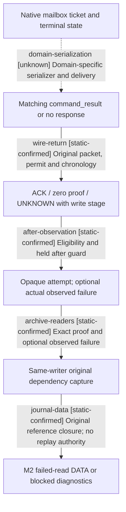

# Research plan: java-failed-read-native-lifecycle-resume61

GENERATED from the supplied research plan; no native semantics are inferred.

Question: How do native mailbox completion, transport return, failed-read after observation and original dependency retention remain distinct through the actual Java M2 caller?



| Edge | Declared status | Evidence IDs | Open question |
|---|---|---|---|
| domain-serialization | unknown | mailbox-source | No concrete failing M2 native operation or current exact command_result producer was supplied; generic mailbox terminal state does not establish its wire or game outcome. |
| wire-return | static-confirmed | transport-source |  |
| after-observation | static-confirmed | coordinator-source |  |
| archive-readers | static-confirmed | m2-source, archive-source |  |
| journal-data | static-confirmed | m2-source |  |

| Observation design | Value |
|---|---|
| mode | offline-only |
| actor_kind | engine |
| owner_scope | Existing bridge mailbox and original Java coordinator failure callback; no GUI or NPC decision policy |
| identity_kind | process-ordinal |
| identity_lifetime | Mailbox ticket sequence belongs to the loaded bridge instance; request_id and held connection chronology belong to the original transport; opaque FailedReadAttempt belongs to one coordinator/writer head and exact objects |
| producer_trigger | not-applicable |
| producer | MainThreadQueryMailboxV1 and NativeGameTransport.dispatchOriginal |
| caller | PlanningReadCoordinator.runReadAttemptLocked and RootIncidentRuntime.captureReadFailureOriginal |
| consumer | NativeOutcomeArchive.loadFailedReadOriginals and EpisodeIncidentJournal failed-read dependency lane |
| cache_lifetime | Mailbox executor/context clears only on terminal matching-ticket reclaim; retained outbound packet remains bound to request; archive trace exists only in one same-writer try/finally scope |
| expected_signal | Source branches separating zero-write, response-wait UNKNOWN, native ACK, observed failure and qualified Known |
| zero_sample_meaning | No runtime observation is performed; missing runtime rows establish no statement about whether native execution occurred |
| stop_condition | One bounded source review of listed exact files, no game/SDK/pipe/process launch |
| runtime_window_ref | None |

| Evidence ID | Declared layer | File | SHA-256 | Supports |
|---|---|---|---|---|
| mailbox-source | source-contract | Z:/ck3_mod_rewrite/ck3_autonomous_player/native_bridge/src/main_thread_query_mailbox_v1.cpp | 2fc9fc6d5b46a5ec0d80d65e2475e160b023a55225bc9c6de8ea78bd83bf9eed | TrySubmit 1628-1708 queues a ticket; Wait 1741-1809 distinguishes cancellation before execution and already-running timeout; Drain 1852 onward and terminal reclaim 1814-1844 retain ownership. Project bridge source, not live EXE execution. |
| transport-source | source-contract | D:/codex-ck3-demos/2026-10-25-java-g2-complete31-h5r4/java/ck3-control/native-transport/src/main/java/org/xar/ck3/control/nativebridge/NativeGameTransport.java | edaea72d31627c28acac1f5cca3267c3e98858fb0d3075bf72caeed16a2fa39d | dispatchOriginal 1017-1080 binds packet, permit and write chronology; matching command_result produces ACK; post-write errors remain UNKNOWN; exact no-write transfer proof alone produces zero. |
| coordinator-source | source-contract | D:/codex-ck3-demos/2026-10-25-java-g2-complete31-h5r4/java/ck3-control/application/src/main/java/org/xar/ck3/control/application/action/PlanningReadCoordinator.java | e370fac44dd431f7cc411bd5247e6a5b0304726c3b573a281dad0b2a3c419efb | runReadAttemptLocked 233 onward samples original after only for eligible returned read; unavailable 379-450 archives opaque attempt and calls per-call failure evidence before global unavailable publication. requireOriginal 76-96 authenticates same callback objects/head. |
| archive-source | source-contract | D:/codex-ck3-background/ck3-java-g2-resume-r4-20261025/resume60/outcome_archive/failed_read08/NativeOutcomeArchive.java | 3c729e33ce8428c6070ee43a859ff150cc07c5449b98a2d678c1bce659356557 | loadFailedReadOriginals 657-675 traces original reader and optional official codec, unions consumed source refs, clears capture in finally. Candidate source not adopted or run. |
| m2-source | source-contract | D:/codex-ck3-background/ck3-java-g2-resume-r4-20261025/resume60/m2_research/failed_read_capture10/RootIncidentRuntime.java | 444a3a94984f108ceae37991701b386903df08aab7f5e3e52a10b744c485c024 | captureReadFailureOriginal 166-210 validates exact opaque proof, preserves only present observed failure, consumes AC13 references() and selects failed-read journal DATA versus blocked diagnostics. Candidate source not adopted or run. |

Check result (file integrity and declarations only):

```json
{
  "schema": "xar.native-research-plan-check.v1",
  "result": "plan-consistent",
  "proof_layer": "record-structure-and-file-integrity",
  "semantic_correctness_verified": false,
  "live_execution_performed": false,
  "observation_plan_issues": [
    "offline-only plan does not define a live observation window",
    "the real producer trigger must be located before live sampling"
  ],
  "declared_edges_by_status": {
    "counter-policy": 0,
    "inference": 0,
    "live-confirmed": 0,
    "static-confirmed": 4,
    "unknown": 1
  },
  "enumerated_native_edges": 5,
  "declared_cases_by_status": {
    "pending": 1,
    "observed": 0,
    "not-applicable": 1
  },
  "checked_evidence_files": 5,
  "limitations": [
    "Evidence layers and conclusions are author declarations; hashes bind bytes, not their truth.",
    "Counts cover this enumerated graph only, not all CK3 branches.",
    "A consistent observation plan is not authorization to run or manipulate CK3."
  ],
  "plan_sha256": "5ac143b2d9ff2ec9001038ee347b1590d536d3891bd3926d0a2e6308cab20e8f"
}
```
