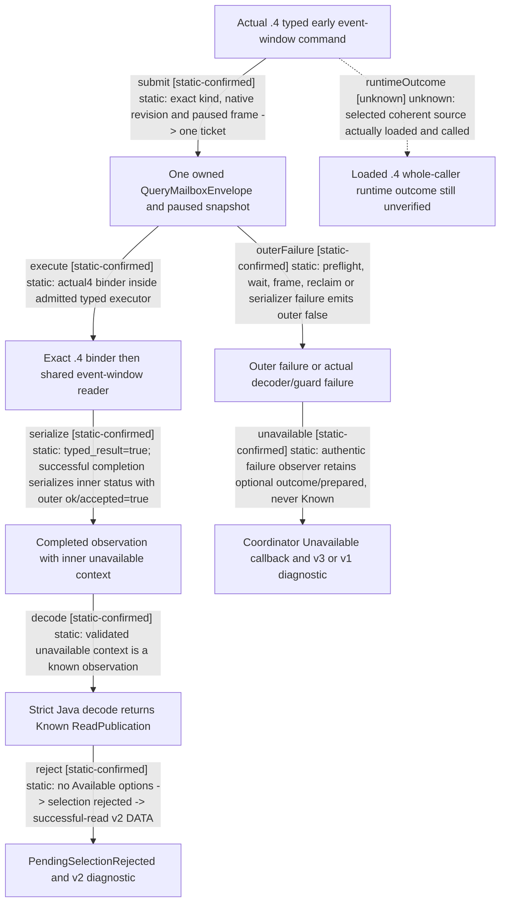

# Research plan: m2-event-window-actual4-result-routing

GENERATED from the supplied research plan; no native semantics are inferred.

Question: Which actual .4 event-window dispatcher and serializer distinguish an inner unavailable presentation from a failed planning READ, and which M2 incident version consumes each result?



| Edge | Declared status | Evidence IDs | Open question |
|---|---|---|---|
| submit | static-confirmed | bridge, mailbox |  |
| execute | static-confirmed | bridge, mailbox |  |
| serialize | static-confirmed | bridge |  |
| decode | static-confirmed | read, codec, coordinator |  |
| reject | static-confirmed | pending, known, runtime, journal |  |
| outerFailure | static-confirmed | bridge |  |
| unavailable | static-confirmed | coordinator, known, runtime, journal |  |
| runtimeOutcome | unknown |  | Root must bind a coherent compiled runtime and actual command/read/capture results; this source review and authored tests supply no runtime observation. |

| Observation design | Value |
|---|---|
| mode | offline-only |
| actor_kind | human |
| owner_scope | Current played-character event window; bridge observation and Java private pending source, not NPC choice |
| identity_kind | generation-id |
| identity_lifetime | Full event instance and native revision are bound to the same Game/session/window; query sequence is per worker and is not an event identity |
| producer_trigger | paused-query |
| producer | bridge.cpp ExecuteTypedQuery12002&lt;event_window&gt; -&gt; BindEventWindowImage12004 -&gt; shared ReadEventWindowContextV1 |
| caller | typed early command handler -&gt; RunTypedQuery12002 -&gt; MainThreadQueryMailboxV1 -&gt; EventWindowContextResultFrame |
| consumer | EventWindowRead.decode -&gt; Known ReadPublication -&gt; PendingUiEventPreparation.event; genuine coordinator Unavailable instead invokes RIR10 failure callback |
| cache_lifetime | Request owns one TypedQuery12002 DTO until matching terminal ticket is reclaimed; .4 worker compares the original full paused snapshot before submission, in Enter/Finish, and after wait. Window DTO is not a persistent permit. |
| expected_signal | Source branch where typed_result=true coexists with inner status=unavailable and outer ok/accepted=true, then Known publication and PendingSelectionRejected; outer failure retains separate coordinator Unavailable semantics |
| zero_sample_meaning | Offline source review takes zero runtime samples and cannot establish that a loaded DLL executed the route, that a visible window existed, or that any option/action occurred |
| stop_condition | Finite named source methods only; no EXE reads, build, live query, action, date advance or runtime sample |
| runtime_window_ref | None |

| Evidence ID | Declared layer | File | SHA-256 | Supports |
|---|---|---|---|---|
| bridge | source-contract | Z:/ck3_mod_rewrite/ck3_autonomous_player/native_bridge/src/bridge.cpp | 41a3e271793e59cb87469324f0ef04611cc0277bedcc06d6fe1043c10fb83953 | Actual .4 typed early dispatch 15708-15731; event kind/parse 13477-13555; guarded submit/wait/reclaim 13781-13895; .4 reader 11764-11771; serializer 8843-8874 and 13998-14028. This is current source, not loaded binary evidence. |
| mailbox | source-contract | Z:/ck3_mod_rewrite/ck3_autonomous_player/native_bridge/src/ck3_12002_query_mailbox.cpp | 81f5fd3f73808720226b6721aea95f3fea9c69c1557f611334c97067fc9ca641 | EnterQueryMailbox/CaptureQuerySnapshot/FinishQueryMailbox verify exact executing slot, owning thread and original paused snapshot; this actual .4 envelope differs from the legacy event-specific mailbox. |
| read | source-contract | D:/codex-ck3-demos/2026-10-25-java-g2-complete31-h5r5/java/ck3-control/native-transport/src/main/java/org/xar/ck3/control/nativebridge/capabilities/events/EventWindowRead.java | 6ae5e5baf9c6ec0fa80cea62eff6388591bafc3acaabb438877f11df5eeac0fb | decode verifies actual packet/request/after custody, accepts the strictly decoded Context.Unavailable and returns EventPolicies.ReadPublication; successful protocol observation does not require available presentation. |
| codec | source-contract | D:/codex-ck3-demos/2026-10-25-java-g2-complete31-h5r5/java/ck3-control/native-transport/src/main/java/org/xar/ck3/control/nativebridge/capabilities/events/EventWindowCodec.java | 33106d4b161d409445dada019b534c51d6e56cada3d32fb11976c16821c961fb | Unavailable context has no scopes/options, retains actual reason and only permitted partial definition readiness; encode preserves its validated original JSON. |
| pending | source-contract | D:/codex-ck3-demos/2026-10-25-java-g2-complete31-h5r5/java/ck3-control/local-service/src/main/java/org/xar/ck3/control/service/root/PendingUiEventPreparation.java | 8de2adbb1cd2007c04d5a020edf475c859d437f180f0c903e497eb0d111f058c | event consumes actual Known read and throws PendingSelectionRejected(pending_event_window_unavailable) before option selection whenever decoded context is not Available. |
| known | source-contract | D:/codex-ck3-background/ck3-java-g2-resume-r4-20261025/resume60/known_interactions/next68/EventRuntimeInstaller.java | 5a17b371b2fc818ce17323853bcb4c2ae389af445946bbf201984bb798af2df4 | Formal Known68 source: actual failed READ callback invokes RIR10 retainPendingUiReadFailure; separate PendingSelectionRejected catch invokes retainPendingUiBlocked with actual successful read receipt. |
| runtime | source-contract | D:/codex-ck3-background/ck3-java-g2-resume-r4-20261025/resume60/m2_research/failed_read_capture10/RootIncidentRuntime.java | 444a3a94984f108ceae37991701b386903df08aab7f5e3e52a10b744c485c024 | Blocked actual receipt follows captureBlocked with originalRead; genuine failure token follows captureReadFailureOriginal and original-only dependency closure. Failure observer capture itself may fail independently. |
| journal | source-contract | D:/codex-ck3-background/ck3-java-g2-resume-r4-20261025/resume60/m2_research/failed_read_capture10/EpisodeIncidentJournal.java | 65ac00bb45ad213a04976f5401fc3cb06112d6e3aeb658e22df5903042dded6b | captureBlocked chooses v2 for successful original-read diagnostics, v3 for authenticated failed outcome/prepared originals and v1 without a read original. All are no-command diagnostics. |
| coordinator | source-contract | D:/codex-ck3-demos/2026-10-25-java-g2-complete31-h5r5/java/ck3-control/application/src/main/java/org/xar/ck3/control/application/action/PlanningReadCoordinator.java | e370fac44dd431f7cc411bd5247e6a5b0304726c3b573a281dad0b2a3c419efb | nativeOk false, guard or decoder failures produce Unavailable and per-call failure observer; validated successful decode/archive produces Known. A successful protocol read can encode unavailable domain presentation. |

Check result (file integrity and declarations only):

```json
{
  "schema": "xar.native-research-plan-check.v1",
  "result": "plan-consistent",
  "proof_layer": "record-structure-and-file-integrity",
  "semantic_correctness_verified": false,
  "live_execution_performed": false,
  "observation_plan_issues": [
    "offline-only plan does not define a live observation window"
  ],
  "declared_edges_by_status": {
    "counter-policy": 0,
    "inference": 0,
    "live-confirmed": 0,
    "static-confirmed": 7,
    "unknown": 1
  },
  "enumerated_native_edges": 8,
  "declared_cases_by_status": {
    "pending": 2,
    "observed": 0,
    "not-applicable": 1
  },
  "checked_evidence_files": 9,
  "limitations": [
    "Evidence layers and conclusions are author declarations; hashes bind bytes, not their truth.",
    "Counts cover this enumerated graph only, not all CK3 branches.",
    "A consistent observation plan is not authorization to run or manipulate CK3."
  ],
  "plan_sha256": "33895b147fb4a6447f8964d92c46f14bd83e33f331f075d6f15b9c0347768dc6"
}
```
