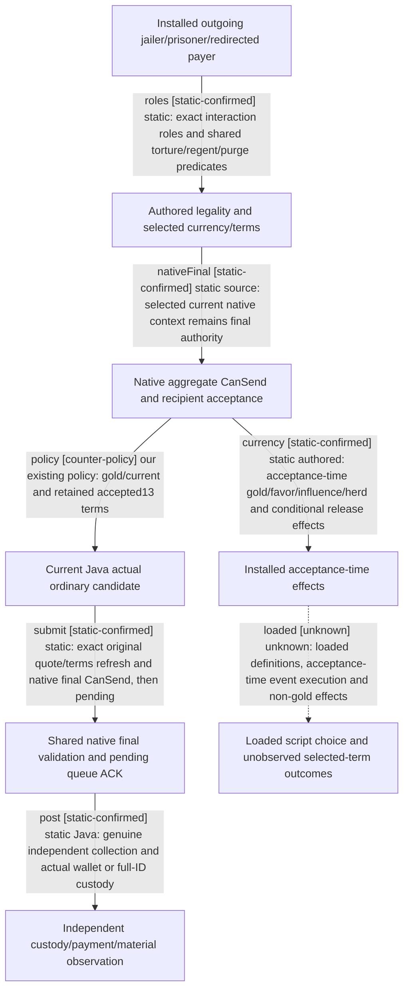

# Research plan: installed-prisoner-currencies-and-current-java-completion-resume61

GENERATED from the supplied research plan; no native semantics are inferred.

Question: Which current installed ransom/release legality and currency/effect branches are already delegated to native authority, and what can the selected Java ordinary candidate and independent completion producers actually establish?



| Edge | Declared status | Evidence IDs | Open question |
|---|---|---|---|
| roles | static-confirmed | prison, diarch |  |
| nativeFinal | static-confirmed | ransom, release, collector |  |
| currency | static-confirmed | prison, effects, basic, amount, installed_extra |  |
| policy | counter-policy | policy, collector, select, mask |  |
| submit | static-confirmed | installer, ransom, release |  |
| post | static-confirmed | installer, post |  |
| loaded | unknown |  | A loaded source-bound original runtime and actual independent currency/term-specific outcome producer is needed before claiming these effects. No new mandatory first-live gate is proposed. |

| Observation design | Value |
|---|---|
| mode | offline-only |
| actor_kind | human |
| owner_scope | Played jailer, redirected payer and exact full prisoner ID. Installed text and current Java source comparison on machine xenoamess-full-tower-eb9d2c1186; no loaded script or Game claim. |
| identity_kind | definition-key |
| identity_lifetime | Definition keys are source identities; actual candidate and outcome still require the same Game/session/public-native frame, exact full character ID and retained actual query/attempt. Prisoner ordinal is not stable across collection changes. |
| producer_trigger | on-action |
| producer | Installed ransom_interaction/on_accept -&gt; ransom_interaction_effect; release/on_accept immediate or delayed event branch. Actual native context remains legality/acceptance authority. |
| caller | Current PrisonersRuntimeInstaller -&gt; ordinary policies/collector -&gt; shared action binding and existing .4 native submit; actual postcondition observer reads an independent original collection after submission. |
| consumer | NativePrisonerEffects12004 distinguishes gold gain/custody, full-ID Free/Dead/HeldByOther, optional named-opinion comparison; unsupported currencies and negotiated effects do not gain outcome credit. |
| cache_lifetime | Retained same-frame latest offer per ordinal is refreshed before submit. Native source60 action re-reads exact terms/CanSend. No current runtime cache or scheduler was sampled. |
| expected_signal | Exact installed9 ransom/13 release options versus Java gold/current_gold action scope; accepted option aggregate versus independent Free/payment/material results and explicit unobserved costs/causation. |
| zero_sample_meaning | Zero samples establish no actual selection, transfer, release, loaded source or native scheduler behavior. Script effect declarations cannot become observed poststate. |
| stop_condition | Read named installed scripts, existing closed topic references and selected Java/native source callers only. No EXE, compilation, test/JVM, pipe, Game action, source deployment or prerequisite gate. |
| runtime_window_ref | None |

| Evidence ID | Declared layer | File | SHA-256 | Supports |
|---|---|---|---|---|
| prison | source-contract | Z:/SteamLibrary/steamapps/common/Crusader Kings III/game/common/character_interactions/00_prison_interactions.txt | 1bb43b3c2061212af8d41b11314ff4e569af2a3506319f820d05877a7762abc5 | Installed interaction source equals historical 1bb43b pin. Outgoing ransom1886-2559 redirects prisoner/payer, validates torture/regent/purge, has nine authored options and runs acceptance effects only while still held. Release4282-6712 has thirteen terms and on_accept delayed-injury versus immediate-release branches. |
| effects | source-contract | Z:/SteamLibrary/steamapps/common/Crusader Kings III/game/common/scripted_effects/00_prison_effects.txt | ea8bb72426246692bf1f310ae7eb83715ae1b7314d046e3660df66443d486030 | Installed ransom_interaction_effect2-234 separates gold/current/extortionate/favor/influence/herd, then installed extra helper232 and release233. This proves installed text, not pristine stock or loaded script execution. |
| diarch | source-contract | Z:/SteamLibrary/steamapps/common/Crusader Kings III/game/common/scripted_triggers/00_diarchy_scripted_triggers.txt | 3995f62fe332f98ccecd39abf70a2a2574fbfb18c86f5d5d3c02a367fda0607a | Installed cannot_release_former_regent_whilst_old_regent_holds_power_trigger376-393 is conditionally applied to its exact prisoner and existing regent/liege roles. |
| basic | source-contract | Z:/SteamLibrary/steamapps/common/Crusader Kings III/game/common/script_values/00_basic_values.txt | c379cc0c58ed1574033f0e07a58697dfc6f8475c26aa4b117f2332008d4a27ef | current_gold_value458-461 floors current gold; acceptance-time saved amount must not be equated to paused quote or raw floating wallet. |
| amount | source-contract | Z:/SteamLibrary/steamapps/common/Crusader Kings III/game/common/script_values/00_interaction_values.txt | 52a7cf8ef212c835bfc5bc5ce049af2e33d7586eb9d477343e8eedacf58ebd66 | normal_ransom_cost_value187-241 uses native ransom_cost plus culture, wealth, game-rule and haggler factors; increased_ransom_cost_value280-285 multiplies1.5. Do not recompute quote from prisoner tier alone. |
| installed_extra | source-contract | Z:/SteamLibrary/steamapps/common/Crusader Kings III/game/common/scripted_effects/pam_effects.txt | fc4c77974a7844c31c1271dcc2ace24b17906620a832658919aa281e42a2b94f | Installed pam_philanthropia_ransom_payer_effect457-473 has personal-tenet/current-gold-derived piety and spiritual fulfilment effects. File presence proves neither unmodified vanilla origin nor current loaded override selection. |
| policy | source-contract | D:/codex-ck3-demos/2026-10-25-java-g2-complete31-h5r5/java/ck3-control/application/src/main/java/org/xar/ck3/control/application/planning/prisoners/PrisonerOrdinaryPolicy12004.java | 479f4f58d45642fde8d28c299b13d89c3fdf4fdc1194b015d51e1e0408adc480 | Current Java ordinary ransom65-89 selects and refreshes gold/current_gold. Release91-115 consumes latest-per-ordinal actual terms, native acceptance, positive-ransom priority and complete war retention; proposes through one command binding. |
| collector | source-contract | D:/codex-ck3-demos/2026-10-25-java-g2-complete31-h5r5/java/ck3-control/application/src/main/java/org/xar/ck3/control/application/planning/prisoners/PrisonerCollector12004.java | 2e8ed58d6dd12d7bf295202fd108b604e909cd7d5129c91d6036f84b21ede2fa | Current ransom gathers every returned ordinal; release retains latest current offer per ordinal and refreshes exact original intent. acceptedRelease uses native CanSend/autoaccept/answer, not Java script evaluation. |
| post | source-contract | D:/codex-ck3-demos/2026-10-25-java-g2-complete31-h5r5/java/ck3-control/application/src/main/java/org/xar/ck3/control/application/effects/NativePrisonerEffects12004.java | 7f5b30061c034715aae7d446e0b7360a97407d3a3f591e0abb7d625ea7aa60cb | Actual NativePrisonerEffects observer34-109 re-reads an independent actual collection. Ransom needs complete absence plus sufficient actual gold gain; release needs retained full-ID Free and records causation/cost=false. Dead/other-jailer are non-applied terminal; opinion comparison optional136-159. |
| installer | source-contract | D:/codex-ck3-demos/2026-10-25-java-g2-complete31-h5r5/java/ck3-control/local-service/src/main/java/org/xar/ck3/control/service/root/PrisonersRuntimeInstaller.java | b5e2e455ebea577f71cfdece3b9e3ac0ebbc3135841ac5041d40d69b6371a251 | Actual Root installer68-100 builds current read family/preparation/policy/actions. observer205-209 installs NativePrisonerEffects with same runtime reads/archive. catalog240-246 requires exact source bytes and 1bb43b pin; registration construction is not loaded qualification. |
| ransom | source-contract | D:/codex-ck3-background/ck3-java-g2-resume-r4-20261025/native10/source60/ck3_autonomous_player/native_bridge/src/ck3_12004_prisoner_ransom_action.cpp | 1ac64fed8ee829bd9a408be182e9d60e22274a19238f1d54ee81d6ebc00243c6 | Frozen native source60 submit82-202 re-reads exact payer/prisoner/selected gold/current_gold/amount/acceptance, selects native option2/3, final-validates actual context and queues original copied native command; returns submitted_verification_pending. |
| release | source-contract | D:/codex-ck3-background/ck3-java-g2-resume-r4-20261025/native10/source60/ck3_autonomous_player/native_bridge/src/ck3_12004_prisoner_release_action.cpp | d74ca94e1148a1024bb8e15bb5a048c168bc6c010148840b6ffa4062a3ddee58 | Frozen native source60 submit136-239 refreshes original13-bit terms, finalizes/validates native context, checks actual ten send costs, then queues copied command. Accepted/CanSend remain native aggregate observations. |
| mask | source-contract | D:/codex-ck3-demos/2026-10-25-java-g2-complete31-h5r5/java/ck3-control/wave2-prisoners/src/main/java/org/xar/ck3/control/wave2/prisoners/ransomquote/RansomOptionMask12004.java | 63d1661e672f31211e7b02373642a60cde913bff3682d7206690b14779a4c5f6 | Current Java fixes authored ransom option count9 but exposes differing diagnostic mask only, not additional action currency. |
| select | source-contract | D:/codex-ck3-demos/2026-10-25-java-g2-complete31-h5r5/java/ck3-control/g2-research/src/main/java/org/xar/ck3/control/g2/m6/prisonerransom/PrisonerRansomFormalPolicy12004.java | 5911c3aba7eabdbf273a46fcdfcec5fd59dda3fc559b183d6b3c0d9cc1a40e86 | Current Java formal selection162-201 retains measured same-dynasty/child/title-tier and war-retention filters; these are existing policy scope, not complete player-legality enumeration or native scheduler scoring. |

Check result (file integrity and declarations only):

```json
{
  "schema": "xar.native-research-plan-check.v1",
  "result": "plan-consistent",
  "proof_layer": "record-structure-and-file-integrity",
  "semantic_correctness_verified": false,
  "live_execution_performed": false,
  "observation_plan_issues": [
    "offline-only plan does not define a live observation window"
  ],
  "declared_edges_by_status": {
    "counter-policy": 1,
    "inference": 0,
    "live-confirmed": 0,
    "static-confirmed": 5,
    "unknown": 1
  },
  "enumerated_native_edges": 6,
  "declared_cases_by_status": {
    "pending": 2,
    "observed": 0,
    "not-applicable": 1
  },
  "checked_evidence_files": 14,
  "limitations": [
    "Evidence layers and conclusions are author declarations; hashes bind bytes, not their truth.",
    "Counts cover this enumerated graph only, not all CK3 branches.",
    "A consistent observation plan is not authorization to run or manipulate CK3."
  ],
  "plan_sha256": "631c7e39d8b0f5c6a87887be0f9f1e75b019d092c9546731d39020766d8c5ce4"
}
```
