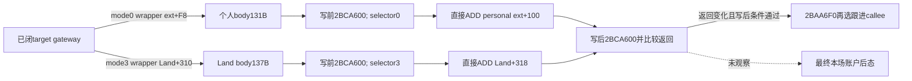

# 借款研究：个人与 Land 的直接 ADD 及写后分支

`machine_id: xenoamess-full-tower-eb9d2c1186`。本轮使用 sole b64 产出的 CK3 1.20.0.4 / build25734779 小窗，EXE SHA `98702f88a547cde2eaf29a85f93b85f68ee4cf8148336a4f7afaeb75319dd518`。没有本岗新 EXE 读取、Native/Java 编译或 Game 执行。

batch05 结果为 `resume61/b64_execution/BATCH05-RESULT01.json`，34,761 B，SHA `e678f109c76662d7ca1b94429d3b84319b293debda0a601cc682714b97b89bdc`。实际 readback、逐条解码及限制在 `resume61/native_loan/SOURCE-RESULT23.json`，14,645 B，SHA `6616294ef98cc18a1af36bb26debc192cf6515285c2192151fc4628869547e28`。

| 实际原件 | 完整普通 body | SHA |
| --- | --- | --- |
| `batch05/capture01/window-017.raw` | `285EE40..285EEC3`，131 B | `4a8c83ef8536cdad09b6b5706995a2991aaf361eb0140f14573ea4101695a4e0` |
| `batch05/capture01/window-018.raw` | `285EF60..285EFE9`，137 B | `7aa1ee2830c0599bbc757c28fb276e845e40c0361e808f85c19d1b027f93b3f4` |

原件根为 `D:/ck3-state/ck3-java-g2-native-static-resume61/`。两个 body 都完整到 RET，所有条件分支位于各自窗口内；被调函数和异常路径的传递语义不因此全闭。

## 直接账户写入已经有实际指令

[目标 gateway 21](loan-native-target-gateway-and-event-lookup-12004-20261026.md)已闭真实 caller：selector0 的 `28B975D` 把 `extension+F8` 作为 wrapper；selector3 的 `28B9841` 把经原生守卫解析的 `Land+310` 作为 wrapper。两路另传同一 amount 与 Character 上下文。

两个 body 的普通顺序相同，差别是给 `2BCA600` 的原始 selector 分别为 0、3：

| 顺序 | 131 B 个人 body | 137 B Land body |
| --- | --- | --- |
| 写前调用 | `285EE62 -> 2BCA600(context, 0)` | `285EF85 -> 2BCA600(context, 3)` |
| 直接写 | `285EE67: ADD QWORD[wrapper+8], amount` | `285EF8A: ADD QWORD[wrapper+8], amount` |
| 写后调用 | `285EE72 -> 2BCA600(context, 0)` | `285EF98 -> 2BCA600(context, 3)` |
| 后续分支 | 比较两次返回的 EAX，变化后才继续检查 context | 同左 |

由当前实际 caller 的 wrapper 计算，直接写槽分别为 **个人 extension+100**、**已解析 Land+318**。这次是 ADD 本体指令证据，不再由邻近 SUB 或函数名推断。

两个 body 都没有在这条直接 ADD 之前比较钱包余额、clamp、检验 amount 正负或直接检查 Character tag/ID。候选 caller 自己已有正 amount 门，gateway 自己另有 extension、非零 amount、selector 与 Land 条件；这些门仍属于各自层级。本体 ADD 采用硬件 64 位运算，没有饱和指令，不能把它改写成无界整数或保证不溢出的数学加法。

## tag、ID 和死亡上下文条件在写入之后

两次 `2BCA600` 返回值相同就返回。返回值不同才依次检查 Character tag、ID 非 `-1`、`Character+1D0` 为空；通过后调用 `2BAA6F0(fullID)`，再按其 bool 调 `28C3D20(context)` 或 `28C3CD0(context)`。

因此，这些条件限制的是 **ADD 之后的跟进调用**，不能将它们读作直接写入的前置守卫；某个写后条件失败不证明账户没有执行 ADD。这也不授最终余额等于入参余额加 amount：写前、写后和跟进 callee 的语义尚未展开，仍须真实关联的账户读回。

本岗不自动扩取这些 callee。tracker `19EAE80` 的后继由 native_war_cash 独占；其 batch05 42 B 是入口片段，仍跨出窗口，不能当完整 allocator 或余额写入本体。

当前闭合的是 **候选 effect → 两个 gateway → 目标 direct ADD 槽与写后调用顺序**。候选类型的脚本 token 注册仍未知，实际 `pay_short_term_gold` 注册和执行也没有因此闭合。payer、target 的独立守卫与 caller 不检查首返回值的事实仍在；没有原子转账、实际借款到账或双端守恒信用。

Java 消费者、cash21 和 LoanFinancingCodec 没有字段变化。`HOLY_LOAN_SOURCE12004` 继续 OFF，未到账本金维持零信用，UNKNOWN 不重投；当前资格、条件、合法提交、钱包与 debt/list 的关联后态仍需各自真实证据。
