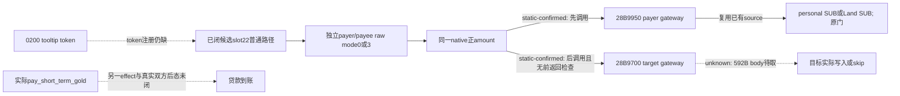

# 借款提示候选 effect：两端账户调用的实际顺序

`machine_id: xenoamess-full-tower-eb9d2c1186`。本轮继续消费 sole b64 的 batch03 原件，目标 CK3 1.20.0.4／build25734779，EXE SHA `98702f88a547cde2eaf29a85f93b85f68ee4cf8148336a4f7afaeb75319dd518`。没有新 EXE 读取、Native 调用或 Game；这些是静态代码结论。

前一篇[类型／factory／首段研究](loan-native-payment-tooltip-source-12004-20261026.md)发现 slot22 的首条 pdata 不等于完整逻辑函数。现在 batch03 的 window010（389 B）、011（96 B）、012（171 B）实际到件。它们及 batch02 原首段的精确出处、SHA、解码在 `resume61/native_loan/SOURCE-RESULT19.json`，25,833 B，SHA `09709f71e614dc6683704b8313dda708ef1d8eac1c2006c0e4b602a9a61034e3`。

slot22 已拼成 `0x2D45760..0x2D459AF` 的 **591 B 普通逻辑路径**，拼接 SHA `cac6781bcd5c2a620a2a3027bb90a66e05faddff00b66b02c207082abda0b6f3`。四个后继 RF 都有实际 fallthrough／branch 来源，正常返回在 `0x2D458B0`；两个诊断分支回到该收尾。异常／unwind 与所有 transitive callee 行为没有因此闭合。

## 原代码怎样选择两端

对象的 root payer 与解析后的 target payee 各保留原 `Character`。这个候选 effect 的普通路径如下：

| 阶段 | 实际数据流 |
| --- | --- |
| payer raw mode | `28C2DF0(payer)` 返回对象 `+0x40` bit32 为真时，再求 `2BAFD80(payer)`；二者合格才为 3，否则为 0 |
| target | 从 effect `+0x140` 解析；目标 `Char` tag、完整 ID 非 `-1` 后才继续 |
| payee raw mode | **只**求 `2BAFD80(payee)`，真为 3，否则为 0；该处没有额外的 payer bit32 条件 |
| 数值 | effect `+0x50` 经 `9D7060` 写原 signed64 amount，继续使用同一 amount |
| amount 为正 | `2D45879 -> 28B9950(payer, payerMode, amount, 3)`，然后 `2D4588D -> 28B9700(payee, payeeMode, amount, 4)` |
| amount 非正或目标不合格 | 进入各自格式化／诊断调用路径，没有经过上述两条 payment gateway call |

两次 gateway call 之间**没有检查前一返回值**。这里只闭合原代码的顺序与参数，不能把它叫作已证明原子转账、足额支付或资金守恒；下层 gateway 的实际 skip／write 条件必须分别消费。第四参 3／4 也不等于十资源 cost-vector 的槽号，更不能命名为军费。

`2BAFD80` 的完整 171 B 已读：先核 `Char` tag、ID 非 `-1` 和 `Character+0x1C0`；再单独调用 `28C2DF0`，检查返回对象的 magic 与 DWORD `+0x40` bit29。之后从当前 context 的 `+0x1E0/+0x1EC` 取首 Land ID；重新读取的 context 为空时另有 death 数据分支。它把 ID 交 `9D6DF0`，检查返回对象 byte `+0x32` 为零才返回 true。该 resolver 包含自己的 fallback，不能把 fallback 的 byte 值补成当前有效 Land。

此 predicate 没有读取余额、费用或原生可负担性。bit29、bit32、Land byte32 的业务名称仍未由本包闭合；两次 government resolver 的结果也没有被我方合并成一个缓存条件。原版 `_governments.info` 的 `treasury`、`replace_gold_cost_by_treasury` 字段只是 authored 输入，不足以按名字给这几个 bit 赋义。

96 B constructor 初始化基类、effect `+0x50` 的数值对象以及 `+0x140` 的目标对象；随后原 73 B factory 写最终 `CPayTreasuryOrGoldEffect` vtable。这里的类型／factory／runtime 链已闭，**脚本 token 注册链仍缺**。它也仍不是实际 `pay_short_term_gold` 的注册或执行证明。

## 复用已持 payer 网关，继续闭 payee

`28B9950` 的完整 540 B 已在[R08 便携 sources](evidence/episode04-r08-rate-application-12004/sources.json)的 `source_bytes.gateway_28B9950` 保存；本轮直接复用，不重新采集。来源机器为 `desktop-3fevhd2-1c74096080`，与本机不同；复用的是同一精确 EXE 的代码知识，未外推来源机器的部署或实机事实。

[既有付款源链](war-payment-passive-12004.md)已闭该 gateway 的 raw mode0 到个人 `extension+0x100` SUB，raw mode3 到解析的 `Land+0x318` SUB。它们有自己的 extension、amount、Land tag／ID 等门，调用不等于必然写入。尤其 **Character 上下文不总是个人钱包账户**。本轮新候选 caller 因此不能只配对一个玩家个人余额就宣称完整转款。

目标 gateway `28B9700` 尚未取得：已有 metadata 给出 `0x28B9700..0x28B9950`／592 B，实际调用由本次 `2D4588D` 到达；native_war_cash 确认其已持 caller，但没有该完整 body。本岗已交 sole b64 的 `FOLLOWUP-CREDIT20.json`，去重后再采；不把另一个 SUB gateway 的结构复制成 ADD 实现。

cash21／LoanFinancingCodec 没有字段变化。Finance15 的观察候选继续保留原战争命令、原 pending、零预支及 UNKNOWN 不重放；本页不新增运行字段、动作资格或测试替身。真实贷款仍需当前 offer、合法单发、独立双方钱包／债务／名单与原 action 的归因后态，`HOLY_LOAN_SOURCE12004` 保持 OFF。
