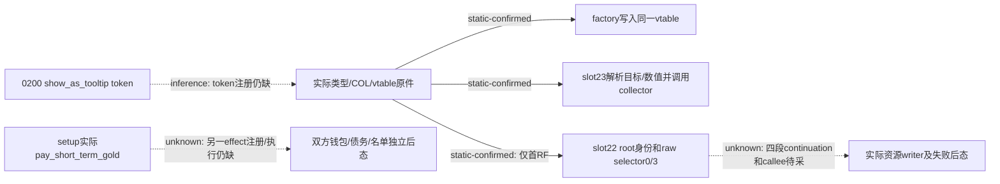

# 借款提示与实际付款：当前4版原生入口

`machine_id: xenoamess-full-tower-eb9d2c1186`。2026-10-26 静态研究，版本 1.20.0.4／build 25734779，EXE SHA `98702f88a547cde2eaf29a85f93b85f68ee4cf8148336a4f7afaeb75319dd518`。本轮只消费 b64 sole owner 的 batch02 原件，没有再读 EXE、调用 Native 或运行 Game。

原件导航：`resume61/b64_execution/BATCH02-RESULT01.json` 的 index25–30，六窗共 732 bytes；完整路径、SHA 与 Capstone 解码在 `resume61/native_loan/SOURCE-RESULT15.json`（21,942 B，SHA `2ef42312d8e08ebf8341107833587d61ec75ee56c15199d07ab04368165c9451`）。batch 的 input CLOSED、unknown read outcome 0、原生文件 held identity 和三个受管阶段退出各由 b64 回执记录；它们只证明采集，不证明语义、已加载或付款。

当前已闭的是一个真实类型与 factory 接线：TypeDescriptor `0x5A81F38` 的名称为 `CPayTreasuryOrGoldEffect`；COL `0x4EDB338` 指向该类型并回指自身；vtable `0x486F440` 的 slot22、slot23 分别为 `0x2D45760`、`0x2D241D0`。factory `0x2D4FC70` 分配 `0x1E0` bytes，调用 `0x2D26550` 后明确写入同一 runtime vtable，将 entry 的 `+0x10` dword 复制到新对象 `+8` 并清 `+0xC`。factory 全 73 B 与完整返回已读。

**类名与 factory 尚不等于脚本 token 注册。** 本包仍缺原生注册表把 `pay_treasury_or_gold` token 绑定到该 entry 的实际来源；类型名匹配是定位线索。更不能把它当成另一个 `pay_short_term_gold` effect。当前安装的 `holy_order.0200.a` 只在 `show_as_tooltip` 中调用前者，真正的 `set_up_loan_effect` 在写 owed、holder、双方身份和 lender 名单之后调用后者。这两个脚本 caller 已由原专题封存，本轮不将它们混成一笔付款。

slot23 的完整 169 B 已读。它把对象 `+0x140`、原 context 和对象 `+0x10` 交给 `0xA03A30` 解析目标，把对象 `+0x50`、输出地址、原 context／context `+0x28`、对象 `+0x10` 交给 `0x9D7060` 求数值，再调用 collector vtable `+8`。collector 参数包括原 root scope、一个 kind4 的目标 scope、kind1 数值 payload、当前 effect 对象与空 forwarded 参数。该完整 body 有返回，直接调用只见解析、数值求值和 collector；下层 helper 的副作用与通用遍历生命周期另有合同，不能只凭这个局部函数宣布整个引擎调用无副作用。

slot22 目前只有**首段 RF**，不是完整逻辑函数。其 `0x2D45760..0x2D4582A` 在 `0x2D45827` 的 `mov rcx,rax` 后继续落到下一段，且已有分支跳往 `0x2D4592F`。本岗最初按一条 pdata row 称其为完整 body 的请求描述不成立；原计划保留，后继按实际指令纠正。完整解码了 202 B 只证明这 202 B 的指令边界，不证明函数完整。

这段源码确认：从当前 root scope 取 kind4/full CharacterID，以低24位索引 storage 后再比较对象 `+0x18` 的完整 ID，不符时使用引擎 fallback；随后调用现有 `0x28C2DF0`，检查返回对象 `+0x40` 的 bit32，再在该位为真时调用 `0x2BAFD80`。二者的结果形成 raw selector 0 或 3。它继续解析 effect `+0x140` 的目标，并检查目标的 `Char` tag 和 non-null ID。**selector 0／3 的资源名称、费用币种、付款资格及失败行为尚未闭合，不能用十资源 cost vector 的槽号给它命名。** 当前也没有看到可归因钱包写入。

held metadata 已给出后续四个相邻 RF 范围：`0x2D4582A..0x2D4589A`、`0x2D4589A..0x2D458B1`、`0x2D458B1..0x2D4592F`、`0x2D4592F..0x2D459AF`，共 389 B。下一独立函数始于 `0x2D459B0`。本岗已向 b64 请求这 389 B，以及实际 caller 已指向的 constructor `0x2D26550..0x2D265B0` 96 B 和 predicate `0x2BAFD80..0x2BAFE2B` 171 B，总 656 B；没有按猜测展开 EXE。

本轮没有证明借款 eligibility、当前 offer、本金、资金支付或到账；`HOLY_LOAN_SOURCE12004` 保持 OFF，未到账资金 credit 为零，未知原动作不重复提交。与[普通战争旁借款观察](loan-existing-war-observation-12004-20261026.md)的 Java 源候选分别报告，不把编译、collector 行或类型名用于升级贷款业务资格。
