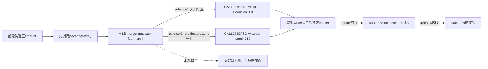
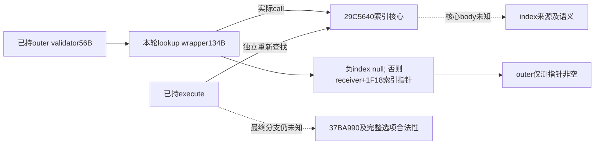

# 借款研究：目标资源 gateway 与事件查找 wrapper

`machine_id: xenoamess-full-tower-eb9d2c1186`。目标为 CK3 1.20.0.4 / build25734779，EXE SHA `98702f88a547cde2eaf29a85f93b85f68ee4cf8148336a4f7afaeb75319dd518`。本轮只读 sole b64 已产出的 batch04 小窗，没有自行读取 EXE、启动 Native 或 Game。

batch04 统一结果为 `resume61/b64_execution/BATCH04-RESULT01.json`，34,087 B，SHA `2617d3449748633be7850aefe175da7efe37e1ff05e93e45308d8974c890e13a`。本岗逐字节 readback 与解码见 `resume61/native_loan/SOURCE-RESULT21.json`，31,221 B，SHA `fdeb04fcea0083859ca4007a0e9c740f6b5e3c8123f9134d8660b05605eaf0a6`。

| 实际原件 | 范围、字节 | SHA |
| --- | --- | --- |
| `batch04/capture01/window-006.raw` | `29C56F0..29C5776`，134 B | `39c9e8602a8cb950cc7dfade2666a44c001a7254621328757d39341472a3a80c` |
| `batch04/capture01/window-007.raw` | `28B9700..28B9950`，592 B | `d0d1aab40af2a9e771e9c25429c1695e8e588e9f60ecd5002df210f1c2d70b3c` |

原件根为 `D:/ck3-state/ck3-java-g2-native-static-resume61/`。捕获结果的三阶段 outer/child 退出、Job0、inputCLOSED、pre/post 与 held path MATCH 是采集闭场事实，不是原生付款或事件业务结果。

## 目标 gateway：账户调用在 tracker 更新之前

[前轮候选 effect 普通路径](loan-native-dual-account-transfer-12004-20261026.md)已经确定先调 payer `28B9950`，随后调目标 `28B9700`，后者第四参为 literal 4。这里补的是目标 gateway 本体；候选类型与脚本 token 的注册连接仍未证明，也不能用该候选替代实际 `pay_short_term_gold`。

592 B 包含 **567 B code、1 B NOP、24 B 跳表**。`28B9938` 的六个真实表项是 `28B9750, 28B9927, 28B9927, 28B97C0, 28B990D, 28B9927`；末尾表数据没有作为机器指令解释。

入口先要求 `Character+1B0` extension 非空、amount 非零，且 selector 在 unsigned 0..5。这里的 amount 门是 `!=0`，没有正值或余额比较；前轮候选 caller 自己另有 `amount>0` 门，不能把它提升为所有 gateway caller 的规则。

| selector | 目标 gateway 的真实路径 |
| --- | --- |
| 0 | `28B975D -> 285EE40(extension+F8, amount, Character)`；之后重新取 extension 的 `+278` 对象，再看其 `+20` 指针 |
| 3 | 再次调用 `2BAFD80(Character)`；经 context/death 分支取 Land ID，`9D6DF0` 解析后要求 Land tag、ID 非 `-1`；`28B9841 -> 285EF60(Land+310, amount, Character)`；之后才读取同一 tracker 链 |
| 4 | `2BAFF30` true 时直接 `Character+1C0` 对象的 `+4A0 += amount`；本页不命名该资源，也不扩其 predicate |
| 1、2、5 | 表项直接到 return 尾部 |

0/3 两路都先调用基础资源 writer，再处理 tracker。tracker 的 `+20` 为空时，会在基础 writer 调用之后退出；因此 tracker 分支未执行不能等同基础账户没有变化。反过来，gateway 的入口、predicate 与 Land 守卫也能在 writer 调用之前退出。

对于本候选实际传入的 fourtharg 4：selector0 在 `28B9796` tail-call `19EAE80(tracker, 0, amount)`，selector3 在 `28B987B` tail-call `19EAE80(tracker, 3, amount)`。`19EAE80` 的 42 B 原件由 native_war_cash 独占后继申请，本岗不重复采集。第四参其他值会走另一个 tail-call 或内联子池分配，不能把 literal 4 命名为某项军费，也不能把子池更新当作再次给钱包加钱。

基础 writer 的实际调用边已闭。本页没有重新读取 `285EE40`、`285EF60` body；历史个人 ADD 来源可以复用，但 Army/WarCash 均确认不持有这两个完整可读本体。两个精确 cache 文件名未中也不能代表全域不存在。源选定的 131/137 B 后继只交 sole b64 去重后处理，不从相邻 SUB 函数推导其全部语义。当前图将这些叶函数的传递效果与真实本场到账分开保留。

这仍不是原子转账证明：payer 与 payee 有独立守卫，候选 caller 在两个调用之间不检查第一个返回值。静态可跳过路径不能冒充本场实际失败，同样不能把 ordered calls 冒充两端实际写入。

## 事件查询：134 B 只闭了受保护的查找 wrapper

[前轮 outer validator](loan-event-native-validator-frontier-12004-20261026.md)在 `29BDFE0` 调 `29C56F0(receiver, eventID)`，再用返回指针是否为空构造 bool。本轮完整 134 B 显示：

1. 对同一全局计数执行 `lock xadd +2`；遇到低位为 1 时减回、pause 等待并重试。
2. `29C573F -> 29C5640`，wrapper 没有改写传入的 eventID。
3. 返回索引为负则返回 null；非负则读 `receiver+1F18` 的指针数组，取 `index*8` 的条目返回。
4. 两个 return 路径都对计数执行减 2。

这闭合了 wrapper 的普通控制流。它没有直接读取 choice 或 enabled；核心 `29C5640` 仍没有可读 body，其现有 runtime metadata 没有包含该入口的 row，不能把前一字节到下一函数之间的区间猜为完整函数。该核心也是已持 Select execute `29BDE56` 的实际 callee，因此本页只给两个实际 caller 复用这条新边，不重复研究 execute。

最终 enabled、合法性及 effect 顺序继续复用 [Select 顺序专题](event-select-execution-poststate-order-12004-2026-10-26.md)和[容器移除专题](event-removal-container-segments-12004.md)的边界。本轮没有证明 disabled 可执行，没有改变第一显示项策略；窗口消失仍不能替代贷款付款。

cash21、LoanFinancingCodec 与 Java 生产字段均未改动。`HOLY_LOAN_SOURCE12004` 继续 OFF；未到账本金仍是零预算信用，UNKNOWN 保留原行动且不重投。后续真实贷款仍需实际资格和报价、合法提交、双端账户以及 debt/list 的原行动关联后态。
