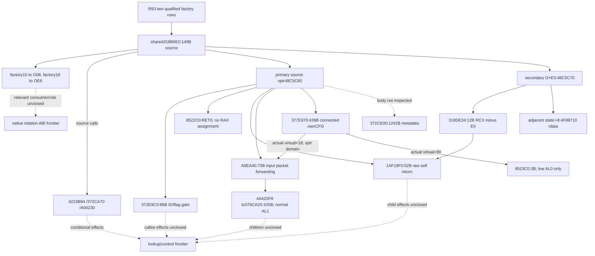

# Native71 guardian factory: typed creation input (1.20.0.4)

October10 continuation-25 owns the source join from an actually registered
guardian/ward factory to its typed creation payload and parsed-trigger input.
The real factory capture is pending. No Create slot, native function body,
creation typedef or parsed-trigger field is closed by this continuation yet.
Guardian pair/collection readiness and new live/G2 credit remain false/zero.

The exact build is CK3 `1.20.0.4`, Steam build `25734779`, EXE SHA
`98702F88A547CDE2EAF29A85F93B85F68EE4CF8148336A4F7AFAEB75319DD518`.
The selected Native71 and full SDK source is
`16da78339cdff5c1a462e20bc301684594a3f800`, retained in
`D:/codex-ck3-background-spill/native71-continuation-20261010/runtime-01/ROOT-ACTUAL-BINDINGS.json`.
Native71's canonical receipt retains Native61 private discovery qualification;
that qualification does not establish any registered Game factory or Create ABI.

## Input and target selection

The existing [O10-2 capture contract](guardian-relation-character-binding-12004.md)
fixes the only keys to `has_relation_guardian` and `has_relation_ward`.
Continuation-24 routes the existing same-driver family query recipe to the
sole runtime01 owner. It expects a fresh private sidecar at
`D:/codex-ck3-background-spill/native71-continuation-20261010/continuation-24/runtime-capture01/guardian-two-factory-source.json`.
The sidecar is not available merely because this path is named.

The external `continuation-25/factory_slot_targets.py` consumes that existing
schema plus the original actual frame's native revision, date and played
Character ID. It requires the inherited exact SHA and qualified paused
capture before selecting targets. It invokes no driver, Game, native factory,
interner, evaluator or process-memory reader.

For each fixed row, it preserves status, matched stored name, NameID, map ID,
raw record ID, factory address, VT, opaque descriptor and full RTTI metadata.
The proved ASCII folding admits the matched stored name. NameID must match
the hit map key; the separately observed raw record ID remains unmodified.
Missing and unreadable records are retained independently.

Each of the four original slot indexes retains its observed availability.
An admitted in-image target must satisfy `address == module_base + rva` and
`0 <= rva < image_size`. Source targets are grouped by `(exact SHA, RVA)`;
all contributing keys, records, VT/RTTI and slot indexes stay attached.
Different VTs can share one body, while one VT does not justify merging
different targets. Slot roles are always `unknown` at this stage. Deduplication
reduces repeated source reads without merging guardian/ward semantics.

Only actual target RVAs are subsequently joined to Root's held actual `.4`
runtime-function metadata. A unique containing `[begin,end)` row supplies
the source extent and preserves any entry offset. Existing cached bodies are
reused first. No absent or ambiguous row is assigned a guessed span, and
no new PE, literal or section scan is required by this selector. Actual type
and call evidence must select the necessary Create body and distinguish it
from destruction, metadata methods and Evaluate; slot ordinal alone does
not assign a role. Evaluate source belongs to continuation-26.

Root's source coordinator supplied the held table at
`Z:/ck3_mod_rewrite_process_assets/g2-background-20261007/upstream-build-migration/function-match-core/NEW-RUNTIME-FUNCTIONS.json`.
Its existing schema is `ck3.runtime-function-table.v1`; `row_fields` are
`[begin_rva,end_rva_exclusive,unwind_rva]`, with 244435 retained rows.
The new continuation performs no PE parse or section acquisition. A real
slot hit will select only its containing row and Root's corresponding
shared cached body; no source extent has been selected yet.

## Child and parsed-trigger boundary

The existing `ck3_12004_first_heir_child_inputs.hpp` already groups admitted
actual-child full IDs and retains every occurrence index. It resolves each
row through `ResolveCoreCharacter(bindings.context.core, row.character_id)`
and applies its existing liveness/frame checks. This receiver source is
reused. A current Character-window subject, played Character, heir or
candidate educator does not supply a replacement child.

Stock direction establishes child-to-guardian and inverse guardian-to-ward
intent; it does not establish register/stack order or parsed scope layout.
Before authoring a native input leaf, the actual Create body must prove
factory `this`, any input/output storage, target token/Character payload,
parse/context lifetime and returned trigger type. The actual parsed-trigger
receiver and child/target argument handoff must then be shared with
continuation-26. No native construction is performed merely to observe this
source. No `guardian_trigger_create_inputs_12004.hpp/.cpp` is added before
these inputs are supported by source evidence.

## New validation and retained limits

One new external selector validation ran on October10 at
`2026-10-10T08:49:23.289415+00:00`, exit0, fourteen checks GREEN.
`continuation-25/TARGET-SELECTION-VALIDATION.json` records the result.
Its synthetic records independently exercise shared targets across distinct
VTs, distinct slot targets, unchanged raw record IDs, unreadable/out-of-image
slots, missing factories, stale frames, wrong builds and contradictory
address/RVA pairs. This qualifies the external metadata selection mechanism
only. It supplies no factory identity, creation/evaluation ABI, guardian
membership, full roster coverage or selected educator.

Native61/Native71 fixtures, production builds and registered consumers were
not replayed. New C++ compilation, Game/SDK/listener operations, EXE reads,
hashes and actual native construction are zero. The next finite dependency
is the runtime01 real two-key sidecar, followed by its exact held source join.

Continuation-24 verified the bound SDK source already retains the qualified
writer. At this stage capture is still NOTRUN because the running SDK entry
needs one Root-arranged invocation on its existing driver object. This is
an execution hook dependency, not a discovered missing/unreadable factory
or an absent Native71 implementation. Ordinary recovery/day-SAVE work has
priority on the sole runtime owner; a second listener is not created.

## 2026-10-11 Native77/R93 actual input and bounded source addendum

The earlier pending-capture statements describe the Native71 stage. Native77
R93 now retains a qualified, paused, same-query hit for both fixed keys. This
closes the actual factory input observation and source-cell association; public
method roles, native receiver lifetime, Character direction and relationship
results remain unproved.

The retained originals are under
`D:/codex-ck3-background-spill/native71-continuation-20261010/runtime-01/native77-r0093/guardian-capture01/`:
`guardian-two-factory-source.json`, `guardian-family-command-result.json`,
`family-result.json` and `ROOT-NATIVE71-GUARDIAN-CAPTURE-RESULT.json`.
Request `family-relation-6156019ed36f44ee94b71bfc119ef5e6` binds PID `35556`,
native revision `2`, public revision `3`, raw date `53290128`, played `29829`
and heir `38822`
at the retained 2026-10-10T21:34:45Z frame. The helper's separate before-player
field stays null. The existing production strict decoder's owned native copy
equals the original sidecar; the new input fields need no additional API.

| Fixed key | Factory address | Available +0x10 DWORD | Available +0x18 QWORD |
| --- | --- | --- | --- |
| has_relation_guardian | 2418436571152 | 21811 | 2418435799752 |
| has_relation_ward | 2418436574080 | 21816 | 2418435801472 |

Both QWORD values are observed raw bits outside the admitted EXE image.
No heap type, pointee bytes, callable role or validity after that frame is
assigned. They are separate from the factory's opaque descriptor at +0x08.
The full key/name/map/record/factory/source-cell and frame association is in
`D:/codex-ck3-background-spill/native71-continuation-20261010/continuation-25f/ACTUAL-R93-INPUT-BINDING.json`.

The actual factory vtable is RVA `48C5F40`, distinct from the source-produced
object vptrs below. Shared slot1 selects the already frozen 149B source at RVA318B9E0, runtime
row [51952096,51952245,84980664]. It uses factory RCX, returns symbolic outer
object O, loads factory+0x10 into O+0x08 and factory+0x18 into O+0xE8. It writes primary
vptr `48C5C80` and secondary vptr `48C5C70` at O+0xE0. Thus secondary receiver+0x08 is
the same source-projected input cell as O+0xE8; it is distinct from a static
vtable+0x08 field. Loads occur after initialization calls, so sampled input bits
are not an unconditional constructed-object postimage. No O was constructed
or observed. The frozen source and boundary are
`D:/codex-ck3-background-spill/native71-continuation-20261010/continuation-25e/PARENT-CONSTRUCTION-SOURCE-ABI.json`
and `continuation-25f/SECONDARY-RECEIVER-INPUT-ABI-PLAN.json` beside the binding.

The minimum tree below records compiled source edges. Dashed edges retain
unclosed effects or input semantics. Vptr projections require the source-final
vptrs and valid lifetime at the actual dispatch reads; intervening child effects
are not silently treated as preservation.

A0EA40 reads incoming RDX+0x14 DWORD and, for nonzero count, RDX+0x08 QWORD;
its local pointer/count-minus-one/zero-byte packet goes to member O+0x40 with
R8=O+0x10 and R9=O+0x40. 376CA20's normal MOV AL,1 defines only low8 bits and
does not establish a relationship Boolean. 377E970's own connected count is
**439B = 167+251+21**, including its actual fallthrough and epilogue. Its
second dispatch forwards original input+1C8 to the same source slot18, while
first virtual+0x90 resolves to `8523C0`'s XOR AL,AL;RET. That defines only AL0,
not all RAX bits or guardian=false. The secondary entry adjusts RCX-=E0
and reuses the existing 52B body. Its adjacent static+8 points into rdata and
is not treated as code. None of these own bodies directly consumes O+E8.

Exact retained contracts are mapped by
`D:/codex-ck3-background-spill/native71-continuation-20261010/continuation-26d-r93-source01/SOURCE-CONTRACTS-02.json`.
The later raw-AL0 entry source is
`primary-vptr-fields32-48-source01/virtual90-target8523c0-source01/ACTUAL-ENTRY-PROBE-SOURCE.json`
under that same26 root. The25 joins
`SOURCE-INPUT-ABI-REUSE.json`, `EMBEDDED-DISPATCH-ABI-REUSE.json`,
`RECORD-ID-CONSUMER-SOURCE-REUSE.json`, `SECONDARY-THIS-ADJUST-REUSE.json`
and `CALLER-CFG-CLOSURE-REUSE.json` are beside the actual binding.

Native77's complete living direct-child roster has count0, so it supplies no
family-derived child/target pair and no guardian=false result. Membership,
Evaluate ABI and G2 outcome credit remain absent. This addendum reuses
retained metadata/source and the existing strict API; it runs no Game query,
native construction/invocation, new QA, EXE read/hash or Z/Git mutation.
