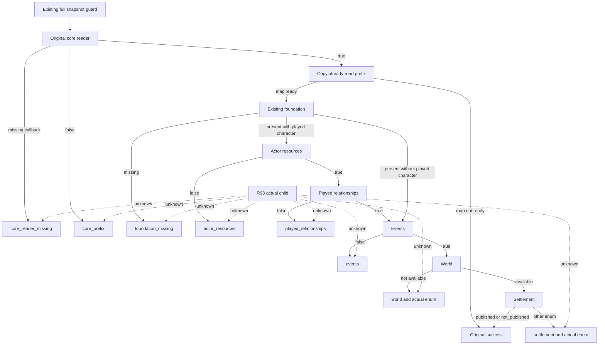

# Native78 snapshot read failure stages — CK3 1.20.0.4

R93 advanced and saved one ordinary day as saved6076/H10107/raw53290152.
The following Sway opinion query failed before its business handler: the
existing full-snapshot guard reported `current_snapshot_read_failed`, expected
revision 6 and native revision 6. The R93 original did not retain a child stage;
equal revisions do not prove a revision mismatch or identify a failing reader.

The exact build is CK3 1.20.0.4 / Steam25734779, EXE SHA-256
`98702F88A547CDE2EAF29A85F93B85F68EE4CF8148336A4F7AFAEB75319DD518`.
Original frozen runtime source is a4fa3d7fd4c8ce338490ffa8f7cce4ac2b5f0e0f.
The adapter now records the failure at one of its eight existing false-return
sites. It copies prefix facts only after the original core reader succeeds and
records the actual world/settlement enum only when that reader already ran.
The existing guard appends that same read attempt's stage to the original error.
The order, short circuit, read count and boolean outcomes remain unchanged.

Root's sole new focused qualification compiled and executed 12 helper/guard
cases successfully at 2026-10-10T22:05:54.631248Z. The cases cover the eight
stage formats and qualification of the same read attempt. They do not execute
the actual adapter or prove the R93 child cause. Adapter source equivalence was
checked once; the next Native78 production compile and live diagnostic remain
pending at source adoption. No old fixture suite was replayed.

Evidence is under
`D:/codex-ck3-background-spill/native71-continuation-20261010/continuation-63f/`
(`root-first/RESULT.json`, `FINAL-QUALIFICATION.json`, `SOURCE-JOIN.json`) and
`continuation-06h-r0093/DELIVERY.json`. New test EXE Defender registration
returned `admin_required_for_verified_readback`; no Add was attempted. Its
settings receipt remains independently incomplete, while compilation and actual
fixture execution succeeded. This source change adds diagnostics, not a claim
that the original game-state reading failure has been fixed.

Root production qualification completed: two actual production objects compiled,
897 retained, canonical GREEN with all39 bindings, and complete SDK78 ready.
Exact source is664c85d9dab3ff898826245e9b0a6053697e0bd6; actual Native78
read-stage observation still awaits cold recovery from saved6076.
