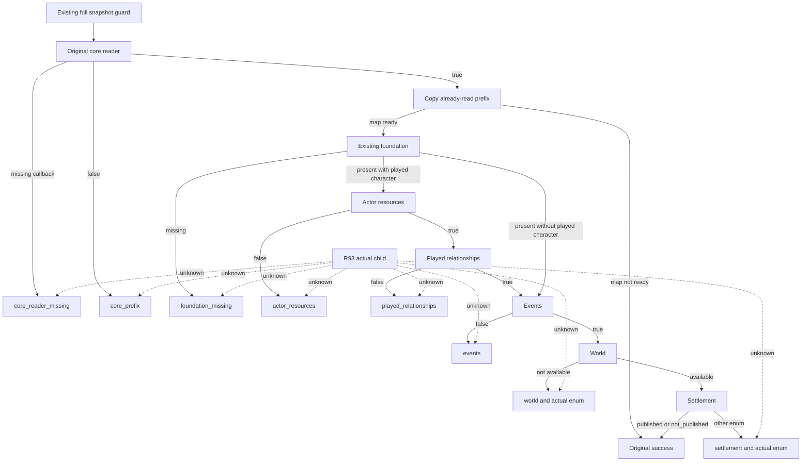
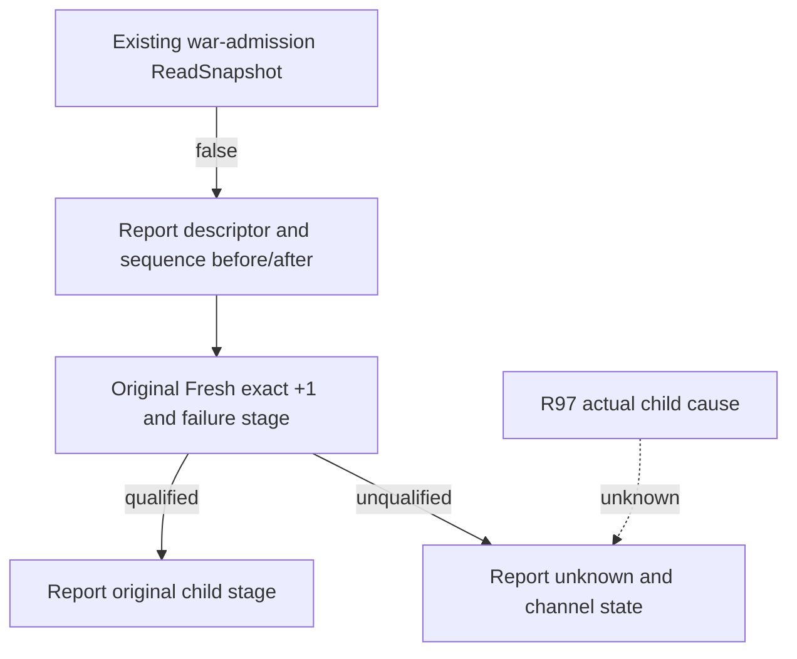

# Native78 snapshot read failure stages — CK3 1.20.0.4

R93 advanced and saved one ordinary day as saved6076/H10107/raw53290152.
The following Sway opinion query failed before its business handler: the
existing full-snapshot guard reported `current_snapshot_read_failed`, expected
revision 6 and native revision 6. The R93 original did not retain a child stage;
equal revisions do not prove a revision mismatch or identify a failing reader.

The exact build is CK3 1.20.0.4 / Steam25734779, EXE SHA-256
`98702F88A547CDE2EAF29A85F93B85F68EE4CF8148336A4F7AFAEB75319DD518`.
Original frozen runtime source is a4fa3d7fd4c8ce338490ffa8f7cce4ac2b5f0e0f.
The adapter now records the failure at one of its eight existing false-return
sites. It copies prefix facts only after the original core reader succeeds and
records the actual world/settlement enum only when that reader already ran.
The existing guard appends that same read attempt's stage to the original error.
The order, short circuit, read count and boolean outcomes remain unchanged.

Root's sole new focused qualification compiled and executed 12 helper/guard
cases successfully at 2026-10-10T22:05:54.631248Z. The cases cover the eight
stage formats and qualification of the same read attempt. They do not execute
the actual adapter or prove the R93 child cause. Adapter source equivalence was
checked once; the next Native78 production compile and live diagnostic remain
pending at source adoption. No old fixture suite was replayed.

Evidence is under
`D:/codex-ck3-background-spill/native71-continuation-20261010/continuation-63f/`
(`root-first/RESULT.json`, `FINAL-QUALIFICATION.json`, `SOURCE-JOIN.json`) and
`continuation-06h-r0093/DELIVERY.json`. New test EXE Defender registration
returned `admin_required_for_verified_readback`; no Add was attempted. Its
settings receipt remains independently incomplete, while compilation and actual
fixture execution succeeded. This source change adds diagnostics, not a claim
that the original game-state reading failure has been fixed.

Root production qualification completed: two actual production objects compiled,
897 retained, canonical GREEN with all39 bindings, and complete SDK78 ready.
Exact source is664c85d9dab3ff898826245e9b0a6053697e0bd6; actual Native78
read-stage observation still awaits cold recovery from saved6076.

## R97 war admission: expose the diagnostic channel

R97 sourcefc62 passed actual cold13 and observed the old marriage successfully,
then ordinary005 failed at02:28:15.583104Z with
`war-termination admission snapshot read failed expected_revision=2 native_revision=2`.
Its original error contains no child stage. The Native82 object lineage confirms
the actual Native78 adapter object/source664 is retained; its eight false returns
record a stage. The production header uses external inline thread-local storage
under the same fully qualified namespace. No source evidence proves a storage
split. Python carries the original native error unchanged.

The minimal war failure formatter now reports the descriptor match, diagnostic
sequence before/after and Fresh status. It preserves the original read count,
Fresh exact +1 rule, guards and success behavior. A missing receipt remains
unknown, with sequence_unchanged, sequence_not_single_attempt or
single_attempt_without_failure_stage distinguishing the observed channel state.

Root's sole [new two-TU FIRST](D:/codex-ck3-background-spill/native71-continuation-20261010/continuation-63j-r0097/root-first/ROOT-ACTUAL-FIRST4-AND-ADOPTION.json)
compiled0/run0 at02:43:54Z: four cases exercise the actual production header
across two linked translation units and the failure formatter. The actual
adapter/Game did not run; old12/5/6 cases were not replayed. Root adopted the
candidate. Native83 compilation and the next actual read remain pending;
no historical cause or live fix is claimed. Defender registration separately
returned admin_required_for_verified_readback, with no Add attempted.

## R98 actual private-prisoner guard read failure and shared channel

Recorded 2026-10-11T03:51:20.023940+00:00; exact1.20.0.4/Steam25734779 build remains frozen. R98 ordinary010
failed before prisoner business at the common NonwarPrivateSnapshotGuardFailureV1
caller (Bridge15182..15186), whose callback makes one ReadSnapshot. Original error:
`cause=current_snapshot_read_failed expected_revision=3 native_revision=3`.
No read stage is present; no child cause is inferred. Original response and
failure receipt are retained under native83-r0098. Private transport lines124..145
forwards frame.error without trim; Python requires no change.

The guard's failed-read renderer now accepts optional descriptor metadata; Bridge
passes actual IsCk3_12004Descriptor. With metadata, it reuses the63j formatter via
a general alias to expose before/after sequence and Fresh/read-stage facts.
Without metadata, the old wire remains. Actual read count/guard semantics and
success path are unchanged. Root's sole new FIRST3 compiled/linked0/run0, proving
new real-guard glue for absent receipt, one stamped failure and legacy metadata
absence; actual adapter/Game were not executed and the old cross-TU4 was not replayed.
Evidence: [new FIRST3](D:/codex-ck3-background-spill/native71-continuation-20261010/continuation-63k-r0098/root-first/ROOT-ACTUAL-FIRST3-AND-ADOPTION.json). Precise reader failure remains
unknown pending the next actual ordinary run; Native84 production build/fullSDK84
source binding are separate steps after source publication and R98 keeper release.

Native84 production qualification recorded 2026-10-11T04:08:32.037017+00:00: one Bridge compile/one DLL link
GREEN, source594979b0/archive664, completeSDK84 source594 GREEN. R99 actual
private-reader stage/cause is pending; no runtime root-cause fix is claimed.
