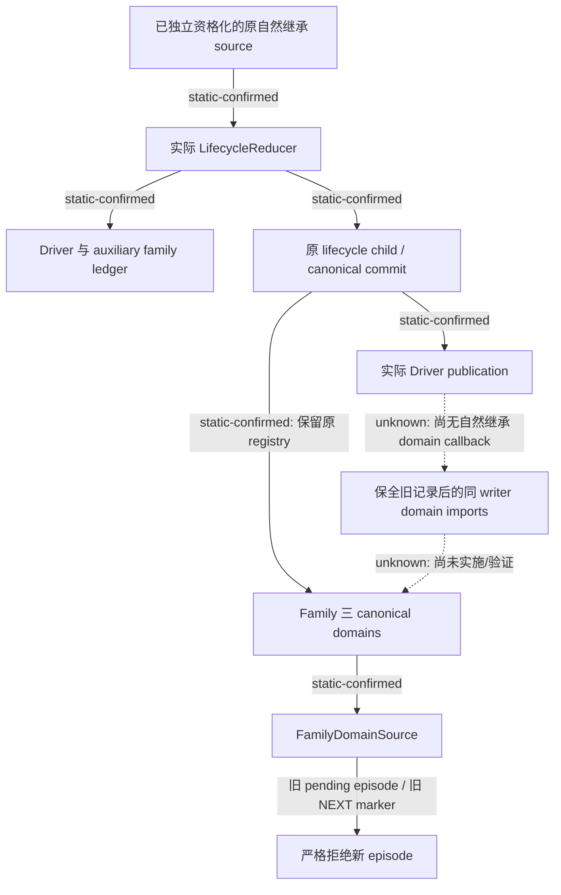

# 自然继承后的 Family 三域与原 writer 接续

`machine_id: xenoamess-full-tower-eb9d2c1186`。观察时刻 `2026-10-25T21:46:42.472247Z`，本机身份由 Root 在本次恢复任务中运行 `tools/ck3_live_run_id.py machine` 取得。本记录审阅实际 R5 可复用开发树 `D:/codex-ck3-demos/2026-10-25-java-g2-complete31-h5r5/java/ck3-control`；它早于后续修复，不代表冻结 runtime、编译、Loaded 或游戏现场。

已确认一个此前的继承来源研究没有覆盖的调用链缺口：实际自然继承 reducer 归档的是 Driver auxiliary 中的 `family_marriage_ledger`，普通 Family 策略读取的却是原 writer 注册的三个完整领域文件。两者没有在当前自然继承提交路径中接合。该结论来自下列实际 producer、writer 和 consumer；尚无本轮游戏重现或真实 private natural proof 的完整软件回归，不把源码推导写成已执行失败。

| 实际入口 | 已核行为 |
| --- | --- |
| `LifecycleComposites.continueNatural:207–228` | 原 `naturalPreparation` 的 FinalSnapshot 调用 `LifecycleReducer.continueSuccessor`；PendingFinalized 进入原 pending 收口。没有由本研究构造 natural authority。 |
| `LifecycleReducer.continueSuccessor:37–70`、`finalizePendingSuccessor:73–100` | 更新实际 Driver、goal、auxiliary；`archiveFamily:176–182` 只读写 auxiliary 的 `family_marriage_ledger`。三个领域 BodyRef 和完整字节不是此 reducer 的输入或输出。 |
| `LifecycleComposites.finish:471–544` | 生成实际 child，原 committer 提交，同 Session `requireCommitted`，再由本实例铸造 `ContinueSuccessor`。 |
| `LifecycleContinuityAuthority.project:57–76` | 原 writer 更新 `java_episode_lifecycle` 的历史、Driver digest/version、episode、actor；保留其他状态及 Family domain registry。 |
| `LifecycleComposites.publishRetained:653–659` | 核真实 canonical proof，调用 `DriverStateAssembler.publishCommitted`，随后返回原 proof；当前没有三个 Family domains 的 publication callback。 |
| `FamilyDomainSource.readCurrent:29–43` | 借用原 writer Session，读取 `FAMILY`、`CHILD_MATRILINEAL`、`DEFAULT_MARRIAGE` 的 canonical 完整 body，检查同一 head；不读取上述 auxiliary archive。 |
| `FamilyOrdinaryPolicy.pending:362–375` | canonical pending 属于其他 episode 时，实际返回 `INCOMPLETE_PRODUCTION_CHAIN`；`FamilyPendingProducer:74` 同时禁止覆盖或重放未决 pending。 |
| `FamilyNextEpisodeMigration.requireCurrent:99–106` | 有 `java_next_episode` 时，要求其 after-owner、player、episode 等于当前请求；即便 pending/resolved 都是 null，前代 marker 仍不属于自然继承后的新 episode。 |

两个应在真实链回归的触发分别是：前代 send 已独立确认、关系仍 pending 时自然死亡；以及领域文件曾经通过 NEXT/FIRST 初始化、当前无 pending/resolved，但之后发生同 Game 自然继承。前者保留的 canonical pending 仍指旧 episode；后者 top-level `java_next_episode` 仍指旧 after-episode。普通策略的严格拒绝符合其单独合同，缺的是有实际自然继承 authority 的完整领域接续。

不能拿现有 NEXT/FIRST 迁移代替这个动作。`FamilyNextEpisodeMigration.Transition:31–35` 明确要求前后 physical Game 不同；`RootFamilyOriginalDomains.initializeNext:78–138` 还需要实际 Root 私有 `EpisodeDomainInitializationProof`、完整 BASELINE、current CAS predecessor 和原件重放。`RootApplicationAssembly:1068–1099` 与 `RootInstalledCatalog:436–463` 的十三域初始化同样是 NEXT/FIRST 的合同。改一个布尔条件并不能产生自然继承授权。

当前最窄的既有接点是 `LifecycleComposites.publishRetained` 中实际 Driver publication 完成之后、`finished.put` 与 `LifecycleObserved` 返回之前。同一借用 Session 仍有效，私有 `PendingPublication` 保留原 parent、actual child、`Prepared`、`Receipt` 和 `ContinueSuccessor`。后续实现应由该 owner 提供窄 typed callback，调用原已注册的领域 import producer；先核实际原 commit，再逐领域保全完整旧 pending/resolved、旧 marker、原 body pin 和前后 episode/player。UNKNOWN 原动作和原提案不得重放，归档不增加婚姻、关系、费用或游戏推进信用。

部分 import 成功、随后外层登记同 parent UNKNOWN 时，head 后缀可能不再全是 `DOMAIN_IMPORT`。这不能成为放宽整个 writer、清 UNKNOWN 或重发 parent 的理由。须保留各领域原 import 的 `Prepared/Receipt`，按实际 canonical 历史与原 parent 身份恢复。现有 API 可用 `requireCommitted`、`requireHistoricalState`、`requireHistoricalHead`、`requireDomainImportContinuation` 和 `readHistoricalTransition(Pin)`；未采用的 `readHistoricalTransitionAt` 不能当成当前 API。

本次已将完整源链交给 Lifecycle、Family、Ledger 与 RootAssembly：Lifecycle 负责实际 parent/领域 publication 接线和原权威回归，Family 负责完整 body producer/consumer，Ledger 核 canonical continuation 与 UNKNOWN suffix；本研究继续原生候选和 claim helper 来源，不并写其目标。RootAssembly 与 M7 owner 均未提供现成可产生真实 private natural proof 的软件 fixture，不能用手工新 authority 或假归档补这个空缺。当前真实 Main provider 是 `RootStartupHostActualInputs → RootStartupInputsProducer.execute`，后续真实输入链具备时应从该入口验证。

精确源码 pins 已实际读回且每个读取前后 stat 一致；完整十文件清单在 `D:/codex-ck3-background/ck3-java-g2-resume-r4-20261025/resume61/native_succession/NATURAL-FAMILY-CHAIN01.json`。关键文件如下，后续 mutable 改动不得追认为本记录审阅的字节：

| 文件 | bytes | SHA-256 |
| --- | ---: | --- |
| `LifecycleReducer.java` | 26837 | `f01afbbfc6bac73172348e17b713b30e632a6a80ff9a3dac55ba7d3c20ca70dc` |
| `LifecycleComposites.java` | 122438 | `8213da2fbfcbf465888878c404c8706e1f5f68f396b60f4f32d3c964f67b2b88` |
| `FamilyDomainSource.java` | 6551 | `72a8fd4ffdc99fc6e6caafba9adfb217679f7d370027e4a0113980331c456505` |
| `FamilyNextEpisodeMigration.java` | 9838 | `b3f9e69fdcb12115f8cd002e20b1d7c0dfc5b8e2d68a6c559b44868b1c618105` |

本记录新增源码/测试/构建/游戏执行均为零；没有把此问题加入首场隐藏前置，也未打断 Host 当前编译或 batch。按通用存储策略 1.0.0，小记录于 `2027-04-23T21:46:42Z` 复核；未删除或改写旧证据。

## 后继源码候选

Lifecycle owner 随后封存 `resume61/lifecycle/natural_family19/SOURCE-DELTA19.json`，本岗实际读回为 **6543B / SHA `3dca7c8cdb6dfb469eb1a5e989b73f18d8e5eb1263290752e4ddab426c194487`**。它保留上表本次审阅的 `LifecycleComposites` 精确 preimage，新增同 owner 的 `CommittedNatural` 私有 token、按实际 physical `SessionIdentity` 绑定的 post-publication callback，并让原 warm 与已经资格化的 private cold 恢复走同一 hook；没有重建 warm Prepared。map 还封存原实际 managed acceptance fixture 的三域和历史读回，**不是已经执行的 JUnit 或 Game 验收**。

该候选须与 Family `natural22` 的完整 body producer/consumer 六源及 RootAssembly `natural71/SOURCE-DELTA71-NATURAL-FAMILY.json`（5364B / SHA `e1c5bedfbec5ba013abb15bfd5fcff88df5ab7ea999e2ea22eec4fc3236b315f`）成组选择，由 Host 在现有 mutable 树按真实前像采用。Lifecycle map 特别纠正了 `ALREADY_COMMITTED` receipt 可能返回后继 head 的问题：绑定原 canonical lifecycle event 的 actual after-head，不把较晚 receipt head 当原迁移起点。map 的编译、JUnit、actual managed chain 和 Native/Game 均为 NOT_RUN；本岗只读回 map，没有把候选源码或 owner 说明升级为运行通过。原缺口及原件 pins 保留，后继真正结果另记。

**19 的 cold 落点随后因真实 read-only scope 冲突而 WITHHELD，不能选择为当前候选。** 本岗实际读回的后继 `natural_family20/SOURCE-DELTA20.json` 为 9683B / SHA `e775fec2b9a98ed4fe856ba87cdc47e217d1997320f3caa0a87f1b6929b2565c`：cold `recoverCommittedPendingEpisode` 保持纯只读，只取得已有真正 private proof 的内存 custody；领域 import 移至现成 writable `ActionCoordinator.continueOriginalComposite → journal.locked → requireOutsideReadOnlyScope → LifecycleComposites.continueOriginal/observe`，在返回 finished `ContinueSuccessor` 前执行同一个 registered producer。warm publication 的窄 hook 不变。Family 需用后继 selector 将原 map22 的 Lifecycle19 依赖替换为 exact20，再与 RA71 成组交 Host。20 仍为源码候选，编译、JUnit、actual managed chain 与 Game 全部 NOT_RUN；19 原件和真实问题保留。
