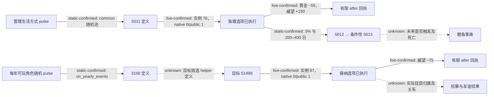

# P20 未覆盖事件的离线源码分析（2026-10-16）

本次同一受管战役的 P20 实际发生 16 条事件 fallback，其中 13 条此前未有 source-known 条目。批后 worker 已为这 13 条发布原版源码事实；冻结 P20 SDK 的加载器对 16 份实际 before 原件均回读为 known，worker 的各批 review 没有 unresolved。这里的 **known 仅指当前 CK3 1.20.0.4 的事件定义、全部源码选项和原生当帧身份已绑定**，不代表所选方案最优、间接脚本分支已走完或玩家收益已实现。事件 72 `faction_demand.1001` 的拒绝策略另有 P21 工作，本专题不重做。

证据根为 `D:/codex-ck3-demos/2026-10-14-robert-30year/continuation42-cold-prep/p21-offline-event-batch01`；其中 `DELIVERY.json` 的 SHA-256 为 `30e017c7383627ec4d912320052bd745c904f74e9d51fddb80e025ebf5bbb29c`。这是本机外置证据路径，不是仓库内或其他机器可直接读取的资产。`RECENT-P20-ACTUAL-KNOWN-INDEX.json` 保留每条实际事件的 before/after SHA、展示与原生选项索引、源码 SHA 及加载结果。两份隔离候选的 source-facts 与现存 canonical facts 逐字节相同，候选加载验证通过；**没有用候选覆盖活知识库**。本专题只提炼事件 76、87 的原版生产链与重要间接效果；其余 11 条新事实复用既有批次 review。

## 事件 76：鱼塘 `stewardship_general.5011`

当前原版 `common/on_action/lifestyles/stewardship_lifestyle_on_actions.txt` SHA-256 `89a901c0cfc09d1883c53124030d57f6023e600288db925a1b92de83feaf0bb9`：`stewardship_lifestyle_progress_pulse` 先经过管理生活方式、可玩角色、首都和近期事件链守卫，再进入 ongoing/common 随机池；该池第 73 行以权重 100 列出 5011。事件定义在 `events/lifestyles/governance_lifestyle/stewardship_general_events.txt:1433`，源码文件 SHA-256 `78de4fe8010bdb7c1b7968d767c306e86bfae75a99d50c358e392246735e59e3`。定义要求 landed、管理生活方式、若干对玩家不满的廷臣、非 tribal/nomadic；`immediate` 登记十年鱼塘 flag。实际窗口的原生定义是 `stewardship_general.5011`、calculated ID `3315011`、实例 76、root character 40526，不能从中文标题反推这些 ID。

原生当帧三个展示项依次映射 native 0/1/2，均已启用。已执行的是 rendered 0 → native 0 → public `select-event-option-1`，源码选项键 `stewardship_general.5011.a`。独立 after 回执证实原实例 76 消失、黄金 −55、威望 +150、压力不变。脚本给这个分支写有全体廷臣 `governance_fish_pond` 好感、按收入计算的 `medium_gold_value` 扣款、`medium_prestige_gain`（原版值 150）；好感未被本次后验独立测量。隐藏分支还有 **3% 几率**在 200–400 日后触发 5012；其后只有在随机找到符合条件的廷臣或宾客时才触发 5013，5013 的唯一选项包含 `death_carp_accident`。这是递归源码上的条件风险，不能写成本次已排程事故或角色死亡。未选的 `.b` 有管理能力决斗及议价奖惩，`.c` 可减压力但使廷臣失望；仅凭源码不能把已选 `.a` 判为最优。

## 事件 87：熟人提供廷臣 `bp1_yearly.3100`

当前有效入口是 `common/on_action/yearly_on_actions.txt:3018` 的 `random_yearly_playable_pulse` → `:3046` 的 `on_yearly_events` → `:3888` 权重 100 的 3100；该 on-action 文件 SHA-256 `14c97f3845138d74a2c2552c5dd3c95de1da035014a5cdf31c92540aae3390fe`。`common/on_action/yearly_groups_on_actions.txt:166` 仍留有 `bp1_yearly_events`，但自身标明停用，活跃入口也注释该 group 已退役并把事件并入 `on_yearly_events`，不能误认旧 group 为本次 producer。事件定义在 `events/dlc/bp1/bp1_yearly_events_chad.txt`，文件 SHA-256 `ff217f814f1ceb8e1eeee9546dcbfd892169d925fe381c8ec9cfc6148d967e13`；触发器寻找无交战的封臣、朋友或亲属所持有的熟练廷臣。

原生窗口记录 calculated ID `1083100`、实例 87、root character 40526；saved scopes 中 `3100_target_courtier=51498`、`3100_courtier_liege=40259`，还有六项技能候选。`immediate` 选目标的 `bp1_yearly_3100_pick_highest_skilled_courtiers` 调用可见，但在当前原版 `game/common` 与 `game/events` 的 `.txt` 文件中未找到其独立定义，目标筛选内部保持 unknown。两个展示项分别映射 native 0/1 且均启用；已执行 rendered 0 → native 0 → public `select-event-option-1`，源码键 `bp1_yearly.3100.a`。after 证实原实例 87 消失、威望 −75，黄金和压力未变。选项源码在 toast 内包含 `add_courtier=scope:3100_target_courtier`，另有 `minor_prestige_loss`、条件性的 `progress_towards_friend_effect` 和特质相关压力影响；关系 callee 在 `common/scripted_effects/00_relation_effects.txt:31–203` 依据现有关系和合法性决定设为朋友、潜在朋友或增加好感。**现有 after 没有核廷臣 51498 是否真正进入本廷，也没有核友谊变化**，因此不能给招募或关系收益信用。未选 `.b` 是威望增加并可能推进敌对关系；两项净效用需要完整业务后验才可比较。

两个原版 on-action/定义来源及其条件分支只证明**脚本可达路径**；引擎内部 pulse 调度、抽样和目标 helper 的实现没有凭本次审计闭合。真实出现、选择和原事件消失分别由 Native 当帧与 after 证明。我方普通规划器按同帧 `shown && enabled` 的最小 `rendered_index` 选项，再用其 `native_option_index + 1` 构造公共 MCP 步骤；它不读取原版 `ai_chance` 来宣称与原生 AI 同策。下次同一严格绑定来源可被现有 source-known loader 识别；未来 5013 等不同定义仍须各自留证与离线分析。
