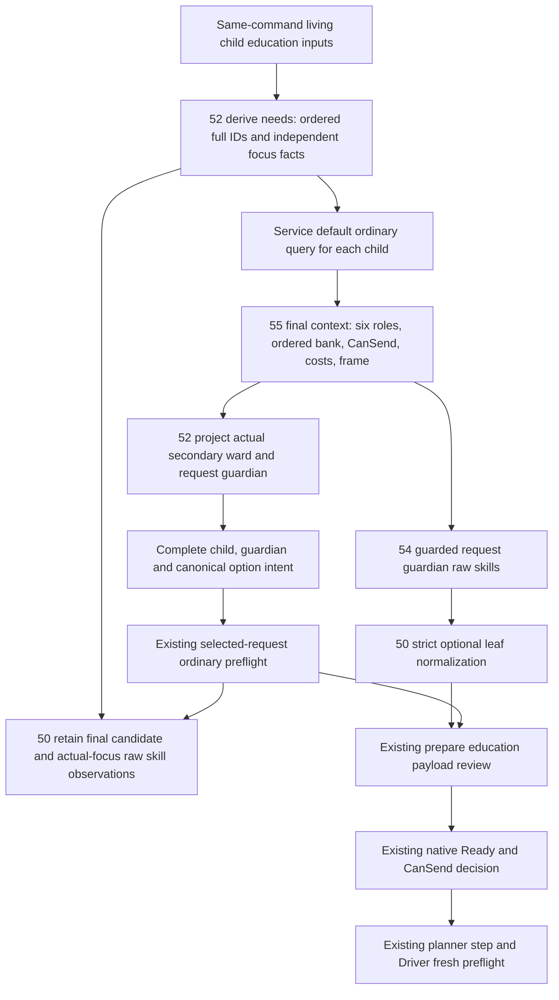

# Current 1.20.0.4 family education request planner

The family opportunity caller now consumes the current children's source-qualified education needs and the ordinary query's actual request pair. It retains the request guardian's raw skill profile with the child's observed focus and independent learning operand. The resulting request still uses the existing ordinary query, materializer, Driver and native send path.

This change is **SOURCE_AUTHORED_NOT_RUN**. No application import, test, build, game query or native dispatch was executed for this source package.

`Service._plan_private_family_education_v1` derives needs once and traverses their existing living-child order. The plan retains known-empty, partial and unknown inputs even when no child query is needed. Each queried child observation contains its needs, complete default candidate and default query. The selected request uses the candidate's generation-preserved child and guardian IDs, followed by the existing explicit pair and option preflight. Its observation also retains the final candidate and final raw skill projection.

Focus management states distinguish known absence, a present education focus, another present focus and an unavailable focus. These states describe observed focus management. They do not establish HasGuardian, an assigned guardian, an adult shortlist or the effect's saved educator scope. The present family transport supplies no same-command generic child relation materials; their observation remains unavailable instead of joining another capture's sidecar.

`request_guardian_skill_inputs_v1` is an optional leaf of an available exact .4 `educate_child_interaction` context. Its child and character IDs equal the final secondary recipient and secondary actor; its native revision equals the enclosing query revision. The existing query owns build, frame and native readiness qualification. A resolved role binding may coexist with unavailable individual skill reads. Known-null final guardian and read failure remain distinct.

The current source qualifies signed DWORD raw diplomacy, stewardship, intrigue and learning values at Character offsets D8, E0, E4 and E8. Zero and negative values remain signed values. Martial retains its independent `actual4_martial_name_enum_unqualified` result. The caller joins the profile child full ID to the needs row and compares the family native revision, date and played character with the corresponding actual query fields using exact types and values. A missing or mismatched join leaves the derived focus operand unavailable with a specific reason, while preserving the complete raw profile and focus facts. Learning retains its independently observed same-query request guardian value and actual child, guardian and revision binding. The record keeps that actual profile child separately from the requested focus child. This observation join introduces no native submit condition. The caller chooses a focus operand only from the child's observed current education focus key. Learning remains independently available; a learning focus reuses that same copied operand. The projection does not populate effect educator values or claim an observed educator selection.

The normalizer admits and validates this optional leaf, then preserves it in the complete public query. The existing materializer binds that complete query into its semantic content token. The token records content and frame; it supplies no user approval or native dispatch authority. The preexisting a05 ordinary support and Ready expressions are unchanged by this leaf. Partial skills, missing focus and martial unavailability introduce no new submit condition.

Options continue to retain every ordered row, duplicate full flag and raw bank byte. `ordinal_selected` is the own ordinal byte equal to one; compatibility `selected` remains the getter's first equal flag result. The request uses the current canonical keys of ordinal-selected rows. The final native query continues to determine option intent, role matches, CanSend, cost and frame.

Source owners are 52 (`family_education_needs_12004.py`), 54 (`ck3_12004_request_guardian_skill_inputs.hpp`), 55 (the existing ordinary query's profile read and serializer), and 50 (this caller and optional-leaf ingress). Existing 30 ordered-copy proof and 55 a05 support remain reused without another copy or allocator qualification. The package's adoption manifest pins the exact small source sections and owner handoffs.
