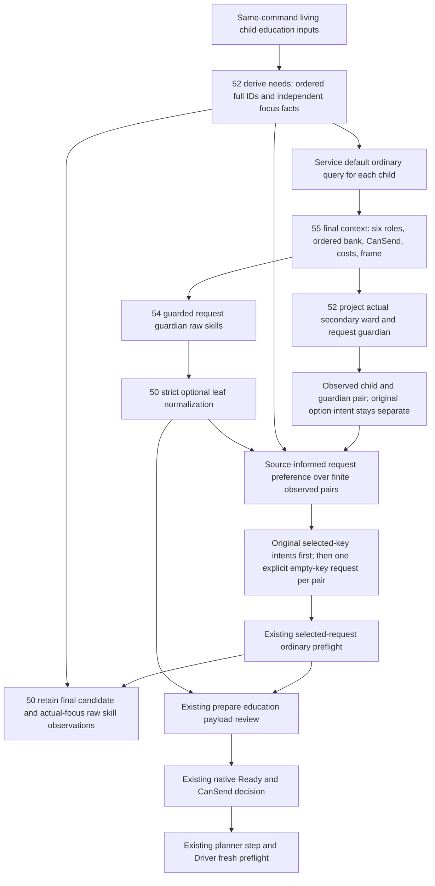
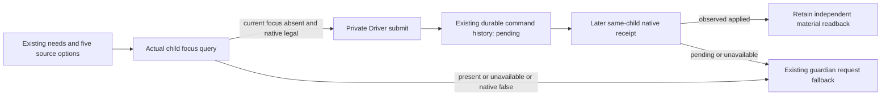

# Current 1.20.0.4 family education request planner

The family opportunity caller now consumes the current children's source-qualified education needs and the ordinary query's actual request pair. It retains the request guardian's raw skill profile with the child's observed focus and independent learning operand. The resulting request still uses the existing ordinary query, materializer, Driver and native send path.

This change is **SOURCE_AUTHORED_NOT_RUN**. No application import, test, build, game query or native dispatch was executed for this source package.

`Service._plan_private_family_education_v1` derives needs once and traverses their existing living-child order. The plan retains known-empty, partial and unknown inputs even when no child query is needed. Each queried child observation contains its needs, complete default candidate and default query. The selected request uses the candidate's generation-preserved child and guardian IDs, followed by the existing explicit pair and option preflight. Its observation also retains the final candidate and final raw skill projection.

The finite default queries are collected before the selected-request preflights. `family_education_request_preference_12004.py` gives their complete pair/key intents an explicit request preference using `(2 * corresponding focus skill + learning) / 5`. The weights reuse the retained stock education skill component described in [the source contract](guardian-education-choice-source-12004.md). The named focus operand is chosen from the needs row's current education focus key and the identity-bound query profile's raw named skill. This preference preserves the family focus frame and guardian query frame separately and permits their revisions to differ. It does not change the existing stricter same-frame focus observation projection. A profile must match the candidate child full ID, guardian full ID and its own query revision before its values influence the preference.

Only candidates with identical available component sets are compared by descending known weighted numerator. Different availability sets retain their original occurrence slots. Unknown focus, martial or learning stays unknown; no operand becomes zero and no candidate is removed for an unavailable skill. Ties use original occurrence, child full ID, guardian full ID and observation index. The planner records the component values, both source frames, complete or partial score, and actual attempt order. It then uses the original explicit pair and canonical keys for each preflight in that order. Native Ready, CanSend and the existing materializer review still determine the selected step.

Authored before/after example, with no execution: the first child has diplomacy focus and the observed request guardian has diplomacy 6 and learning 10, giving numerator 22. The second child has stewardship focus and the same observed request guardian has stewardship 16 and learning 10, giving numerator 42. Previously the first ready request was attempted first. The new complete-component preference tries the second request first; if its native preflight rejects it, the first remains available for an attempt. This example describes the authored selection rule and supplies no runtime result.

This is an explicit source-informed request policy. Full native AI willingness clauses are not retained, and the stock effect's selected educator is not observed by the request guardian profile. The culture branch can reset the effect component to 10; other traits and modifiers are not supplied here. The preference therefore records no AI replay, educator assignment or education outcome prediction.

Focus management states distinguish known absence, a present education focus, another present focus and an unavailable focus. These states describe observed focus management. They do not establish HasGuardian, an assigned guardian, an adult shortlist or the effect's saved educator scope. The present family transport supplies no same-command generic child relation materials; their observation remains unavailable instead of joining another capture's sidecar.

`request_guardian_skill_inputs_v1` is an optional leaf of an available exact .4 `educate_child_interaction` context. Its child and character IDs equal the final secondary recipient and secondary actor; its native revision equals the enclosing query revision. The existing query owns build, frame and native readiness qualification. A resolved role binding may coexist with unavailable individual skill reads. Known-null final guardian and read failure remain distinct.

The current source qualifies signed DWORD raw diplomacy, stewardship, intrigue and learning values at Character offsets D8, E0, E4 and E8. Zero and negative values remain signed values. Martial retains its independent `actual4_martial_name_enum_unqualified` result. The caller joins the profile child full ID to the needs row and compares the family native revision, date and played character with the corresponding actual query fields using exact types and values. A missing or mismatched join leaves the derived focus operand unavailable with a specific reason, while preserving the complete raw profile and focus facts. Learning retains its independently observed same-query request guardian value and actual child, guardian and revision binding. The record keeps that actual profile child separately from the requested focus child. This observation join introduces no native submit condition. The caller chooses a focus operand only from the child's observed current education focus key. Learning remains independently available; a learning focus reuses that same copied operand. The projection does not populate effect educator values or claim an observed educator selection.

The normalizer admits and validates this optional leaf, then preserves it in the complete public query. The existing materializer binds that complete query into its semantic content token. The token records content and frame; it supplies no user approval or native dispatch authority. The preexisting a05 ordinary support and Ready expressions are unchanged by this leaf. Partial skills, missing focus and martial unavailability introduce no new submit condition.

Options continue to retain every ordered row, duplicate full flag and raw bank byte. `ordinal_selected` is the own ordinal byte equal to one; compatibility `selected` remains the getter's first equal flag result. The request uses the current canonical keys of ordinal-selected rows. The final native query continues to determine option intent, role matches, CanSend, cost and frame.

## DEFAULT rejection and the explicit empty-key fallback

The caller previously discarded an available observed child/guardian pair on
DEFAULT `can_send=false`. That actual default query, candidate and raw profile
are preserved; the false result does not determine a same-pair explicit `[]`
query. Derivable ordinal-selected keys remain `default_request_intent`, including
known `[]`; unavailable rows/keys leave it `None`. A separate identity carrier
contains only observed pair IDs. The same-method comparison adapter records its
input basis; unknown default keys are not asserted empty.

Original selected-key intents are tried first in existing preference order.
If none selects a ready step, each pair gets one explicit `[]` fallback. Original
`[]` intents are not repeated. Every attempted query, review, final candidate
and raw profile is retained; compatibility `selected_request_*` describes the latest attempt.
DEFAULT false is not rewritten. The attempted query's actual Ready, CanSend and
available materializer review still select the existing initiation step.

The [existing native option source](education-native-option-rows-12004.md)
separates absent keys (native defaults) from `[]` (request all off). Clear is
followed by refresh/finalize/validate and actual role/bank/request readback; the
finalizer's toggle byte is not CanSend. Final readback must honor the request;
Service neither synthesizes zero bytes nor assumes legality. This source ledger
precedes the Service hunk. No new key, role assignment, AI or outcome meaning,
execution or qualification is claimed; no test, import, build or query was run.

Source owners are 52 (`family_education_needs_12004.py`), 54 (`ck3_12004_request_guardian_skill_inputs.hpp`), 55 (the existing ordinary query's profile read and serializer), and 50 (this caller and optional-leaf ingress). Existing 30 ordered-copy proof and 55 a05 support remain reused without another copy or allocator qualification. The package's adoption manifest pins the exact small source sections and owner handoffs.

The private child-focus consumer is `Service._plan_private_family_child_focus_v1`, mounted before the existing guardian request path at a family education opportunity. It queries complete observed living-child IDs without using an older family focus absence or unknown value as native legality. The five current stock options supply an explicit `source_informed_childhood_focus_preference_12004.v1`: known affinity adds20 and known disaffinity adds-20. Equal available component sets compare by their known sum, unknowns retain the original option slots, and the original five-key order breaks ties. This preference supplies no education outcome probability.

Each preferred key uses `query_child_education_focus_private_v1`. Only that actual query's available, absent current focus and native_legal true select `private-select-child-education-focus-v1`; a present focus is retained without replacement. Native false and unavailable observations stay distinct. `auto_turn` calls the actual private Driver submit method with the selected query. Its ACK or unknown send state remains pending in the existing durable command history. No new ledger is introduced.

The next family opportunity reads the owning submission by action ID from that history. A later native revision can use `query_child_education_focus_receipt_private_v1`; only its independent same-child `observed_applied` result records applied state. A pending or unavailable receipt preserves the original submission and permits the separate ordinary guardian request fallback. The actual played controller and validators belong to the new native query and owning command; no age, guardian or manual control predicate is invented by this consumer.

