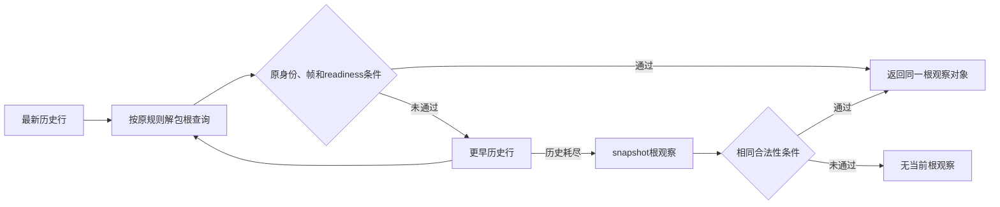

# P50：战役根观察的历史搜索开销

公共源码候选将已归档根观察的搜索改为从新到旧惰性查找，保留全部原有身份、帧和 readiness 条件。当前罗贝尔战役的 SDK48／P50R1 冻结源码未改，未部署此候选；自动游玩、录制和三十年交付不依赖它。

`machine_id: xenoamess-full-tower-eb9d2c1186`。本轮观察为2026-10-17 19:00–19:04 UTC（10月18日03:00–03:04 CST）；实际测量时间、输入 SHA、逐项结果和限制见[小型回执](evidence/p50-root-history-lookup-performance-2026-10-18.json)。其他机器和未来运行不借用本机性能数字。

## 先定位实际成本

[P49 已封定的118日片段](evidence/p49-settled-performance.json)耗134.924610秒，即1.143429秒／日；[stage并集](evidence/p49-stage-slice.json)把递归 plan 的42.765141秒累计纠正为29.275382秒独立 wall。该 plan 区间中已有约0.999秒 Native wait、2.612秒 semantic snapshot；其余不能直接写成 Python CPU。succession阶段4.448秒、family阶段2.734秒是嵌套分类，不能再与总 wall 相加。

该片段另有21次 full-state persistence，共10.448秒，其中 temp stream write约9.954秒；这说明不能仅以 JSON 序列化或 MCP 传输慢解释整局。已有[默认关闭的 WAL 实验](../../ck3_autonomous_player/experimental/driver_state_wal_v1/README.md)保留自己的恢复和实机资格边界，本次不重复建设、不热装。日期变化等待约69.960秒也不是纯 CPU 指标，不能靠删除合法观察或改变战争意愿消除。

本次选择已知生产调用中的一处等价 CPU 开销：`strategy._same_frame_campaign_root_context` 先扫描全历史并收集所有根查询，再逆序寻找首个符合当前 actor／native revision／date 和 readiness 的 payload。运行至8853条历史时，这种方式每次都解包整个前缀，即使最新几条已经含当前根观察。

## 等价搜索

新实现按相同优先级逐条逆序解包，找到首个合法根观察就返回原对象；历史全部没有匹配时，最后检查 snapshot 自带的根。未增加缓存、未跨帧重绑，也没有增加或减少 Native 查询。

玩家 GUI、原生 AI 候选搜索和桥接命令均未修改；此处只消费已有观察。war-entry、继续战争、终止战争、目标及配置的排序与合法性条件保持原合同。`open_kaishek` 为 not-applicable：本次只改 Python 历史读取，没有脚本语义可由其 parser／runtime 预验。

## 有限离线 A/B

原始材料是已关闭 P49 的 `0010-1-result.json` 中实际 `campaign_root_context`，152433 B，SHA `fd2f3dab9088b82009f49278641c616bd32d08fb451d1667201a6c51cb3740c6`；来源 build1.20.0.4／EXE SHA `98702F88A547CDE2EAF29A85F93B85F68EE4CF8148336A4F7AFAEB75319DD518`。只读该小响应及相关小 metadata，没有读取活跃 Driver、SAVE 或媒体。8853行历史是合成缩放投影，不能称实际完整转录回放。

每种路径交替顺序测9组、每组100次，取每次 lookup 的中位数：

| 同帧输入场景 | 旧实现 | 新实现 | 命令解包次数（旧→新） |
| --- | ---: | ---: | ---: |
| 最近4行内有当前根 | 0.500624 ms | 0.001194 ms | 8853→4 |
| 历史与snapshot均无当前根 | 0.552196 ms | 0.594758 ms | 8853→8853 |
| 仅snapshot含当前根 | 0.549569 ms | 0.554935 ms | 8853→8853 |

三种路径返回对象身份完全相同；Native评估次数均为0。正常命中路径少约0.499毫秒，miss路径在本次测量中慢约0.043毫秒（7.7%）；不能宣称所有路径更快或已经改善游戏日／分钟。它是局部小优化，不能把约419倍 lookup 比值写成整局加速倍数，<1秒／日、0.5秒／日仍未验收。

12种离线比较保留最新合法历史优先、auto-turn封套、旧帧／错误角色／缺必要项回退、可选规则缺失、snapshot兜底及输入不变。正式普通规划与战争替代权限相关测试25项、21子例通过；新增回归明确检查同一对象和优先级。首次新测试错写 auto-turn 封套，修正测试为既有生产者的 `auto_turn.result` 后通过，没有为测试改业务语义。

额外运行的旧 `test_nonwar_planning_root_reuse.py` 存在4项失败，原函数在独立进程复算仍同样4 FAIL／1 PASS：旧 Council mock不接受 `position_key`，旧 relationship mock未提供当前 sidecar 完成回执。回执保留原失败，不把这些过期夹具修复扩成当前三十年推进的前置工作，也不声称全部测试通过。

## 下一次采用边界

只在后续正常 SDK 来源准备时评估此公共候选；当期首三十年、MCP永久存档与视频先行。后续若实测整局收益，应使用同策略、同帧候选身份／配置和相同后置语义，报告完整墙钟与暂停／查询次数。较大机会仍是已观察的 plan wall、持久化写入和日期等待，先靠现有分层计时定位，不通过降低战争意愿、增加投降或减少必要应战换吞吐。

外置包为 `N/p50-root-lookup-performance01`（N见[当前交接](../handover/2026-10-18-robert30-clean-vacation-handoff.md)）；使用统一存储策略的小文件1MiB预算，无重型写入、无删除。派生包48小时复核时点和闭场空间读回见回执，不续存所有历史资产。
