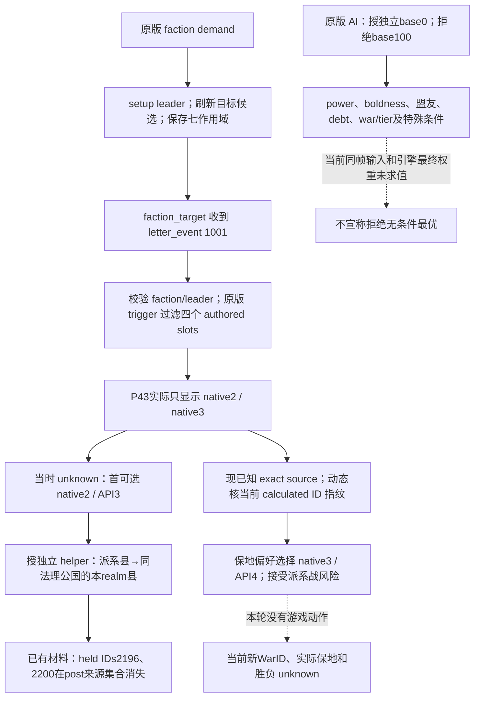

# P50：本期失地来源与续行时保留民粹知识

本轮复核确认，P43 的一次民粹最后通牒选择本身会授独立，而且原版影响范围可以大于窗口中的单个目标头衔。已知的两个直接持有头衔 ID 在这次选择后的来源帧消失。P43 的动态绑定修复已同时存在于公共源码和交接指定的 SDK48 冻结源；本轮没有重复修改策略。续行的具体优化是保留已经学到的当前 exact registry 闭包，避免新 SDK namespace 只带初始 character-event seed、再次把该事件当作未知。

本次执行 `machine_id: xenoamess-full-tower-eb9d2c1186`，实际观察为 **2026-10-17 18:18:36–18:25:14 UTC / 10月18日02:18:36–02:25:14 CST**；身份来自 `tools/ck3_live_run_id.py machine`。本轮只读取小型历史投影、源码和 source registry；Game／MCP／OBS调用、Driver／SAVE／媒体正文读取、游戏动作均为0。完整来源、机器边界、命令和摘要见[本轮小证据](evidence/p50-populist-loss-prevention-2026-10-18.json)。P43 原 AUDIT 没有 machine_id，故历史材料仍记 **`machine_id: unknown`，所属机器未核实**；这次在已知机器上读到文件不补造其历史机器身份，也不形成当前游戏状态验收。

## 能解释的失地与未闭合范围

[P43 有限审计](p43-populist-current-source-and-natural-audit-2026-10-17.md)固定的 AUTO193 是 `faction_demand.1001 / instance41 / calculated3571001`。当帧只显示 native2（rendered0／API3，授独立）和 native3（rendered1／API4，拒绝并开派系战），均可用。原计划 `registry_known=false`，按用户对未知事件的首个可选项规则选择了 native2，原实例随后真实 advanced。这是已发生的让步，不能撤回或重放。

审计中的直接持有集合从 `[2196,2200,2230,2231,2262]` 变为 `[2230,2231,2262]`，后集合的来源绑定为选择后的 `native:4191`；同游戏日 `native:4190→4191` 的战争数从2变0。`2200=c_siracusa` 已有原首战独立绑定，`2196=c_messina` 仍只是同一 stock source-order 的推导。集合中包含不同层级头衔，不能把5→3算成领土面积减少40%。两ID的移出是真实已有材料；新持有人、全部领地边界以及两场战争各自结束原因尚未独立闭合，也不能把本期所有失地都归因于这一个窗口。

原版 `successful_popular_revolt_outcome_effect` 的普通分支不是“只转移 target_title”：它从派系成员县出发，取这些县所在法理公国内仍属于 faction_target top realm 的县，再按王国分组移交并独立。符合条件的公国、战争占领扩展及王国过半后的处理又有各自分支。因此一个目标为2200的窗口可同时造成多个头衔退出；原首战确胜与后来主动让地可以同时成立。

## 原版来源与决策树

本轮实际读取的 `.4` 来源为 `events/factions/faction_demands.txt`（SHA `eb17720ca9d48acfb8cc24e5f61edc62fd2d4d2d599561c92854fc762104eccd`）、`common/scripted_effects/00_faction_effects.txt`（SHA `c7f853b9c8cf836cfc6b635c58bfa3c31a686528e99f5628e320a1d97a5efc70`）及 `common/factions/00_populist_faction.txt`（SHA `c67853a56bcea26ed90427cdba7ed4a51968ee085ec88e34fe2976ce5437dd4d`）。前两份全文 SHA 与[已有原版树](ck3-1.20.0.3-faction-demand1001-populist.md)一致，可复用这些脚本文本的分析；旧 `.3` 的 EXE、ABI、力量或实机结果不迁移为当前 `.4` 事实。本轮未读取当前 EXE，也未重验运行时绑定；离线 fixture 声明的 `.4` EXE SHA 为 `98702F88A547CDE2EAF29A85F93B85F68EE4CF8148336A4F7AFAEB75319DD518`。

候选与实际调用者也已核对：两处 faction `demand`（927、1568行起）先 `setup_populist_leader_effect`，随后再次 `get_popular_revolt_target_effect` 刷新目标，保存 faction、leader、target_title，收集受影响封臣，再向 faction_target 触发1001（1015、1665行）。目标 helper（effects93–267）从派系县及其法理父链取得候选：成员数至少11且目标为王国级时尝试王国，再在至少5且公爵级时尝试公国，按法理范围内反叛县征召兵及持有人／主头衔折扣排序，最后退到征召兵最多的成员县。这里只记脚本实际写出的顺序和条件，不把注释替换为不同的布尔语义；原生 faction 列表的底层索引、调度以及当前实际评分未重读。

## 修复已存在，续行需要带上知识闭包

旧拒绝 hook 除来源 SHA 外还固定旧 `calculated3551001 / f4179448…`，所以即使 P43 worker 学完新 `3571001 / 14b787d2…`，旧 hook 仍会漏掉。现 `_source_known_exact` 使用当前 native definition ID 重算应有 exact 指纹，同时保持 `.4` 来源／完整选项目录、当前帧、PID／generation、actor／七作用域、双按钮映射、enabled及advertised step守卫。它没有开放通用 letter-event source-rebind；未知事件仍遵守原首可选项规则。

本次 exact 核对：

| 闭包 | 公共源码与SDK48结果 |
| --- | --- |
| `populist1001_known_refusal_v1.py` | 同为14717 B，SHA `6e8a57777c042bdc77ecac12a31cd526993470ecdd94fcbe507c7598c7abb66c` |
| context／offline loader／build registry | 三叶全文分别相同；精确SHA见小证据 |
| Strategy 的 annotate→choice 调用块 | 相同，SHA `67835b25a827f8d3f7a4540cc8a75580fc51283e776879b36ec8a7ecebc2def5` |
| Service 的 refusal receipt verifier 块 | 相同，SHA `735195ae019b2f890b8b55e6751cd09d6dd03191d9661aa76338986a01f5ede2` |

Strategy／Service整文件有其他P48/P49差异，不宜为此整搬公共文件覆盖被冻结源。**本项不需要 runtime patch。** 当前 SDK48 生产 loader 对旧 state 的真实文件验证成功，按14b787d2 exact 条目注解后，原193投影选择变为API4；没有source knowledge的同一投影仍为API3。

对新namespace，复用原state，或迁移以下最小三件闭包并由实际loader读回：

- `state/evidence/event-source-registry/14b787d272428d83ecbf6e7e9e13389b6b3857688c4e0e7fb007a851cd61b17f.json`，1299 B／SHA `2127e8163fcbd9232572cb26b24d7f95c22191aba8a4b13e058f640b89bb225d`。
- 该entry引用的 `facts/14b787d2….json`，45102 B／SHA `4564f0f8af65591708ab8f9b580250d71084b091c44cc06e97775462e243a5cd`。
- entry内绑定的原版事件文件及可读绝对路径，SHA `eb17720c…`。本机路径原样有效；换机器不能直接照搬绝对路径并宣称已知，须重新建立和验证来源绑定。

不因SDK namespace变更清掉持久知识；只复制初始58组character-event seed会遗漏这份letter-event知识。未来若实际calculated ID、build、来源、选项布局或上下文改变，继续按现有规则采集、首可选项续行、批后离线分析；本轮不预造未来exact ID，也不修改未知事件默认规则。

## 验证与后续观测

在交接指定 `sdk-p48-candidate01/src` 上运行现有两组聚焦测试，**29 passed in4.40s**，覆盖当前ID／旧ID、来源／目录变动、过期绑定、普通Strategy注解、Service前后采集及错native回执不重放。另用生产loader实际重读当前state entry／facts／原版源后执行同一policy，得到 `active_event_source_reviewed_populist_refusal / select-event-option-4`。没有游戏动作；测试拒绝回执为synthetic seam，实际保地、开战、胜利、自然继承或G2分子均不增加。

本轮未改／执行CK3脚本，`open_kaishek`对原生窗口身份及Python planner／Service接缝不提供对应语义，预验记`not-applicable`并附fixture SHA；未为形式重复执行引擎。私有检查脚本最初与stdlib `inspect`同名造成import失败，尚未进入产品测试；移除脚本目录的import搜索路径后才完成上述验证，原故障与产品RED分开记录。

新增公共准备工具 [`qualify_populist_source.py`](../../tools/g2_saved_campaign/qualify_populist_source.py)，供新namespace准备脚本在携带知识后调用。参数为 `--package-root`（实际SDK/src）、`--state-dir`（实际新state）、`--fixture`（可省略，默认固定仓库P43投影）和 `--output`（新回执文件）。它先清除fixture自带known，再由所选SDK的生产loader读取目标state、验证当前14b787d2 exact来源，最后由已有policy回放到API4；不实例化SDK／Service，不产生游戏命令。当前真实state返回PASS／API4；缺失知识的空state返回预期FAIL／unknown／API3，证明没有借用fixture自带known或只检查文件存在。两份运行回执SHA分别为 `162209888c343a7ed0cb7a1bd60ae493febec9706f4472fbdbf214d022610640`、`e39cd0194415cd6dc94b2866175ce5b0a80cdc28caf5259064323a6f9edbf48b`。这项检查针对已发生的知识丢失回归，不新增游戏／战争门禁；Root可在新namespace实际state落地后接入一次。

## P43至P49有限后继核查

后继审计只按小请求metadata定位SEM，读取单件不超过256KiB的74份SEM及25份小before capture；未读取AUTO／Driver／SAVE／媒体正文。P43／44／45／47／49的SEM数依次为27／7／12／13／15，P46／48请求目录没有JSON。25份capture中只有原193的1001，未发现第二份民粹授独立capture；这不是对所有战争或全部历史动作的穷尽审计。

| 后继最后SEM | 当前snapshot／raw | 继承表内held来源 |
| --- | --- | --- |
| P43／1779 | native5983／53293416 | native4191／53263944，3ID |
| P44／462 | native6286／53297328 | 同上 |
| P45／696 | native6681／53302224 | 同上 |
| P47／787 | native7681／53317032 | 同上 |
| P49／656 | native8533／53331120 | 同上 |

所有后继继承表都保留 `[2230(duchy),2231(county),2262(county)]`，其binding却一直是原授独立后的4191，而非当前SEM帧。**不能将这份继承缓存称为P49当前持有集合，也不能据它证明后来没有继续失地。** 当前小材料只闭合原193的那次选择与持有集合变化，没有新证据能给后来其他失地分配原因。续行若要分析当前损失，应复用已有estate／succession只读查询取得fresh held集合，再与当前faction／war后态匹配；不为本次离线研究新增游戏调用。

下一次自然出现该known窗口时，继续使用原生选项与现有战争流程，并独立核原实例消失、saved faction的新WarID／defender身份及直接持有集合；收到ACK不增加保地信用。若需要比较让步与抵抗的质量，优先复用现有faction alerts的same-frame `surrender_impact`、power／成员县输入与战争观测，匹配saved FullFactionID再使用；本次历史窗口缺这些同帧输入，不能补猜胜率或无条件最优。不得为该研究重放193或重开1066局。

本包遵循通用存储策略1.0.0，task_start／task_close及后继闭场均有机器与实际卷读回；外置小件合计低于1MiB，0重型写入、0新重型预留、0删除。Root确认本包写入属于同160GiB共享预留范围、原复核期限为2026-10-18T11:49Z；其capacity小回执只作引用，本worker不独立授新容量准入。外置派生包闭场48小时后按用途复核，主仓小结论按record180日复核；本轮不续租共享run容量或延长原SAVE／媒体保护。
