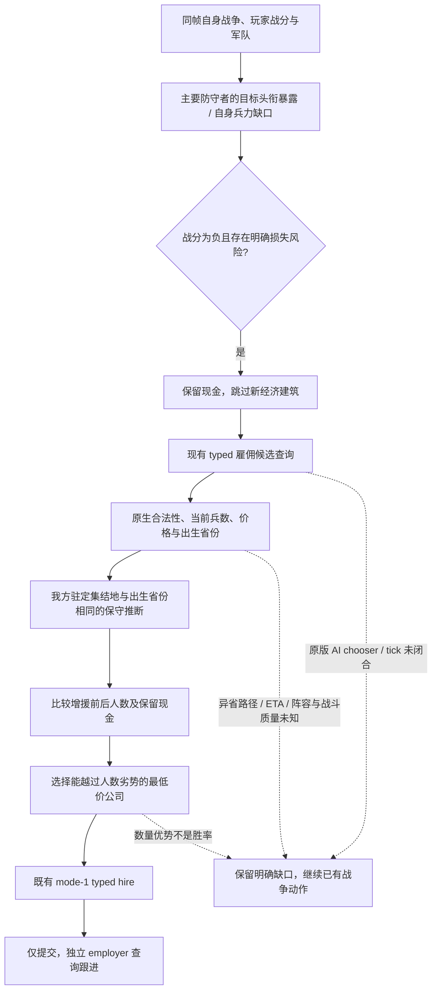

# 输势战争的现金与雇佣兵权衡

用户于 2026-10-18 要求：保卫自己领土的战争恶化时，先比较败战损失、当前战况、兵力缺口、雇佣能否改变兵力对比及是否赶得上，不能仍按和平建筑收益花钱。本包并行于现有罗贝尔长局；不修改冻结 SDK48、Native25 或运行中的游戏。

## 实现前的原版来源与边界

复用 [actual4 雇佣候选与 mode-1 hire 原生树](mercenary-query-and-mode1-hire-migration-12004.md)。该来源冻结 `1.20.0.4`、EXE SHA `98702F88A547CDE2EAF29A85F93B85F68EE4CF8148336A4F7AFAEB75319DD518`：当前 manager 按原顺序给完整 CompanyID 候选，分别求 current soldiers、CanHire、十资源价格、payment status、CanAfford、合约时长、出生省份；写口重新解析公司、重新验证后排入原生命令队列。候选查询不是原版 AI chooser；原版 AI 候选评分、重新计算 tick、最终购买意愿仍 unknown。旧 [1.19 军事预算](military-preparation.md) 的 80%/1.25/70% 参数不能直接外推给 actual4。

`machine_id: xenoamess-full-tower-eb9d2c1186`；2026-10-17 19:05:19 UTC 只读核对当前安装的 `common/defines/`，[小型来源摘录](evidence/p50-war-mercenary-defines-2026-10-18.json)保存路径、SHA 和行号。当前 `NMercenary` 定义雇佣范围、合约与原版债务上限；没有证明旧 AI 比率仍被当前原生 chooser 消费。没有启动游戏、调用 Native 或重读 EXE。

## 我方策略合同

这是独立玩法策略修正，不计作策略中立的性能收益。败战目标暴露不等于已证实的 title transfer，负战分不等于战争败率；分列当前输入与推断。新经济建筑只在明确的自身高威胁条件下被让位，已提交建筑的独立回执仍可读，原战争动作继续执行。雇佣仅在原生合法且可负担、能够把已知人数劣势变为人数优势、能够在当前驻定我军集结省份出生时考虑。该空间模型明确是推断，不宣称零日抵达、部队已经生成、能救下正在结束的战斗或已验证能打赢。

## 当前已实现的普通规划链

`war_reinforcement_tradeoff_v1.py` 分列自身主要战争、玩家战分、可能暴露的防守目标、独立兵力查询和保留现金理由。主要防守战争战分为负且有目标头衔，或自身战争战分为负且当前已动员兵力不足，先抑制新经济建筑；原版终局失败分数也保留现金。没有猜测一个“损失百分比”或把混合头衔计数当面积。战分为正或仅协助盟友时，不构成普遍禁建。

`construction_formal_consumer.py` 的门设在旧 pending／完工回执处理之后、查询新建筑与新现金支出之前。原来的推进、驻守和具体军令继续存在。普通 `Service` 在否则推进的战争回合调用 `war_mercenary_consumer_v1.py`：现成 typed 雇佣查询 → 同帧候选规范化 → 必要时现成 campaign-root 财务查询 → 决策 → 现成 `hire_mercenary_v1(company_id, expected_revision)`。缺能力或本帧查询失败会继续原战争动作，不反复查询卡住时钟。单独预览 plan 不消耗查询机会。

兵数优先取 `snapshot.army_strengths` 中的 `current_soldiers`。只有 `army_strengths_queried_snapshot_id/revision` 与当前快照一致的 available／partial 缓存才可用；Native driver 在发布该缓存前已经核对 native revision、日期、角色、episode、连接代次及 scope 身份。复用现有 `_same_frame_army_strength_balance`，没有把语义快照中的 `soldiers:null` 补成零。空间模型复用原战争规划器的 regular、无路线、无移动目标、非战斗／非退却状态，比较原生预计出生省份是否等于己方驻定集结省份；异省路线与 ETA 仍是后续观测入口。

提交前写入 `war-mercenary-pending-v1.json`；超时／丢 ACK 保留未知，冷 SDK 不重发。独立较后雇佣查询观察到 employer=玩家时，仅记录 `employment_observed`；付款与军队生成仍为 false。新雇佣军尚未进入独立军队库存时，阻止连续购买第二队；已知拒绝也不能用同一旧报价在同帧死循环。既有建筑、送礼、婚姻 pending 使用现有共享读取合同让位。

## 合同与现金维持

2026-10-17 19:15:15 UTC，在上述机器核对当前安装的原版定义：[精确摘录及 SHA](evidence/p50-mercenary-contract-source-2026-10-18.json)。`game_concepts_l_english.yml` 第 705 行把该合同描述为一次性费用，第 702 行说明合同内解散后重新集结无需再次付款；军事界面用原生报价和角色相关合约时长显示这笔交易。[官方开发日志 18](https://admin-forum.paradoxplaza.com/forum/developer-diary/ck3-dev-diary-18-men-at-arms-mercenaries-and-cbs.1357939/)也说明雇佣改为预付合同，没有月维持费。这是原版合同与说明来源；不声称已验证所有费用结算分支或任意 mod 改写。

`war_reinforcement_finance_v1.py` 使用同帧钱包、原生整个合同报价、实际 `hire_duration_months`、campaign-root 总收入与最大军事月维护费。不会把整个合同报价再乘月份、不会虚构一笔重复的月雇佣维护费。继承已有 200 金底线和已存在的 18 月军事资金分配系数，最低余款取二者的较大值：`max(200金, min(18月,合同月数) × 当前最大军事月维护费)`，同一笔预留不相加两次。

收入侧保持 gross 含义；`gross − 最大军事维护费` 只表示军事小计余量，不能叫 NET。详见[2026-10-05 历史 NET 纠正](war-cash-current-resources-12003.md#2026-10-05-勘误旧-net-字段实际为月总收入新版完整支出合同)。现金维持模型不预支未来收入，并输出扣合同价后的现金、军事分配期限、可覆盖的恒定当前军费月数与完整净支出缺口；它不是所有未来支出的上界。维护费升高时，即使余款仍超过 200 金，也会拒绝无法保留该军事分配的公司。

## 当前罗贝尔小样本与离线结果

初始独立帧 `native:8535/public2/date53331120` 的 [8KB 冻结输入](evidence/p50-current-war-risk-input-2026-10-18.json) 记录主要防守战争 `100663323`、目标 `2230`、战分 `-12`；兵数缺失保持 null。回放明确跳过新建筑报价并保留原战争推进，同时在支持相应能力时请求雇佣机会。它不是当前实时帧。

另从已封普通 AUTO44 与 AUTO46 取得 [7.8KB 同帧兵力侧车](evidence/p50-actual-operational-strength-2026-10-18.json)：两者精确对应 `native:8588/public55/date53331960`，我方 1351、敌方 1575＝135＋1265＋175；后者包括一支退却军，不能当全部立即可交战兵数。现有原规划器的兵力与 base-power 汇总完全一致；SEM 里的兵数仍为 null。角色与省份来自同帧驻守 admission，不把初始 8535 的钱包／收入追认为 8588 的当前财务。

离线混合回放明确标为“实际作战输入＋合成市场及财务”：一个同省出生、1200 当前士兵、150 金的合成公司会令集结点人数 1351→2551，超过已观察敌军 1575，因此能够走到 typed hire 决策。合成钱包 413.36412、gross 5.92266、最大军费 4.512 时，余款 263.36412、18 月军事分配 81.216、保留底线 200；忽略收入的军事现金覆盖为 58 整月。这些财务数字沿用初始观察值作为合成场景，**不是 8588 的新原生财务或实际雇佣结果**。人数变化证明该选择改善当前模型，不证明战斗能赢。

最终重点测试 **20 项通过，7.34 秒**，[实际执行回执与源码 pins](evidence/p50-war-reinforcement-offline-2026-10-18.json)包含 registered normal MCP 的查询→typed hire→冷 SDK pending→独立 employer 读回、真实 production Native driver 在合成 endpoint 上的查询来源入历史，以及旧战时／安静路线建设两个 compound。新用例覆盖源缓存失配、缺财务查询、费用维持反转、同帧拒绝、丢 ACK、具体军令与旧建筑回执优先。新增独立测试已经接入 `static-ci.yml`。

扩展旧建设 consumer 时有 7 项失败；改用未改的 HEAD 原 consumer 同样 7 项全部复现，见[基线回执](evidence/p50-war-construction-baseline-2026-10-18.json)。另一组 root／history／建设回归有 49 项及 93 子例通过，旧 R724 fake-driver 的 7 个失败先在未改的 `take_internal_semantic_snapshot` 因缺少 `command_timeout_seconds` 发生，尚未到达本包查询代码。没有为这些旧夹具中断游戏或扩大改造。

本包只改变公共源码和离线证据，未摄入当前冻结 SDK48、未构建 Native、未操作运行游戏、存档或录制。实际长局仍按它已冻结的来源运行；后续合法新 SDK 摄入与真实雇佣／战果验收分别记录。精确临场 ETA、跨省到达、兵种克制与指挥官质量，以及完整战争收益／损失效用尚未被这个最小数值模型替代。

## 当前长局可复用的原有 MCP

[已封 CAP2 能力摘录](evidence/p50-native25-existing-mercenary-capabilities-2026-10-18.json)确认当前 Native25 原来就广告 `query-player-mercenary-context-v1` 和 typed `hire-mercenary-v1` capability；本包未新增它们。Root 可在既有合法批边界查询当前角色的新鲜市场、财务和兵力，再经原有 typed MCP 作单次雇佣及独立后验；这条手动原生路线不要求更新冻结 SDK48 或重启 Game。新普通 auto 选择器的运行资格另记。该历史 CAP 不证明新角色已经雇佣、当前价格或合法性，不能直接复用上文旧玩家数值。
