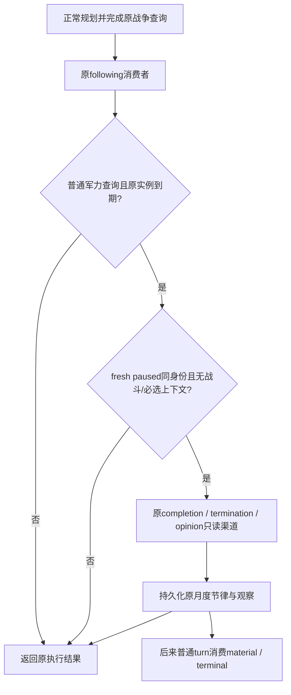

# P56：普通战争查询后的已启动 Sway 观察

`machine_id: xenoamess-full-tower-eb9d2c1186`；2026-10-17T21:59Z 开始离线施工。
基线 `410e1b3ff0c41d0893c72c096aa89421c3cc42b3`，交付时父分支为
`0eb18ca13bf6213da779618355d6199cde6126bd`。[源码与验证证据](evidence/p56-sway-quiet-observation-2026-10-18.json)
记录实际 source SHA 和测试层次。本次没有访问当前 R3、SDK、Game、MCP、Driver、SAVE 或媒体；
没有热装或新运行。G2 仍6/8，M6/M7不增分。

[P55](p55-g2-m6-m7-natural-coverage-2026-10-18.md)已确认普通调度只接 baseline `life-advance`，
因此战争时钟或路线推进可饿死已有 Sway 的首次 baseline、月度 material 和 terminal 观察。
本候选增加一个窄读窗口：**原普通军力查询完成后，观察已应用的原实例**。
原生输入、具名收益与终态语义继续使用[既有 Sway 来源合同](sway-beneficial-terminal-followup-12004.md)，
没有改原版候选/AI模型或我方战争选择。

## 原战争查询先完成

[Service](../../ck3_autonomous_player/src/xar_autoplayer/bridge/service.py)在原执行及原 following-turn 消费之后
调用新[quiet observer](../../ck3_autonomous_player/src/xar_autoplayer/bridge/ordinary_sway_quiet_observation_v1.py)。
仅接 `native_war_army_strength_query` 的成功 `query-army-strengths-v1`，要求 result status为
available/partial并包含实际 army rows。现有 strategy 的这一分支本来就先排除 combat/retreating/gathering。
围城救援、战斗、撤退、接触预测、路线推进、驻留时钟及其他 selected step均不进入此窗口。
已有 `ordinary_sway_optional` 的一次调用也不再重复观察。

只有 original applied/postcondition-verified ledger、无 pending、原 observation权限已启用时才检查月度资格。
未到期、无原实例、原实例已terminal或其他actor不取额外 Native snapshot，不发 Start/Stop/重提 pending。
到期后读取 fresh paused/map-ready帧，再核同 Game PID/连接、actor/episode/date、明确未 pending identity，
无 event/interaction/exclusive modal，且全部 player armies明确不在combat/retreat，随后复用原同实例读取器。
首次原identity观察和之后30游戏日节律继续由同一个 scheduler持久化；Service重建不重置期限。

`selected_step`、原 result、战争动作和游戏时钟保持原义。新增观察放在旧 following消费之后，
因此当次新增material/terminal不会冒充被刚刚已完成的查询消费；后续普通轮次仍走原消费者。
读失败沿原 cadence推迟，无同日重试；可选存储/读取异常保留原已完成结果，不授权重放。
输出复用 `ordinary_sway_optional`，额外标记 `schedule_window=after_completed_ordinary_army_query`，
便于现有 d0a closed-AUTO审计识别 job与来源。

## 仍保留的边界

这是一个额外的普通军力只读窗口，**不是所有战争形态的公平调度保证**。
如果长时间只有 route/contact/驻留时钟，或本来处于战斗、撤退和救援等紧急分支，观察仍可延后。
初次 Start 仍只走原普通 `life-advance`机会，本包不扩大新目标或新 Start范围。
到期意味着可检查，不保证 Native读取可用、产生新增收益或自然终局。

新观察仍须原 action/actor/target/fullID/generation与独立来源匹配；中性
`terminated_unattributed`不升级为成功/失败原因。M6仍需真实 active baseline→新增具名收益→自然terminal→
后来普通消费的完整原证据。本候选没有完成这一实机链。
当前运行冻结树与 owner source epoch没有采用本候选，不能只热换leaf或把公共源码就绪视为已部署。

## 验证

新增[六项测试](../../ck3_autonomous_player/tests/unit/test_ordinary_sway_quiet_observation_v1.py)
接真实 Service auto-turn编排、原只读 Service wrappers、normalizers、持久化 ledger和following消费者。
普通规划/军力执行、Native返回和OS边界均为synthetic；没有游戏进程。
主组合验证原查询先执行、baseline/gain/中性terminal持续归档、月度节律跨Service重建、后续轮次消费，
并覆盖空/pending/关闭权限、紧急或换身份帧、其他战争动作、已有optional、读失败和存储失败。

首轮新增5项及原 scheduler/Service的15项共20项通过。随后收紧军力status检查并补一项
空ledger/pending/权限回归，仅重跑新增文件6项通过；加CI入口后按该入口直接执行6项再次通过，
unittest正文0.107秒，含导入工具墙钟约2.15秒。三次结果分别保留，不拼成新业务成绩；没有重跑旧68项矩阵。
默认 Start目标/冷却与完整普通war优先级仍由原回归验证。

CI增加该小文件的独立命令。`open_kaishek: not-applicable`：本次是Python只读调度与既有接口编排，
没有新增Paradox语义、Native ABI或CK3验收。来源/测试小回执按统一存储策略复核，未复制存档或原片。
