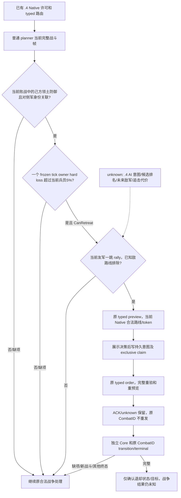

# P76：普通战斗规划器的有界主动退却消费

`machine_id: xenoamess-full-tower-eb9d2c1186`。本包于 2026-10-18 UTC 进行源码集成和 synthetic endpoint 资格；具体时间、命令及源码 SHA 见[证据索引](evidence/p76-ordinary-active-retreat-consumer-2026-10-18.json)。当前游戏、录制、MCP owner、冻结 SDK 和 Native DLL 均未修改。状态是 **普通生产路径源码已接线、离线资格通过，未部署／未取得自然 .4 退却业务证据**。G2 保持 **6/8**。

普通自动规划器原先会读取当前战斗并选择有界继续观察，主动退却 typed API 没有普通消费者。现在增加一条窄分支：己方主导的防御领土战战分为负，当前战斗对侧至少一支完整 CUnit 确实在该战敌军观测中，己方当前参战人数不高于对侧，且同帧 frozen main tick 的 selected-owner hard loss 超出明确政策预算时，先核真实一跳友军集结路线，再最多提交一次已有原生退却操作。缺条件时继续原来的合法战争处理。

## 来源与政策边界

本包先复用 P70 已封来源：外置 `p70-native-retreat-admission01/AUDIT.md`、候选 SHA `9bdfe453492ed6813e546c25363df3a0c2164dad5a8e97a3cd47dc3a2d1acf85` 及其 11 项资格；[P60 操作入口](p60-native-constructor-nohire-and-retreat-2026-10-18.md)解释原生能力与本机 .4 边界。历史 R7 CAP0002 的实际广告包含 BattleControl、PreviewMove、Move 三个原语，来源 SHA `7c6f509ab51f0bff54524f9f467aa3dccb637bf9476fe6dcaef9878892d90796`，绑定 CK3 **1.20.0.4**／EXE SHA `98702F88A547CDE2EAF29A85F93B85F68EE4CF8148336A4F7AFAEB75319DD518`。本包没有重新读取 CAP、大 Driver 或游戏内存。

原生许可、原生 AI 意图和我方政策分开：现有 NativeDriver 负责 CanRetreat、完整 frame/成员、一次性 token、原生路线重预览、H3937 及最终 move 验证；没有新增“先成功才能首次调用”的审批门。旧 [.3 原生树](battle-retreat-and-continue-native-ai-12003-2026-10-03.md)不迁移成 .4 AI 意图或排名证据；.4 通用 AI 战中主动退却的候选枚举、评分、重算周期和自然命令 producer 仍为 unknown。

我方当前预算明确取 selected owner 的同帧 Entry 当前兵员总数的 **5%**，单位 Q100000；只在上述正在失利的己方领土防御、当前战斗人数劣势范围内生效。预算比较的是现有 production adapter→frozen runner 的一个冻结主阶段 tick hard-loss；它不是实际下一日预报、原生 AI 阈值、完整败战率或“退却损失更少”的证明。人数对比只说明人数，不代表有效战斗力。领土目标是暴露范围，CB 最终割地、这场战斗的战分归属及未来战争结果分别未证。固定 5% 是初始自有保军政策，后续须以真实结果校准，未宣称最优或优于原版。

## 普通生产路径

[Service](../../ck3_autonomous_player/src/xar_autoplayer/bridge/service.py)仅增加三个小接点：普通计划之后、可选雇佣之前调用[规划消费](../../ck3_autonomous_player/src/xar_autoplayer/bridge/ordinary_retreat_service_v1.py)；允许其三个普通阶段路由；已有 `before_submit` 展示／拦截之后执行。没有修改 `strategy.py` 热区。消费复用真实 `_battle_control_turn_state`，不另建当前战斗识别器。

候选来源为当前其他同 owner、可控、正兵力、静止且不在战斗或退却中的友军所在省。完整的已发布敌方当前位置／路线／目标必须可读，候选不能与其中任何一项重合；已有 typed preview 必须确认一跳原生路线以及完整同源 frame。排序沿当前友军观测顺序，尚未复刻原生 AI 目标排名。单军没有目的地时明确留下 `no_observed_rally`，不凭首都身份假定安全。未来敌人、未集结部队、到达后的安全及 pursuit 损失仍未知。

事件、交互、结算、强制窗口和已选具体命令保持优先。规划阶段不调用 Native；预览、提交和只读后验均由执行阶段拥有。预览不可用或同帧已尝试后回原流程，不在同一 frame 查询循环。新 token 不允许重发旧未决命令。

## 单发与后验

提交前先持久化 pending，再按 episode／selected CUnit／完整 CombatID exclusive 创建、flush/fsync 原意图，随后调用现有 typed Service。故障发生在两次写入之间仍留下 observation-only ownership；缺 ACK、异常、重启或更换目标不能重发原战斗命令。fsync 文件不外推目录级断电验收。明确的原生 rejected 不授效果信用，保留 claim 后回原流程；这一版本对同一 CombatID 故意只尝试一次，尚未开放拒绝后重新决策。

ACK 不是完成。独立 Core 必须是新 public frame、同 episode／连接／角色，逐军核同 owner、非战斗、retreating、目标和精确路线；原 CombatID available 时，full-side 核对侧 winner 与 pursuit/done，owner-subset 核 affected 离场且 unaffected 仍在原侧。若原 CombatID 已消失，改用**已有**严格 terminal reader；full-side 仅在 observed journal、normal_result、原成员、对侧 winner、原实例实际移除，以及 subject/全部 affected 的真实退却目标路线一致时授退却状态观测。

没有 journal、抑制结果、缺军、重新入战、连接变化或删除后的 owner-subset 分支保留 pending，普通 lifecycle reader 继续处理，不因此重发或伪造 terminal。`command_causation_verified=false` 始终保留：这些独立状态不单独证明命令与自然战败之间的因果，更不授胜利、保地、付款或战争成功。尚未取得自然 `.4` preview→order→完整独立后验和保存链；旧 1.19 构造夹具不提供该信用。

新增测试覆盖真实 Service 正常计划、before_submit、auto_turn→NativeDriver synthetic .4 端点的预览／提交、持久 unknown 的冷对象不重发、明确 rejected、源变更、原生重预览路线变化、H3937、完整现有 transition/terminal normalizer 及各身份负例。测试结果与最终 source pins 见证据索引；既有 Native 退却和 frozen-tick 诊断测试只作相关回归。没有性能 A/B 或实战效果提升声明。

外置研究包 `p76-ordinary-retreat-consumer01` 上限 512KiB，沿 parent `43a2697c…`／effective `cc715804…` 的既有小 source 范围，global 新增预留 0；到期复核仍是 `2026-10-18T11:49:00.265518Z`。原场自动游玩和录制不以本包为继续前置。
