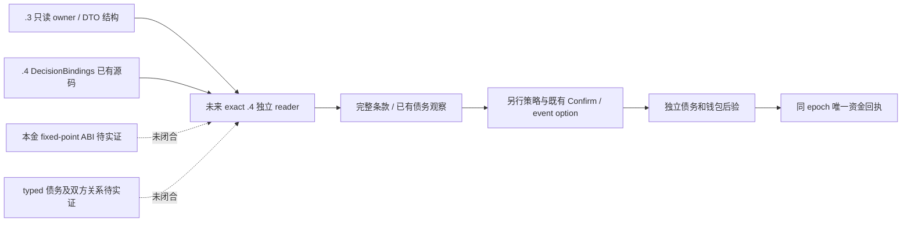

# P83 增量：exact 1.20.0.4 贷款读器的复用与缺口

本次仅核仓库源码和已有小证据，`machine_id: xenoamess-full-tower-eb9d2c1186`，观察于 2026-10-18T11:18Z；精确 UTC、来源 SHA 和协议草案见 [source map](evidence/p83-exact12004-loan-reader-source-map-2026-10-18.json)。没有读取或操作现场 Native、EXE、SDK、游戏、Steam、MCP、桌面、活跃树、媒体、存档或 Driver，没有构建、热装或后继新局。此文不是实机资格，也没有新增公开查询路由。

[筹款诊断补丁](p83-financing-capability-stages-2026-10-18.md) 已区分通用 Confirm 与贷款到账。后续最小工作应继续复用 `query-player-holy-order-loan-context-v1` 的只读职责、原 application-main owner 和帧信封，在 exact `.4` 来源闭合后提供独立 `.4` schema；无需重造借款命令或解除 `.3` admission。当前 Python normalizer、Native mailbox 和 factory 都仍硬限 `.3`，不能只改版本字符串。

| 数据 | 可复用源码 | 必须补齐的 exact `.4` 事实 |
| --- | --- | --- |
| 决议最终门槛 | `ck3_12004_religion_context_addons.cpp:26–41` 已有 decision database/hash/lookup、root、shown、CanTake、cost、CanAfford 入口 | 贷款实际定义身份、当前 borrower scope、当帧合法性和 owner 稳定读取；这些入口的存在不证明当前人物可借 |
| 十槽费用 | `.3 ReadDecision:92–104` 本来调用 evaluator 写入十槽数组 | 原 DTO 与 JSON 仅保留 gold[0]、treasury[6]、prestige[1]、piety[2]。未来完整保存十槽、scale 与状态；不得把其余六槽补零 |
| 当前本金 | `.3 ReadAmountRaw` 按 `holy_order_gold_value` 查已加载表达式，并在 root scope 求值 | `.4` fixed-point registry、fallback/type、evaluator、上下文布局、scratch 构造与释放全部需要独立闭合，不能照抄 `.3` 地址或从旧公式手算报价 |
| owed / holder | `.3 ReadVariable` 区分缺失与类型，holder 按 fullID 解析，另读双方 years | `.4` variable context/row/payload 类型、真实作用域、fullID store 与稳定性；holder 能解析不等于其 debtor list 包含 borrower |
| 双方关系 | 既有 [原版审计](evidence/p87-loan-actual-install-source-2026-10-18.json) 说明 setup 的 owed、holder、原身份与 lender 债务人关系 | typed 原身份及其定义作用域、实际被选 lender、lender→borrower 成员关系需读器实证，不能由事件 root 或钱包增加推断 |
| 查询与到账后验 | 复用现有 query 元数据/同帧 guard；通用 Confirm 有唯一 claim，未知不重放 | 查询/Confirm/事件出现均不是本金到账。需要后续新帧独立债务身份与可归因钱包变化，再生成唯一资金回执 |

现 `.4` `holy_site_decision_cooldown.cpp` 的 source pins、RTTI/type/key 和双次稳定解析是**决议定义**的可复用模式；它们不证明 fixed-point script-value registry 或贷款变量 ABI。`.3` 和 `.4` 的部分决议入口地址不同，另一些相同，不能统一加减偏移。此轮没有读取二进制，因此没有产生新的 `.4` ABI 证明。

证据内的小协议草案保留 source frame 和 exact build 外壳，并将本金、完整十槽费用、typed owed、holder、原双方身份、lender 债务人关系分别设为可用/不可用观察；没有读取时保持 unknown，缺失变量与未读取不同。`available=false` 时不生成零本金、零费用、false 成员关系或可执行借款资格。草案未注册、未被普通 planner 消费，也不是孤立授权 validator。

可采用的实现顺序是：先在独立 `.4` 源叶闭合实际 getter 和 owner 读取，再串接完整 DTO/serializer/normalizer；本金或债务任何必要源未闭时整个贷款条款保持 unavailable。后续合成协议测试应针对完整十槽往返、typed absent 与 unknown、错 actor/frame/build 和债务关系不一致；这些软件测试也不能替代原生读取实证。没有必要先做一个猜测地址的 `.4` reader stub，因此本包只交付源码差额方案与小协议，没有 C++ / Python 生产代码或额外财政测试。

资金策略原有边界已再次核对：`observe_procurement_package_budget_v1` 保留原 anchor、重叠战争闭包与累计合同；`emergency_quote_budget_v1` 在同/低等级保留原 limit，当前钱包增长不会自动刷新。没有贷款/退款 receipt consumer。未来真正到账需按独立唯一 receipt 在同一采购 epoch 修订，继续累计已付/未知承诺并重新观察完整市场条款；本次未提前实现 credit、增加额度或改变建设门槛。取消工程的 final CanCancel、退款/费用与项目/钱包后验仍是另一项实质接口缺口。

本包仅新增本专题和小证据。JSON、相对链接、精确来源 pins 做一次自核，不重跑已通过的 12 项诊断夹具或旧财政矩阵；公共发布、Native 采用、借款/退款/雇佣/保地结果均须另有实际记录。小型记录仍在同一 N42 reservation 内，新增 reservation 0，11:49Z 复核期限没有延长。
