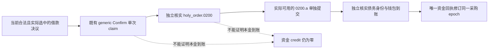

# P83 增量：战时筹款能力分层与零到账入账

本次为公共源码补丁，尚未提交、推送或部署。观察于 2026-10-18T11:10Z，`machine_id: xenoamess-full-tower-eb9d2c1186`。没有运行或读取 CK3、Steam、Native、MCP、桌面、冻结运行树、存档、Driver 或媒体；最终编码继续独立运行。精确源码与测试回执见 [小证据](evidence/p83-financing-capability-stages-2026-10-18.json)。

复核 [P83 建设资金门槛](p83-wartime-construction-cash-and-financing-gaps-2026-10-18.md) 后，胜势战争也已经要求工程全款后保留军费、未付承诺和完整原生应急雇佣报价。本增量不改这项现金政策，也不扩大 [P87 政治生存危机](p87-political-survival-crisis-profile-2026-10-18.md) 的开支资格。

仍有一个生产诊断错误：`observe_war_financing_capability_gap_v1` 和普通战争显示还称当前 `.4` 借款提交通道未实现。[已有原版来源审计](evidence/p87-loan-actual-install-source-2026-10-18.json) 已说明通用决议 Confirm 可复用；缺口是当帧完整贷款条款、typed 债务和可归因到账后验，不能继续把这些层混为“没有提交通道”。原版来源先于本次补丁，复用其 06:37–06:41Z 的原始读取及 SHA，本次没有重读安装目录或追认当前加载状态。

原版定义在 `holy_order.0200.a` 调用贷款 setup 并支付，本金不是 Confirm 或事件出现时就到账；tooltip 金额也不是锁定报价。图中后半段是尚需闭合的资格路径，本补丁没有执行或新增它。取消工程仍缺完整退款/费用条款、合法取消及独立项目/钱包后验，没有采用退款百分比。

诊断现分别记录源码已知的 Confirm 工具/能力名、借款决议和预期事件；只从调用方传入的能力集合记录是否公告，未传则保持 unknown。即使公告，也保持当前合法决议未核实、完整条款未核实、typed 债务未核实、到账未核实，以及 `submit_planned=false`、本金/退款报价 unknown、未到账资金 credit=0、未知提交不重放、资金回执保持原采购 epoch。没有新增 query、action 或 capability。

诊断还会检查战争 ID 仍在当前 `active_wars`；已不活跃的历史 priority 行不再触发危局。该 ID 检查不单独证明整份 priority 的帧身份，生产调用方仍负责由当前 snapshot 生成它。最大军费复用现有 actor/native revision/date 根上下文校验，过期或异人的根只能报告维护费未知，不能用它制造当帧短缺结论。普通战争显示改为“取消工程与合法借款仍待当帧条款及独立到账核验”，不再声称已完成经济评估或缺少所有借款执行通道。

新增定向软件夹具 **12 passed in 7.03s**，进程 exit 0；launcher 与唯一 pytest 子进程实际优先级读回均 `0x4000`（BELOW_NORMAL），没有并发 pytest 或旧矩阵重跑。覆盖公告/未公告均不授借款资格、旧帧维护费、历史战争、布尔伪金额、普通 consumer 保留已有未知工程回执和战争时钟、零动作与零资金 credit。普通生产 helper 和 consumer 直接参与这些夹具；游戏输入是 synthetic，不是取消、借款、雇佣、拦截或保地的实机验收。

本包仅修改两个 Python 叶、新测试、CI 原财政分组的单个测试登记和本专题/证据。冻结 SDK、`runtime-source-00a70009`、当前编码源没有修改，无热加载或新游戏。小型日志/回执复用原 N42 单一 160 GiB reservation，新增 reservation 为 0，未延长 11:49Z 复核期限；未清理任何旧资产。公共提交和后继运行是否采用须另有实际记录，不能从本次软件测试外推。
