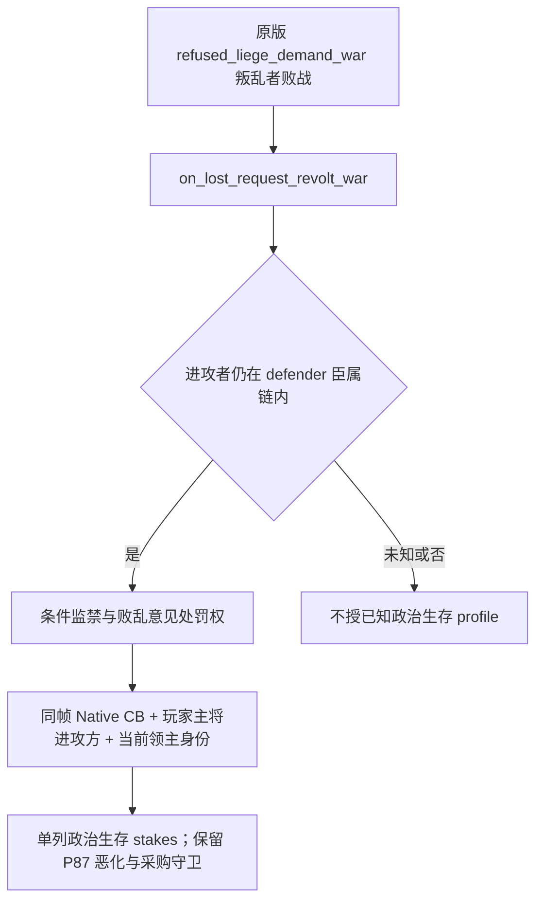

# P87：拒绝领主要求叛乱的政治生存风险

`machine_id: xenoamess-full-tower-eb9d2c1186`。2026-10-18T07:27:16Z 先核原版定义及现有 Native 观测，再处理公共策略；来源与阶段见 [小证据](evidence/p87-political-survival-crisis-profile-2026-10-18.json)。本专题不授当前 SDK49、未来 SDK06、借款、付款、佣兵到场或战果信用。

`refused_liege_demand_war` 的叛乱者属于进攻方。现有 P87 两处 `defender` 条件会漏掉这一角色；把它改称头衔受攻击会混淆真正的风险。实际安装的原版 `00_civil_war.txt:1595` 在叛乱者败战时调用 `on_lost_request_revolt_war`。该 effect 对仍在防守方臣属链内的进攻者生效：未被囚禁者触发监禁，防守方获得 `vassal_lost_faction_revolt_war` 意见。该意见带有剥夺头衔、监禁、放逐及处决理由。**理由与条件监禁风险不等于自动剥夺全部头衔或死亡。** 直属叛乱者另有派系冷却；本次不把这些效果的实际发生当成已验证事实。

现有 `NativeDriver._war_termination_cache_for_snapshot` 只向同一暂停 Native 帧投影查询结果，校验 snapshot/native revision、连接、episode、阵营、主将与战分。现有 campaign-root 给出同帧人物、直属／最高领主及 exact `.4` provenance，故不需要新增 EXE 或 Native load。只能以明确命中的直属或最高领主证明该关系；不可推断未观察的中间领主。缺同帧查询、角色不符或来源未知时保留普通策略。

原版来源先于实现完成：三叶全文 SHA 已实际读回并记录；公共实现与定向验证待后续追加。原普通规划器入口为 `GameplayBridgeService` → `plan_war_mercenary_turn_v1` → `assess_mercenary_reinforcement_v1`，已核其真实调用路径；不会另建仅供测试的采购路线。

## 公共实现与定向软件资格

`war_political_survival_stakes_v1.py` 单列政治生存 profile，只接受当前活跃战中的玩家主将进攻方、原生 `refused_liege_demand_war`、同帧查询和已观察的 defender 领主关系，且 campaign-root 必须绑定已审 `.4` provenance。政治 stakes 不写入 `title_targeted`。缺少查询、来源不符、错帧、错连接、错 episode、盟友或普通进攻 CB 都保留普通策略；本次不新增 Native reader，也不为未知 CB 强制插入新查询路由。

普通 Service 的原消费者把这个 profile 传入战争现金优先级及战略采购判断。新增政治应急政策只接受原等级2的 −75 战分与组合恶化证据，不开放政治等级1覆盖；每一笔政治应急采购都必须条件兵数反转。完整合同立即可付且其他承诺保留时，等级3才接受军费现金缓冲不足风险。到场、集中、胜率、未来债务发生仍未知，未到账筹款信用仍为零。同 epoch 原现金锚、累计已付／未知承诺、升级需新帧及未知 pending 单发守卫保留。持久政治 profile 也校验完整来源绑定，不能仅凭标签获得资格。

最终新增定向 **23 passed / 0 failed，pytest5.95秒，进程7.17秒，exit0**。测试调用公共实际缓存投影及注册 MCP → GameplayBridgeService → 原雇佣消费者；Native/Game 输入为合成，实际加载的五个公共模块路径和 SHA 已读回。覆盖来源／角色负例、普通进攻战不扩权、缺恶化、−74战分、不能反转（包括仍能保留较短军费缓冲的报价）、缺完整报价、未知 pending、同 epoch 不重开及未到账资金伪造拒绝。首轮夹具方法名错误的失败与中间软件资格均保留；最终结果对应完整来源与上述窄触发条件。未重跑原36项矩阵。合成 camera-unavailable 日志不授真实摄像机或游戏信用。

新测试仅追加进现有 losing-war CI 组；远端终态由后续实际发表提交单独观察。当前 SDK49、future SDK06 与主局均未修改。后继新局采用须显式携带新增 helper 与四个消费者叶、对应 source contract，并用该目标 namespace 的真实同帧 Native CB／root 输入另做资格；本次软件通过不能抵扣部署或实机业务结果。
