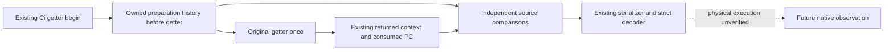

# Person inputs before the actual Ci getter

The existing knight-stat callback previously read Native65 preparation history
after its original Ci getter. Source now also copies that same owned history
before the original getter and carries both copies through the existing context
serializer and Python decoder. This makes the callback's entry inputs observable
independently of data produced or changed during the getter.

The frozen source contracts are [six-stage native capture](battle-person-six-stage-native-capture-12004.md),
[entry context handoff](battle-person-entry-context-handoff-12004.md) and
[installed transfer](native71-person-installed-transfer-12004.md). The new source
binds the existing exact1.20.0.4 EXE and nine existing Ci getter return sites.
It reuses the same begin event; the input leaf creates no clock or native query.
The original getter is still called once with the original receiver.

`preparation_entry_inputs` retains the selected full ID, original getter site,
existing event and pre-getter history. `current_input_outcome_binding` retains
independent comparisons against the same getter's returned character/context,
Native65 preparation identity, model owner and consumed PC. False, unavailable
and true comparisons remain distinct. These facts describe supplied source data;
they do not prove callback truth, goal success or a new action gate.

The strict decoder accepts both fields optionally, so older records retain their
existing shape. CMake registers the two new implementation units in the existing
Runtime target. No new observer, query, fixture target or Bridge.cpp hook is added.

Root adopted the nine-file13/62/59/60 source package assembled by34. The owner
cancelled tests: imports, compilation, linking, execution and new Game operations
are zero. This is source-only integration, readiness `research`. The already
compiled Native84/fullSDK84 source594 artifacts are unchanged; this source has
not been built or loaded and adds no production-live credit.

[Coherent source manifest](D:/codex-ck3-background-spill/native71-continuation-20261010/continuation-34/background-g2-offline-20261011/ROOT-PERSON-SOURCE-ADOPTION-MANIFEST.json).
