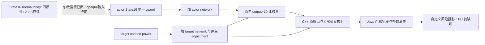

# 宣战兵力评估：保留字节与 Java 消费边界

本次在 `machine_id: xenoamess-full-tower-eb9d2c1186` 先复核已有 6428 B 小窗口，后接收唯一执行者 Batch11/12 实际交付的 908 B 续段。本研究岗没有自行读取 EXE、运行 JVM、连接游戏或修改生产代码。最初观察时间、完整路径与 SHA 见 [POWER-FRONTIER23.json](D:/codex-ck3-background/ck3-java-g2-resume-r4-20261025/resume61/planner_owner/power_frontier23/POWER-FRONTIER23.json)，5746 B / `2fcf3109dbfd9ae591aabe9dcd6c4d96e1751b7be4060cd6cd22c99454a1cf83`。

下述指令结论限于**按 sidecar 声明 RVA 解码的保留字节**。当前 `.4` header 把这些入口绑定给实际生产 reader，但原 sidecar 缺机器和 EXE/build 字段。首次按不完整父目录查找未命中，随后已找回真实 `FAMILY-MAP.json`，见下方更正。这份复核仍没有重新授予 `.4` build、完整 ABI、loaded 或实机资格。原始采集机器记为 `unknown`；当前机器读回相同内容不补造原始采集身份。

| 保留输入 | 实际 bytes / SHA-256 | 本次范围 |
| --- | --- | --- |
| `1A23220–1A23A91` | 2161 / `29c9ed29e593371810feb40fca1d0e958a0095227e5b51c3b7c643690feedb89` | 从声明入口连续解码到 `ret`，覆盖该保留函数 |
| `1A23FF0–1A24F1F` | 3887 / `63e70c6e8c2c0e81864721c5e0f2c5a58ccb9e40a5e5385e8da1b9a1b419782a` | size/SHA 与完整解码覆盖核对；不在此复述整个网络候选图 |
| `1A22D10–1A22E8C` | 380 / `f62d7f3c32d907c01208b460dce38f2ab47cb8fba4084f96c4e45d9a037a7e09` | State16 builder 首片；最终值结合下面三份独立原件追踪 |
| `1A22E8C–1A2318D` | 769 / `ec838a18e1348cc9f3190c31ffb8e54a2713c64f6ea2cd52a63c4f7d5fb4ba4b` | Batch11 `window-001.raw`；独立完整解码到边界，实际末条直接引用下一 121 B RF |
| `1A2318D–1A23206` | 121 / `5699a0cd3d1574868e839d104313d8fb1eb90c6af65fca7ea2e15017e981ac66` | Batch12 `window-002.raw`；原生定点乘法后 `1A231FE` 加到 q0，恢复 R13 后到公共尾 |
| `1A23206–1A23218` | 18 / `5f20b0b677d4450874ef8c09c1341b3ecdf6d9b24922003339881780bf5b0e3f` | Batch11 `window-002.raw`；只有寄存器/栈恢复及 `RET`，没有 q0 写入 |

`ck3_12004_war.hpp/.cpp` 当前源码绑定 assessment、builder、network collector 为上述三个入口，严格匹配 `.4` EXE SHA，并拒绝 fixture overrides。该源码合同与历史 raw 的完整来源资格分别记录。共享 reader 虽保留 `ck3_12002_war_entry.cpp` 文件名，实际回调由上述版本入口注入，不能据文件名给它改 schema 或替换 ABI。

## 原生输入到底比较什么

给定的 `1A23220` 字节保留 actor、State16、effective target、output 四个寄存器参数。第五参数是可空指针，第六参数为模式；现有共享 wrapper 明确传 `nullptr, 1`，并在调用前后检查 builder dependency 和 State16 未变。

- `1A23359–1A23375` 读取 target `Character+1C0 → +308` 的有符号 qword，缺组件时取零，先写 output `+8`。模式 1 分别调用 network collector：target 使用 `0/0/0`，actor 使用 `1/1/1`；target contribution 加到 output `+8`。
- 后续 profile byte 等于 5 的分支还能调整 output `+8`。它读取 qword 槽 `5C687E0`（`1A23539`）及 `5C687F0`（`1A235F3`）。下面的 26 号复核已补齐该支路的部分算术关系；两个槽的正式 define 名称、当前加载值和完整输入语义仍未知。
- `1A237A6` 取 **State16 第一 qword + actor network contribution** 作为比较分母。正分母路径写出有符号固定点除法结果到 output `+10`。非正分母路径直接把 target total 写入该槽；不能擅自改成零、无穷大或“必胜/必败”。
- State16 首片 `1A22E55–1A22E70` 先从 actor 的相同 power leaf 写第一 qword。raw profile 不等于 5 时直接到恢复/返回尾，正常返回的 q0 保留该 leaf 值。raw profile 等于 5 时，Batch12 实件已确认 `1A231FE` 再加上一项原生定点乘法结果，见下方公式；不能把未经调整的 cached leaf 替代全部 actor 的最终 q0。

所以 `actual_power_ratio_raw` 在通常正分母路径是**目标总战略力量相对己方总战略力量**的原生比较量。它不提供到场时间、可执行军队覆盖、战斗胜率、战役成本或期望收益。

2026-10-26 00:27 UTC 的 [POWER-ADJUSTMENT26.json](D:/codex-ck3-background/ck3-java-g2-resume-r4-20261025/resume61/planner_owner/power_frontier23/POWER-ADJUSTMENT26.json) 继续复用同一份 2161 B 原件，新增 EXE 读取为 0。`R13` 是入口 actor，`R15` 是入口 target；后者传入 `28C2DF0`，仅返回对象 raw byte `+4D6 == 5` 时走入该调整。actor `+1B0` 为空时输入 `b=0`，否则 `b` 取 `actor→+1B0→+310` 对象的 signed byte `+4`，该字段的正式名称尚未绑定。

`1A2346E–1A23543` 对全部 256 种 signed-byte 输入都走有界乘法路径；按已解码的 signed multiply-high、移位及向零修正核对，结果恰为 `bias_raw = -500*b`，0 个不符。这是保留指令的纯算术核对，不是原生调用或 Java 测试。随后按原生固定点乘法分支计算 `bias × [5C687E0]`，加 `100000`，再有符号夹到 `[50000,150000]`。此系数乘以 `230E6F0` 返回对象 `+8` 的 qword，再乘 `[5C687F0]`，最终加到 target output `+8`；两个乘法均使用原生 scale `100000` 分支，未外推任意 int64 输入的溢出语义。

当前原版 `00_ai.txt:764–780` 声明 `AI_BOLDNESS_ADJUSTMENT_FACTOR_ADMIN_REALM_POWER=1.0`，注释的 `50%–150%` 范围与上述夹取相符；`871–884` 另有 `ADMIN_REALM_TOTAL_POWER_ADJUSTMENT_TOP_LIEGE=0.4` 与 `..._VASSAL=0.05`。这只给出待验证的脚本候选，尚无 define registration 或 loaded slot 原件，**不把相符的注释当成槽绑定**。`230E6F0` returned `+8` 数值的正式含义、输入 byte 名称、profile raw 值的正式 enum 仍未闭合，因此本次没有修改 Java 宣战门槛。

Batch11 的机器绑定与实际采集关闭结果见 [BATCH11-RESULT01.json](D:/codex-ck3-background/ck3-java-g2-resume-r4-20261025/resume61/b64_execution/BATCH11-RESULT01.json)，15434 B / `6bde997dbb22764fcd9a7ba0f9088b47ae6d8123303647127fb175081ea089d2`，执行者观察时间 `2026-10-26T00:57:33.581638+00:00`。本研究独立核对自己的 769 B 与 18 B 完整长度/SHA，并逐片解码，没有重写合并 raw。actor raw profile5 支路的同一 signed byte 输入使用相反符号 `bias_raw=+500*b`，256 种输入的纯算术核对也是 0 不符；随后读取同一个 `5C687E0`、夹取 `0.5–1.5`、调用 `230E6F0` 并取返回 `+8`。后续系数从 raw 槽 `5C687E8` 或 `5C687F0` 选择，两个槽的正式名称和加载值仍未知。最终 q0 写入由随后 Batch12 补齐，见末节。

图的实线表示本次 raw 指令或当前 reader/consumer 源码中的依赖，不表示 build/loaded/live 已重新资格；虚线保留真正未知边。没有把它接成原版 AI 目标缓存、完整合法宣战目录或宣战执行链。

## 当前生产者与消费者

共享 C++ reader 先读取 target 原始 power，再独立采集两侧网络 contribution，以 checked signed64 加总，保存 actor base/total、target base/pre-adjustment/adjustment delta/actual total。它检查重建 ratio 与原生 output `+10` 完全相等；重建值用于拒绝 ABI 或分解不一致，实际原生值仍是输出权威。

当前 `WarEntryAssessmentCodec` 保留这些有符号整数原值，核对三组 decomposition，并绑定实际 actor、请求 targets、native revision、date 和 build provenance。`WarEntryCandidates.powerProjection` 分别展示 base 与 total margin，明确 `eu_lower_raw=null`、缺少到场/战斗/成本等组件，且该投影不授予自动宣战。已有 claim 分支还要求 actor total 为正，不把分母为零的 native fallback 当通常 ratio。

另有一处域差异：C++ 明确拒绝负 actor/target network，Java record 只核 base/total 非负及分解，故仅从形状构造可接受某些负 network。**当前合格 C++ producer 已不能产生这种包**。本轮没有据手造不可达包新增门禁、测试或声称复现业务故障；这里只保留合同对照，供确有入口演进时同步。

当前剩余的明确源边是 `230E6F0` 返回 `+8` 的实际含义、三个全局槽的定义注册/加载来源、输入 byte 和 raw profile 的正式绑定，以及完整 ABI 与当前加载资格。State16 普通控制流余段已由 29 号结果补齐；原始采集机器未知的历史限制仍保留。当前安装 `00_ai.txt` 的宣战候选门、声明门、best-CB 相对分数门和 call-allies 力量门各有语义；不能仅靠注释把它们套入这些未知槽，更不能把 AI 策略子集裁剪用于 human full catalogue。

## 原 map 已找回：380 B 仍只是一段 RF

实际路径在 `migration-steam25734779/war-score-membership/actual4-domain/war-map/first01/FAMILY-MAP.json`，此前查找遗漏了 `war-score-membership` 层。原件 329359 B / `8ed7f73562e0feba753be8cc3a56a9e8b27a4f1d1edeeab533f2862e4402ef4a`，配套 `WAR-FINITE-MANIFEST.json` 为 3215 B / `9fe48cb3ae885adc31bb8e1252d0120495f14c2c2641b1c08f413488e79bd0de`。原 map 精确指向以上 raw，并记录 old/new 归一化指令及控制形状在所声明区间内相等。

恢复记录是 [POWER-MAP-RECOVERY24.json](D:/codex-ck3-background/ck3-java-g2-resume-r4-20261025/resume61/planner_owner/power_frontier23/POWER-MAP-RECOVERY24.json)，5698 B / `d5326b4da0055745ccf48fb05114bda695a8f8320bd4a5379dcff6acb53cdf80`。旧 23 JSON 及当时文档原字节保留；“所尝试路径不存在”的事实继续成立，“原 map 灭失”的宽泛推断在此更正。

原 map 的 `complete_instruction_span_normalized_equal` 表示**声明区间**解码完整；builder 声明长度仍只有 380 B。其末尾没有 `ret`，且已有跳转到区间外 `1A23206`，不能据该 status 把 logical function 后续控制流算作已覆盖。后续应沿实际 split-RF 续段闭合，不能仅重读同一首段再宣布完整。已读原 map/manifest 同样未携带原机器及 EXE SHA，恢复路径本身不证明当前加载或实机成功。

## 记录中的 build 来源链与精确续段

后续按 map 的原始输入继续查到既有 `PDATA-PARSE-RECEIPT.json`、`NEW-RUNTIME-FUNCTIONS.json` 与冻结树的 `BUILD-FREEZE.json`。冻结记录声明 EXE SHA `98702f88a547cde2eaf29a85f93b85f68ee4cf8148336a4f7afaeb75319dd518`、build25734779；`.pdata` 读取回执与 runtime index 指向同一冻结 EXE 路径。该历史 SHA 与 Root 本轮安装 witness 中的 SHA 相同。这恢复的是**记录中的历史 build 来源链**，不是新读 EXE、raw 采集时的原生文件身份、当前 loaded 状态或全部 ABI 验证。旧冻结及 `.pdata` 回执仍缺 machine_id，继续明确为 unknown。

[POWER-SOURCE-LINK25.json](D:/codex-ck3-background/ck3-java-g2-resume-r4-20261025/resume61/planner_owner/power_frontier23/POWER-SOURCE-LINK25.json)（3692 B / `ea1c756909468f27bdd8fe8587a57969d3771bae01d92a7a14d18b302c6e4fed`）保留所有精确元数据引用。只流式读取了已有 JSON，没有读取新 EXE 字节。runtime index 给出以下连续 unwind 区间：

| begin | exclusive end | unwind | bytes |
| --- | --- | --- | ---: |
| `1A22D10` | `1A22E8C` | `51C3470` | 380，已有 raw |
| `1A22E8C` | `1A2318D` | `51C3484` | 769，Batch11 实件已读 |
| `1A2318D` | `1A23206` | `51C349C` | 121，Batch12 实件已读 |
| `1A23206` | `1A23218` | `51C34B0` | 18，Batch11 实件已读 |

最初三个元数据续段总计 **908 B**。已有 380 B 原件尾部在 `1A22E7F` 以 `JNE` 直接到 `1A23206`，另一条路径经完整的 `MOV RAX,[RBP+1B0]`（`1A22E85`，7 B）fallthrough 到 `1A22E8C`。因此 27 号请求只取这两条实际边的 787 B，保留中间 121 B；没有因 RF 邻接就预采全部区间。Batch11 实件现在又在 `1A2318B` 明确给出 `JA 1A231B0`，不跳时 fallthrough 到 `1A2318D`，两条实际边都进入同一个 121 B RF。

后继 [SOURCE-REQUEST28.json](D:/codex-ck3-background/ck3-java-g2-resume-r4-20261025/resume61/planner_owner/state16_middle28/SOURCE-REQUEST28.json) 因而只请求这 **121 B**，5066 B / `7bf995b5deff8a8e9f751bb07fc7a7f8f3815bcffb6c94ccd9ca8c8ede61f6c7`；Batch11 已关闭，没有热扩。配套 28 号 plan/check/graph 保留当时的未知边，不改写成提前闭合。

Batch12 于 `2026-10-26T01:16:24.068828+00:00` 实际交付 121 B，见 [BATCH12-RESULT01.json](D:/codex-ck3-background/ck3-java-g2-resume-r4-20261025/resume61/b64_execution/BATCH12-RESULT01.json)，14373 B / `88e656e339e2d9f0afe9d34e8e860038649106b21f518337eb665aa59ae2dcc5`。四个独立 raw 合计 1288 B、343 条完整指令；按直接跳转和 callee 正常返回作 CFG 覆盖检查，所有普通边都落在已读指令边界内，没有写出 combined raw。该检查没有覆盖异常展开或解释 opaque callee。

现在 raw5 的正常源路径可以写成：`q0 = cached_leaf + mul_native(mul_native(H,F),C)`；`F = clamp(100000 + mul_native(500*b,A),50000,150000)`。其中 `mul_native` 表示实际 scale100000 的原生分支，`A` 是 raw 槽 `5C687E0`，`C` 从 `5C687E8/F0` 选择，`H` 是 `230E6F0` 返回对象 `+8` 的 qword。最终 121 B 的 `1A231FE ADD [RDI],RDX` 给出额外项的实际写入，而不是靠旧注释补出。**最终 q0 数据流已读闭合，H/C/A 的正式语义仍未闭合**；当前 Java 已消费 native q0，本研究没有改成手算替代值。

精确结果见 [POWER-STATE16-RESULT29.json](D:/codex-ck3-background/ck3-java-g2-resume-r4-20261025/resume61/planner_owner/power_state29/POWER-STATE16-RESULT29.json)，4214 B / `76140810104b33edb08cde238873f0f355ca3128cf3326c8499395d2de921f96`，以及同目录 `RESEARCH-PLAN29.json`、`CHECK29.json`、`GRAPH29.md`。原 `native_research_plan.py check/render` 实际退出 0，只验证结构/引用哈希，`semantic_correctness_verified=false`、`live_execution_performed=false`。完整 ABI、原函数执行、loaded/Game、actual Origin、dispatch/poststate 和成绩均未由本次研究授予。

NativeLead 随后将实际 H 输入的有限后继交本研究岗。NPI 命名索引没有该 body 或已闭合 owner；唯一读取者按 core/shared/Dspill 三个明确根及前 12 批 344 个实际窗口查重，没有覆盖入口的可复用原件，这不是全库不存在声明。精确 saved RF 为 `[230E6F0,230EA01)`，785 B，unwind 指针 `5242060`。独立 [SOURCE-REQUEST30.json](D:/codex-ck3-background/ck3-java-g2-resume-r4-20261025/resume61/planner_owner/opaque_h30/SOURCE-REQUEST30.json)，4326 B / `3399bd7a36b9815af24be2a6b0a449b103b4b3f444e590ed7dc63ff4266609b4`，仅请求 785 CODE / 0 METADATA，13 号已冻结批不扩。请求保留 actual actor `1A230F2`、target `1A2366A` 两个 CALL 与 returned `+8` 读点的原指令 hex，不自动追 callee/UW/global。30 号记录保留当时未读 body 的未知边；其 check/render 退出 0 仅为结构/哈希一致。

## H 的实际返回来源与类型命名

唯一执行者 Batch14 于 `2026-10-26T01:45:12.081343+00:00` 交付独立 `window-001.raw`，785 B / `598353e0cd89fec7db9cdb7fb38191aba58118e29d56dda01a82184c97d68ad8`。本研究实际完整解码 193 条指令。返回正常路径选择 `selected receiver+B8` 的存储单元，raw availability byte 为 `selected receiver+D8`；caller 读取返回 `+8`，因此 H 取自 `selected receiver+C0`。raw flag 为零的路径返回静态对象 `RVA 5D26DF8`，fallback H 地址为 `5D26E00`，该数据**没有读取，不能假定为零**。

这个 body 没有就地写入 `B8/C0/D8`，也没有用标量算术当场产生 H。外部 callee 是否更新它、实际 producer、失效写入与有效期仍未知；一次 paused query 不授予该存储值的新鲜资格。返回存储单元前还会再读 `cell+20`（同一 `D8`）；失败分支调用 `852460` 后接 `INT3`，该 callee 的正式错误/异常含义没有从模式猜出。receiver 可在 full-ID 验证、`9D6DF0`、`230C8A0` 和 table lookup 分支中重定向，不能把 H 永远归给未经重定向的入口对象。

NPI 提供的既有 actual4 typed bindings 随后经五个 Source60 原件的实际逐 file bytes/SHA 读回 MATCH：`5C67568` 是 Character storage/full ID `+18`；`5D1DAF8` 是 LandedTitle storage/full ID `+10`。所以 actual caller 给 H 的入口 receiver 可以按该现有源合同命名为 title，body 先用 title `+128` 查 holder character。`28BFD80` 的 top-liege 角色也来自现有 typed binder，而非本次看模式造名。精确五 refs 和范围见 [TYPED-H-LINK32.json](D:/codex-ck3-background/ck3-java-g2-resume-r4-20261025/resume61/planner_owner/typed_h32/TYPED-H-LINK32.json)，3660 B / `f5b16ba69ca4fe34cd8e68449a0f797140a27c2a0702691d588657a340e77879`。这些 Source60 原件只作已存在类型命名的导航；**不能拿来代替本场 v7 完整 Native cut，也不授新增 RTTI、H 数值含义、完整 ABI 或 loaded/Game**。

返回链实际结果保存在 [OPAQUE-H-RESULT31.json](D:/codex-ck3-background/ck3-java-g2-resume-r4-20261025/resume61/planner_owner/opaque_h31/OPAQUE-H-RESULT31.json)，8673 B / `be5197c2359fe4f182524c82d3bfaa1c21bcdd8426593fbfa698d003daa989bb`，包括真实 return tail hex、RIP operands、callee 列表和未闭边。配套 `RESEARCH-PLAN31.json`、`CHECK31.json`、`GRAPH31.md` 经原工具实际退出 0，仅结构及哈希一致；producer trigger、存储 struct/数值含义、cache lifetime 和 Java 门槛均未由此改变。

资料用途复核为 `2026-11-01T08:00:00Z`；本轮存储仍受 Financial101/102 的 `2026-10-26T08:00:00Z` 期限约束，没有自动续期或取得新的写入额度。
