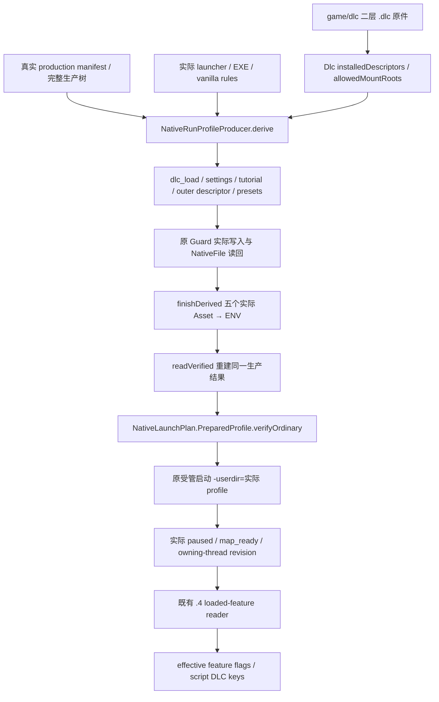

# Prepared PROFILE、DLC 配置与原生加载事实的来源边界

machine_id: `xenoamess-full-tower-eb9d2c1186`。2026-10-26 本轮源码研究；复核期限 `2026-10-26T08:00:00Z`。这是原生产者到消费者的来源审计，没有启动 CK3、编译、运行 fixture 或新增 EXE 采样，不增加首场准入条件。

精确八份源码快照索引：`D:/codex-ck3-background/ck3-java-g2-resume-r4-20261025/resume61/formal_release/PROFILE-DLC-SOURCE-INDEX01.json`，2847 B，SHA-256 `7b8297f535a93b25e34c33fc7a6e9a8382784da17b778d6a374fd7a01365e836`。Java 来自当前 R5 可复用开发树；Native 来自仓库原生产源码。索引只记录本次读取的字节身份，不将可变开发树升级成已冻结 runtime。

## 原生产与消费链

当前 `NativeRunProfileProducer` 第 76–103 行读取真实输入，生成 singleton `enabled_mods=["mod/xar_autoplayer.mod"]` 与 `disabled_dlcs=[]`。五个叶的路径由原 `AssetKind` 定义。外层 descriptor 由第 449–453 行从真实正式 descriptor 渲染，使用 UTF-8 BOM，补入唯一 production 路径；内层不得含 Workshop remote ID 或安装 path。

第 110–131 行 `finishDerived` 要求五个实际 Asset 齐全、无重复、与唯一期望 FileRef 和字节相同，并复核每个 NativeFile 身份；ENV 并非只保存预计 SHA。第 134–152 行 `readVerified` 核合格 producer runtime，然后从真实原件再次 derive/finish，比较完整规范序列化结果。预计内容和 Java 构造器不能代替该读回。

`NativeLaunchPlan.PreparedProfile.verifyOrdinary` 第 133–170 行再消费 ENV、当前来源图和实际 preparedInputs：核 state/profile、EXE、dlc_load 原件、singleton mod 配置、外层 descriptor 目标、manifest、presets、vanilla rules、launcher/settings/tutorial 以及完整生产文件集合。NativePlan 的第 226–231 行从同一个 profile 产生 `-userdir=` 参数。这些是原有物理配置和来源校验，尚未证明 CK3 内部已加载内容。

## 各种证据分别证明什么

| 来源 | 实际语义 | 不能由它推导的事实 |
| --- | --- | --- |
| `dlc_load.json` 的 `disabled_dlcs=[]` | 当前管理配置没有显式禁用 DLC；exact singleton mod 配置 | 当前账号拥有全部 DLC、每个 DLC 实际挂载、某个 feature 已生效 |
| `NativeRunProfileProducer.observeDlc` | 当前 installed game/dlc 下二层 `.dlc` 文件的真实 FileRef，以及这些文件的父目录 | 账号授权、运行时挂载和有效脚本覆盖来源 |
| 真实 ENV 与 NativePlan prepared-profile 验证 | 受管 profile、生产树与预备配置确实来自同一批真实原件 | CK3 已开局、当前帧读取通过、业务成功 |
| 既有 .4 loaded-feature manifest | 满足原 reader 的实际帧约束时，读取 effective gameplay flags 与 script DLC keys | 商店授权裁决、整个虚拟文件系统、每条有效 event/GUI/script 定义的文件和行来源 |

`observeDlc` 第 433–442 行只遍历深度二的 installed descriptor，返回的 scope 明确为 `INSTALLED_DESCRIPTORS_ONLY_NOT_ACCOUNT_ENTITLEMENTS_OR_RUNTIME_MOUNTS`。`NativeRunProfileManifest.Dlc` 第 241–246 行固定此合同。虽然 `LoadProfile` 的拒绝文案使用 “all owned DLC”，其实际检查是 singleton mod 列表和空 disabled 列表，不应把该文案当作独立的账号证据。

## 既有 actual4 reader 的真实入口

现有 [actual4 feature profile](../../ck3_autonomous_player/native_bridge/include/xar_bridge/ck3_12004_features.hpp) 固定 1.20.0.4 与 SHA `98702f88a547cde2eaf29a85f93b85f68ee4cf8148336a4f7afaeb75319dd518`，feature root `0x5CB87F8`、enum table `0x47334D0..0x4733580`（44 项）、script DLC set `0x5CC15E0`、identifier name `0x3F4F8E0`。当前安装身份来自本岗 `INSTALLATION-WITNESS02.json`；本研究没有重哈希 EXE。

[bridge.cpp](../../ck3_autonomous_player/native_bridge/src/bridge.cpp) 第 11723–11738 行对实际 .4 descriptor 分派到 `ck3_12004::BindLoadedFeatureManifestNativeEnvironmentV1` 和 `ReadLoadedFeatureManifestV1`。它传入真实 owning-thread 和 capture-frame 回调。actual4 实现复用原 `.2` detail 算法，同时传入自己的固定 RVA 与 render profile，不应因旧 `loaded_feature_manifest_v1.cpp` 仍含 1.19.0.6 就判断 .4 路由不存在。

原 detail reader 第 482–550 行要求非零 expected revision、application main、暂停、map_ready、exact environment；两次读取 feature/DLC 集合后再次捕获帧，帧或集合变化即返回 unavailable。成功返回 effective flags 与 script DLC keys。原 `ck3_12002_feature_serializer.cpp` 第 213–216 行继续把 entitlements 写成 `unavailable / store_verdict_provenance_unclosed / items:null`。本次只是追踪现有调用与来源，没有新取得当前游戏样本，也没有重新授予 .4 runtime 资格。

该 reader 的来源合同与历史研究参见 [default manifest/sentinel actual4 migration](default-manifest-sentinel-migration-12004.md) 和 [loaded feature manifest](loaded-feature-manifest.md)。首场仍按既有生产路径推进；本文只防止跨越证据语义，不把商店授权或 VFS 研究变成新的业务前置。
