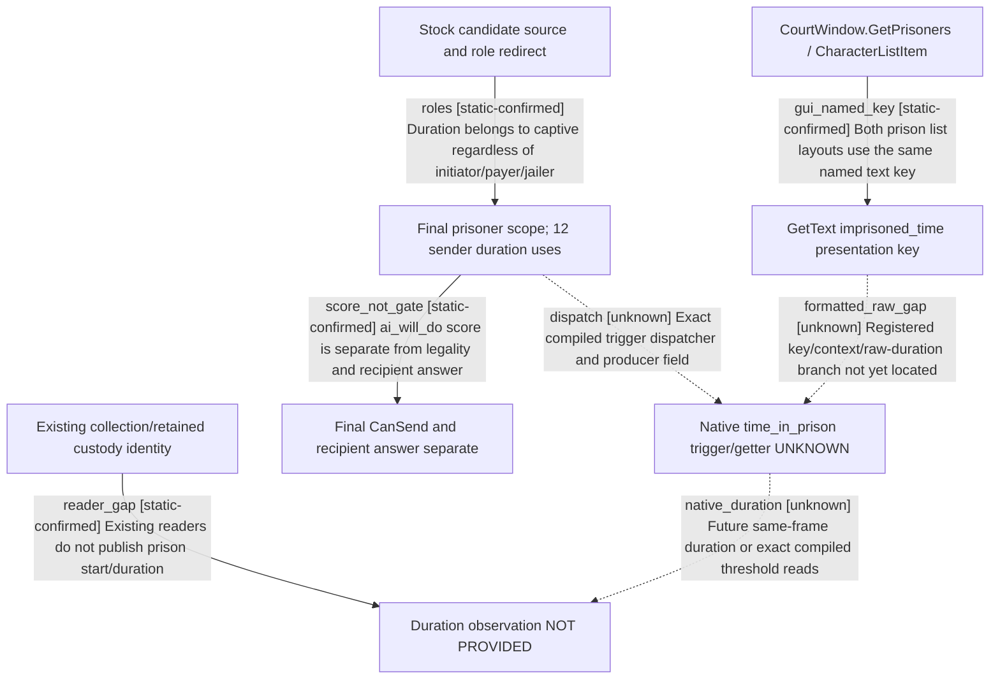

# Research plan: prisoner-duration-threshold-source12004-resume61

GENERATED from the supplied research plan; no native semantics are inferred.

Question: Which final prisoner owns the stock duration threshold and which exact raw source remains unknown after the native GUI imprisoned_time presentation key?



| Edge | Declared status | Evidence IDs | Open question |
|---|---|---|---|
| roles | static-confirmed | stock |  |
| dispatch | unknown |  | Locate held current-build registration/getter and actual engine caller |
| score_not_gate | static-confirmed | stock |  |
| reader_gap | static-confirmed | collection, retained |  |
| native_duration | unknown |  | Units/calendar boundaries, jailer transfer and reimprisonment reset/cache lifecycle unknown |
| gui_named_key | static-confirmed | court_gui |  |
| formatted_raw_gap | unknown |  | No held metadata locator from NativeProtocolIdentity; no formatted-text parsing or neighboring timestamp inference. |

| Observation design | Value |
|---|---|
| mode | offline-only |
| actor_kind | ai |
| owner_scope | Stock sender scoring for finalized full prisoner identity; player legality/answer/poststate separate |
| identity_kind | generation-id |
| identity_lifetime | Full prisoner ID; custody duration lifetime/reset unknown |
| producer_trigger | unknown |
| producer | Native raw duration/getter unknown. CharacterListItem.GetText imprisoned_time is presentation only. |
| caller | Four stock ai_will_do trees after final role redirect; engine scheduling and compiled trigger dispatcher unknown |
| consumer | Sender modifiers for ransom, pay_ransom, ransom_me and release_from_prison |
| cache_lifetime | Custody relation observed; time origin/reset/cache lifetime unknown |
| expected_signal | Held current-build registered time_in_prison name entry and exact native caller/getter; no live sample requested |
| zero_sample_meaning | No catalog match is a missing locator, not zero duration/no prisoner/no modifier |
| stop_condition | Exact stock script, two bridge files, bounded stock GUI source and held metadata lookup only. No EXE scan/Game/provider or formatted-text parsing. |
| runtime_window_ref | None |

| Evidence ID | Declared layer | File | SHA-256 | Supports |
|---|---|---|---|---|
| stock | source-contract | Z:/SteamLibrary/steamapps/common/Crusader Kings III/game/common/character_interactions/00_prison_interactions.txt | 1bb43b3c2061212af8d41b11314ff4e569af2a3506319f820d05877a7762abc5 | Twelve duration sites/four sender trees, final role scopes, independent modifiers and duration-free child branch |
| collection | source-contract | Z:/ck3_mod_rewrite/ck3_autonomous_player/native_bridge/src/ck3_12004_prisoner_collection.cpp | 90545bf882d658a061ba25b881d4d79eaf9c590582b27cd90f715915674ded4a | Existing full captive/jailer collection without duration output |
| retained | source-contract | Z:/ck3_mod_rewrite/ck3_autonomous_player/native_bridge/src/ck3_12004_prisoner_retained_target_state.cpp | c235cc583cfc904f1d026638d52de846ba037d5182165252ec3b65382bfeb5d4 | Retained alive/free/player-held/other-held state has jailer identity without prison start date |
| installation | exact-build | D:/codex-ck3-background/ck3-java-g2-resume-r4-20261025/resume61/formal_release/INSTALLATION-WITNESS02.json | 49f08808eb15dd2eb2d24d05f400c7dd68cf1d4d7de14741e2efbbd7417c339c | Current metadata witness reuses historical full EXE SHA by exact file identity; no new hash/loaded Game proof |
| court_gui | source-contract | Z:/SteamLibrary/steamapps/common/Crusader Kings III/game/gui/window_court.gui | e730078c5f671e7e564c6e7799215d9fabda0546d38ba615f26302b122ad5135 | CourtWindow.GetPrisoners row source, both &gt;4 and &lt;=4 layouts bind CharacterListItem.GetText imprisoned_time at405/574. Formatted presentation, not raw duration/getter/unit. |

Check result (file integrity and declarations only):

```json
{
  "schema": "xar.native-research-plan-check.v1",
  "result": "plan-consistent",
  "proof_layer": "record-structure-and-file-integrity",
  "semantic_correctness_verified": false,
  "live_execution_performed": false,
  "observation_plan_issues": [
    "offline-only plan does not define a live observation window",
    "the real producer trigger must be located before live sampling"
  ],
  "declared_edges_by_status": {
    "counter-policy": 0,
    "inference": 0,
    "live-confirmed": 0,
    "static-confirmed": 4,
    "unknown": 3
  },
  "enumerated_native_edges": 7,
  "declared_cases_by_status": {
    "pending": 3,
    "observed": 0,
    "not-applicable": 0
  },
  "checked_evidence_files": 5,
  "limitations": [
    "Evidence layers and conclusions are author declarations; hashes bind bytes, not their truth.",
    "Counts cover this enumerated graph only, not all CK3 branches.",
    "A consistent observation plan is not authorization to run or manipulate CK3."
  ],
  "plan_sha256": "0e76b4191791514e0dad3dab0e098217aec63d9c5e5378f9315f389acb3e90a6"
}
```
