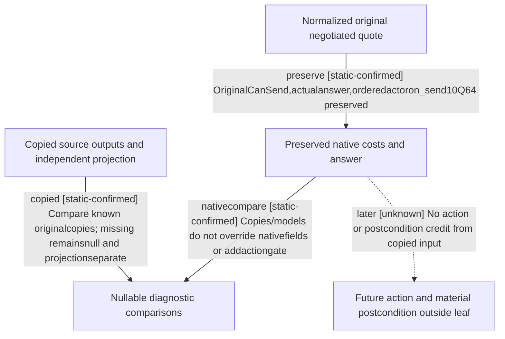

# Current negotiated prisoner quote result, CK3 1.20.0.4

The pure result consumer joins the selected outgoing negotiated release quote
to its copied source observations. It preserves the original native CanSend,
actual answer and ten actor/on_send cost values. Partial source or conflicting
copies produce independent comparison diagnostics; they do not introduce an
action gate or replace a native value with a projection.

This is `release_from_prison_interaction` with selected release options. It is
distinct from a received `pay_ransom_interaction` or `ransom_me_interaction`.
Those acceptance-time payments must not be derived from these on-send costs.

## Source and exact current input

The exact build is CK3 1.20.0.4, Steam25734779, executable identity
`98702f88a547cde2eaf29a85f93b85f68ee4cf8148336a4f7afaeb75319dd518`.
[Selected quote source](prisoner-selected-quote-source-12004.md) retains the
actual recipient score, answer and cost parents. This work reuses their sealed
35c/39/40 contracts and adds zero binary capture, evaluator or native call.

The current source594 SDK is
`D:/codex-ck3-background-spill/ck3-sdk79/ck3_autonomous_player`. Its three
existing quote/preview/cost contract files exactly match the frozen source-first
inputs. `ACTUAL-SOURCE594-SDK79.json` binds these bytes and 35c DELIVERY SHA
`67162f0db1999ace7f84b08bf3c88c0efbfea641d9c03863023b77a72030ba7e`.

The existing reader finalizes the requested mask, invokes its original cost
and optional answer callbacks and compares two independent samples plus the
before/after frame. Its copied envelope records guarded original outputs
separately from source projections. The existing transport normalizes both
objects. The new function consumes those normalized values directly; it calls
no normalizer, repeats no source arithmetic and computes no new price.

## Result semantics

`consume_prisoner_negotiated_quote_result_12004` receives the selected normalized
preview and optional normalized source envelope, together with full role IDs,
native revision, query sequence, proof epoch, raw date, selected ordinal and
requested mask. It retains full32-bit generation values; it does not join by
an ID index or a snapshot label alone.

The native result retains all ten ordered signed-Q64 resources with raw scale
100000, payer `actor` and timing `on_send`. Zero, negative values and the signed
64-bit extrema remain integers. Amounts are not independently interpreted as
funds or affordability. CanSend is the observed native gate.

Actual native answer status0/1/2 and its score stay separate. The score is a
Q100000 operand rather than a probability or a substitute answer. A false
CanSend preserves unevaluated answer/score values as absent. Auto-accept keeps
the original acceptance result without fabricating a raw answer or score.

For each copied source occurrence the consumer reports nullable comparisons
of original copied costs, answer, score and auto-accept against the final quote.
Projection-versus-copy comparisons are separate. A missing guarded copy
produces null, even when a projection exists. A known mismatch produces false;
the original native fields remain unchanged. Output cost entries are detached
from input containers, so later result consumers cannot change their inputs.

The result selects no reply or send step, submits no RPC and grants no material
postcondition. Root adopted35's mount in the existing private collection transport:
an available selected negotiated query returns `prisoner_negotiated_quote_result_12004`
after the existing preview/source normalization. Shared strict,
driver, QueryContext and overall policy selection stay under their existing
owners; this leaf adds no current pending received-ransom permission.

## New cases and delivery

45 uniquely owns `test_prisoner_negotiated_quote_result_12004.py` and its nine
new pure-result methods. Their synthetic normalized inputs cover two ordered
observations, partial source with known native output, missing copies versus
projections, diagnostic mismatches, refusal independent of score, false
CanSend, auto-accept, original unavailable reason, full generations and the
selected mask/ordinal. The fixture has no current or physical-native claim.

At delivery the author performed zero production imports or test runs.
Root integrated the production leaf and actual caller without execution after
the owner's explicit testing cancellation. Existing authored cases remain unrun;
the focus/compound recipes are cancelled. Source adoption adds no new live or
software qualification. Old quote/QA fixtures and native callbacks are not replayed.

The external appendix is
`D:/codex-ck3-background-spill/native71-continuation-20261010/continuation-45/background-g2-offline-20261011`.
Old plus new45 assets share a4 MiB ceiling and review/expiry at
2026-10-11T08:41:22.843427Z. The initial old-quota rejection is preserved;
Root supplied the already-effective R99+4GiB inherited upper-bound amendment.
No new global reservation, census or unrelated cleanup was requested.

The following graph is generated from the same checked research plan; the
check confirms record/file integrity, not native semantics or live execution.

