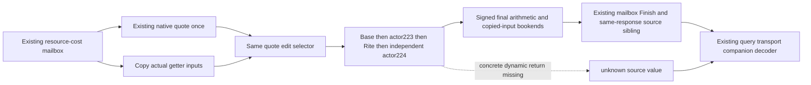

# Religion creation price source in the existing cost response

This source change connects the current creation-price model to the existing resource-cost query for reviewed CK3 1.20.0.4. It is authored research code. No new tests, imports, compilation, runtime queries or game acceptance were executed for this change.

## Actual producer and consumer

`ExecutePlayerReligionDraftResourceCostsMailbox12002` starts a bounded source probe after the existing mailbox/window admission and before the unchanged native quote. It reuses that quote's matched `editing_owned_current_rite` selector, then calls `ReadCreatePietyFinalPriceSourceModel12004` once. A known false selector selects the create/null-auxiliary source path. A true or missing selector retains an unavailable source result.

The input mapping follows held getter `14F57A0`: resolve the first actor from the complete ID at window `+CC`; resolve the current Rite from that actor's `+B4`; independently resolve the actor again; use price payload window `+B28`. Registry index and complete generation checks, reached fallback pointers and selected complete IDs remain separate facts. Window `+C8` and the old quote's source Rite ID are retained as their original carriers and do not replace the numerical current Rite.

The model consumes base contributions, actor property `223`, the Rite term, an independent actor property `224`, and the final fixed arithmetic in that order. The two actor selections are not cached into one occurrence. Definition-disabled and no-expression zero/literal Rite branches can return known numerical terms. Dynamic provider returns remain unavailable when their actual target/output source is missing.

The probe retains successful copied read occurrences, including duplicates, up to 16,384 occurrences and 262,144 bytes. Completion captures input mappings again and separately re-reads every retained span. These counters describe retained successful copies; the independent verification reads are additional guarded reads. The existing `FinishQueryMailbox` result then admits or rejects the current source value.

The serializer appends optional `religion_creation_price_source_12004` beside `player_religion_draft_resource_costs` in the same command result. Its schema is `religion-creation-price-source-12004-v1`. The top signed `final_piety_price_raw_q64` is present only when the create model is complete, mappings and spans match, and the actual mailbox finish succeeds. Partial model facts remain distinct from current readiness. This source projection declares `actual_original_consumed_values=false`.

`query_player_religion_draft_resource_costs_private_v1` decodes the optional sibling from that same response into `religion_creation_price_source_facts_12004`. The decoder binds the existing complete player ID, native revision, date and capture epoch, checks each source operand's width and nullable state, and preserves the separate native quote and availability. It performs no additional query. Invalid, absent or partial source facts cannot replace the native quote.

## Source and remaining boundaries

The held 285-byte getter mapping and 361-byte final arithmetic source are recorded with the native price model. The Rite term reader closes actual `2C628A0` zero/literal paths; the actor adapter closes actual `2C4D660` mode-zero reuse of the qualified collection reader. Runtime registration adds the collection adapter and source publisher to the existing price provider include; the already registered resource-cost mailbox is reused.

The dynamic Rite value still needs the concrete expression class/slot `+30` target reached at `375438F` and its returned Q64. Positive compiled expressions separately need the mask return at `3755600` and the conditionally reloaded value return at `3755646`. No target is inferred from a fixture address, a software tuple or a copied revision. The editing branch, actual original-consumed values and current game acceptance are not established by this source delivery.

## Root integration

Recorded 2026-10-11T06:31:17.219056+00:00. Seventeen connected production files and five source topics were
adopted into master. Classification is research / SOURCE_ADOPTED_NOT_RUN; the
owner cancelled imports, tests, compilation and local game operations. Actual
repository bytes are in the
[Root adoption receipt](D:/codex-ck3-background-spill/native71-continuation-20261010/ROOT-RELIGION-PRICE-SOURCE-ADOPTION-20261011.json).
Native84/fullSDK84 still represent compiled Source594, and were not rebuilt or
loaded. This source addition does not qualify a current numerical price or an
action outcome. Exact source remains CK3 1.20.0.4 / Steam25734779 / executable
SHA-256 `98702F88A547CDE2EAF29A85F93B85F68EE4CF8148336A4F7AFAEB75319DD518`.

Partial or invalid companion facts preserve the existing native quote. The
remaining dynamic source targets are recorded above; no unknown-only wrapper
or extra query was adopted.
