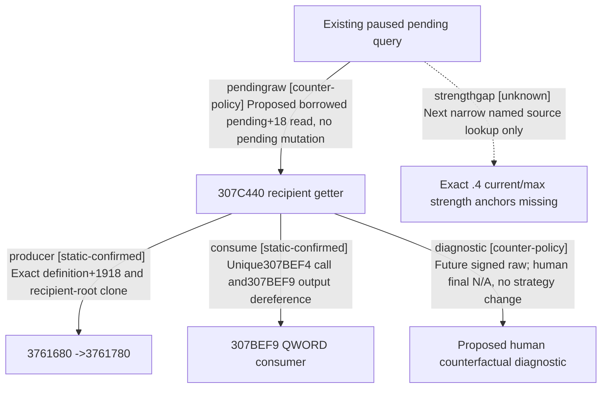

# Research plan: g2-m2-inbound-alliance-ai-acceptance-12004

GENERATED from the supplied research plan; no native semantics are inferred.

Question: Can the current pending invitation expose the already source-closed .4 recipient raw score with honest human counterfactual scope, and which narrow sender inputs remain missing?



| Edge | Declared status | Evidence IDs | Open question |
|---|---|---|---|
| pendingraw | counter-policy | lock |  |
| producer | static-confirmed | lock |  |
| consume | static-confirmed | lock |  |
| diagnostic | counter-policy | lock |  |
| strengthgap | unknown | lock | Need the two named .4 leaf registration/callback anchors; legacy1.19 addresses cannot migrate by delta. |

| Observation design | Value |
|---|---|
| mode | offline-only |
| actor_kind | human |
| owner_scope | Current incoming negotiate_alliance sender36445/recipient player31254; no runtime access |
| identity_kind | generation-id |
| identity_lifetime | Full native character/pending generations and same query frame; definition key/source separately bound |
| producer_trigger | paused-query |
| producer | 307C440 recipient raw getter -&gt;3761680 -&gt;3761780 ordered numerical score |
| caller | Native inner307BD70 mode1 call307BEF4; proposed sibling existing pending collector borrows pending+18 |
| consumer | Native307BEF9 dereferences returned QWORD; proposed typed diagnostic explicitly counterfactual for human recipient |
| cache_lifetime | No score cache claimed; reevaluate only in a future same-frame existing paused query; no query executed here |
| expected_signal | Returned-original-output pointer and signedQ64 with roles/frame; missing military anchors remain explicit, not zero |
| zero_sample_meaning | No native evaluations permitted in this source-only work, so no calls/observed raw score says nothing about AI value or candidate existence |
| stop_condition | One bounded review of held235B getter,678B caller,existing pending-copy/score evidence; zero new EXE bytes/Game calls |
| runtime_window_ref | not-applicable: offline-only source plan |

| Evidence ID | Declared layer | File | SHA-256 | Supports |
|---|---|---|---|---|
| lock | source-contract | source-lock.json | b084a1f393ad3d3c4b5119bcfd811abbbd069b960da8a163916d50e23668acc6 | Manually reviewed exact cached getter/caller and pending-copy operands, current binder ABI, and explicit human-scope boundary; nested original evidence pins retained. |

Check result (file integrity and declarations only):

```json
{
  "schema": "xar.native-research-plan-check.v1",
  "result": "plan-consistent",
  "proof_layer": "record-structure-and-file-integrity",
  "semantic_correctness_verified": false,
  "live_execution_performed": false,
  "observation_plan_issues": [
    "offline-only plan does not define a live observation window"
  ],
  "declared_edges_by_status": {
    "counter-policy": 2,
    "inference": 0,
    "live-confirmed": 0,
    "static-confirmed": 2,
    "unknown": 1
  },
  "enumerated_native_edges": 3,
  "declared_cases_by_status": {
    "pending": 1,
    "observed": 0,
    "not-applicable": 1
  },
  "checked_evidence_files": 1,
  "limitations": [
    "Evidence layers and conclusions are author declarations; hashes bind bytes, not their truth.",
    "Counts cover this enumerated graph only, not all CK3 branches.",
    "A consistent observation plan is not authorization to run or manipulate CK3."
  ],
  "plan_sha256": "fe68b621e1210c85f98b526a2f1a1d6ceee212c6c7b254b8078aba761e66d678"
}
```
