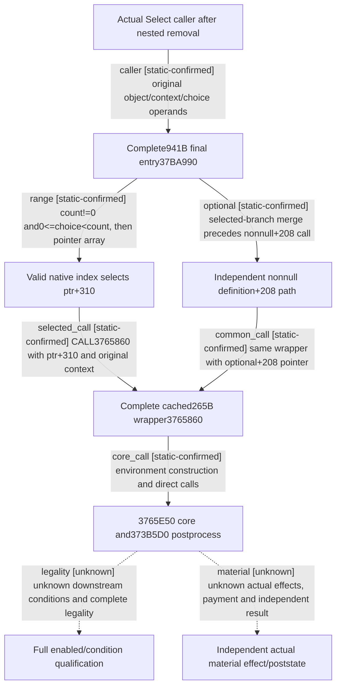

# Research plan: event-final-option-dispatch-12004

GENERATED from the supplied research plan; no native semantics are inferred.

Question: What does actual Select callee37BA990 directly check and call after manager removal, and which effect or enabled branches remain unproven?



| Edge | Declared status | Evidence IDs | Open question |
|---|---|---|---|
| caller | static-confirmed | select, actual_body, batch, bridge |  |
| range | static-confirmed | actual_body |  |
| optional | static-confirmed | actual_body |  |
| selected_call | static-confirmed | actual_body, wrapper |  |
| common_call | static-confirmed | actual_body, wrapper |  |
| core_call | static-confirmed | wrapper, wrapper_metadata, wrapper_detail |  |
| legality | unknown | actual_body, wrapper | No direct enabled/shown read in full37BA990 does not prove disabled choice executable.3765E50,373B5D0, outer guards and UI materialization remain distinct. |
| material | unknown | actual_body, wrapper | Lower execution/condition/postprocess, stack-context ownership and real resulting state are unobserved; wrapper/caller returns grant no material effect or UNKNOWN replay. |

| Observation design | Value |
|---|---|
| mode | offline-only |
| actor_kind | engine |
| owner_scope | Current event Select final processing entry and its existing directly called wrapper; no live event or Game. |
| identity_kind | generation-id |
| identity_lifetime | Original full event ID is resolved before this call; definition, stack context, selected native index and actual instance are separate. No pointer/ID reuse qualified. |
| producer_trigger | on-action |
| producer | Complete retained Select29BDDE0 caller passes object from context+1B0, original context and command choice to37BA990. |
| caller | Actual Select CALL29BDF68, after nested manager processing returns. |
| consumer | 941-byte37BA990 directly bounds choice and calls selected pointer+310 and optional definition+208 through3765860. |
| cache_lifetime | New941-byte exact held source from sole b64batch06; existing265-byte Oct7 wrapper cache has acquisition machine unknown and is not relabeled fresh held. |
| expected_signal | Exact choice range, two direct call paths, complete RET and explicit downstream core/condition/poststate frontier. |
| zero_sample_meaning | No Game samples; absence of a direct enabled read in this complete body does not prove disabled choice executable or effect absent. |
| stop_condition | Read actual941-byte original and its source refs; reuse265-byte direct wrapper only. Do not expand adjacent413-byte body, lower callees or Game from this plan. |
| runtime_window_ref | None |

| Evidence ID | Declared layer | File | SHA-256 | Supports |
|---|---|---|---|---|
| select | source-contract | Z:/ck3_mod_rewrite_process_assets/g2-background-20261007/upstream-build-migration/event-actions-12004/Select_execute-new-029BDDE0-029BDFBD.bin | 1eef08870d369db2f2d550c7da9bfcd23339c63c3fe1c8445450ae9585a91a2a | Human complete477-byte decode:29BDF5B contextRDX,29BDF60 RCX from context+1B0, R8D command choice,29BDF68 CALL37BA990, then local cleanup without success branch. |
| actual_body | source-contract | D:/ck3-state/ck3-java-g2-native-static-resume61/batch06/capture01/window-004.raw | 939a02d0053fabf119192c95178d14bf78d12898670ecf8a70f73baaedb263ca | Human complete941-byte decode throughRET37BAD3C: range0&lt;=choice&lt;count at+1AC; selected ptr from+1A0 plus310 calls3765860; independent nonnull+208 calls same wrapper after merge. No direct materialized enabled/shown read; no final effect qualification. |
| batch | source-contract | D:/codex-ck3-background/ck3-java-g2-resume-r4-20261025/resume61/b64_execution/BATCH06-RESULT01.json | cede0d05a748a5715f77678f66dccd904df6938e96382fd4908309991f498aca | Sole actual collector record binds exactwindow004941B/rawSHA plus Request/Auth/Admission, held identity and actual three child outcomes. Raw was independently readback by this owner, without claiming new own EXE I/O. |
| wrapper | source-contract | Z:/ck3_mod_rewrite_process_assets/g2-background-20261007/upstream-build-migration/shared-span-cache/new-03765860-03765969.bin | aee8d876e5d6e8c26817f83cf34a1a80f09e744481cbea1e3f0ac1bf2ecc0c82 | Human full265-byte decode throughRET3765968: construct locals, pass original inputs/environment to3765E50, then373B5D0 and cleanup. No inferred full script execution or success return. |
| wrapper_metadata | locator | Z:/ck3_mod_rewrite_process_assets/g2-background-20261007/upstream-build-migration/shared-span-cache/new-03765860-03765969.json | 3ce9cd9573a9a7b784c267ff30a65eea01bf9de9406e714ed616978cc6186321 | Existing exact wrapper range3765860..3765969,265 bytes/1 original read; not semantic or fresh held proof. |
| wrapper_claim | locator | Z:/ck3_mod_rewrite_process_assets/g2-background-20261007/upstream-build-migration/shared-span-cache/new-03765860-03765969.claim | e6c8ac77d4697e4a7eb9bcdf1dba11a36ea0b9300c29be05fa41b2ce344a2f1c | Old Oct7 claim points guest-cost-native/function-map original output; acquisition machine unknown. Current read does not supply original machine identity. |
| wrapper_detail | locator | Z:/ck3_mod_rewrite_process_assets/g2-migration-20261007/activity/guest-cost-native/function-map/normal_rule_effect-DETAIL.json | ec3ae45b5850286e5595262cf5071dddcd57feeac8c4f0c7e6c2ca0673e57be1 | Original old/new cache mapping records new row188588 and265-byte full decode. Its source label is not used as a semantic conclusion. |
| bridge | source-contract | Z:/ck3_mod_rewrite/ck3_autonomous_player/native_bridge/src/ck3_12004_events.cpp | 0f40c383a3dfce5b2411e4c8b6fc18bf4a2a4fb2db8d0d79baf1660ae300da88 | Current source-contract identifies Event+1B0 definition and definition+1AC option count; public submit validates current instance and index, independent of final execution/effect proof. |
| runtime_metadata | locator | Z:/ck3_mod_rewrite_process_assets/g2-background-20261007/upstream-build-migration/function-match-core/NEW-RUNTIME-FUNCTIONS.json | 56e8abfd647eb96df034dd025491c3d3e1bd114da1c2787da9f41b648c398245 | Actual selected row189785=[37BA990,37BAD3D,535B044] and wrapper row188588=[3765860,3765969,5353DD0]. Unwind ranges select bytes and are not complete logical semantics. |

Check result (file integrity and declarations only):

```json
{
  "schema": "xar.native-research-plan-check.v1",
  "result": "plan-consistent",
  "proof_layer": "record-structure-and-file-integrity",
  "semantic_correctness_verified": false,
  "live_execution_performed": false,
  "observation_plan_issues": [
    "offline-only plan does not define a live observation window"
  ],
  "declared_edges_by_status": {
    "counter-policy": 0,
    "inference": 0,
    "live-confirmed": 0,
    "static-confirmed": 6,
    "unknown": 2
  },
  "enumerated_native_edges": 8,
  "declared_cases_by_status": {
    "pending": 2,
    "observed": 0,
    "not-applicable": 0
  },
  "checked_evidence_files": 9,
  "limitations": [
    "Evidence layers and conclusions are author declarations; hashes bind bytes, not their truth.",
    "Counts cover this enumerated graph only, not all CK3 branches.",
    "A consistent observation plan is not authorization to run or manipulate CK3."
  ],
  "plan_sha256": "8c5864f318307fcfb3bde72c03d9385658ea34cfa38c50fefbce5c55df3a27ea"
}
```
