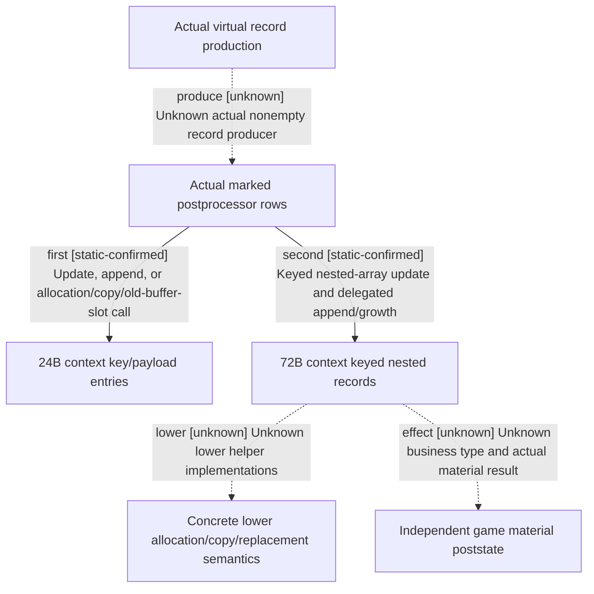

# Research plan: event-option-context-record-writes-12004-20261026

GENERATED from the supplied research plan; no native semantics are inferred.

Question: What do both actual postprocessor callees write into the original context, and which branches remain below unbound helper/type boundaries?



| Edge | Declared status | Evidence IDs | Open question |
|---|---|---|---|
| first | static-confirmed | post, prefix, suffix, manifest, reuse |  |
| second | static-confirmed | post, second, batch |  |
| lower | unknown | second | 37297F0/37295B0/DBDB80/EC5460/9D0F30 implementations and concrete allocator bindings not supplied; do not infer exception, free or business results. |
| produce | unknown | post | No actual target virtual+B0 type/script token or naturally produced nonempty records. |
| effect | unknown | second, prefix, suffix | No field business names or independent poststate. Context writes do not authorize disabled options, payment, ACK success or UNKNOWN replay. |

| Observation design | Value |
|---|---|
| mode | offline-only |
| actor_kind | engine |
| owner_scope | 373A0F0 logical313B and373A430 exact535B direct consumers of actual373B5D0. |
| identity_kind | generation-id |
| identity_lifetime | Context/record pointers only in this synchronous call chain. int32 keys do not qualify save/reload identity or pointer reuse. |
| producer_trigger | on-action |
| producer | Actual373B5D0 marked32B/80B rows; concrete virtual producer/nonempty records remain unknown. |
| caller | 373B610 invokes373A0F0(context+18,key,payload+8);373B64C invokes373A430(context,row). |
| consumer | First updates/appends24B key/payload entries. Second matches72B rows by key, updates nested16B/4B arrays and+40/+44, or delegates append/growth. |
| cache_lifetime | Two historical raw spans reused with exact4 manifest, source machine unknown.535B alone is new held batch08. Neither is Game/Loaded state. |
| expected_signal | Three local returns in313B;535B key match, nested copies, append and growth calls. Real lower helper implementations explicitly unknown. |
| zero_sample_meaning | No Game samples. Code does not establish nonempty records or any wallet/debt/relationship effect. |
| stop_condition | No new EXE beyond source-selected535B; reuse313B. Stop at direct virtual/copy/reserve/replacement helpers, no automatic recursive expansion. |
| runtime_window_ref | None |

| Evidence ID | Declared layer | File | SHA-256 | Supports |
|---|---|---|---|---|
| prefix | source-contract | Z:/ck3_mod_rewrite_process_assets/g2-background-20261007/upstream-build-migration/shared-span-cache/new-0373A0F0-0373A156.bin | 2d0552949d946aa73bf51494fc5e47b66072f1cb8116f0f39fd7d4bc0fef5f2f | Original102B key scan and in-place16B payload update. Combined in RAM with original211B suffix; no replacement raw created. |
| suffix | source-contract | Z:/ck3_mod_rewrite_process_assets/g2-background-20261007/upstream-build-migration/shared-span-cache/new-0373A156-0373A229.bin | 522d0af63084a0d4ce5f202fff3afef489ae25633372135c5c79171f26eba0ff | Original211B closes no-key spare-capacity append and full-capacity allocation/copy/old-buffer-slot paths, all three local returns with prefix. |
| manifest | source-contract | Z:/ck3_mod_rewrite/docs/ck3-native-ai/religion-context-hostility-conversion-12004-operands.json | dedc93e8890efee26005a6ca79df51434803d561c9f8a66028bbc319ee0ffdef | Explicit .4/build25734779/EXE binding. source_reads64/82 and logical_function_closure3 bind both original spans and logical313B SHA/97 instructions. |
| reuse | source-contract | D:/codex-ck3-background/ck3-java-g2-resume-r4-20261025/resume61/b64_execution/HELD-SOURCE-REUSE08-02.json | 64e7a33cc9e89b5d52e0cdcf4013e2338570c85a45f592817f8cdcbaa2542d63 | Sole collector exact-reference reuse record. Source acquisition machine unknown; no fresh installed/Loaded/source-machine qualification. |
| second | source-contract | D:/ck3-state/ck3-java-g2-native-static-resume61/batch08/capture01/window-013.raw | fcf4d2e3b242d9d04f544a3c69d6f7d65f63c8a48a9707b3cf6258db0dabbf14 | Full535B decode toRET373A646. Searches context+100 vector72B rows by source+8 key; found branch copies nested16B and4B arrays plus scalar+40/+44; nonmatch append/growth delegates named actual callees. |
| batch | source-contract | D:/codex-ck3-background/ck3-java-g2-resume-r4-20261025/resume61/b64_execution/BATCH08-RESULT01.json | 57d5803fb12857f3b3fdaa805de650c1bb2aedbb228118a391a025b4171c0d81 | Actual batch08index13 raw535B/identity binding, all phases exit0/Job0/threeMATCH and inputCLOSED. Owner readback exactMATCH; shared batch totals are not all charged to this owner. |
| post | source-contract | D:/ck3-state/ck3-java-g2-native-static-resume61/batch07/capture01/window-021.raw | 99dd8f1dc1c0be35fd8b371893ae5e0445bf43c3f38c5bc628f5f93b967b2c7b | Actual160B caller passes context+18,key,payload to first setter and original context,80B row to second after corresponding nonzero record flags. |

Check result (file integrity and declarations only):

```json
{
  "schema": "xar.native-research-plan-check.v1",
  "result": "plan-consistent",
  "proof_layer": "record-structure-and-file-integrity",
  "semantic_correctness_verified": false,
  "live_execution_performed": false,
  "observation_plan_issues": [
    "offline-only plan does not define a live observation window"
  ],
  "declared_edges_by_status": {
    "counter-policy": 0,
    "inference": 0,
    "live-confirmed": 0,
    "static-confirmed": 2,
    "unknown": 3
  },
  "enumerated_native_edges": 5,
  "declared_cases_by_status": {
    "pending": 2,
    "observed": 0,
    "not-applicable": 0
  },
  "checked_evidence_files": 7,
  "limitations": [
    "Evidence layers and conclusions are author declarations; hashes bind bytes, not their truth.",
    "Counts cover this enumerated graph only, not all CK3 branches.",
    "A consistent observation plan is not authorization to run or manipulate CK3."
  ],
  "plan_sha256": "b18fef9ac6920ad4848657cc80bd90aeeec4097158ba9f4046bb11ece17d6008"
}
```
