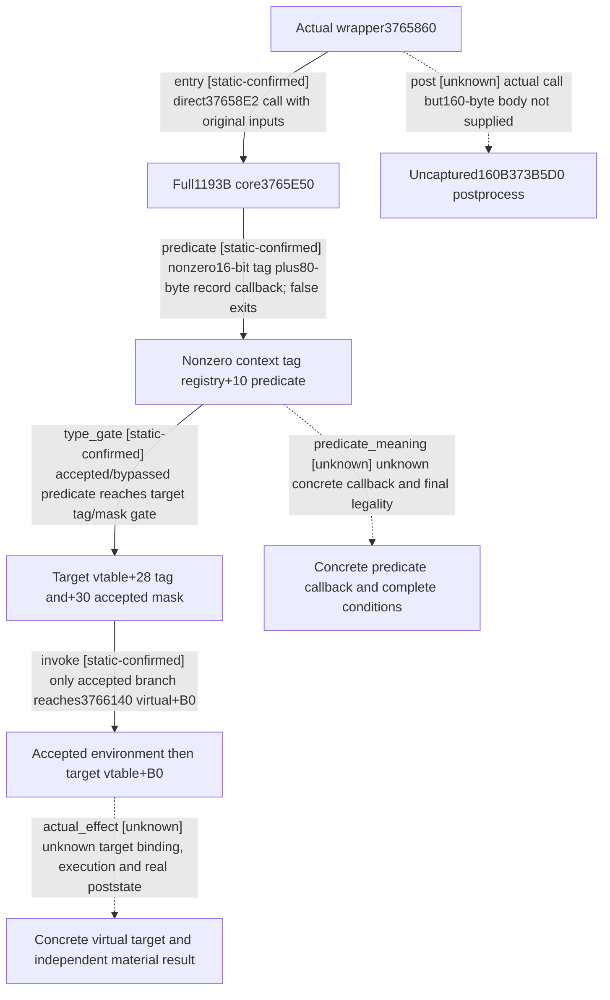

# Research plan: event-option-context-type-gates-12004

GENERATED from the supplied research plan; no native semantics are inferred.

Question: Which actual context/tag gates precede3765E50&#x27;s virtual execution, without equating them to option enabled or a material result?



| Edge | Declared status | Evidence IDs | Open question |
|---|---|---|---|
| entry | static-confirmed | wrapper, core, upstream12 |  |
| predicate | static-confirmed | core |  |
| type_gate | static-confirmed | core |  |
| invoke | static-confirmed | core |  |
| predicate_meaning | unknown | core | Registry producer and concrete+10 target not located; do not rename this context/type condition as materialized option enabled. |
| actual_effect | unknown | core | Actual object constructor/vtable+B0 target, full execution and independently attributable material results remain unknown. |
| post | unknown | wrapper | 373B5D0..373B670 exact metadata row188037; nearby cache ends at this start. Sole collector must deduplicate/fresh-admit any new160-byte source before semantic review. |

| Observation design | Value |
|---|---|
| mode | offline-only |
| actor_kind | engine |
| owner_scope | Source-selected shared wrapper3765860 and directly called1193-byte3765E50; no current Game or permission. |
| identity_kind | generation-id |
| identity_lifetime | Original context,16-bit tag, target object and native event ID remain distinct. No old pointer or ID is qualified for reuse. |
| producer_trigger | on-action |
| producer | Actual941-byte final Select body calls3765860 on selected+310 and independent nonnull+208 paths. |
| caller | Full cached265-byte3765860 calls3765E50 at37658E2 with original target and constructed environment. |
| consumer | Complete1193-byte3765E50 gates context record predicate and target tag/mask, builds copied environment then calls target vtable+B0. |
| cache_lifetime | Retained exact-build cache. Actual claim says2026-10-10T09:10:15.619086+00:00; acquisition machine unknown, not relabeled current held. |
| expected_signal | Exact conditional branches before virtual+B0 and explicitly unknown callback targets/postprocess/material effects. |
| zero_sample_meaning | No Game sample; type acceptance and virtual entry cannot prove selected-option enabled, effect execution or payment. |
| stop_condition | Read complete1193-byte cache and its exact refs; do not append adjacent71B or virtual targets. The separate160B postprocess remains request-only to sole collector. |
| runtime_window_ref | None |

| Evidence ID | Declared layer | File | SHA-256 | Supports |
|---|---|---|---|---|
| core | source-contract | Z:/ck3_mod_rewrite_process_assets/g2-background-20261007/upstream-build-migration/shared-span-cache/new-03765E50-037662F9.bin | b8596d2cf02947765fd384ba0274628df0618a566f174ea37041a29821cbb77f | Human full1193B decode throughRET37662F8: nonzero context tag registry+10 ALfalse returns before+B0; target+28 tag and+30 mask gate+B0; accepted path constructs local state and copied environment; specific virtual targets and full meaning unknown. |
| metadata | locator | Z:/ck3_mod_rewrite_process_assets/g2-background-20261007/upstream-build-migration/shared-span-cache/new-03765E50-037662F9.json | ac7ce9390c5ecd6b4a3a40febe4a1706d578de43a2199bd4c4d19707bb50ab0a | Exact1193-byte retained range3765E50..37662F9. No adjacent source or semantic qualification. |
| claim | locator | Z:/ck3_mod_rewrite_process_assets/g2-background-20261007/upstream-build-migration/shared-span-cache/new-03765E50-037662F9.claim | cd4c1321e84aa0b46aafdd633ff1d7acbcc46a89d29871c890fed464f37dabc5 | Original2026-10-10 claim points continuation27/root-source01; source machine unknown. Current read does not repair that historical machine identity. |
| wrapper | source-contract | Z:/ck3_mod_rewrite_process_assets/g2-background-20261007/upstream-build-migration/shared-span-cache/new-03765860-03765969.bin | aee8d876e5d6e8c26817f83cf34a1a80f09e744481cbea1e3f0ac1bf2ecc0c82 | Full265-byte wrapper passes original target/environment at37658E2 and calls373B5D0 at37658EF after core returns. |
| upstream12 | source-contract | D:/codex-ck3-background/ck3-java-g2-resume-r4-20261025/resume61/outcome_archive/native_option11/FINAL-OPTION-ACTUAL12.json | 0809f91f6fd8d72f1bc2d0806eea15a3139bdd7322d7ec81bda99f3407e575a7 | Frozen owner12 report binds actualbatch06/raw941 and existing wrapper265. Its earlier core unknown frontier is narrowed here; no upstream hash is rewritten. |

Check result (file integrity and declarations only):

```json
{
  "schema": "xar.native-research-plan-check.v1",
  "result": "plan-consistent",
  "proof_layer": "record-structure-and-file-integrity",
  "semantic_correctness_verified": false,
  "live_execution_performed": false,
  "observation_plan_issues": [
    "offline-only plan does not define a live observation window"
  ],
  "declared_edges_by_status": {
    "counter-policy": 0,
    "inference": 0,
    "live-confirmed": 0,
    "static-confirmed": 4,
    "unknown": 3
  },
  "enumerated_native_edges": 7,
  "declared_cases_by_status": {
    "pending": 2,
    "observed": 0,
    "not-applicable": 0
  },
  "checked_evidence_files": 5,
  "limitations": [
    "Evidence layers and conclusions are author declarations; hashes bind bytes, not their truth.",
    "Counts cover this enumerated graph only, not all CK3 branches.",
    "A consistent observation plan is not authorization to run or manipulate CK3."
  ],
  "plan_sha256": "e21089b503723508c21ffc00f9c1aa3193819b2e44bcb78496eabc5c4c837808"
}
```
