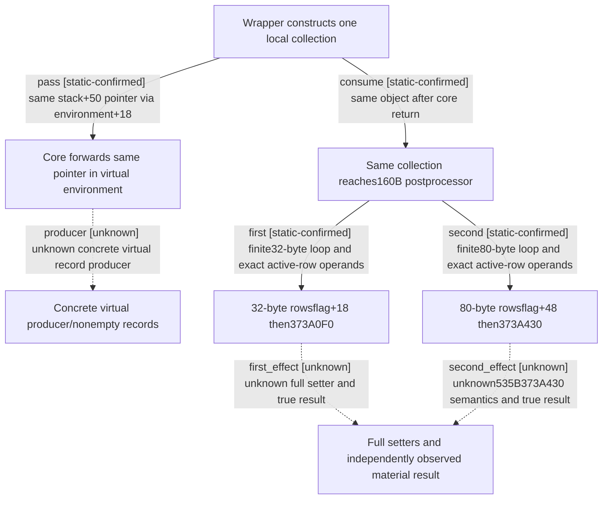

# Research plan: event-option-postprocess-records-12004

GENERATED from the supplied research plan; no native semantics are inferred.

Question: How does the actual160-byte postprocessor consume two collections passed through option execution, and what still prevents a material-effect conclusion?



| Edge | Declared status | Evidence IDs | Open question |
|---|---|---|---|
| pass | static-confirmed | wrapper, core |  |
| consume | static-confirmed | wrapper, post, batch |  |
| first | static-confirmed | post |  |
| second | static-confirmed | post |  |
| producer | unknown | core | Actual vtable+B0 implementation and record-appending behavior not bound; no real nonempty collection observed. |
| first_effect | unknown | post, prefix, prefix_claim | Only102B partial legacy373A0F0 source, with missing claim provenance; real branch continuations373A156/373A214 and full result remain unqualified. |
| second_effect | unknown | post | No complete373A430 body or actual resulting material state supplied; no option-enabled, payment or UNKNOWN replay conclusion. |

| Observation design | Value |
|---|---|
| mode | offline-only |
| actor_kind | engine |
| owner_scope | Actual373B5D0 postprocessor and the same local collection&#x27;s upstream wrapper/core argument flow. |
| identity_kind | generation-id |
| identity_lifetime | Original context and local collection last for this synchronous native call chain only. No reuse of old event IDs, pointers or Game epochs is qualified. |
| producer_trigger | on-action |
| producer | 3765860 constructs one stack object and passes its pointer through environment+18 into core/virtual+B0. |
| caller | 37658EF passes the identical stack object inRCX and original context inRDX to373B5D0. |
| consumer | 373B5D0 iterates32-byte rows with+18 flag and80-byte rows with+48 flag, invoking373A0F0 and373A430 respectively. |
| cache_lifetime | New160-byte exact held source from sole b64batch07. Old265/1193-byte sources reused; old102-byte prefix has missing-batch02 claim and incomplete provenance, not promoted to new held source. |
| expected_signal | Two bounded loops, actual call operands and explicit missing setter/material result boundary. |
| zero_sample_meaning | No Game samples; zero or disabled rows in this code path cannot be inferred for a current scene. |
| stop_condition | Consume exact160-byte original and existing direct caller/core only; do not append next32-byte function or infer lower setter semantics. |
| runtime_window_ref | None |

| Evidence ID | Declared layer | File | SHA-256 | Supports |
|---|---|---|---|---|
| post | source-contract | D:/ck3-state/ck3-java-g2-native-static-resume61/batch07/capture01/window-021.raw | 99dd8f1dc1c0be35fd8b371893ae5e0445bf43c3f38c5bc628f5f93b967b2c7b | Human full160-byte decode throughRET373B66F. First32-byte rowsflag+18 call373A0F0(context+18,key,payload+8). Second80-byte rowsflag+48 call373A430(context,row). No return-value branches or count clearing. |
| batch | source-contract | D:/codex-ck3-background/ck3-java-g2-resume-r4-20261025/resume61/b64_execution/BATCH07-RESULT01.json | beb69b6948738f9cfb395d3c06cf3dcafe3b6711af0931a99849cad06809c8a9 | Actual collector resultindex21 binds160B/SHA and source/admission/child outcomes. Owner readback matches exact original; no own EXE I/O or Game qualified. |
| wrapper | source-contract | Z:/ck3_mod_rewrite_process_assets/g2-background-20261007/upstream-build-migration/shared-span-cache/new-03765860-03765969.bin | aee8d876e5d6e8c26817f83cf34a1a80f09e744481cbea1e3f0ac1bf2ecc0c82 | Full cached265-byte caller constructs stack+50 object, places pointer at environment+18, then373B5D0 receives the identical object and original context. |
| core | source-contract | Z:/ck3_mod_rewrite_process_assets/g2-background-20261007/upstream-build-migration/shared-span-cache/new-03765E50-037662F9.bin | b8596d2cf02947765fd384ba0274628df0618a566f174ea37041a29821cbb77f | Full cached1193-byte core copies environment+18 pointer into the structure passed to accepted target virtual+B0. Concrete target/record production not supplied. |
| prefix | locator | Z:/ck3_mod_rewrite_process_assets/g2-background-20261007/upstream-build-migration/shared-span-cache/new-0373A0F0-0373A156.bin | 2d0552949d946aa73bf51494fc5e47b66072f1cb8116f0f39fd7d4bc0fef5f2f | Only102-byte legacy prefix, has real fallthrough373A156 and jump373A214 beyond window. Partial code cannot close setter logic or fresh image identity. |
| prefix_claim | locator | Z:/ck3_mod_rewrite_process_assets/g2-background-20261007/upstream-build-migration/shared-span-cache/new-0373A0F0-0373A156.claim | 2a58454bab16aa1714df64919d43fb015a4b3c1840736ee6d9e6e60a588f126f | Old claim says missing-batch02; acquisition machine and complete provenance unknown. It is not promoted to actual current held source. |

Check result (file integrity and declarations only):

```json
{
  "schema": "xar.native-research-plan-check.v1",
  "result": "plan-consistent",
  "proof_layer": "record-structure-and-file-integrity",
  "semantic_correctness_verified": false,
  "live_execution_performed": false,
  "observation_plan_issues": [
    "offline-only plan does not define a live observation window"
  ],
  "declared_edges_by_status": {
    "counter-policy": 0,
    "inference": 0,
    "live-confirmed": 0,
    "static-confirmed": 4,
    "unknown": 3
  },
  "enumerated_native_edges": 7,
  "declared_cases_by_status": {
    "pending": 2,
    "observed": 0,
    "not-applicable": 0
  },
  "checked_evidence_files": 6,
  "limitations": [
    "Evidence layers and conclusions are author declarations; hashes bind bytes, not their truth.",
    "Counts cover this enumerated graph only, not all CK3 branches.",
    "A consistent observation plan is not authorization to run or manipulate CK3."
  ],
  "plan_sha256": "0f230f57719501245bf2fe4a3fff874fe83874b7e1befb32cbc55976434d0458"
}
```
