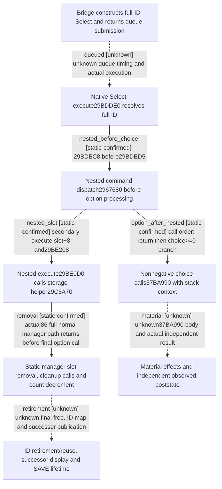

# Research plan: event-select-dispatch-poststate-lifecycle-12004

GENERATED from the supplied research plan; no native semantics are inferred.

Question: In the retained exact .4 Select command, what executes between ID resolution and option processing, and which step actually establishes removal or material effect completion?



| Edge | Declared status | Evidence IDs | Open question |
|---|---|---|---|
| queued | unknown | bridge, select | Which later main-thread turn actually executes this queued command; no new live trace exists |
| nested_before_choice | static-confirmed | select |  |
| nested_slot | static-confirmed | nested, table, stage |  |
| removal | static-confirmed | storage_prefix, manager86, nested, select |  |
| retirement | unknown | manager86 | Cleanup callee semantics, ID lookup deletion/retirement/reuse, successor display order, stack-context ownership and SAVE/LOAD lifetime remain unobserved |
| option_after_nested | static-confirmed | select |  |
| material | unknown | select | No37BA990 semantic/body or live action-postcondition was analyzed; interpreter return and disappearing window cannot supply that proof |

| Observation design | Value |
|---|---|
| mode | offline-only |
| actor_kind | engine |
| owner_scope | Current played character event command; retained Select command and its nested stage dispatch only |
| identity_kind | generation-id |
| identity_lifetime | Full event instance ID carried by command and resolved again at execution. No pointer or ID is qualified for reuse after removal, reload, or another Game generation. |
| producer_trigger | on-action |
| producer | Exact .4 native UI or bridge builds Select command with full event ID and option index |
| caller | Owning native command queue invokes Select execute 0x29BDDE0; exact queue-to-execution timing remains unobserved |
| consumer | Select execute resolves ID, invokes nested command through 0x2967680, then conditionally calls 0x37BA990 with stack context and option index |
| cache_lifetime | Offline immutable Oct7 retained byte spans for exact EXE SHA; no live cache, pointer or current scene asserted |
| expected_signal | Instruction-ordered nested command dispatch, exact secondary table target, and explicit gaps before removal/material effects can be inferred |
| zero_sample_meaning | No live samples were collected; this cannot show that no event exists or that any queued action succeeded |
| stop_condition | Review only the six original evidence files and the formal ledger_writer actual86 report; no own EXE read, new capture, native execution or live sampling |
| runtime_window_ref | None |

| Evidence ID | Declared layer | File | SHA-256 | Supports |
|---|---|---|---|---|
| bridge | source-contract | Z:/ck3_mod_rewrite/ck3_autonomous_player/native_bridge/src/ck3_12004_events.cpp | 0f40c383a3dfce5b2411e4c8b6fc18bf4a2a4fb2db8d0d79baf1660ae300da88 | Human source review: full current event ID and bounded option index are copied to channel7; returned submitted is only submit_command result |
| select | source-contract | Z:/ck3_mod_rewrite_process_assets/g2-background-20261007/upstream-build-migration/event-actions-12004/Select_execute-new-029BDDE0-029BDFBD.bin | 1eef08870d369db2f2d550c7da9bfcd23339c63c3fe1c8445450ae9585a91a2a | Human decoded whole-body review: 29BDEC8 nested 2967680 call precedes choice-sign test29BDED5 and final option-processing call29BDF68-&gt;37BA990 |
| nested | source-contract | Z:/ck3_mod_rewrite_process_assets/g2-background-20261007/upstream-build-migration/shared-span-cache/new-029BE0D0-029BE22B.bin | 34a736d5ec81041fedb6f87bbbfb5531b6fa81838181fc05c8949dcfb662713a | Human whole-body review: ID re-resolution, definition+250 conditional interface notification, then29BE208 calls29C6A70 with vector36398 and resolved index |
| table | source-contract | Z:/ck3_mod_rewrite_process_assets/g2-background-20261007/upstream-build-migration/shared-span-cache/new-04773470-047734A8.bin | 1dc210bdfacc85db1fb87ca3f06b5ca85bad238e2eef341414f30ca6d61eae6e | Secondary vptr4773478 has execute slot+8=29BE0D0 and mode slot+20=855AA0; no RTTI class name inferred |
| stage | source-contract | Z:/ck3_mod_rewrite/docs/ck3-native-ai/evidence/episode04-r08-task-construction-20261021/phase-a04/phase-chain-spans.bin | d47634df16e1ffc6a1be15ef7dea961cf9fdf9d93d90d39436b8b95c2fc592d9 | Existing source slice offset3364 length249 binds full2967680 dispatcher: +10, branch+20, direct+8 or29677C0, then+18; existing exec_call slice binds wrapped+8 invocation |
| storage_prefix | locator | Z:/ck3_mod_rewrite_process_assets/g2-background-20261007/upstream-build-migration/shared-span-cache/new-029C6A70-029C6A9E.bin | b68748a3c604520cf3782b64843c8b620d5e09233704a5b7e5a2675bc3899935 | Original46-byte prefix binds count-1/current-slot/last-slot and call29C6C80; this prefix alone did not close the complete logic |
| manager86 | source-contract | D:/codex-ck3-background/ck3-java-g2-resume-r4-20261025/resume61/ledger_writer/EVENT-MANAGER-REMOVAL-ACTUAL86.json | ea489414ce03fa63f87470a78481e60c60a6c53f00511978a441b4af775a8df6 | Sole owner actual report consumes b64batch02 original80+125 bytes and decodes full legal nonempty manager path: clear tail, cleanup selected if nonnull, fill selected with tailPtr, alias wrapper cleanup once, decrement count and return. No final free/ID map/reuse/SAVE or material result inferred |

Check result (file integrity and declarations only):

```json
{
  "schema": "xar.native-research-plan-check.v1",
  "result": "plan-consistent",
  "proof_layer": "record-structure-and-file-integrity",
  "semantic_correctness_verified": false,
  "live_execution_performed": false,
  "observation_plan_issues": [
    "offline-only plan does not define a live observation window"
  ],
  "declared_edges_by_status": {
    "counter-policy": 0,
    "inference": 0,
    "live-confirmed": 0,
    "static-confirmed": 4,
    "unknown": 3
  },
  "enumerated_native_edges": 7,
  "declared_cases_by_status": {
    "pending": 2,
    "observed": 0,
    "not-applicable": 0
  },
  "checked_evidence_files": 7,
  "limitations": [
    "Evidence layers and conclusions are author declarations; hashes bind bytes, not their truth.",
    "Counts cover this enumerated graph only, not all CK3 branches.",
    "A consistent observation plan is not authorization to run or manipulate CK3."
  ],
  "plan_sha256": "4e345996e24f3dda2c089c9edc9b7635ad0505952d2f55e1e8455885cb9d6cf6"
}
```
