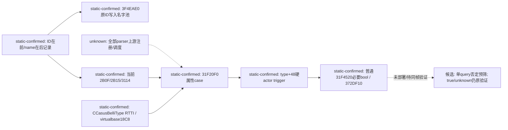

# P32 loader02：脚本字段到原生 type+48 的缺口已静态闭合

machine_id: `xenoamess-full-tower-eb9d2c1186`。CK3 1.20.0.4；复用已核EXE SHA
`98702F88A547CDE2EAF29A85F93B85F68EE4CF8148336A4F7AFAEB75319DD518`。
本轮只读安装EXE与既有源码/文档，没有Game、MCP、Native函数调用、活跃Driver读取、
SDK/DLL/生产源码/index修改或构建。Root的SDK33恢复与保留Game/OBS不受干预。

## 结论与对上一轮的纠正

当前版本的 `allowed_for_character` 确实编译到 `CCasusBelliType+0x48`；它是
`31F4520(false,false,nullptr)` 的必要条件，纯actor依赖的这一个类型字段可以做
单次查询内的否定预筛候选。不是整组规则、AI位图、display条件或整个evaluator返回值。

上一轮误把 `{字符串指针,下一行ID}` 当成同一条注册记录，因此读到2B10而解析器用2B0F。
这不是引擎运行时把ID减1，也不是当前版本symbol未知。真实布局由当前初始化代码直接证明：
`{int32 token, uint32 padding, const char* name}`，步长16；字符串指针之前8字节才是本条ID。
旧 `REPORT.md`、`TYPE-FIELD-TABLE-LOCATOR.json`、`TYPE-FIELD-SYMBOL-LOCATOR.json`
及旧manifest保留原样；它们对该映射“未闭合”的结论由本增量明确取代。
旧1.20.0.2宗教文档发现的“后置word等于token+1”只作为定位线索，未外推为当前证据。
本轮揭示的真实结构也不授权去改写那些历史原件。

## 当前原版真实producer → loader → consumer

1. **原生名字producer：**完整1940B函数 `[3F4EAE0,3F4F274)`。
   `3F4EFFD`将R15设为第一个名字指针位置46E0D68；`3F4F004`设置结束指针4703128。
   `3F4F017`读DWORD `[R15-8]` 到临时token；`3F4F01E`读QWORD `[R15]`为字符串。
   `3F4F17D..198`把这个确切token交给字典插入；`3F4F1C9..1E4`按同一个token*8
   将名字字符串指针写入反向表；`3F4F246`令R15+=16。
   反向表global位于5DC1198，静态池对象是5DC1150（+48正好是5DC1198）。
   原名字getter3F4F8E0从当前manager+48按原ID索引，最大值manager+54为inclusive；
   无任何减1。我们没有调用会加锁/初始化的getter或constructor。

2. **准确三条原始记录：**

   |脚本名|真实记录RVA|原始token|name指针RVA|名字RVA|
   |---|---|---|---|---|
   |allowed_for_character|46EB910|2B0F|46EB918|470D640|
   |allowed_against_character|46EB970|2B15|46EB978|470D750|
   |allowed_for_character_display_regardless|46EFDA0|3114|46EFDA8|46C8708|

   新的 `loader02-correct-token-name-rows.json` 保留这三条完整16B记录及NUL结尾名字字节。
   旧pointer-first扫描也错置了表边界；当前producer循环地址才是准确遍历边界。

3. **实际类型与this坐标：**完整 `[31F1A40,31F202B)`构造器初始化当前CB类型，
   `31F1A6E..75`选择vbtable4890848，其首两DWORD为{-8,18C0}。
   `31F1B17..31`安装secondary虚表并写vtordisp；virtualbase位置为type+8+18C0=18C8。
   secondary vtable48CCF28的COL4F8CF48明确offset18C8、cdOffset4，TypeDescriptor
   名为`.?AVCCasusBelliType@@`。构造器31F1B40初始化+48 trigger，后面分别初始化
   +118、+1E8、+2B8等同类trigger。独立删除体31F2030:2044减18C8并以18D0释放对象，
   再互证坐标。**secondary slot0是删除析构，不是parser**；早期文件名
   `loader02-type-parser-thunk.json`里的31F75E8实际尾跳删除体31F2030，本增量纠正其名称，
   不用它假称parser调用者已经找到。

4. **loader字段分派：**31F20F0解析体持有RDI=这个virtualbase this。
   - 31F2463以2ADF为switch基准；byte表31F3984、RVA表31F3948。
     token2B0F的byteindex1选择31F25FB，31F2661再次使用2B0F名字，
     31F268F把`RDI-1880 = type+48`作为compiled trigger接收者，传root种类4并调vtable+20。
   - token2B15的byteindex5选择31F26AA，31F26EA再次使用2B15名字，
     31F2718把`RDI-16E0 = type+1E8`交给同一compiled loader。
   - 31F2F3F以30D9为switch基准；byte表31F3BA4、RVA表31F3B20。
     token3114选择31F2FC5，31F2FDE再次使用3114名字，
     31F300C把`RDI-17B0 = type+118`交给同一compiled loader。
   Root种类4和type+18C8坐标同时由独立constructor/RTTI确认，不按字段名猜偏移。
   本轮没有定位parser更上游所有注册/调度分支；这一剩余调用图债务不改变已闭合的
   属性记录、分派case、目标成员和实际消费者的数据链，不声称还原完整游戏加载器。

5. **普通full消费者：**复用当前完整31F4520窗口。
   第六参数false时31F4700..4719先求group rule+58；31F4728..473D求type+48，
   null reason下任一false就不进31F47DA的31F1660物化。type+118只在第五参数true求值，
   所以本普通false,false查询不拿display条件当硬门。37998D0在text=null直接尾跳372DF10；
   单次actor-helper可调用原版372DF10(type+48, actorScope)，不是自写文化或政府布尔公式。

## 可直接继续施工的边界

前轮29个类型硬条件的actor/global源码审阅仍是候选输入；这次只补此前缺失的成员绑定。
不重新盘CB、不新增族、不推断罗贝尔一定false。Hungarian最小首例只需原版硬actor bool；
claim没有硬actor块且其title/claimant/defender链混合，继续wide。group+58里herder/tributary
关系仍依赖defender，不能缓存group；type-positive也不能通过arg6=true跳过group。

最小后续工程点仍是 `.4` declaration candidate reader：按完整已加载CB/recursive-trigger
来源资格，在单个paused query里构造一次0x168 actor-root/named-actor scope，调用原版
372DF10(type+48,scope)，只缓存这个bool。False可预测该CB零目标；true/unknown保留现有
完整候选超集，再照旧31F4520 false,false、配置物化及提交重验。当前来源变化/未知mod/递归
trigger覆盖保持wide，不用旧的CB-only source review替新递归定义背书。

首先做无裁剪shadow：复用一次完整baseline，记录各CB真实actorbool、precheck耗时、
projected omitted calls和baseline合法tuple漏项；返回原完整目录。同一Game暂停帧才比较
最终实际CB-first输出的全部暴露tuple、顺序和重复次数，保留public/native revision各自绑定。
成本/full nativeShape不可见时仍标PARTIAL。旧P23的1,110,468calls/1.8726934秒只作潜在
覆盖成本，不能算新增提速。当前缺的运行值就是各加载类型的实际actorbool及新shadow后态；
**静态字段映射本身已无需读取游戏内存补证**。本轮不触发Native构建或冷载。
